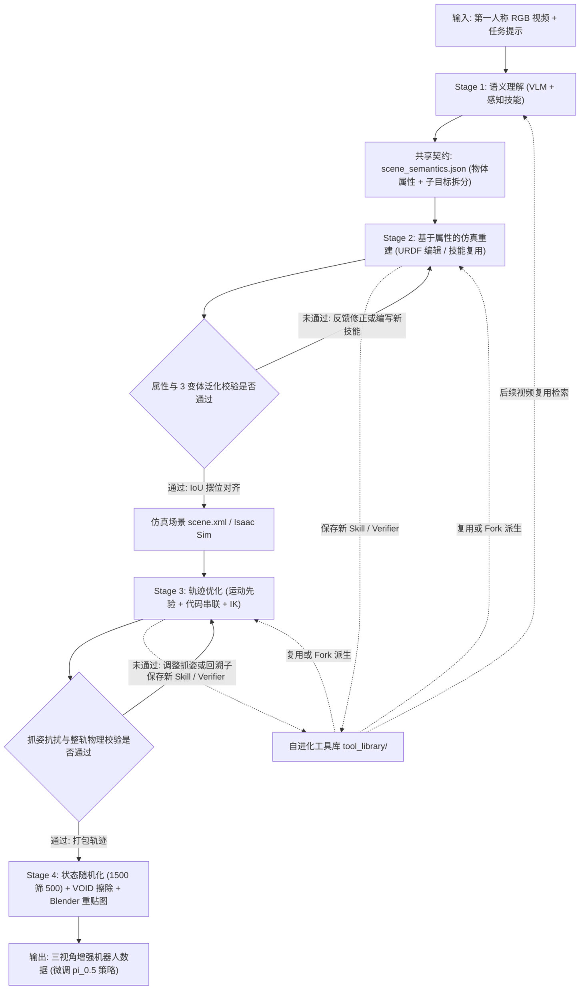
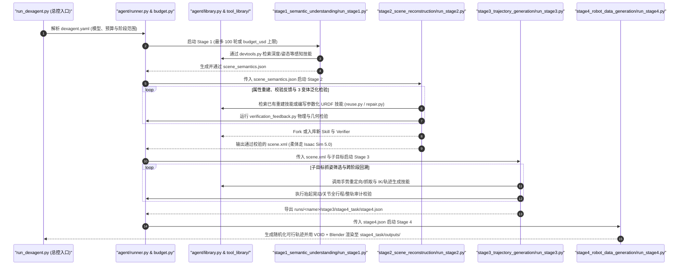

# DexAgent: An Agentic Human2Sim2Robot Framework for Dexterous Manipulation with Self-Evolving Tool Library

## 一句话定义

DexAgent 是一个配备自进化工具库（Self-Evolving Tool Library）的智能体化 Human2Sim2Robot 框架，仅输入单条第一人称视角人类示范视频与自然语言任务提示，即可通过「语义理解—属性仿真重建—轨迹优化—数据增强与重绘」四阶段闭环及属性特定校验器（verifier），生成物理可执行的多指灵巧操作轨迹与视觉策略训练数据。

## 英文缩写速查

| 缩写 | 英文全称 | 简要说明 |
|---|---|---|
| Human2Sim2Robot | Human-to-Simulation-to-Robot | 从人类视频提取交互并在物理仿真中重建与求取可执行机器人轨迹，再迁移至真机的数据生成范式 |
| VLM | Vision-Language Model | 视觉-语言大模型，作为各阶段可API切换的智能体骨干，负责任务拆解、工具调用与代码编写 |
| URDF | Unified Robot Description Format | 统一机器人/物体描述格式，Stage 2 从无关节初始 URDF 起步逐属性编辑物体几何与关节约束 |
| IK | Inverse Kinematics | 逆运动学，用于在 Stage 3 根据已验证的末端灵巧手目标位姿反解机械臂关节构型 |
| IoU | Intersection over Union | 交并比，Stage 2 通过优化仿真渲染掩码与人类视频掩码的 IoU 校准物体场景位姿 |
| VOID | Video Object and Interaction Deletion | 视频物体与交互擦除方法，用于在 Stage 4 从原视频中抹除人手与原物体以便合成机器人渲染 |

## 为什么重要

1. **打破固定流水线对物体类型与长程任务的限制：** 以往 Human2Sim2Robot 方案（如 Do as I Do、SPIDER、TopoRetarget、V2D）依赖预设的刚体重建或单一动作重定向流程，遇到带自由度约束的铰接体（如瓶盖、抽屉、剪刀）、大形变柔体（如打绳结）或跨阶段长程协作任务时容易失灵。DexAgent 按任务与物体属性动态选择「人类运动引导优化」或「代码生成运动」，覆盖刚体、铰接体、柔体与工具使用等 11 类灵巧操作。
2. **用阶段内属性校验阻断上游错误级联：** 若重建几何、尺度或关节轴线出错，后续轨迹优化即便强行求得动作也无法在物理上成立。DexAgent 为每个阶段配置属性校验器（verifier），单阶段最多迭代 100 轮或直至耗尽预算，仅当全部校验通过后才交付下一阶段，从而显著提升真机可执行率（11/11 任务回放成功）。
3. **让经验沉淀为可复用的 Skill 与 Verifier：** 面对新类别物体时编写的参数化技能与校验器会被保留进工具库，避免每次从零试错。在 100 条 EgoDex 视频上的测试表明，随着工具库积累至 85 个技能与 168 个校验器，平均处理耗时显著低于不保留持久化工具库的基线（2.1 h 对 V2D 的 3.7 h、GPT-6: Astra 的 3.3 h），在资产复用阶段可进一步压缩至 13.1 分钟。

## 核心信息

| 字段 | 内容 |
|---|---|
| 作者 | Youhui Wang、Yunzhu Li、Li Fei-Fei、Jiajun Wu、Huang Huang |
| 机构 | 斯坦福大学（Stanford University）、哥伦比亚大学（Columbia University） |
| 发表时间 | 2026-09-28（arXiv v1）/ 2026-10-02（arXiv v2） |
| 论文链接 | [arXiv:2609.35318](https://arxiv.org/abs/2609.35318) / [HTML v2](https://arxiv.org/html/2609.35318) |
| 项目与代码 | [项目主页](https://dexagent1.github.io/) / [工具库可视化](https://dexagent1.github.io/library/) / [dexagent1/DexAgent](https://github.com/dexagent1/DexAgent) |
| 清单分类 | `environment.reconstruction` |
| 来源条目 | `survey_ax_2609_35318` |
| 开源状态 | **已开源**（MIT 协议，主仓 `dexagent1/DexAgent` 包含智能体运行时 `agent/`、四阶段脚本与 `dexagent.yaml` 配置；完整感知与渲染还需自行配置 SAM 3/HaMeR/Isaac Sim 5.0/VOID/Blender 等子环境及 VLM API） |

## 核心原理

DexAgent 围绕「**Skill（技能）+ Verifier（校验器）+ 自进化工具库**」构建四阶段闭环流水线（论文 §III）：

1. **工具库治理机制（§III-A）：**
   - 工具库中的 **Skill**（输出资产、位姿或轨迹）与 **Verifier**（在仿真内判定产出是否合法并返回失败原因）均为带类型标注的 Python 函数。
   - 改进既有工具时执行 **fork（派生新版本）** 而非覆盖原函数，且约束工具必须具备跨样本通用性（禁止针对单条视频硬编码）。
   - 每个阶段设预算上限或 **100 轮智能体交互（agent turns）** 封顶；超时未通过全部校验器则直接判为失败，防止未验证的残缺结果流向下游。
2. **Stage 1 — 语义理解（§III-B）：**
   - 输入单条第一人称 RGB 视频与自然语言任务提示。VLM 先从提示词推断候选物体与潜在属性，再抽取视频帧并结合可选感知技能（深度估计、重力方向、人手姿态）验证物体实际表现与运动方式。
   - 将整段示范拆分为动作粒度最细的有序子目标（如抓放拆为 `pick up` / `move` / `place`），记录作用手（左/右/双手）、目标物体与可观测成功条件，输出共享契约文件 `scene_semantics.json`。
3. **Stage 2 — 基于属性的仿真重建（§III-C）：**
   - **校验器先行：** 根据 Stage 1 提取的属性选择或新建校验器——刚体检验轮廓、尺度、质量与静置稳定性；铰接体检验关节存在性、轴向、行程范围与自锁；可变形体检验拓扑结构。
   - **参数化技能构造与泛化检验：** 若库中无现成技能，智能体从无关节可编辑 URDF 起步，逐一针对每个属性定义校验器并修改 URDF 直至通过，随后联合运行所有校验器排查属性冲突；通过后还须开展第二轮检验，新增校验器并用该参数化函数再生成 **3 个变体**全部过检后才正式收入工具库。
   - **场景摆位与相机对齐：** 通过最大化仿真渲染物体掩码与视频分割掩码的 IoU 优化物体空间位姿；默认依据深度估计距离并利用 Sharpa 机器人手与人手叠加对齐估计相机位姿（也可传入人工标定参数），输出就绪的 `scene.xml`（可变形绳索使用 Isaac Sim 5.0）。
4. **Stage 3 — 机器人轨迹优化（§III-D）：**
   - 为每个子目标定义定量成功条件（如到达目标位姿或目标关节角），并灵活选用技能确定目标手部姿态：直接重定向人手姿态、优化手指关节以复现人手—物体接触，或基于接触、力闭合与避障余量合成新抓取。
   - 借助任务特定物理校验器筛选候选抓姿（如搬运类任务执行抬升与晃动测试，铰接类任务执行滑动与旋转测试以覆盖完整关节行程），失败则依反馈微调姿态或切换工具。
   - 经 IK 求解机械臂构型后，智能体编写连接关键位姿的控制代码（可选引入人手轨迹先验），拼接所有子目标并在下游卡住时回溯修改前序子目标动作，最后通过整条轨迹的限位与物理一致性审计。
5. **Stage 4 — 数据生成与 Sim2Real 视觉重绘（§III-E, Appendix §VI-A）：**
   - 在桌面可达工作空间内随机化物体与机器人初态（每任务初采 1,500 组种子并经同套位姿/轨迹校验筛选，取 500 组可行回合；不足则补采）。
   - 利用 **VOID** 擦除原视频中的人手及原物体，在 **Blender** 中对仿真机器人与物体进行重贴图并合成进原背景，同时渲染左/右双腕相机视角，为每条回合输出「1 个第一人称视角 + 2 个腕部视角」同步图像序列用于微调 $\pi_{0.5}$ 策略。

## 流程总览

## 源码运行时序图

官方仓库以 `run_dexagent.py dexagent.yaml`（支持 `--from` 与 `--to` 指定起止阶段）按序驱动 `stage1_semantic_understanding/` 至 `stage4_robot_data_generation/` 四个独立 `run_stage*.py` 入口；核心智能体循环由 `agent/runner.py` 搭配 `agent/budget.py`、`agent/library.py`、`agent/devtools.py`、`agent/verification_feedback.py` 与 `agent/repair.py` 管理预算、工具检索及校验修复，并将阶段产出依次经 `scene_semantics.json`、`scene.xml` 与 `stage4.json` 向下传递。

## 实验与评测

### 1. 视频手物交互三维重建（HOI4D, Table I）

在 HOI4D 数据集上按刚体与铰接体分别评测几何重建精度（F-5 / F-10 越高越好，Chamfer 距离 CD 越低越好）：

| 方法 | 刚体 F-5 ↑ | 刚体 F-10 ↑ | 刚体 CD ↓ | 铰接体 F-5 ↑ | 铰接体 F-10 ↑ | 铰接体 CD ↓ |
|---|---|---|---|---|---|---|
| HO | 0.28 | 0.51 | 3.86 | 0.29 | 0.47 | 1.30 |
| IHOI | 0.42 | 0.70 | 2.70 | 0.32 | 0.47 | 1.47 |
| MCC-HO | 0.52 | 0.78 | 1.36 | 0.35 | 0.55 | 1.21 |
| G-HOP | 0.69 | 0.91 | 0.63 | 0.07 | 0.09 | 1.23 |
| FoundationPose | 0.71 | 0.91 | 0.49 | 0.40 | 0.60 | 1.26 |
| Any6D | 0.71 | 0.91 | 0.50 | 0.38 | 0.60 | 1.24 |
| Do as I Do | 0.72 | 0.91 | 0.49 | 0.40 | 0.61 | 1.25 |
| **DexAgent（本文）** | **0.83** | **0.96** | **0.29** | **0.47** | **0.68** | **1.08** |

相对各指标的最强对比方法，DexAgent 在刚体上将 F-5/F-10 分别提升 15.3% 与 5.5%、CD 降低 40.8%；在更具挑战的铰接体上将 F-5/F-10 提升 17.5% 与 11.5%、CD 降低 10.7%。

### 2. 仿真机器人轨迹重定向质量（OakInk, Table II）

在 MuJoCo 仿真器中评测人手到 Sharpa 灵巧手轨迹的物理可执行率（成功判据：平均物体位置误差 $< 0.1\text{ m}$ 且旋转误差 $< 0.5\text{ rad}$）：

| 方法 | 物理校验通过率 (%) ↑ | 位置残差 $E_{pos}$ (m) ↓ | 旋转残差 $E_{rot}$ (rad) ↓ |
|---|---|---|---|
| Dex-retargeting | 28.6 | 0.08 | 0.62 |
| SPIDER (`mjwp`) | 71.4 | 0.04 | 0.57 |
| SPIDER (`mjwp_act`) | 77.1 | 0.04 | 0.42 |
| Do-as-I-Do (Sharpa hand) | 81.0 | 0.03 | 0.15 |
| Do-as-I-Do（去转移奖励） | 79.0 | 0.03 | 0.14 |
| Do-as-I-Do（仅退火采样） | 72.0 | 0.08 | 0.32 |
| **DexAgent（本文）** | **85.7** | **0.03** | **0.12** |

DexAgent 相比最优对比方法 Do-as-I-Do 将成功率相对提升 5.8%，并在保持相同位置误差（0.03 m）的同时将旋转误差进一步降低 20.0%。

### 3. 真机 11 项灵巧操作实验（Table III & Table IV）

硬件平台为双臂 **YamBox** 工作站配两只 **Sharpa** 灵巧手、头部 RealSense D435（$640\times 480$，30 fps 录制人类示范）及双腕 Zed Mini 相机。每个对比方法保留自身支持的模块、缺省阶段统一补齐并用相同数据增强协议生成 500 条三视角回合微调 $\pi_{0.5}$。

- **开环轨迹回放（Table III，10 次试验中至少 1 次成功计为通过）：** DexAgent 完成全部 **11/11** 任务；SPIDER 通过 **6/11**，V2D 与 GPT-6: Astra 各 **5/11**，TopoRetarget 为 **3/11**，Dex-retargeting / Do as I Do / EgoInfinity 仅 **1/11**（仅 Cup 成功）。
- **闭环策略成功率（Table IV，每任务 10 次随机物体初态测试）：**

| 方法 | Cup | Giftbox | Drawer | Rope Knot | Scissors | Drawing | Computer | Bottle | Biology | Battery | Multi-object | 11 项均值 |
|---|---|---|---|---|---|---|---|---|---|---|---|---|
| Dex-retargeting | 0% | 0% | 0% | 0% | 0% | 0% | 0% | 0% | 0% | 0% | 0% | 0.0% |
| EgoInfinity | 60% | 20% | 0% | 0% | 0% | 0% | 0% | 0% | 0% | 0% | 0% | 7.3% |
| TopoRetarget | 60% | 10% | 0% | 0% | 0% | 10% | 10% | 0% | 0% | 0% | 0% | 8.2% |
| Do as I Do | 50% | 50% | 10% | 0% | 0% | 0% | 10% | 0% | 0% | 0% | 0% | 10.9% |
| GPT-6: Astra | 60% | 40% | 50% | 0% | 0% | 30% | 0% | 0% | 0% | 0% | 0% | 16.4% |
| V2D | 70% | 40% | 30% | 0% | 0% | 10% | 10% | 0% | 0% | 0% | 30% | 17.3% |
| SPIDER | 70% | 40% | 10% | 0% | 30% | 20% | 20% | 0% | 0% | 10% | 0% | 18.2% |
| **DexAgent（本文）** | **90%** | **70%** | **80%** | **50%** | **80%** | **40%** | **50%** | **70%** | **40%** | **60%** | **70%** | **63.6%** |

### 4. 自进化工具库规模与计算耗时（§V-B, Fig. 4, Appendix §VI-D）

- 在 100 条 EgoDex 视频上（重复物体排在序列后段），工具库从零特定任务工具起步，至第 78 条样本时已积累 **85 个技能**与 **168 个校验器**；结合全部实验样本最终形成 **103 个技能**与 **188 个校验器**（各自按功能分为 6 大类）。
- 随工具库与资产复用增加，单样本耗时从首条视频的 **4.3 h** 降至技能复用阶段 **2.2 h**、资产复用阶段 **13.1 min**；100 条全流程共计 210 h（均摊 **2.1 h/样本**），相比 V2D（3.7 h）与 GPT-6: Astra（3.3 h）分别提速 43.2% 与 36.4%；当技能与资产同时复用时，产出速度约为 V2D 的 17 倍、GPT-6: Astra 的 15.1 倍。

## 与其他工作对比

| 对比维度 | DexAgent（本文） | SPIDER / TopoRetarget / Dex-retargeting | Do as I Do / EgoInfinity / V2D | GPT-6: Astra（零样本对比） |
|---|---|---|---|---|
| **核心范式** | 智能体化四阶段闭环（属性重建 + 混合运动生成 + 校验驱动迭代） | 物理或拓扑保持型纯动作重定向（依赖外部提供场景资产） | 固定流程的端到端视频重建与轨迹重定向管线 | 直接零样本提示大模型生成机器人轨迹 |
| **物体与长程适应性** | 支持刚体、铰接体、柔体（绳索）及多子目标长程协同 | 在刚体与部分铰接任务可行，打绳结/开瓶/多物体普遍受限 | 固定流程难以适配柔体拓扑与细粒度机制约束 | 在长程复杂物理约束与精细工具操作上成功率较低 |
| **错误防传播机制** | 阶段内属性特定校验器 + 100 轮上限迭代 + 失败阻断 | 仅面向轨迹优化目标函数，缺乏上游场景与语义纠错 | 缺乏阶段间物理门控与分阶段可逆反馈 | 无结构化仿真校验器与工具库闭环 |
| **跨视频演化与成本** | 工具库持久化沉淀 Skill/Verifier 并可选缓存资产，均值 2.1 h（复用可至 13.1 min） | 每次独立求解重定向优化 | 无持久工具库（V2D 均耗约 3.7 h/样本） | 无工具沉淀（均耗约 3.3 h/样本） |

## 结论

**一句话总判：在 Human2Sim2Robot 数据生成管线中引入「按物体属性定制的阶段内仿真校验」与「可复用的自进化工具库」，能够有效防止重建与运动误差向真机策略级联，把单条人类视频的数据转化成功率推向可用水平。**

1. **重建与轨迹生成的阶段门控是突破复杂物体的关键：** 借助分阶段属性校验（如铰接轴行程测试、抓姿晃动测试、3 变体参数化泛化检查），DexAgent 将真机开环回放覆盖率从基线最高的 6/11 提升至 11/11，并首次让打绳结、拧瓶盖、吸管滴定等任务产出有效策略数据。
2. **混合运动策略优于单一重定向或纯代码控制：** 对每个子目标分别选择「人手运动先验优化」或「代码串联关键位姿」，在 OakInk 上既保住了 0.03 m 位置保真度，又将物理可执行通过率提高至 85.7%，$\pi_{0.5}$ 真机平均成功率达 63.6%。
3. **工具库持久化决定规模化吞吐边界：** 跨视频复用 Skill、Verifier 与资产缓存后，单样本耗时可由 4.3 h 压低到 13.1 min，显著降低了智能体多轮推理的长期边际成本。
4. **必须正视校验盲区与工具库污染风险：** 当校验器本身设计不充分或缺少力觉判据时，有缺陷的技能可能被写入工具库并持续影响后续任务，工程部署需配合定期审计与增量回测。

## 工程实践

1. **环境与物理引擎版本对齐：** 依据官方仓 `README.md`，主环境建议使用 Python 3.11 并严格锁定 **MuJoCo 3.10 + NumPy 1.x**（`requirements.txt` 固定），因为不同版本在接触求解细节上存在差异；绳索等可变形任务需额外配置 **Isaac Sim 5.0**（`environments.isaac`），Stage 4 的 VOID + Blender 重渲染需配备至少 **40 GB 显存 GPU**。
2. **模型与成本预算控制：** 运行前务必在 `dexagent.yaml` 中设定每阶段的 `max_rounds` 与全局 `agent.budget_usd`（默认硬上限 100 轮），防止遇到长视频或缺失工具需现写调试时产生不可控 API 开销；Stage 1 与 Stage 3 在具备相应感知/物理结果后可在纯 CPU 环境下配合 VLM API 运行。
3. **按需调用分阶段入口调试：** 开发或排查具体环节时，不必每次重跑全链路，可通过 `run_dexagent.py dexagent.yaml --from stage3` 或直接执行 `stage1_semantic_understanding/run_stage1.py` 等单阶段脚本定位 `scene_semantics.json`、`scene.xml` 与 `stage4.json` 中间契约。
4. **真机与数据对齐注意：** 若迁移到非 YamBox + Sharpa 手平台，需复制并修改 `setup/` 目录下的台架描述、第一人称相机标定参数与腕部相机外参，同时保证策略训练与真机推理时的三视角分辨率及手部对齐方式一致。

## 局限与风险

1. **力敏任务与仿真—现实物理鸿沟：** 论文明确指出，诸如精细插拔、按压或依靠触觉力控的任务，即便在 MuJoCo/Isaac Sim 中通过了几何与运动校验，真机执行时仍可能因未建模的摩擦、柔顺或接触力偏差而失败（如 Biology 滴定与 Drawing 擦拭仅 40% 成功率）。
2. **校验器不完备导致的工具库污染风险：** 若某个新编写的 Skill 绕过了不够严格的 Verifier 并被保留进 `tool_library/`，其隐蔽缺陷会在后续复用中被持续放大。
3. **单次运行 API 耗时与算力门槛高：** 即使均值降至 2.1 h，首次处理新任务仍需要数小时多轮 VLM 推理与 GPU 渲染（Stage 4 需 40 GB 显存生成 500 条三视角视频），且目前尚未内置强化学习策略作为技能失败时的自动兜底。

## 关联页面

- [Agentic Robots 综述](paper-towards-agentic-robots-survey.md)
- [全量项目节点清单](../overview/awesome-agentic-robots-node-index.md)
- [VLA 方法背景](../methods/vla.md)
- [机器人动作重定向工作流（Robot Motion Retargeting Workflow）](../methods/robot-motion-retargeting-workflow.md)
- [机器人仿真场景生成（Robot Simulation Scene Generation）](../methods/robot-simulation-scene-generation.md)
- [机器人智能体脚手架（Agent Harness）](../methods/robot-agent-harness.md)
- [智能体工具调用接口（Agent Tool-Use Interface）](../methods/agent-tool-use-interface.md)
- [Sim2Real 迁移工作流（Sim2Real Transfer Workflow）](../methods/sim2real-transfer-workflow.md)
- [机器人学习数据流水线（Robot Learning Data Pipelines）](../methods/robot-learning-data-pipelines.md)
- [轨迹优化（Trajectory Optimization）](../methods/trajectory-optimization.md)
- [SPIDER：物理信息灵巧重定向](../methods/spider-physics-informed-dexterous-retargeting.md)
- [TopoRetarget：交互保持灵巧重定向](../methods/toporetarget-interaction-preserving-dexterous-retargeting.md)
- [机器人操作（Manipulation）](../tasks/manipulation.md)
- [双臂协同操作（Bimanual Manipulation）](../tasks/bimanual-manipulation.md)

## 推荐继续阅读

- [DexAgent 官方项目主页](https://dexagent1.github.io/)
- [DexAgent 工具库在线可视化展厅](https://dexagent1.github.io/library/)
- [DexAgent 官方 GitHub 仓库（dexagent1/DexAgent）](https://github.com/dexagent1/DexAgent)
- [arXiv:2609.35318 论文 HTML 原文](https://arxiv.org/html/2609.35318)

## 参考来源

- [DexAgent 原文核对归档](../../sources/papers/paper-agentic-2609-35318.md)
- [dexagent1/DexAgent 官方代码核查](../../sources/repos/paper-agentic-2609-35318.md)
- [官方 Awesome 快照归档](../../sources/repos/awesome-agentic-robots-survey-index.md)
- [arXiv:2609.35318 论文原文](https://arxiv.org/abs/2609.35318)
- [DexAgent 官方项目主页](https://dexagent1.github.io/)
