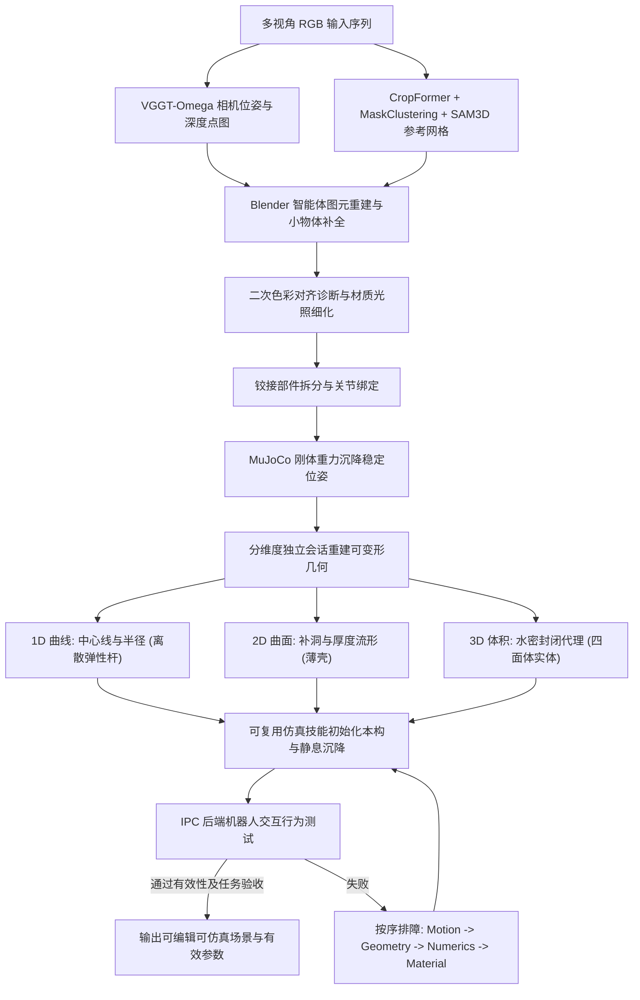

# CoDimRecon: Agentic Reconstruction of Sim-Ready 3D Scenes with Deformable Curves, Surfaces, and Volumes

## 一句话定义

**CoDimRecon** 是一种面向机器人与物理仿真的智能体三维场景重建框架，能从多视角 RGB 图像自主构建包含刚体、铰接部件以及**余维可变形物体**（1D 曲线杆、2D 曲面壳、3D 实体）的可编辑仿真场景，并通过仿真机器人行为测试闭环校准几何与本构模型。

## 英文缩写速查

| 缩写 | 英文全称 | 简要说明 |
|---|---|---|
| IPC / QIPC | Incremental Potential Contact / QIPC | 基于势垒的无穿透、无单元翻转连续碰撞接触力学求解框架及其后端实现 |
| DER | Discrete Elastic Rod | 离散弹性杆模型，以连续中心线、半径与 Bishop 标架描述一维细长体的拉伸、弯曲与扭转 |
| StVK | St. Venant–Kirchhoff (Elasticity / Membrane) | 经典超弹性本构模型，本文中用于薄壳膜力学及与 Hencky 对数应变结合的大压缩实体 |
| CD | Chamfer Distance | 倒角距离（本文按 50 万面积加权采样点的非平方对称最近邻平均距离，单位 cm） |
| NC | Normal Consistency | 法向一致性，预测与真值网格最近邻点对表面法向夹角余弦绝对值的双向均值（%） |
| LS | Latent Similarity | 基于冻结视频编码器（V-JEPA 2.1）特征空间的布局（Layout）与运动（Motion）相似性指标 |
| RR | Rendering Refinement | 基于二次色彩对齐诊断的渲染-评估-细化闭环 |

## 为什么重要

1. **补齐“刚体假设”的仿真鸿沟：** 现有组合式场景重建（无论是优化式还是零样本/智能体管线）几乎全部将物体视为刚体，无法支撑机器人对线缆、塑料袋、纸张、靠垫等日常柔顺物体的交互学习。
2. **几何表达随物理维度而变：** 细长或薄壁结构若强行用低阶三维四面体剖分不仅需要极高厚向网格密度，还易出现数值锁死（locking）。物理仿真要求曲线、曲面、体分别采用中心线+半径、流形中面+厚度、水密实体，因此**重建目标本身必须对齐下游求解器离散格式**。
3. **静态视觉无法决定不可逆与非线性物理行为：** 纸张折叠需要塑性铰链来保留折痕，仅靠弹性模型即使数值收敛也会在夹爪松开后回弹。CoDimRecon 将物理验证从“静态稳定性/碰撞检查”推进到“机器人交互行为测试”，用可复用技能初始化并在失败时按固定优先级诊断修订。

## 核心信息

| 字段 | 内容 |
|---|---|
| 作者 | Shuzhao Xie, Lelin Wang, Guying Lin, Zhi Wang, Minchen Li |
| 机构 | 清华大学深圳国际研究生院（SIGS, Tsinghua University）、卡内基梅隆大学（CMU）、创世纪 AI（Genesis AI） |
| 发表时间 | arXiv:2609.36024v3（2026-09-28 提交 v1，2026-10-03 更新 v3） |
| 论文链接 | [arXiv Abstract](https://arxiv.org/abs/2609.36024) / [arXiv HTML](https://arxiv.org/html/2609.36024) |
| 项目与代码 | [项目页](https://shuzhaoxie.github.io/CoDimRecon/)（标注 `Code Soon`，提供交互式 3D 场景与视频演示；截至 2026-11-27 暂未公布源码仓库） |
| 清单分类 | `environment.reconstruction`（来源条目：`survey_ax_2609_36024`） |
| 开源状态 | **宣称将开源或未列链接**（项目页标注 `Code Soon`；论文原文与项目页演示已通读核对，未见可运行仓库） |

## 核心原理

CoDimRecon 以多视角 RGB 图像集合 $\mathcal{I}=\{I_v\}_{v=1}^{V}$ 为输入，分三阶段在 Blender 与物理仿真器间协同完成场景资产构建与验证：

### 1. 几何与生成双先验引导的场景构建（Sec. 3.1 & Appendix B.1–B.3）

直接让多模态智能体看图编写 Blender 脚本容易出现全局尺度失真、布局漂移及忽略工具调用。CoDimRecon 显式提供两路参考：
- **度量几何上下文：** 通过 VGGT-Omega 估计相机内参、camera-to-world 位姿、逐帧深度图 $D_v$ 与反投影点图，用于统一房间尺寸、物体位置与多视角渲染比对。
- **物体级生成网格参考：** 用 CropFormer 提取单帧实体掩码，借鉴 MaskClustering 与 InstaScene 欠分割过滤聚类成 3D 物体轨迹；对每条轨迹 $o$ 选择反投影三维三角面片总面积 $A_v^o = \sum_{\tau \in \mathcal{F}(M_v^o)} \operatorname{Area}(\tau)$ 最大的最优视角 $v^\star$ 送入 SAM3D 生成规范网格，随后在邻近视角窗口 $\mathcal{V}_o$ 内借助 MASt3R 稠密像素对应与 Umeyama 相似变换 $\Delta\Theta^{(i)}$ 迭代渲染对齐，选取渲染-跟踪掩码平均 IoU 最高的变换 $\Theta^\star$；容器内遗漏的小物体则结合 REST3D 与 SAM3D 补全。
- **可编辑图元重建：** 生成网格仅作形状参照而不直接入库。智能体在 Blender 中使用基础图元（长方体、圆柱、圆台等）叠加 bevel、subdivision 与 lattice 修改器重新拟合家具与刚体，既修补生成网格缺陷、暴露可动部件边界，又大幅压缩网格规模（Appendix B.2 中一把办公椅从 178,172 顶点 / 356,084 面压缩到 43 个图元、2,192 顶点 / 1,183 面）。

### 2. 外观细化、铰接拆解与刚体沉降（Sec. 3.2）

- **二次色彩对齐诊断与渲染闭环（RR）：** 在渲染图与观测帧之间使用迭代重加权最小二乘（IRLS）拟合通道级二次映射 $c' = a\,c^2 + b\,c + d$。若对齐后图像误差大幅改善，说明问题主要来自光照或材质差异；若改善甚微，则提示几何或位姿存在偏差。智能体据此显式编辑 Blender 材质与灯光（避免烘焙 3DGS 光照导致仿真打光不一致）。
- **显式关节分解：** 依据涵盖旋转（revolute）、移动（prismatic）、螺旋（screw）、圆柱（cylindrical）、万向（universal）与球面（spherical）六类关节的指南，将抽屉、柜门、台灯臂以及键盘/电话按键等独立可动部件分离并绑定关节。
- **刚体重力稳定：** 暂时将所有物体视作刚体导入 MuJoCo 在重力下自由沉降，消除微小悬空或穿透，并将稳定位姿回写为场景规范摆放。

### 3. 分维度可变形重建与行为验证闭环（Sec. 3.3 & Appendix B.4）

针对可变形物体，智能体按几何维度拆分为**独立会话**重建，以兼容 IPC 家族连续碰撞接触后端（文中提及 QIPC v0.0.1.dev895）：
- **1D 曲线（杆离散）：** 补全路径并估计半径（如螺旋电话线），重采样消除自穿透（原始 3,200 节点 15,755 对重叠线段重采样为 576 段无自穿透折线，维持重构螺旋形状为无应力自然态）。
- **2D 曲面（壳离散）：** 修补孔洞并合并碎块为带厚度的流形中面（如塑料袋与纸张，与相邻刚性垃圾桶完全分离）。
- **3D 体积（实体离散）：** 进行水密封闭与四面体网格剖分；高面数物体先构造低面数闭合代理绑定形变（如椅垫与豆袋沙发）。
- **可复用仿真技能与静息态沉降：** 技能库打包可用本构模型、可运行示例场景、脚本与候选参数初值，完成初始模型绑定后在重力下执行静息态沉降并将平衡态写回 Blender。
- **智能体引导的行为验证与固定序修订：** 智能体规划预设诊断操作（Franka 机械臂抓取抬升电话听筒、三点下压椅垫、对折纸张 $140^\circ$ 后释放），检查拉伸率、单元 Jacobian 翻转与任务验收标准（如抬升高度、折痕保留率）。一旦失败，**严格按以下顺序逐层排查**：`Motion（轨迹/工具/接触位置） → Geometry（几何形状与边界条件） → Numerics（求解器与接触数值参数） → Material model（仅在前三者均无法复现预期行为时切换本构）`。例如纸张在首次折叠后因弹性回弹未能保留折痕，才触发启用屈服曲率 $\kappa_Y = 25\text{ m}^{-1}$ 的塑性铰链弯曲模型。

## 流程总览

## 源码运行时序图

**不适用**（截至 2026-11-27 项目页仅标注 `Code Soon` 并开放交互式场景检视与仿真视频演示，尚未确认公开可运行的官方源码仓库实现）。

## 实验与评测

### 1. 组合式三维场景重建定量基准（Table 3）

在 HoloScene 发布的 3 个 Replica 场景与 3 个 ScanNet++ 场景（`67d702f2e8`、`7831862f02`、`acd69a1746`）上评估几何、输入视角渲染、V-JEPA 2.1 潜在特征相似度（LS）及 MuJoCo 刚体稳定性（单物体逐一释放不倾倒比例）：

| 数据集 | 方法 | CD (cm) ↓ | F1@5cm (%) ↑ | NC (%) ↑ | PSNR ↑ | SSIM ↑ | LPIPS ↓ | Layout ↑ | Motion ↑ | Stable(Ground) % ↑ | Stable(All) % ↑ |
|---|---|---:|---:|---:|---:|---:|---:|---:|---:|---:|---:|
| Replica | HoloScene* | 6.79 | **53.48** | 78.76 | **21.22** | **0.6881** | **0.4171** | 94.46 | 95.71 | 77.77 | 49.41 |
| Replica | ReplicateAnyScene | 41.88 | 18.74 | 61.82 | 11.17 | 0.5529 | 0.6461 | 76.84 | 80.88 | 96.97 | 69.47 |
| Replica | GPT-6 Astra | 11.79 | 52.91 | 73.12 | 14.07 | 0.5671 | 0.5440 | **97.24** | 95.57 | 92.27 | 87.97 |
| Replica | **CoDimRecon (Ours)** | **6.63** | 52.24 | **79.76** | 15.06 | 0.5695 | 0.4817 | 95.14 | **96.90** | **100.00** | **97.54** |
| ScanNet++ | HoloScene* | 27.15 | 28.49 | 65.24 | **18.79** | **0.7134** | 0.3959 | 80.20 | 81.73 | 55.40 | 42.03 |
| ScanNet++ | ReplicateAnyScene | 50.73 | 19.08 | 54.69 | 8.94 | 0.5483 | 0.6710 | 92.87 | 74.87 | 78.66 | 82.72 |
| ScanNet++ | GPT-6 Astra | 22.73 | 35.90 | 70.14 | 14.22 | 0.5579 | 0.5356 | 94.47 | 96.31 | 96.30 | **96.31** |
| ScanNet++ | **CoDimRecon (Ours)** | **21.66** | **38.28** | **74.91** | 16.68 | 0.6440 | **0.3728** | **96.30** | **97.04** | **97.05** | **96.31** |

- 注：`HoloScene*` 为禁用官方默认法向监督、并替换为本文 MaskClustering 实例掩码与 VGGT-Omega 相机/深度的修改配置；`ReplicateAnyScene` 中未开源的位姿对齐与关系推理模块由作者按原文复现；PSNR/SSIM/LPIPS 在输入训练视角上测得，反映观测保真度而非新视角合成。

### 2. 可变形资产行为测试与折纸对照实验（Table 2、Table 4/5、Appendix B.4）

- **电话线（1D 离散弹性杆）：** 半径 $1.3\text{ mm}$、$E=40\text{ MPa}$、$\mu=0.60$；两次重复机器人抬升听筒轨迹的峰值高度分别为 $197.8\text{ mm}$ 与 $197.7\text{ mm}$，非邻接线段最小间隙维持 $22.0\text{ }\mu\text{m}$，全时段杆段拉伸率稳定在 $[0.9983, 1.0465]$。
- **纸张折叠（2D StVK 膜 + 塑性铰链）：** 厚 $0.105\text{ mm}$、$E=2250\text{ MPa}$、屈服曲率 $\kappa_Y=25\text{ m}^{-1}$。在完全相同的 $140^\circ$ 夹爪折叠轨迹下对比弹性与塑性对照复现：

| 弯曲模型 | 峰值折角 (°) | 松开 +1 s 折角 (°) | 结束折角 (°) | 保持率 (%) | 屈服铰链数（自然角变化 $>0.1\text{ rad}$） |
|---|---:|---:|---:|---:|---:|
| 弹性弯曲（对照重跑） | 121.66 | 4.48 | 2.67 | 3.7 | 0 |
| **塑性铰链弯曲** | **124.24** | **114.97** | **114.15** | **92.5** | **372** |

- **椅垫与豆袋沙发（3D 实体）：** 椅垫采用 StVK–Hencky 模型（$E=30\text{ kPa}$），70 mm 圆头压头三点目标下压 25 mm 实测下陷 22.9 / 22.6 / 22.9 mm 且释放后恢复（回弹偏差 $\le 3\text{ mm}$）；豆袋沙发采用 Stable Neo-Hookean 模型（$E=20\text{ kPa}$），重力沉降 2.26 s 后最大顶点位移收敛至边界盒对角线 $D=1.75\text{ m}$ 的 $10^{-4}$ 以内，最小单元 Jacobian $>0.91$。

### 3. 消融实验（Table 5 / 文中引用 Tab. 7）

- **几何与生成参考（ScanNet++ `67d702f2e8` 单场景几何消融）：** 完整方法 CD 7.24 cm、F1 44.98%、NC 75.93%；移除几何参考使 CD 恶化 **+64.9%**（11.94 cm），印证几何先验主要锚定全局尺度与布局；移除生成参考使 F1 下降 **-13.0%**（39.12%）、NC 下降 **-10.3%**（68.14%），物体形状明显粗糙。
- **渲染细化（RR）与分会话策略：** 移除 RR 在单场景上仅使 CD 微增 1.7%（7.36 cm），但在 ScanNet++ 平均渲染上使 PSNR 从 16.68 降至 15.82（-5.2%）、LPIPS 从 0.3728 升至 0.3938（+5.6%）。将曲线/曲面/体指令合并到同一智能体会话会明显劣化线缆几何重建（Fig. 7）。

## 与其他工作对比

| 方法 | 输入 | 几何先验 | 生成先验 | 自动实例发现 | 免训练 | 智能体管线 | 可变形物理仿真（1D/2D/3D） |
|---|---|---|---|---|---|---|---|
| HoloScene | RGB + Mask + Cam | ✓ | ✓ | ✗ | ✗ | ✗ | ✗ |
| SimRecon / ReplicateAnyScene | RGB | ✓ | ✓ | ✓ | ✓ | ✗ | ✗ |
| VIGA | 单视角 RGB | ✗ | ✓ | ✓ | ✓ | ✓ | ✗ |
| Lucida / Lumera | RGB / 单视角 RGB | ✓ | ✓ | ✓ | ✗ | ✓ | ✗ |
| LiteReality-Agent | 带位姿 RGB-D | ✓ | ✓ | ✓ | ✓ | ✓ | ✗ |
| GPT-6 Astra | RGB | ✗ | ✗ | ✓ | ✓ | ✓ | ✗ |
| **CoDimRecon** | **多视角 RGB** | **✓** | **✓** | **✓** | **✓** | **✓** | **✓（杆/壳/实体 + 塑性）** |

在纯外观指标上，优化式方法 HoloScene* 因直接优化渲染像素而获得更高 PSNR/SSIM，但几何碎片化且在 MuJoCo 中稳定性较差（Replica Stable-All 仅 49.41% vs. CoDimRecon 97.54%）；直接用相同智能体骨干看图建模的 GPT-6 Astra 缺少几何与生成双先验，在 Replica 上的倒角距离（11.79 cm）显著差于 CoDimRecon（6.63 cm）。

## 结论

**一句话总判：CoDimRecon 的核心贡献不在于提出新的底层物理求解器或 3D 生成器，而是构建了“几何/生成双先验定尺定形 + 余维分会话重建 + 机器人行为测试按序排障”的智能体闭环，首次打通从多视角 RGB 到可变形（杆/壳/实体）可交互仿真场景的端到端路径。**

1. **图元重绘优于直接保留生成网格**：以 SAM3D 网格作为形状参考、在 Blender 中用基础图元+修改器重建，在办公椅案例中实现了 $81\times$ 顶点和 $301\times$ 面数压缩，同时天然支撑关节拆解与紧凑编辑。
2. **分维度会话不可合并**：曲线、曲面、体分别面向离散杆、薄壳与四面体求解器，合并提示会在同一会话中干扰智能体对细长曲线的几何构建。
3. **数值通过不等于物理行为正确**：纸张折叠对照实验证明，纯弹性模型同样能通过无穿透和应变检查（峰值 $121.66^\circ$），却在松手后回弹至 3.7% 保留率；必须依赖任务级行为测试去触发塑性铰链等本构修订（92.5% 保留率）。
4. **先排运动与几何、最后动本构**：Table 6 统计的 8 次行为测试修订中，有 6 次通过调整运动规划、工具圆角、接触点位或几何边界解决，仅 2 次真正需要更换本构模型（Hencky 对数应变与塑性铰链）。

## 工程实践

- **Blender 与 MuJoCo / IPC 工具链拆分：** 外观材质与可编辑资产保留在 Blender 工程文件（`.blend`）中；刚体快速稳定沉降使用 MuJoCo；可变形精细无穿透接触交互则导出到支持离散杆、薄壳、实体及混合维度接触的 IPC 家族求解器（如 QIPC），并在完成静息沉降后将平衡态几何回写 Blender。
- **IPC 无自穿透前置处理：** 重建出的螺旋线或高曲率曲线在离散化前需做重采样间距约束，保证非邻接线段间距大于杆直径（文中通过 576 段重采样、每段长度大于杆径至少 $1\text{ }\mu\text{m}$ 来消除 15,755 对初始重叠）。
- **有效参数登记与复用：** 将典型物体本构模板与初始参数封装为“可复用仿真技能（skills）”，但在工程资产元数据中应明确标记为“有效仿真参数”而非真实物理测量值。

## 局限与风险

1. **参数未与真实动力学对齐：** 论文明确指出所有接受的弹性模量、密度、摩擦与屈服曲率均是基于视觉合理性与任务验收得到的**有效仿真参数**，而非真机力/形变实测标定参数，迁移到精确力控 Sim2Real 时仍需真实系统辨识。
2. **评测规模与消融覆盖有限：** 定量对比仅在 6 个室内场景（Replica 3 个 + ScanNet++ 3 个）上进行，且组件几何消融仅覆盖单个 ScanNet++ 场景（`67d702f2e8`）；可变形物体方面尚无同类三维重建基线可供横向定量比较。
3. **智能体与前置模型依赖重、源码未公开：** 管线串联 VGGT-Omega、CropFormer、SAM3D、MASt3R、REST3D、Blender、MuJoCo 与 QIPC，并依赖高性能闭源多模态智能体骨干；截至 2026-11-27 官方代码尚未开源（`Code Soon`），端到端延迟与计算开销未作详细报告。

## 关联页面

- [Agentic Robots 综述](paper-towards-agentic-robots-survey.md)
- [全量项目节点清单](../overview/awesome-agentic-robots-node-index.md)
- [VLA 方法背景](../methods/vla.md)
- [机器人仿真场景生成](../methods/robot-simulation-scene-generation.md)：对照场景、资产与可运行性检查。
- [视觉三维重建](../methods/visual-3d-reconstruction.md)：多视角几何先验与生成式三维网格对齐基础。
- [智能体技能封装](../methods/agent-skill-packaging.md)：对应本文中可复用物理仿真技能的封装机制。
- [编程智能体验证闭环](../methods/coding-agent-verification-loops.md)：对应本文的渲染细化与行为测试诊断闭环。
- [CRISP Real2Sim](../methods/crisp-real2sim.md)：同类面向仿真的真实到虚拟场景与物体重建思路。
- [机器人操作任务](../tasks/manipulation.md)：可变形线缆、纸张与软体按压等操作任务场景。

## 推荐继续阅读

- [CoDimRecon 官方项目页](https://shuzhaoxie.github.io/CoDimRecon/)：含交互式 Blender 重建场景检视器、7 组关节控制演示及 1D/2D/3D 可变形仿真视频。
- [Physics-Based Simulation 在线开源教材](https://phys-sim-book.github.io/)：论文作者团队维护，系统介绍离散杆、薄壳、有限元实体及 IPC 无穿透接触力学原理。
- [arXiv:2609.36024 原文（HTML）](https://arxiv.org/html/2609.36024)：查看 Appendix B.4 中的详尽仿真数值容差与 Table 6 修订日志。

## 参考来源

- [CoDimRecon 论文原文核对归档](../../sources/papers/paper-agentic-2609-36024.md)
- [Awesome Agentic Robots 综述条目索引](../../sources/repos/awesome-agentic-robots-survey-index.md)
- [CoDimRecon arXiv 论文页面](https://arxiv.org/abs/2609.36024)
- [CoDimRecon arXiv HTML 全文](https://arxiv.org/html/2609.36024)
- [CoDimRecon 官方项目页](https://shuzhaoxie.github.io/CoDimRecon/)
