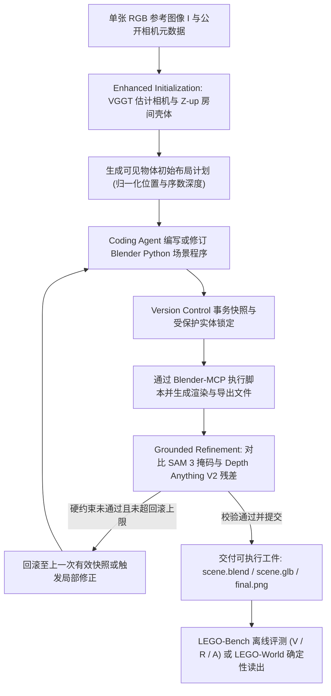

# LEGO-Anything: Coding Agents for 3D Scene Reconstruction

## 一句话定义

**LEGO-Anything** 是一个面向单视角 RGB 图像的 **Image-to-Code（Image2Code）** 三维场景重建框架：让通用编码智能体在 Blender 中反复编写、执行、渲染并检查场景程序，从而输出可编辑、可执行、可查询的结构化三维场景，而非静态网格或单一渲染图。

## 英文缩写速查

| 缩写 | 英文全称 | 简要说明 |
| --- | --- | --- |
| Image2Code | Image-to-Code | 将输入图像映射为可执行三维场景程序（Blender Python 脚本）的重建范式 |
| MCP | Model Context Protocol | 连接编码智能体与 Blender 编辑/渲染环境的标准工具调用协议（Blender-MCP） |
| F@5% | F1-score at 5% Depth-Scaled Tolerance | LEGO-Bench 主几何指标，以参考点前向深度的 5% 为容差计算可见表面 F1 |
| VGGT | Visual Geometry Grounded Transformer | LEGO-Plugin 初始化阶段用于估计相机与场景几何框架的视觉几何模型 |
| SAM 3 | Segment Anything Model 3 | LEGO-Plugin 与基准基线中用于提取参考图像区域掩码和实例分割的模型 |
| AbsRel | Absolute Relative Error | LEGO-World 深度估计评测中使用的归一化相对深度绝对误差（越低越好） |
| VLM | Vision-Language Model | 论文用于对照测试「智能体能否自我评判重建改进方向」的视觉语言裁判模型 |

## 为什么重要

1. **可执行程序优于静态 3D 资产**：网格、点云或隐式渲染结果难以事后修改物体布局与物理关系；显式场景程序把物体、几何、布局与相机参数保留在代码里，可直接运行、检查、编辑与查询。
2. **填补「单图、场景级、端到端可执行」基准空白**：既有基准多聚焦单物体建模（如 3DCodeBench、P3D-Bench）、文本生成世界（WorldCoder-Bench）或标定多视角（SceneActBench）；**LEGO-Bench** 利用高拟真仿真提供自然图像风格输入与精确私有几何/掩码真值。
3. **揭示编码智能体用于空间重建的真实瓶颈**：智能体几乎总能交付语法可运行的 `.blend/.glb` 文件（交付率接近 100%），但几何与外观保真度远未饱和；轨迹诊断直接催生了免训练控制层 **LEGO-Plugin**。

## 核心信息

| 字段 | 内容 |
| --- | --- |
| 论文标题 | *LEGO-Anything: Coding Agents for 3D Scene Reconstruction* |
| 作者 | Xirui Li, Peng Shi, Mingwen Dong, Sheng Zhang, Zhuoyan Xu, Dongkyu Lee, Shuaichen Chang, Yi Xiang, Lin Pan, Jiarong Jiang |
| 机构 | University of Maryland, College Park；AWS（第一作者实习期间完成） |
| 发表时间 | arXiv:2609.36380v1（2026-09-28） |
| 论文链接 | [arXiv:2609.36380](https://arxiv.org/abs/2609.36380) / [arXiv HTML](https://arxiv.org/html/2609.36380) |
| 项目与代码 | [项目主页](https://lego-anything.com)（标注 `Code · Coming soon` 与 `Early Access`） |
| 清单分类 | `environment.reconstruction` |
| 来源条目 | `survey_ax_2609_36380` |
| 开源状态 | **宣称将开源或未列链接**（截至 2026-11-27 尚未公布官方代码仓 URL；Appendix I 所涉 `NousResearch/hermes-agent` 为第三方对照 Harness） |

## 核心原理

### 1. LEGO-Anything：Image-to-Code 迭代构建形式化

给定单张参考 RGB 图像 $I$，编码智能体 $\pi$ 在三维编辑环境 $\mathcal{E}$（Blender 5.0.1 + Blender-MCP）中交互生成场景程序 $P$，执行后得到三维场景 $S$：

$$
P = \pi(I; \mathcal{E}), \qquad S = \operatorname{Exec}_{\mathcal{E}}(P).
$$

智能体并非一次性生成完整代码，而是沿着工作空间（Agent Workspace）、动作空间（Action Space）、Blender 状态脚本（Blender Code Structure）与迭代工作流（Scene Construction Workflow）形成轨迹 $\tau = \{(P_t, S_t, o_t)\}_{t=1}^T$，最终提交 `scene.blend`、`scene.glb` 与渲染图 `final.png`。

### 2. LEGO-Bench：仿真真值驱动的三维评测体系

基准基于 LychSim 与合法授权的 Fab 资产库构建（208 张 RGB 图像、104 个逻辑场景、8 类环境、17 个主题、443 个规范化资产），采用嵌套难度分层 $\mathcal{O}_E \subset \mathcal{O}_M \subset \mathcal{O}_H$（保持建筑、材质、灯光与相机不变，仅递增可见物体数量），并附带 10 例 NYC 航拍（Bird's-Eye）压力测试。评估拆分为三条正交维度：

- **交付有效性（Validity, $V_i \in \{0,1\}$）**：要求 `scene.blend` 可重新加载且含至少 1 个网格与激活相机、`scene.glb` 非空且合法、`final.png` 可解码不退化，且主评测器顺利完成；否则记 $V_i = R_i = A_i = 0$。
- **可见表面几何重建（Reconstruction, $R_i$, F@5%）**：**不做任何全局或逐物体配准与缩放**，直接在提交相机坐标系下光栅化可见三角面并与私有深度反投影点云对比；点云按私有实例掩码 $M_o$ 投影归属（不依赖物体命名），以参考点前向深度 $z(g)$ 的 5% 为容差 $\tau(g)=0.05\,z(g)$ 计算每物体调和平均并宏平均：

$$
F_{i,o}=\frac{2\,\mathrm{Prec}_{i,o}\,\mathrm{Rec}_{i,o}}{\mathrm{Prec}_{i,o}+\mathrm{Rec}_{i,o}}, \qquad R_{i}=\frac{1}{|\mathcal{O}_{i}|}\sum_{o\in\mathcal{O}_{i}}F_{i,o}.
$$

- **评测器重渲染外观（Appearance, $A_i$）**：评测器保留提交场景的相机、几何、材质与灯光，在统一渲染引擎与分辨率下重新渲染 $\hat{I}_i$（不直接采信智能体提交的 `final.png`），统计 8-bit sRGB 三通道最大像素差不超过 $\delta=30$ 的像素比例：

$$
A_{i}=\frac{1}{|\Omega_{i}|}\sum_{u\in\Omega_{i}}\mathbf{1}\!\left[\left\|\hat{I}_{i}(u)-I_{i}(u)\right\|_{\infty}\leq 30\right].
$$

- **综合得分（Overall, $S$）**：对全部尝试样本（含失效样本）求均值 $S = \frac{1}{N}\sum_{i=1}^N \frac{1}{2}(R_i+A_i)\cdot V_i$。

### 3. 失败诊断与 LEGO-Plugin 免训练约束层

通过对中间轨迹重打分与 6×6 盲测 VLM 裁判矩阵分析，论文定位出三个系统性故障，并在 **LEGO-Plugin**（以 MCP 工具、workflow skills 和 runtime hooks 挂载于原有 Harness）中逐一修复，全程仅读取参考图像 $I$：

1. **增强初始化（Enhanced Initialization，针对初始化慢且空间失准）**：调用 VGGT 从单图估计重力对齐的 Z-up 曼哈顿坐标系与相机参数，先安装并校验房间壳体与相机，再输出含归一化质心、投影范围与相对/序数深度（刻意避免易出错的绝对米制深度）的物体构建计划。
2. **有据细化（Grounded Refinement，针对自评几何准确率低于随机 50%）**：利用 SAM 3 掩码与 Depth Anything V2 相对深度，检查存在性、合法变换、支撑/包含/碰撞、朝向、重复布局、相机可见性、投影边界、深度序与渲染亮度；每轮候选最多修正 2 次，硬约束未过或缺少证据即拦截提交。
3. **版本控制（Version Control，针对后期编辑回退分数）**：每次编辑包裹为带快照（变换、网格、材质、层级、相机、渲染设置）与受保护实体清单的事务；拒绝误改未声明/受保护物体，未通过检查则自动回滚至上一已提交状态（每例最多 8 次事务与 2 次回滚）。

### 4. LEGO-World：冻结场景程序作为视觉表征

无需任务微调，直接从重建冻结的三维场景 $S$ 通过确定性读出函数 $\rho_k$（可见实例二维投影框、投影掩码、相机空间深度渲染）同时输出目标检测、实例分割与相对深度预测：$I \to P \to S \xrightarrow{\rho_k} \hat{y}_k$。

## 流程总览

## 源码运行时序图

**不适用**（截至 2026-11-27 核查：项目页 <https://lego-anything.com> 标注 `Code · Coming soon`，论文与项目页均未公开 LEGO-Anything / LEGO-Bench / LEGO-Plugin 官方可运行仓库链接；论文 Appendix I 仅列出第三方通用运行环境与对照 Harness `Harbor`、`Codex` 及 `NousResearch/hermes-agent` 固定提交 `aa6f77596b`，无可核对的官方源码调用入口）。

## 实验与评测

### 1. LEGO-Bench 主对比结果（Table 3，3 次运行均值与标准差，%）

| 模型 / 系统 | Indoor V↑ | Indoor R↑ | Indoor A↑ | Indoor S↑ | Outdoor V↑ | Outdoor R↑ | Outdoor A↑ | Outdoor S↑ |
| --- | ---: | ---: | ---: | ---: | ---: | ---: | ---: | ---: |
| **GPT-6-astra + Codex** | **100.0 (0.0)** | 52.4 (1.1) | **54.4 (0.7)** | **53.4 (0.8)** | 98.0 (1.0) | 34.0 (1.5) | **45.5 (0.5)** | **39.6 (0.8)** |
| GPT-6-sol + Codex | 99.4 (1.1) | 22.2 (2.4) | 42.5 (0.3) | 32.3 (1.0) | 99.7 (0.6) | 19.8 (1.0) | 28.7 (0.5) | 24.2 (0.4) |
| GPT-6-luna + Codex | 99.7 (0.5) | 15.8 (1.2) | 30.5 (0.3) | 23.2 (0.7) | 99.7 (0.6) | 13.2 (0.6) | 21.4 (0.5) | 17.3 (0.5) |
| GPT-5.6-terra + Codex | 99.7 (0.5) | 9.5 (1.0) | 21.3 (0.5) | 15.4 (0.6) | 98.0 (1.7) | 8.1 (0.7) | 15.0 (0.9) | 11.5 (0.4) |
| GPT-5.6-sol + Codex | 97.8 (2.3) | 9.8 (2.1) | 19.8 (0.6) | 14.8 (1.0) | 98.7 (0.6) | 12.8 (1.8) | 17.7 (0.4) | 15.3 (0.8) |
| GPT-5.6-luna + Codex | 99.1 (0.0) | 10.2 (2.1) | 18.0 (0.7) | 14.1 (1.3) | 97.0 (1.0) | 7.8 (1.5) | 16.6 (0.8) | 12.1 (1.0) |
| VIGA（纯程序模式） | 100.0 (0.0) | 10.8 (1.5) | 20.3 (0.7) | 15.6 (1.1) | 100.0 (0.0) | 8.0 (0.4) | 17.1 (0.0) | 12.6 (0.2) |
| Gen3DSR | 92.0 (1.1) | **65.4 (0.7)** | 0.0 (0.0) | 30.1 (0.4) | 80.0 (1.0) | **35.0 (0.5)** | 0.0 (0.0) | 14.0 (0.1) |
| 3D-RE-GEN | 100.0 (0.0) | 1.2 (0.1) | 11.3 (0.2) | 6.3 (0.1) | – | – | – | – |
| SceneGen | 71.6 (3.0) | 9.7 (1.8) | 0.0 (0.0) | 3.4 (0.5) | 38.7 (1.5) | 2.6 (1.1) | 0.0 (0.0) | 0.5 (0.2) |
| REST3D | 77.5 (13.0) | 7.2 (0.7) | 0.0 (0.0) | 2.8 (0.4) | – | – | – | – |
| SceneConductor | 12.3 (2.3) | 5.0 (2.1) | 0.0 (0.0) | 0.3 (0.2) | – | – | – | – |

### 2. 复杂度分层、推理预算与轨迹诊断

- **复杂度影响（Table 4，六款 GPT 均值）**：跨 Easy / Medium / Hard，Validity 稳定在 99.5%，但综合得分从 24.6% 降至 21.3% 再降至 20.5%；室外几何 $R$ 下降最剧烈（18.4% → 14.2% → 12.7%）。NYC 航拍压力测试（Table 6，F@2%）下，GPT-6-astra 的 $V=100.0\%$、$R=24.0\%$、$A=46.6\%$、$S=35.3\%$。
- **推理算力扩展（Figure 4，42 例 Office 子集）**：推理强度从 Low 增至 XHigh 时，GPT-6-astra 从 32.3% 升至 61.8%，GPT-6-sol 从 21.3% 升至 39.7%，GPT-6-luna 从 14.4% 升至 21.2%；而 GPT-5.6 系列未呈现单调增益。
- **轨迹退化与自评盲区（§5.1, Table 8）**：GPT-6-astra 约在 10% 预算内生成首个可评测场景，而 GPT-5.6-sol 需约 20%，且后者 29.6% 的编辑导致得分下降、最终得分比最佳中间态低 3.2 分。在 360 对检查点（2,160 次主判定）上，VLM 自评在 Reconstruction 方向与真实指标一致率仅 45.8%（跨模型 45.4%），Appearance 为 62.2%（跨模型 63.9%）。
- **人工-指标对齐（Appendix E.5）**：6 名盲测标注员在 240 个样本（960 个局部区域）上的兼容一致率为 86.6%（Reconstruction 88.9%、Appearance 84.3%），人工聚合判决与指标差异在 $\varepsilon=0.05$ 内的兼容率达 83.7%。

### 3. LEGO-Plugin 与 LEGO-World 消融验证

- **LEGO-Plugin 增益（§5.3，42 例 Office 子集）**：对全部 6 个配置均有正向提升，相对增益呈明显的「越弱提升越大」分布：GPT-5.6-luna **+62.7%**、GPT-5.6-terra +55.8%、GPT-5.6-sol +55.3%、GPT-6-luna +27.5%、GPT-6-sol +12.1%、GPT-6-astra +2.1%。
- **LEGO-World 下游感知读出（Table 5 & Table 9，每任务 100 张图）**：使用未加插件的 GPT-6-astra 重建冻结场景（检测/分割 94/100 有效输出、深度 99/100 有效输出），在等置信度 AP 协议下，COCO BBox AP 达 30.14（对比 DINO 59.88）、LVIS Mask AP 达 14.75（对比 SAM 3 53.96）、ETH3D 相对深度 AbsRel 达 0.1554（对比 Depth Anything 3 0.0783）。
- **关节先导测试（Appendix B.4）**：在完整 14 个可动目标 + 12 个静态对照的 Office 场景中，冻结局面关节试评分 $S_{\mathrm{Art}}^{\mathrm{pilot}}=0$，说明现有单图场景重建尚不具备场景级可动结构恢复能力。

## 与其他工作对比

| 基准 / 方法 | 单图输入 | 场景级评测 | 可执行交互场景 | 室内+室外覆盖 | 自然图像观感与可控难度 | 相对 LEGO-Anything 的差异 |
| --- | --- | --- | --- | --- | --- | --- |
| 3DCodeBench / P3D-Bench | 是 | 否 | 否 / 否 | 否 | 否 | 聚焦单物体或参数化部件，不考场景布局与相机耦合 |
| WorldCoder-Bench | 否（文本） | 是 | 是 | 否 | 否 | 由文本规范驱动，不检验对给定图像的几何/外观忠实度 |
| SEIG | 是 | 否 | 是 | 否 | 否 | 同属 Blender 可执行程序路线，但定量评测偏物体级 |
| SceneActBench | 是（多视图） | 是 | 是 | 否 | 否 | 重建赛道使用标定多视图室内观测且排除房间结构与纹理 |
| Gen3DSR / SceneGen / REST3D | 是 | 是 | 部分固定资产 | 部分支持 | — | 输出固定场景或缺少材质/光照渲染耦合，且多数不支持室外 |
| **LEGO-Anything + LEGO-Bench** | **是** | **是** | **是** | **是** | **是** | **通用编码智能体端到端构建可编辑 Blender 程序并多维自动打分** |

## 结论

**一句话总判：通用编码智能体已能稳定交付可运行的单图三维 Blender 场景程序，但几何与外观保真度远未饱和，且必须依赖参考证据约束与版本回滚来抑制迭代退化。**

1. **「能跑通」不等于「建得准」**：所有测得的 GPT 系列智能体交付有效性均接近 100%，但综合分最高仅 53.4%（室内）/ 39.6%（室外），研发评测不应只看脚本无报错退出。
2. **不要依赖大模型自由视觉自评几何**：实证表明编码智能体自我判断几何改好还是改坏的一致率仅 45.8%（低于盲猜），必须引入 VGGT、SAM 3、深度估计等确定性外部信号做残差校验。
3. **版本事务与快照回滚是长程迭代刚需**：近三成编辑（弱模型达 29.6%）会让已建好的场景变差，用事务边界保护已通过校验的实体与相机能直接带来最高 62.7% 的相对收益。
4. **场景程序可作为统一视觉中间态，但精度尚不足以替代专用感知模型**：冻结场景无需微调即可读出检测、分割与相对深度，但距 DINO / SAM 3 / Depth Anything 3 仍有约一倍差距。
5. **交互式仿真场景仍缺少可动关节恢复**：在包含 75 个已验证关节资产的场景清单下，单图重建的先导关节恢复得分为 0，面向机器人交互仿真仍需显式关节建模能力补齐。

## 工程实践

- **Harness 边界隔离设计**：参考 Appendix G 的架构模式，保持原编码智能体为规划器、Blender-MCP 为唯一编辑入口，将初始化、参考证据提取与事务回滚做成可插拔的工具与钩子，无需微调模型即可跨代迁移。
- **显式声明可编辑与受保护实体**：每次工具调用只允许修改事务声明范围内的物体或灯光，并对相机和已校验对象加保护锁，可有效避免后期局部修补破坏全局视角与透视对齐。
- **分离测试集构建资产许可与人工核查**：借鉴 LEGO-Bench 的构建流程，筛选明确允许 AI 使用的资产、用嵌套子集控制复杂度，并将所有自动生成的物体/关节提案经人工模拟运行验证后再进入评测集。

## 局限与风险

- **代码与基准暂未公开**：截至 2026-11-27 官方主页仍显示 `Code · Coming soon`，无法在本地复现 Harbor 容器评测或验证 LEGO-Plugin 的精确延迟开销。
- **单视角尺度与遮挡歧义**：单张 RGB 图像无法确定绝对米制尺度，LEGO-Bench 在无配准相机系下打分虽严格惩罚相机/尺度偏移，但也放大了单目先验误差。
- **读出协议与置信度缺失**：LEGO-World 对检测和分割采用了等置信度（1.0）排序规则，无法反映真实检测器的置信度校准能力；且在需要关节物理交互的场景中，当前生成程序还无法自动复原可动部件结构。

## 关联页面

- [具身大模型评测基准选型闭环](../queries/embodied-eval-benchmark-selection-loop.md)：对照评测基准设计与指标选型闭环。
- [Agentic Robots 综述](paper-towards-agentic-robots-survey.md)
- [全量项目节点清单](../overview/awesome-agentic-robots-node-index.md)
- [VLA 方法背景](../methods/vla.md)
- [机器人仿真场景生成](../methods/robot-simulation-scene-generation.md)：对照仿真场景资产、碰撞、关节与可运行性检查。
- [视觉三维重建流程](../methods/visual-3d-reconstruction.md)：对照经典 SfM/MVS/3DGS 几何重建与单目尺度约束。
- [Coding Agent 验证闭环](../methods/coding-agent-verification-loops.md)：对应本文基于执行渲染、残差检验与事务回滚的迭代验证机制。
- [机器人智能体执行框架](../methods/robot-agent-harness.md)：对照 LEGO-Plugin 作为免训练 Harness 护栏层的接口设计。
- [具身智能体评测方法](../methods/embodied-agent-benchmarking.md)：对照多维度、失败计入分母及人工兼容度校准的基准评测规范。

## 推荐继续阅读

- [LEGO-Anything 官方项目主页（含交互式 Metric Viewer）](https://lego-anything.com)
- [LEGO-Anything arXiv HTML 全文（2609.36380v1）](https://arxiv.org/html/2609.36380)

## 参考来源

- [LEGO-Anything 原文核对与精读笔记](../../sources/papers/paper-agentic-2609-36380.md)
- [Awesome Agentic Robots 综述索引归档](../../sources/repos/awesome-agentic-robots-survey-index.md)
- [arXiv:2609.36380 官方摘要与论文入口](https://arxiv.org/abs/2609.36380)
- [LEGO-Anything 官方项目页](https://lego-anything.com)
