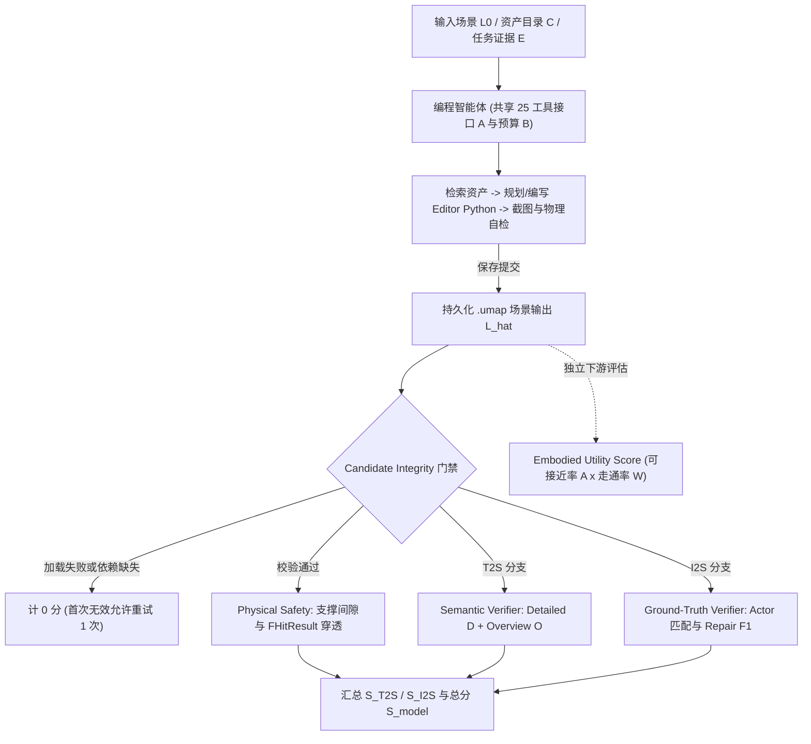

# Code4Scene: Benchmarking Coding Agents for Constructing and Editing 3D Scenes

## 一句话定义

Code4Scene 是一个包含 170 个基于人工搭建 Unreal Engine 场景的任务基准，通过统一的 25 工具执行接口，在开放式「文本构筑（T2S）」与有隐藏真值的「图像编辑（I2S）」两类设定下，直接对生成的可持久化 `.umap` 场景进行工件完整性、任务达成度、静态物理安全及非目标保留评测。

## 英文缩写速查

| 缩写 | 英文全称 | 简要说明 |
|---|---|---|
| T2S | Text-to-Scene Construction | 从空场景与开放式文本描述及资产目录构筑 3D 场景的任务设定 |
| I2S | Image-to-Scene Editing | 给定损坏场景与参考图像，推断差异并精准修复至隐藏真值状态的任务设定 |
| EUS | Embodied Utility Score | 辅助下游可用性指标，通过固定路径跟随代理测量可接近率与行走完成率 |
| AABB | Axis-Aligned Bounding Box | 世界坐标轴对齐包围盒，用于 T2S 支撑间隙与碰撞初筛计算 |
| VLM | Vision-Language Model | 视觉语言模型；评测流水线固定使用 Qwen 3.8 27B（关闭思考模式）作为视觉裁判 |
| TP / FP / FN | True Positive / False Positive / False Negative | Actor 级修复评价中的真阳性修复、误改/多余修改假阳性、漏修假阴性计数 |

## 为什么重要

在机器人仿真、具身智能训练环境搭建与游戏/工业三维设计中，前沿编程智能体（coding agents）已能编写引擎脚本并通过多模态反馈迭代修改三维场景。然而，传统评测多停留在脚本静态检查或渲染图像外观：一张看似合理的渲染图可能掩盖悬空、穿模、损坏依赖或误删背景对象等持久状态错误。Code4Scene 将三维场景作者能力拆解为「开放式空间推理（构建）」与「精确状态控制与作用域隔离（编辑）」，并以引擎原生状态和隐藏真值校验替代单纯视觉打分，揭示了当前代理在空间组合与精确编辑边界上的共性短板。

## 核心信息

| 字段 | 内容或状态 |
|---|---|
| 作者 | Xiaokang Ye, Siddhant Hitesh Mantri, Zimeng Chen, Edward Zhang, Zhaoxu Zheng, Yuanheng Li, Yizhao Chen, Tianyang Huang, Lianhui Qin |
| 机构 | UC San Diego（UCSD）、UC Berkeley |
| 发表时间 | 2026-09-29（arXiv v1）；2026-11-17（arXiv v2，46 页含附录） |
| 论文链接 | [arXiv:2609.36777](https://arxiv.org/abs/2609.36777)（[HTML 全文](https://arxiv.org/html/2609.36777)） |
| 项目与代码 | [项目页](https://simworld.org/code4scene)；官方源码仓库暂未列出（Appendix A 声明将发布公开集脚本与工具 schema） |
| 清单分类 | `environment.reconstruction`（`survey_ax_2609_36777`） |
| 开源状态 | 宣称将开源或未列链接（截至 2026-11-27，原文声明将公开 83 例公开集任务代码、评测/分析脚本、工具 schema 与 skill 规范，但未发布 GitHub 地址；第三方 Fab 资产包受原授权约束） |

## 核心原理

Code4Scene 将三维场景制作形式化为引擎内代理代码生成问题。给定源自人工搭建场景 $\mathcal{L}^\star$ 的资产目录 $\mathcal{C}$、初始场景 $\mathcal{L}^0$、代理可见证据 $E$、共享工具接口 $\mathcal{A}$ 与资源预算 $B$，智能体输出持久化关卡文件 $\hat{\mathcal{L}}$：

$$f: (\mathcal{L}^0, \mathcal{C}, E, \mathcal{A}, B) \rightarrow \hat{\mathcal{L}}$$

1. **双任务构建机制（170 个保留任务）**：
   - 从 522 个 Epic Fab 内容包中筛选人工场景（剔除 5 个禁止 AI 使用的资产包及未确认权限的 TrainStation 共 20 例），保留 83 个公开案例（16 T2S + 22 Indoor + 45 Outdoor）与 87 个私有案例（10 T2S + 50 Indoor + 27 Outdoor）。
   - **T2S 构筑**：$\mathcal{L}^0$ 为空（130 m 或 200 m 底板），$E$ 为经 VLM 初拟、双人独立校对的自然语言需求（平均 58 条、最高 92 条可核查条款）及资产目录；预算 800 次工具调用 / 180 分钟。
   - **I2S 编辑**：在含 95–6,700 个 Actor 的人工场景副本上施加人工设计的原子/组合破坏（移除、插入、复制、替换、平移、旋转、缩放、镜像，涵盖 Restore、Lifecycle、Layout、Symmetry、Transform 五类），提供室内 2 张或室外 1 张参考图作为 $E$，隐藏真值 $H$ 仅评测器可见；预算室内 120 次 / 45 分钟、室外 80 次 / 20 分钟。
2. **统一 25 工具执行接口（$\mathcal{A}$）**：
   - 包含资产检索（`search_assets`、`get_categories`、`get_asset_metadata`、`get_asset_preview`）、Actor 级编辑（`spawn_actor`、`spawn_blueprint_actor`、`set_actor_transform`、`delete_actor`、`delete_all_spawned`）、状态检查（`get_actors_in_level`、`find_actors_by_name`）、异步编辑器 Python（`execute_python_script`、`read_job_log`）、确定性场景图规划（`validate_scene_graph`、`solve_scene_graph`、`render_plan`、`tier_derivation`、`ground_pass`、`build_tier`）、校验（`take_screenshot`、`measure_scene`、`check_floating`、`check_collisions`）以及环境持久化（`setup_environment`、`save_scene_as`）。代理只能通过受控评测代理访问这 25 个工具与统一 Skill 规范。
3. **三层评测流水线与评分函数**：
   - **准入门禁（Candidate Integrity）**：独立重启 Unreal Engine 5.8.0 加载提交的 `.umap`，验证场景图 schema、最小 Actor 数、依赖包可解析性与资产清单一致性；仅当首次无有效提交时允许最多 1 次重试，无有效提交记 0 分。
   - **静态物理安全（Physical Safety, $P$）**：$S_{\mathrm{physics}} = 0.5(1-r_{\mathrm{unsup}}) + 0.5 S_{\mathrm{pen}}$。支撑检测要求底部距世界地面或下层支撑面垂直间隙 $\le 5\text{ cm}$；穿透检测在 AABB 粗筛后以引擎原生 `FHitResult` 最小平移深度为准（T2S 容差为最短 AABB 边长的 5% 限幅于 $[5,50]\text{ cm}$，I2S 固定 $5\text{ cm}$）。
   - **T2S 语义校验**：结合 **Detailed Alignment ($D$)**（Identity/Environment 0.25、Content/Quantity 0.40、Attributes/Materials 0.15、Spatial Composition 0.20；采用「引擎结构状态 -> 定向多视角 RGB 截图 -> Qwen 3.8 27B 裁判」三阶证据阶梯）与 **Overview Alignment ($O$)**（4 张全局视图评估对齐/布局/风格/完整度并乘以无提示几何完整度修正 $(0.75 + 0.25 S_{\mathrm{struct}})$，严重变形时截断至 0.40），总分：
     $$S_{\mathrm{T2S}} = 0.2 D + 0.6 O + 0.2 P$$
   - **I2S 真值修复校验**：忽略 Actor 名称/GUID，通过最小代价匹配与隐藏真值比对（位置 $\le 5\text{ cm}$、四元数旋转 $\le 5^\circ$、缩放与包围盒 $\le 5\%$、资产与材质属性精确一致）。统计正确修复 $\mathrm{TP}=m+d$、漏修 $\mathrm{FN}$ 与包含错误状态及误改背景 Actor 在内的假阳性 $\mathrm{FP}=|C|-m+o$，计算宏观 $F_1$：
     $$S_{\mathrm{I2S}} = 0.8 F_1 + 0.2 P, \qquad S_{\mathrm{model}} = 0.5 \overline{S}_{\mathrm{T2S}} + 0.5 \overline{S}_{\mathrm{I2S}}$$
   - **辅助下游指标（EUS）**：独立测量固定导航网格（胶囊半径 50 cm、高 180 cm、坡度 $\le 35^\circ$）上底层物体的可接近率 $A$ 与路径完成率 $W$，$\mathrm{EUS} = A \cdot W$。

## 流程总览

## 源码运行时序图

**不适用**（核查结果：截至 2026-11-27，arXiv:2609.36777v2 原文仅给出项目主页 `https://simworld.org/code4scene` 并于 Appendix A 声明将发布公开集任务代码与评测脚本，候选仓库列表为空且尚未确认可运行的官方源码仓库实现）。

## 实验与评测

实验在 8 张 NVIDIA RTX A5000 (24 GB) 的 Unreal Engine 5.8.0 环境中进行，公开集（83 例）覆盖 14 个系统配置，私有集（87 例）覆盖 10 个系统配置（表 2、表 10、表 13、表 16）：

| 智能体配置 | 公开 T2S Semantic | 公开 T2S Phys | 公开 $S_{\mathrm{T2S}}$ | 公开 I2S Repair F1 | 公开 I2S Phys | 公开 $S_{\mathrm{I2S}}$ | 公开 $S_{\mathrm{model}}$ [95% CI] | 私有 $S_{\mathrm{model}}$ |
|---|---|---|---|---|---|---|---|---|
| **GPT-6 Astra (max)** | **0.797** | 0.738 | 0.785 | 0.462 | 0.802 | 0.530 | **0.658** [0.619, 0.700] | — |
| **Gemini 3.8 Flash (high)** | 0.615 | 0.918 | 0.675 | **0.562** | 0.816 | **0.613** | 0.644 [0.596, 0.696] | **0.664** |
| **Claude Fable 5.1 (max)** | 0.749 | **0.980** | **0.796** | 0.339 | 0.786 | 0.428 | 0.612 [0.573, 0.659] | — |
| **Claude Opus 5 (max)** | 0.714 | 0.855 | 0.742 | 0.388 | 0.790 | 0.469 | 0.606 [0.558, 0.660] | — |
| **GPT-5.6 Sol** | 0.723 | 0.872 | 0.753 | 0.314 | 0.681 | 0.387 | 0.570 [0.544, 0.595] | 0.576 |
| **GLM-5.3 Flash (max)** | 0.633 | 0.678 | 0.642 | 0.200 | **0.830** | 0.326 | 0.484 [0.446, 0.518] | 0.476 |
| **Muse Spark 1.3** | 0.529 | 0.570 | 0.537 | 0.239 | 0.784 | 0.348 | 0.443 [0.369, 0.512] | 0.483 |
| **Grok 4.6** | 0.677 | 0.701 | 0.682 | 0.049 | 0.736 | 0.187 | 0.434 [0.411, 0.456] | — |
| **Qwen 3.8 27B (thinking on)** | 0.489 | 0.738 | 0.538 | 0.132 | 0.664 | 0.238 | 0.388 [0.336, 0.439] | 0.369 |
| **Gemma 4 31B (thinking off)** | 0.474 | 0.760 | 0.531 | 0.001 | 0.579 | 0.117 | 0.324 [0.292, 0.356] | 0.284 |
| **DeepSeek V4.1 Flash** | 0.334 | 0.424 | 0.352 | 0.079 | 0.776 | 0.219 | 0.285 [0.218, 0.353] | 0.216 |

- **关键发现与消融/诊断数据**：
  1. **构筑与编辑能力并不等价**：T2S 与 I2S 的 Spearman 相关系数为 $\rho = 0.67$。Claude Fable 5.1 领跑 T2S（0.796），Gemini 3.8 Flash 领跑 I2S（0.613），GPT-6 Astra 与 Gemini 的配对总分差为 $0.0134$（95% 区间 $[-0.0402, 0.0665]$），未能分出显著胜负。
  2. **空间组合是普遍瓶颈**：在 14 个系统的 T2S 四类细粒度需求中，Spatial Composition 均为最低项（Astra 最高仅 0.587）。即便在实体确认存在的 387 条可分析空间约束中，仍有 **74/387（19.1%，CI 12.1–26.6%）** 被直接判为空间关系不匹配。
  3. **完全修复仍伴随大比例误改**：在所有 187 次完全找回目标（Recall=1）的提交中，**64/187（34.2%，CI 25.5–42.3%）** 产生非目标假阳性（其中 50 次修改了非目标 Actor、27 次多出未匹配新增 Actor）。在 22 个室内案例中，Astra 完全恢复 20 次高于 Gemini 的 17 次，但若叠加「零误改」条件则反转为 Astra 15 次 vs Gemini 16 次；这一比例在严格（2.5 cm / 2.5° / 2.5%，34.8%）与宽松容差（10 cm / 10° / 10%，33.7%）下基本不变。
  4. **编辑操作类型分化与室内外差异**：Astra 在 Transform 修复领先（0.591 vs Gemini 0.529），Gemini 在 Layout（0.707 vs Astra 0.618）、Lifecycle 与 Restore（0.411）领先；在室外公开修复 F1 上 Gemini 达 47.3 远高于 Astra 的 28.7，而室内公开修复 F1 上 Astra 达 82.1 高于 Gemini 的 74.5。
  5. **下游具身导航（EUS）与评测器验证**：在 71 个室外修复辅助队列中，Gemini 使 EUS 相对损坏输入提升 $+0.059$（0.264 -> 0.323），其余 7 个系统变化在 $-0.031$ 到 $+0.014$ 之间；30 个构筑提示上 Gemini（0.479）与 Sol（0.477）领先。T2S 评分在 4 个回顾性留出提示上与 Plackett-Luce 人类共识一致率达 86.90%（$\tau_b = 0.738$），VLM 裁判固定证据重复测试的 $\tau_b = 0.889\text{–}0.944$。

## 与其他工作对比

| 基准 | 输出工件 | 输入模态 | 任务类型 | 语义/对齐评测 | 物理有效性 | 非目标保留校验 |
|---|---|---|---|---|---|---|
| **BlenderGym (2025)** | Script | 图像 | 真值目标 | 几何/渲染 | — | — |
| **SceneActBench (2026)** | GLB / Pose | 文本 + 图像 | 真值目标 | 对齐 | — | — |
| **4DBuildBench (2026a)** | `.blend` | 文本 | 开放式 | 视觉提示对齐 | 物理机制 | — |
| **CutsceneBench (2026)** | Sequence | 文本 | 开放式 + 真值序列 | 镜头/序列 | — | — |
| **WorldCoder-Bench (2026)** | HTML | 文本 | 开放式 | 对齐 | 物理检查 | — |
| **AuthorBench (2026)** | JSON | 文本 | 开放式 + 语言编辑 | 需求对齐 | 物理检查 | 保留校验 |
| **VWE-Bench (2026)** | Asset map | 文本 + 当前图 | 语言指定编辑 | 验证查询 | — | 拒绝越权修改 |
| **Code4Scene (2026)** | 持久化 `.umap` | 文本（构筑）/ 参考图（编辑） | 开放式构筑 + 图像反推真值编辑 | 多阶状态+VLM / Actor 匹配 | 支撑间隙 + `FHitResult` 穿透 + EUS | 精确 Actor 级 $\mathrm{FP}$ 惩罚 |

与上述先行基准相比，Code4Scene 的核心差异在于：（1）直接面向工业级 Unreal Engine `.umap` 关卡，通过「重开关卡 + 依赖与资产清单校验」验证持久化可执行工件，避免仅凭渲染图或临时脚本过关；（2）在编辑任务中不给自然语言修改指令，而是要求代理从「目标参考图 vs 当前 95–6,700 Actor 场景」的视觉差异自主反推修改方案并严格守住非目标边界。

## 结论

**一句话总判：前沿编程智能体已经能在引擎工具链辅助下搭建出外观连贯的三维场景，但远未掌握可靠的三维空间关系推理与不破坏无关对象的精确状态控制。**

1. **T2S 与 I2S 选型不可混同**：开源与闭源系统中均未出现全能领跑者——Claude Fable 5.1 在开放式构筑与物理合法性（0.980）领先，GPT-6 Astra 室内修复召回与几何变换（Transform）最强，而 Gemini 3.8 Flash 在整体编辑（Repair F1 0.562）、室外大场景编辑（F1 47.3）及成本效率（加权 $1.780 vs Astra $6.039、Fable $7.280）综合优势突出。
2. **「资产找对」不等于「摆对」**：19.1% 的空间关系在物体已生成的前提下依然出错，说明工程集成中不能仅靠提高资产检索与生成召回率，而需要引入显式的空间约束求解器（如 `solve_scene_graph`）与多视角几何核验闭环。
3. **编辑场景必须设作用域防护**：34.2% 的「完全修复」仍伴随着误改或误增背景 Actor，且开源小参数模型（Qwen 3.8 27B / Gemma 4 31B / DeepSeek V4.1 Flash）在百万像素大场景编辑中 Repair F1 普遍低于 0.14；工程落地时应对智能体编辑权限做 Actor 白名单/差分回滚隔离。
4. **Python 接口类型鲁棒性是低垂果实**：85.0% 的错误提交源于 `AttributeError` 或 `TypeError`（如 Astra 室内/室外错误提交中 22/28 次），在 Skill 文档与工具层补充严格静态类型提示与运行前 dry-run 校验即可消除大量无效调用。

## 工程实践

- **接口与规划工具组合**：Paper Appendix D.4 显示，高分模型在构建任务中平均每题调用 72.1–123.6 次非轮询工具（表 15），且大量位姿调整并非直接调用 `set_actor_transform`，而是通过 `execute_python_script` 批量编写 Unreal Editor Python 脚本完成；建议结合 `validate_scene_graph`、`solve_scene_graph` 做先验防重叠求解，再用 `check_floating` 与 `check_collisions` 在提交前自检。
- **资产检索与依赖打包**：代理在场景中动态创建的材质或中间资产若未正确随关卡保存，会直接触发 Candidate Integrity 门禁失败计 0 分；工作流末尾应强制校验所有引用资源路径属于冻结资产清单并调用 `save_scene_as`。
- **代码复现边界**：截至 2026-11-27 官方仓库尚未公开，当前基于论文全文静态核对方法细节与指标，未在本地 Unreal Engine 5.8.0 环境运行。

## 局限与风险

- **静态几何近似与无动力学交互**：仅评估静态场景与固定胶囊体导航（EUS），不覆盖布料、流体、铰接机构等动力学属性；T2S 支撑检测基于 AABB 接地代理，未验证多级堆叠承重链或精确网格接触稳定性。
- **接口能力与空间推理耦合**：基准固定了特定 25 个工具的 Unreal Harness 与客户端（Codex / Claude Code / Antigravity 等），得分同时反映模型空间推理能力与对特定客户端/Python API 的熟悉度，不能剥离纯模型能力。
- **统计与标注覆盖边界**：每个模型–任务对仅保留单次有效生成结果，源聚类自助法区间反映场景异质性而非多次采样的生成方差；T2S 人工偏好验证仅包含 16 个提示（留出集仅 4 个提示），且 I2S 修复容差与 0.8/0.2 权重尚未经过系统的人类感知对齐标定；部分自动化抽取的 T2S 需求图未经过人工逐条审核。

## 关联页面

- [具身大模型评测基准选型闭环](../queries/embodied-eval-benchmark-selection-loop.md)：对照评测基准设计与指标选型闭环。
- [Agentic Robots 综述](paper-towards-agentic-robots-survey.md)
- [全量项目节点清单](../overview/awesome-agentic-robots-node-index.md)
- [VLA 方法背景](../methods/vla.md)
- [AI 模型与智能体基准评测](../methods/ai-benchmark-evaluation.md)：对照相关方法与适用场景。
- [机器人仿真场景生成](../methods/robot-simulation-scene-generation.md)：对照三维仿真环境自动生成与可用性校验路线。
- [具身智能体基准评测](../methods/embodied-agent-benchmarking.md)：与下游 EUS 导航评估思路互补。
- [编程智能体校验闭环](../methods/coding-agent-verification-loops.md)：引擎状态校验、自检工具与回滚机制。
- [智能体工具调用接口](../methods/agent-tool-use-interface.md)：25 工具统一接口与技能规范设计。

## 推荐继续阅读

- [Code4Scene 论文页面 (arXiv:2609.36777)](https://arxiv.org/abs/2609.36777)
- [Code4Scene 项目主页](https://simworld.org/code4scene)
- [SimWorld 开源模拟环境论文 (NeurIPS 2025)](https://proceedings.neurips.cc/paper_files/paper/2025/hash/f1eff44d59d9c66cc6e359d36d80b0b9-Abstract-Conference.html)

## 参考来源

- [论文精读归档：Code4Scene (arXiv:2609.36777v2)](../../sources/papers/paper-agentic-2609-36777.md)
- [官方 Awesome 快照归档](../../sources/repos/awesome-agentic-robots-survey-index.md)
- [arXiv HTML 原文 (2609.36777v2)](https://arxiv.org/html/2609.36777)
- [Code4Scene 官方项目主页](https://simworld.org/code4scene)
