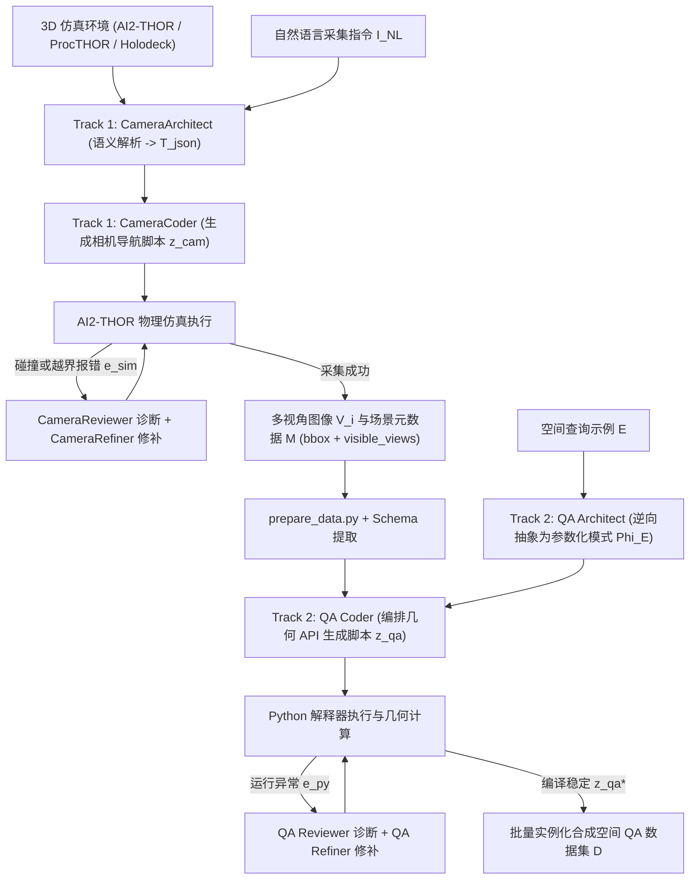
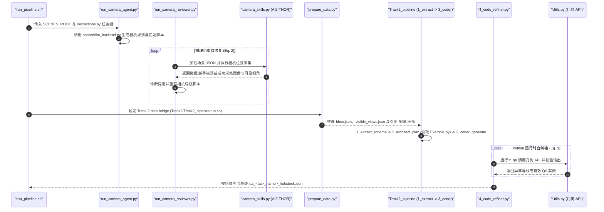

# Exemplar2VQA: A Scalable Exemplar-Driven Visual Question Answering Generation Framework via Multi-Agent Coding

## 一句话定义

Exemplar2VQA 是一个面向具身智能空间推理的示例驱动（exemplar-driven）3D 视觉问答（VQA）自动化合成框架：它不直接让大模型猜测三维空间关系，而是通过双轨四角色多智能体协作编写可执行 Python 代码，在 AI2-THOR 仿真器中自主采集多视角图像并调用确定性几何 API 批量计算真值问答对。

## 英文缩写速查

| 缩写 | 英文全称 | 简要说明 |
|---|---|---|
| Exemplar2VQA | Exemplar-Driven Visual Question Answering Generation Framework | 本文提出的示例驱动双轨多智能体空间 VQA 合成框架 |
| VQA | Visual Question Answering | 视觉问答任务，本文中特指多视角与三维空间关系推理问答 |
| MLLM | Multimodal Large Language Model | 多模态大语言模型（如 Qwen2.5-VL、InternVL2、GPT-4o） |
| AI2-THOR | Allen Institute for AI Interactive 3D Environment | 本文采用的带物理碰撞与渲染反馈的 3D 室内交互仿真平台 |
| NEFTune | Noise Embeddings for Fine-Tuning | 微调时向嵌入层注入随机噪声以提升指令微调鲁棒性的技术 |
| OOD | Out-of-Distribution | 分布外泛化，指仅用室内合成数据微调后在室外或跨基准上的迁移表现 |

## 为什么重要

1. **用「确定性代码执行」根除大模型空间标注幻觉：** 直接让 LLM/VLM 对多视角图像标注 3D 距离、遮挡和异中心（allocentric）方位极易发生幻觉；本文实测使用 `Gemini3.5-Flash` 直接标注 10K 条 VSI-Bench 训练样本微调 `Qwen2.5-VL-3B`，均分反而从 35.3% 跌至 28.2%。Exemplar2VQA 让模型只负责逻辑路由与代码生成，所有几何运算交由 Python 工具库精确求值。
2. **仅凭单个问答示例即可自主扩增多种基准格式：** 传统合成管线依赖人工编写僵化规则，难以适配新基准的提问结构。Exemplar2VQA 允许用户只提供一个具体 QA 示例（exemplar），由架构智能体逆向抽象出参数化模板并结合 ProcTHOR/Holodeck 无限扩展场景，同时支持按需调节各类题型的采样配比。
3. **验证了纯室内合成空间数据向真实与室外场景的高效迁移：** 仅使用 Exemplar2VQA 生成的 6K–10K 条室内合成问答对微调 `Qwen2.5-VL-3B/7B`，不仅在 MMSI-Bench、VSI-Bench 等主基准大幅超越同规模甚至 32B/72B 基线与人类标注数据微调基线，还在零样本条件下显著提升室外混合基准 ViewSpatial-Bench、SpaCE-10 与真实生活场景 Spatial-MM 的表现。

## 核心信息

| 字段 | 内容 |
|---|---|
| 作者 | Jiayu Ying、Qijian Tian、Ruijie Xu、Xinnan Zhu、Daoguo Dong、Jiachen Xu、Xin Tan |
| 机构 | 华东师范大学（East China Normal University）、上海交通大学（SJTU）、复旦大学（Fudan）、腾讯（Tencent） |
| 发表时间 | 2026-09-29（arXiv v1，NeurIPS 2026 录用） |
| 论文链接 | [arXiv:2609.37655](https://arxiv.org/abs/2609.37655) / [HTML v1](https://arxiv.org/html/2609.37655) |
| 项目与代码 | [yingjiayu12/Exemplar2VQA](https://github.com/yingjiayu12/Exemplar2VQA) |
| 清单分类 | `data.annotation` |
| 来源条目 | `survey_ax_2609_37655` |
| 开源状态 | **已开源**（`CC-BY-4.0`）：包含 `run_pipeline.sh`、Track 1 相机生成流水线、Track 2 QA 生成流水线、跨轨道数据桥接 `prepare_data.py`、共享推理后端 `shared/llm_backend.py` 及 3 个示例场景；运行需自行配置 AI2-THOR、Holodeck/Objaverse 资产及 `Qwen3-Coder-30B-A3B-Instruct` 或 OpenAI 兼容 API |

## 核心原理

Exemplar2VQA 将空间数据合成形式化为从三维环境 $\mathcal{S}$ 与空间查询示例 $\mathcal{E}$ 到数据集 $\mathcal{D} = \{(\mathcal{V}_i, Q_i, A_i)\}_{i=1}^N$ 的确定性映射 $\mathcal{D} = \Phi_{\mathrm{E2V}}(\mathcal{S}, \mathcal{E})$。系统拆分为 **Camera Generation（Track 1）** 与 **QA Generation（Track 2）** 两条解耦流水线，全部智能体均基于同构的开源 **`Qwen3-Coder-30B-A3B-Instruct`** 模型，通过独立系统提示与隔离上下文承担 **Architect、Coder、Reviewer、Refiner** 四种职责：

1. **Track 1 — 物理闭环驱动的多视角相机采集：**
   - **语义解析（CameraArchitect）：** 将自然语言采集指令 $I_{\mathrm{NL}}$（如围绕床进行 $360^\circ$ 环拍）解析为标准化 JSON 轨迹任务 $\mathcal{T}_{\mathrm{json}}$，显式约束目标过滤条件 $\mathcal{F}$、轨迹类型、视角 $\theta$ 与可见像素阈值 $\mathcal{C}$。对目标物体 $o$（包围盒三维尺寸为 $D_o \in \mathbb{R}^3$），自适应计算环绕半径：$r(o) = r_{\mathrm{base}} + \frac{1}{2}\max(D_o)$（Eq. 1）。
   - **相机脚本编译（CameraCoder）：** 将 $\mathcal{T}_{\mathrm{json}}$ 编译为计算 $P \in SE(3)$ 位姿序列并调用 AI2-THOR API 的 Python 脚本 $z_{\mathrm{cam}}$，采集多视角图像 $\mathcal{V}_i$ 与去重后的场景元数据。
   - **仿真反馈自修复（CameraReviewer + CameraRefiner）：** 直接在 AI2-THOR 物理引擎中运行 $z_{\mathrm{cam}}$；一旦触发碰撞、穿墙或视野越界回溯 $e_{\mathrm{sim}}^{(k)}$，由 Reviewer 定位几何/逻辑缺陷并由 Refiner 迭代修补：$z_{\mathrm{cam}}^{(k+1)} = \mathcal{R}_{\mathrm{cam}}(z_{\mathrm{cam}}^{(k)}, e_{\mathrm{sim}}^{(k)})$（Eq. 2）。
2. **Track 2 — 示例逆向抽象与确定性 QA 编译：**
   - **模板逆向抽象（QA Architect）：** 将用户提供的具体空间 QA 示例 $\mathcal{E}$ 剥离具体实例，抽象为带占位符集合 $\mathbf{V} = \{v_{\mathrm{cat}}, v_{\mathrm{count}}, v_{\mathrm{view}}, \dots\}$ 的通用模式 $\Phi_{\mathcal{E}}$。
   - **几何程序生成（QA Coder）：** 根据 $\Phi_{\mathcal{E}}$ 与场景元数据 $\mathcal{M}$（物体包围盒与可见视角记录）编写脚本 $z_{\mathrm{qa}}$，严格串联前置投影与关系判定调用链。
   - **运行时自纠错与批量实例化（QA Reviewer + QA Refiner）：** 若 Python 解释器抛出语法、类型或逻辑异常 $e_{\mathrm{py}}^{(k)}$，通过闭环迭代 $z_{\mathrm{qa}}^{(k+1)} = \mathcal{R}_{\mathrm{qa}}(z_{\mathrm{qa}}^{(k)}, e_{\mathrm{py}}^{(k)})$（Eq. 3）收敛至可执行脚本 $z_{\mathrm{qa}}^*$，随后脱离 LLM 枚举场景物体组合批量实例化海量问答对。
3. **几何 API 编排与歧义过滤（Code 1）：**
   - 工具库 `Exemplar2VQA_Utils` 封装了 `get_object_xz_points`（3D 映射 2D `[X, Z]` 足迹）、`calculate_planar_angles`（平面相对夹角）、`is_spatial_relation_satisfied(dir, ref, tgt, th=0.15)`（方位判定）、`calculate_projected_distance`（相机移动投影距离）、`cal_3d_bbox_distance_between_categories`（类别间最短 3D 包围盒距离）以及关键质量守卫 `is_angle_ambiguous(angles, threshold=10)`——自动剔除靠近坐标轴边界的模糊空间构型，避免产生语义含糊的训练样本。

## 流程总览

## 源码运行时序图

官方仓库以根目录 `run_pipeline.sh` 作为端到端入口：先通过 `Track1/Track1_Pipeline/run.sh` 依次驱动 `run_camera_agent.py`、`camera_skills.py` 与 `run_camera_reviewer.py` 在 AI2-THOR 中完成无碰撞多视角采集，再经 `Track2/Track2_pipeline/run.sh` 调用 `prepare_data.py` 对齐元数据目录并按 `1_extract_schema.py` → `2_architect_plan.py` → `3_coder_generate.py` → `4_code_refiner.py` 四步生成确定性空间问答对。

## 实验与评测

### 1. 主空间推理基准（MMSI-Bench & VSI-Bench，Table 1 & Table 2）

| 基准与设置 | 对比基线 / 模型 | 核心结果与提升 | 关键子任务表现与边界 |
|---|---|---|---|
| **MMSI-Bench**（1,000 多选题，合成 ~6K 多图 QA，LoRA 微调 `Qwen2.5-VL-7B`） | Base 25.9% / SpaCE-10 FT 27.0% / ViewSpatial FT 26.2% / InternVL2.5-38B 27.9% / Qwen2.5-VL-32B 27.7% | **28.2%**（+2.3% vs Base；Full SFT 达 **28.0%**；3 种子均值 **29.33 ± 0.99%**） | `Cam.-Cam.` 24.7% → **33.3%**（+8.6%），零样本 `Appr.*` 18.2% → **27.3%**；但纯静态微调使零样本动态 `Obj.*` 从 39.5% 降至 25.0% |
| **VSI-Bench**（选择题子集，合成 ~10K 旋转视频 QA，全参 SFT 微调 `Qwen2.5-VL-3B`） | Base 35.3% / GPT-4o 34.6% / Gemini-1.5 Pro 42.1% / LLaVA-Video-72B 40.7% / ViewSpatial FT 37.8% | **42.9%**（+7.6% vs Base；跨架构迁移 `InternVL2-8B` 36.7% → **46.1%**，Table A3） | `Rel. Dir.` 42.6% → **52.1%**，`Rel. Dist.` 34.7% → **43.8%**，零样本 `Route Plan*` 28.9% → **35.1%**（+6.2%）；4 项数值任务均分 22.5% → **37.4%**（Table A5） |

### 2. 零样本分布外泛化与全景适应（Table 3–4, Table A1–A2）

直接使用仅在 MMSI-Bench 室内合成 6K 数据上微调的 `Qwen2.5-VL-7B` 进行零样本跨基准评测：
- **SpaCE-10（Table 3）：** 总体准确率由 Base **33.3%** 升至 **42.2%**（+8.9%），高于在 MMSI-Bench（39.1%）或 ViewSpatial（40.6%）真实数据集上微调的同款 7B 模型；物理几何类任务涨幅显著（`Size Assessment` +18.2%、`Function Reasoning` +16.1%），而依赖功能区语义聚类的 `Scene Quant.` 由 36.9% 降至 24.2%。
- **ViewSpatial-Bench（Table 4，含室外与混合场景）：** 总体由 **36.9%** 升至 **45.4%**（+8.5%），人视角朝向 `Obj. Ori. (Per)` 由 37.1% 跃升至 **60.6%**（+23.5%），`Scene Sim. (Per)` 升至 39.5%（+10.7%）。
- **Spatial-MM / Spatial-Obj（Table A2，2,000 条真实生活场景）：** 总体由 **69.71%** 稳定提升至 **70.50%**（`1_obj` 84.46%、`2_obj` 63.85%）。
- **OSR-Bench（Table A1，360° 全景基准）：** 仅用 6K 离散四向环拍合成图微调 `Qwen2.5-VL-7B`，均分从 **28.3%** 升至 **36.5%**（+8.2%），超过 `Qwen2.5-VL-72B`（33.5%）与 `LLaVA-v1.5-13B`（31.6%）。

### 3. 架构消融、直接标注对比与吞吐效率（Table 5–6, §4.6, Appendix A.5–A.6）

- **多智能体拓扑消融（100 个种子样本生成成功率，Table 5）：** 1 Agent（全合并）在 QA / 相机轨道分别仅 **34.0% / 60.0%** → 2 Agents（72.0% / 74.0%）→ 3 Agents（85.0% / 80.0%）→ 4 Agents 完整架构达到 **92.0% / 84.0%**。将 4-Agent 生成模型替换为 `Qwen3.5-9B` 后，成功率骤降至 **48.0% / 56.0%**。
- **直接 VLM 标注对比（Table 6）：** 使用 `Gemini3.5-Flash` 直接标注 10K 条 VSI-Bench 样本微调 `Qwen2.5-VL-3B`，均分从 Base 35.3% 跌至 **28.2%**（`Appr. Order` 暴跌至 **6.3%**），远逊于 Exemplar2VQA 的 **42.9%**。
- **两阶段解耦效率（2× RTX A6000，Appendix A.6）：** LLM 仅在 Phase 1 一次性参与代码合成（相机轨道平均 **3 分钟/任务**，QA 轨道平均 **2 分钟/任务**）；Phase 2 脱离 LLM 纯程序化执行，相机渲染约 **15 秒/场景**，100 个场景批量实例化 QA 总计仅约 **25 秒**。

## 与其他工作对比

| 对比维度 | Exemplar2VQA（本文） | 直接 LLM/VLM 合成（如 ShareGPT4V / 直接标注） | 传统硬编码规则合成（如 CLEVR） | 人工标注空间基准（如 MMSI-Bench） |
|---|---|---|---|---|
| **空间真值来源** | 仿真精确元数据 + Python 确定性几何 API 计算 | MLLM 隐式自回归猜测，易发生几何与跨视角幻觉 | 固定硬编码几何规则 | 人工标注与多轮审校 |
| **题型与格式扩展性** | 仅需 1 条具体 QA 示例即可自动抽象并按需控制题型配比 | 提示词可定制但跨图一致性与去重极不稳定 | 新增题型需手写全部底层逻辑 | 扩展新题型与新场景成本高昂 |
| **规模化边际成本** | 脚本合成后线性脱离 LLM（100 场景约 25 秒） | 随数据量线性消耗高昂大模型推理算力 | 推理期成本低但前期工程开发重 | 随样本量线性增长且难以破万 |
| **多视角物理约束** | AI2-THOR 物理引擎闭环校验遮挡、碰撞与越界 | 无物理反馈，难以保证多帧几何一致 | 依赖预设静态机位 | 依赖真实采集视频/图像 |

## 结论

**一句话总判：在空间智能合成数据管线中，把大模型限定为「规划与编写几何程序的多智能体编排器」而非「空间答案猜测器」，能以极低生成成本同时解决幻觉、题型僵化与室内向室外迁移难题。**

1. **多智能体职责隔离决定代码生成上限：** 将语义规划（Architect）、代码编译（Coder）、故障诊断（Reviewer）与代码修补（Refiner）拆分至独立上下文窗口，使 100 样本成功率从单智能体的 34%/60% 提升至 92%/84%，且 30B 级专业代码模型显著优于 9B 通用模型。
2. **「一次性 LLM 合成 + 无 LLM 批执行」是千级以上数据扩展的关键：** 相机脚本约 3 分钟、QA 脚本约 2 分钟的一次性开销即可在脱离大模型后以百场景 25 秒的速度批处理实例化，天然支持通过 ProcTHOR/Holodeck 扩展和课程学习分布调控。
3. **静态与动态能力的跷跷板效应需要混合配比：** 仅使用静态物体配置合成数据微调会削弱模型原有的时序动态追踪先验（MMSI-Bench 零样本 `Obj.*` 由 39.5% 降至 25.0%，SpaCE-10 功能区计数亦有所下降），下游训练时应与动态视频或区域级指令混合使用。

## 工程实践

1. **环境与多模型后端配置：** 官方仓库面向 Linux CUDA 环境（Windows 需 WSL2），要求 Python ≥ 3.10 与固定提交版 `ai2thor==0+6f165fdaf3cf2d03728f931f39261d14a67414d0`（配套 Holodeck/Objaverse 资产）。通过 `EXEMPLAR2VQA_LLM_BACKEND` 环境变量即可无缝切换多卡 `vllm`（默认 `Qwen/Qwen3-Coder-30B-A3B-Instruct`）、单卡 `transformers` 或 `openai` 兼容接口，无需改写提示词。
2. **端到端与分轨运行方式：** 仓库内置 `Track1/data/scenes/scene_{0,1,2}` 示例场景；直接运行 `bash run_pipeline.sh` 可一键打通 Track 1 采集、`prepare_data.py` 元数据规整（生成 `<scene>_bbox.json` 与 `<scene>_visible_views.json`）及 Track 2 的 `qa_<task_name>_holodeck.json` 导出；自定义采集指令与 QA 示例分别修改 `Track1/Track1_Pipeline/Instructions.py` 与 `Track2/Track2_pipeline/Example.py`。
3. **下游 MLLM 微调关键超参（Appendix A.1）：** 作者使用 `swift` + DeepSpeed ZeRO-2 + NEFTune（$\alpha=5$）与 XML 标签约束输出（`<answer>...</answer>`），全局批大小 32、余弦退火 3 epochs（warmup 0.05、weight decay 0.01）；多图任务（7B LoRA $r=16, \alpha=32$）使用学习率 `1e-4` 并限制单图最大像素 `1,003,520`，视频旋转视角任务（3B 全参 SFT）使用学习率 `1e-5`。

## 局限与风险

1. **静态视角局限与动态追踪退化：** 现行几何工具链与示例抽象主要针对静态、以物体为中心的配置，尚不支持连续运动轨迹与动态时空事件建模，导致纯静态合成微调后动态追踪子任务（如 MMSI-Bench `Obj.*`）出现负迁移。
2. **强依赖仿真器显式 3D 元数据：** Track 2 必须读取 AI2-THOR 导出的精确包围盒与可见物体记录，无法直接消费无 3D 真值标注的互联网原始照片或普通真实视频。
3. **长尾边界与语义对齐残余误差：** 尽管多智能体大幅压低了碰撞与语法崩溃，在剩余失败案例中 Track 1 仍有 62.5% 来自「轨迹可运行但未精确对齐抽象语义意图」，Track 2 仍有 37.5% 为「未能按预期产出 QA 对」，复杂几何边界仍受制于底层编码模型能力。

## 关联页面

- [Agentic Robots 综述](paper-towards-agentic-robots-survey.md)
- [全量项目节点清单](../overview/awesome-agentic-robots-node-index.md)
- [VLA 方法背景](../methods/vla.md)
- [视觉表征学习](../methods/visual-representation-learning.md)：对照多视角视觉表征与空间理解基础。
- [自动标注管线（Auto-Labeling Pipelines）](../methods/auto-labeling-pipelines.md)
- [编程智能体校验闭环（Coding Agent Verification Loops）](../methods/coding-agent-verification-loops.md)
- [生成式数据增强（Generative Data Augmentation）](../methods/generative-data-augmentation.md)
- [机器人学习数据流水线（Robot Learning Data Pipelines）](../methods/robot-learning-data-pipelines.md)
- [机器人仿真场景生成（Robot Simulation Scene Generation）](../methods/robot-simulation-scene-generation.md)
- [智能体工具调用接口（Agent Tool-Use Interface）](../methods/agent-tool-use-interface.md)
- [机器人智能体脚手架（Agent Harness）](../methods/robot-agent-harness.md)
- [Sim2Real 迁移工作流（Sim2Real Transfer Workflow）](../methods/sim2real-transfer-workflow.md)

## 推荐继续阅读

- [Exemplar2VQA 官方 GitHub 仓库（yingjiayu12/Exemplar2VQA）](https://github.com/yingjiayu12/Exemplar2VQA)
- [arXiv:2609.37655 论文原文与附录（HTML v1）](https://arxiv.org/html/2609.37655)
- [Holodeck: Language Guided Generation of 3D Embodied AI Environments](https://github.com/allenai/Holodeck)

## 参考来源

- [Exemplar2VQA 原文核对归档](../../sources/papers/paper-agentic-2609-37655.md)
- [yingjiayu12/Exemplar2VQA 官方代码核查](../../sources/repos/paper-agentic-2609-37655.md)
- [官方 Awesome 快照归档](../../sources/repos/awesome-agentic-robots-survey-index.md)
- [arXiv:2609.37655 论文原文](https://arxiv.org/abs/2609.37655)
- [yingjiayu12/Exemplar2VQA GitHub 仓库](https://github.com/yingjiayu12/Exemplar2VQA)
