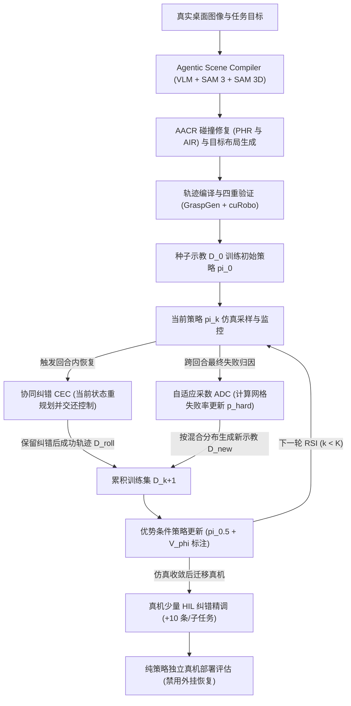

# EmbodiRSI: Recursive Self-Improvement for Data-Efficient Robot Adaptation

## 一句话定义

EmbodiRSI 是一种工作在 Real-to-Sim-to-Real（R2S2R）范式下的智能体递归自提升（RSI）系统，将目标真实桌面重建为可复用的任务级仿真工作空间，并利用策略执行反馈闭环驱动回合内纠错与跨回合定向采数，从而以极低真机采集代价完成操作策略的物理环境自适应。

## 英文缩写速查

| 缩写 | 英文全称 | 简要说明 |
|---|---|---|
| RSI | Recursive Self-Improvement | 递归自提升：策略执行反馈反向决定下一轮获取何种训练经验，使数据分布与策略能力协同演化 |
| R2S2R | Real-to-Sim-to-Real | 实到虚再到实：从真机观测构建任务级仿真进行低成本学习，再迁移并精调回物理机器人 |
| HIL | Human-in-the-Loop | 人在回路精调：在真机部署前由操作员提供少量纠错示教以消除残留执行误差 |
| AACR | Agent-Guided Adaptive Collision Rectification | 智能体引导自适应碰撞修复：在保持支撑/包含关系前提下消除重建场景几何穿插 |
| PHR / AIR | Parallel Horizontal Rectification / Adaptive Intra-group Rectification | AACR 的两阶段几何算子，分别负责支撑组间并行水平分离与组内关系感知微调 |
| MCP | Model Context Protocol | 模型上下文协议：外层 OpenClaw 监督器调度各类具身技能模块的标准接口 |

## 为什么重要

1. **解决自适应阶段的“分布漂移”盲区**：通用 VLA（如 $\pi_{0.5}$）迁移到新桌面时，不同训练阶段暴露出的短板会随策略更新而转移；静态一次性生成或遥操作采集的数据集无法针对当前策略的新脆弱状态补充样本。
2. **打通“观测失败”到“获取有效经验”的闭环**：把传统仅作一次性预处理的 Real2Sim 场景保留为长期可复用训练工作空间，在同一套物体与任务接口上统一支撑种子示教生成、评估诊断、失败恢复与困难配置重采。
3. **显著压低真机数据成本**：通过两轮仿真 RSI 与极少量（每子任务 10 条）真机 HIL 纠错，在 14 个桌面双臂子任务上超越每子任务 200 条纯真机示教基线，将物理数据开销降至约 1/20。

## 核心信息

| 字段 | 内容 |
|---|---|
| 论文标题 | *EmbodiRSI: Recursive Self-Improvement for Data-Efficient Robot Adaptation* |
| 作者 | Haoran Lang*, Haotao Lu*, Shiyu Sang*, Haoyang Luo, Guo Chen, Qun Li, Jingyi Yu, Ye Shi†, Jingya Wang† |
| 机构 | 上海科技大学（ShanghaiTech University，依据通讯作者邮箱 `wangjingya@shanghaitech.edu.cn`、`shiye@shanghaitech.edu.cn`；arXiv HTML 原文未完整导出机构角标图例） |
| 发表时间 | 2026-09-30 提交 arXiv v1，2026-10-29 更新至 v4（arXiv:2609.38905v4） |
| 论文链接 | [arXiv:2609.38905](https://arxiv.org/abs/2609.38905) / [HTML 全文](https://arxiv.org/html/2609.38905) |
| 项目与代码 | 论文 Reproducibility Statement 声明“The full code for the entire pipeline will be released soon.”；当前未公布独立项目页或 GitHub 代码仓库 |
| 清单分类 | `data.collection` |
| 来源条目 | `survey_ax_2609_38905` |
| 开源状态 | 宣称将开源或未列链接（截至 2026-11-27 未确认公开可运行官方源码） |

## 核心原理

EmbodiRSI 将策略优化 $\pi_k \to \pi_{k+1}$ 与下轮经验分布 $p_{k+1}(c)$ 的更新耦合为递归闭环，每轮维持累积仿真数据集 $\mathcal{D}_k$，由“可复用仿真与轨迹基础设施”和“双时间尺度反馈机制”两部分组成：

1. **智能体驱动的可复用 Real2Sim 场景与轨迹基础设施（§3.1–§3.2, Appendix B）**：
   - **物体级重建与关系保持碰撞修复（AACR）**：输入真实桌面图像 $I_0$（及可选目标图或语言指令），VLM 识别可动物体，SAM 3 分割掩码，SAM 3D 重建带纹理网格得到初始场景 $\mathcal{S}_0 = \{o_T, o_1, \dots, o_N\}$（$o_i=(c_i, m_i, T_i^0)$）。随后将物体按支撑关系划分为组 $\mathcal{G} = \{G_1, \dots, G_K\}$：先用 **PHR** 选定中心根组 $G_r$ 并对无扫掠冲突的其余组批量外移；再用 **AIR** 针对组内关系（同平面支撑水平分离、包含关系垂直调节、插接关系有限倾角调整）消除穿插。最后经粗关系工具（`on-top-of`、`inside`、`beside`）与多视角渲染 critic 迭代细化构建组织后目标场景 $\mathcal{S}_{\mathrm{org}}$。
   - **可重锚定的轨迹编译与四重验证**：轨迹智能体 $\mathcal{A}_{\mathrm{traj}}: (\mathcal{S}_0, \mathcal{S}_{\mathrm{org}}, l) \mapsto (\mathcal{C}, \mathcal{D}_{\mathrm{demo}}, \mathcal{E})$ 编译有序子任务并规划物体空间路径，调用 **GraspGen** 生成 6-DoF 抓取并沿物体路径保持相对变换 $T_{o_i \to g} = (T_{o_i}^0)^{-1} T_{g,i}^0$，由 **cuRobo**（cuRobov2）按前一过渡段末态关节角连续求解无碰撞关节轨迹。仅当满足四重门控 $\operatorname{Accept}(\tau) = V_{\mathrm{mesh}} \land V_{\mathrm{view}} \land V_{\mathrm{motion}} \land V_{\mathrm{exec}}$（扫掠网格碰撞、VLM 多视角评审、序列运动可行性、执行后位姿校验）才以 LeRobot 格式保留，并将路点锚定到源物体或目标锚点以支持重置后重定位：$\widetilde{T}_{ee}^j = T_{r(j)}^{\mathrm{cur}}(\overline{T}_{r(j)})^{-1}\overline{T}_{ee}^j$。

2. **智能体滚动监控器（Agentic Rollout Monitor, §3.3.1）**：
   - 在策略 $\pi_k$ 仿真采样期间，监控智能体结合时间窗 RGB 观测、动作历史与仿真状态 $x_t$ 判定动作语义：
     $$y_t = \mathcal{A}_{\mathrm{RSI}}(o_{t-w:t}, x_t, a_{1:t}, l), \qquad y_t \in \{\texttt{continue}, \texttt{recover}, \texttt{complete}\}$$
   - 触发 `recover` 受置信度、冷却时间、尝试次数上限与“是否已夹持目标物”门控约束，避免打断正常搬运；仿真真值位姿仅供监控与规划工具使用，不输入给策略网络。

3. **回合内：协同纠错（Collaborative Error Correction, §3.3.2）**：
   - 当策略在中间失败状态 $t_f$（如抓偏、滑落、碰撞偏移）触发恢复时，系统暂停仿真推进，把配置中的标称抓取迁移到物体当前位姿：$T_g^{\mathrm{cur}} = T_o^{\mathrm{cur}}(T_o^0)^{-1}T_g^0$。
   - 规划器从机械臂当前关节角生成进入抓取的衔接动作（或接续剩余操作程序），并在完成局部纠错后刷新观测，在门控允许下将控制权交还 $\pi_k$ 继续执行。由此产出的包含“非标称中间态 $\to$ 纠偏动作 $\to$ 最终成功”的轨迹进入 $\mathcal{D}_k^{\mathrm{roll}}$。

4. **跨回合：自适应数据采集（Adaptive Data Collection, §3.3.3, Appendix A.2）**：
   - 本轮采样结束后，智能体将最终失败（**纠错后成功的回合不计入失败分子**）归因至源物体重置、目标锚点重置或两者皆非，并将物体重置平面位置归一化到网格 $u^s(x,y) \in [0,1]^2$，计算各网格单元归因失败率 $\widehat{r}_{k,b}^s = U_{k,b}^s / N_{k,b}^s$。
   - 筛选观测数与归因失败数达标且失败率高于全局均值的网格，映射回世界坐标重置区间（必要时含偏航角范围）形成困难分布 $p_{\mathrm{hard},k}(c)$，并与初始分布混合采样生成下一批验证示教 $\mathcal{D}_k^{\mathrm{new}}$：
     $$p_{k+1}(c) = (1 - \alpha)\, p_0(c) + \alpha\, p_{\mathrm{hard},k}(c), \qquad 0 \le \alpha \le 1$$

5. **优势条件策略更新与 MCP 监督编排（§3.3.4, Appendix A.3）**：
   - 合并累积数据 $\mathcal{D}_{k+1} = \mathcal{D}_k \cup \mathcal{D}_k^{\mathrm{roll}} \cup \mathcal{D}_k^{\mathrm{new}}$（实验阶段仅保留最终完成任务的轨迹用于训练，失败轨迹仅用于失败归因）。
   - 采用基于 $\pi_{0.5}$ 骨干的 RECAP 式优势条件训练：以同骨干价值模型 $V_\phi$ 计算 $n=50$ 步价值差（$R_t^{(n)}=0$）$\widehat{A}_t^{(n)} = V_\phi(o_{t+n}, l) - V_\phi(o_t, l)$，将二值优势标签 $z_t = \mathbb{I}[\widehat{A}_t^{(n)} > \delta]$ 以文本形式拼入条件，最小化行为克隆损失 $\mathcal{L}_\pi(\theta) = \mathbb{E}[\ell_{\mathrm{BC}}(\pi_\theta(\cdot \mid o_t, l, z_t), a_t)]$。
   - 外层由基于 **OpenClaw** 的监督器通过 **MCP** 接口调度 7 类有类型技能（场景构建、采集、抓取、配置、运动合成、训练、评测），维护持久化工作流状态并按依赖门控定位局部修复上游失效步骤。仿真 RSI 完成后，再以每子任务 10 条真机 HIL 轨迹对选定策略进行同公式精调。

## 流程总览

## 源码运行时序图

**不适用**（截至 2026-11-27，arXiv:2609.38905v4 仅在 Reproducibility Statement 中说明“The full code for the entire pipeline will be released soon.”，论文及公开索引未提供可访问的官方代码仓库或可运行入口文件）。

## 实验与评测

实验平台为 14-DoF 双臂 ALOHA（头相机 + 双腕相机 RGB，14 维关节与夹爪状态），策略骨干初始化自 $\pi_{0.5}$，智能体系统基于 GPT-5.5，仿真平台为 Isaac Sim。共在 **3 个配对桌面场景、14 个子任务**（S1 Office 6 个、S2 Kitchen 4 个、S3 Household 4 个）上训练每场景统一的多任务策略；所有最终评估均完全禁用智能体接管、规划器恢复与人工介入（物理测试每子任务 10 次自主实验，共 140 次/组；仿真测试采用独立随机重置评估）。

### 1. 跨轮次自主仿真演化（Table E.1，场景均衡成功率 %）

| 场景（子任务数） | R0（50 条/任务） | R1（200 条/任务） | R2（400 条/任务） | 典型高提升子任务示例（R0 → R2） |
|---|---:|---:|---:|---|
| S1: Office Table（$n=6$） | $28.2 \pm 11.4$ | $49.0 \pm 15.8$ | $74.4 \pm 9.7$ | 黑笔入笔筒：$14.0\% \to 76.5\%$；鼠标放垫：$33.3\% \to 85.1\%$ |
| S2: Kitchen Table（$n=4$） | $70.3 \pm 26.1$ | $84.5 \pm 8.2$ | $90.8 \pm 7.8$ | 茄子入篮：$32.3\% \to 82.5\%$；胡萝卜入篮：$90.0\% \to 98.6\%$ |
| S3: Household Table（$n=4$） | $52.7 \pm 18.8$ | $78.5 \pm 11.0$ | $85.4 \pm 8.7$ | 零食袋上架：$28.6\% \to 75.5\%$；糖纸入罐：$48.0\% \to 82.0\%$ |
| **三场景均衡均值** | **50.4** | **70.7** | **83.5** | 全部 14 个子任务均从 R0 到 R2 单调提升 |

*数据预算分配（Table D.2）：R0 为 50 条初始生成示教；R1 新增 100 条新示教 + 50 条监控/纠错衍生轨迹；R2 再新增 100 条新示教 + 100 条监控/纠错衍生轨迹。*

### 2. 等轨迹预算消融：自适应闭环 vs. 静态仿真采集（Table 1, E.3–E.5）

在初始较难的 S1 与 S3 场景下共享同一份 50 条种子示教、匹配累计保留轨迹数（200 与 400 条/子任务）进行对照：

| 对比维度（S1 + S3 场景均衡 %） | Static 静态采集（400 条） | EmbodiRSI 自适应（400 条） | 增益（pp） | 备注 |
|---|---:|---:|---:|---|
| 仿真自主成功率 | 59.3 | **79.9** | **+20.6** | 200 条预算时亦为 63.8% vs. 49.4%（+14.4 pp） |
| R2S2R 零样本真机成功率 | 46.3 | **59.2** | **+12.9** | 400 条 S1+S3 真机未精调迁移 |
| R2S2R + 10 条真机 HIL 后 | 67.9 | **82.1** | **+14.2** | 自适应优势在叠加 HIL 后仍完整保留 |

*细粒度例外说明（E.3）：在 10 个子任务中，S3 的笔袋入铁盒任务静态采集在仿真上略高（400 条时 97.2% vs. 96.0%）；而在 S1 鼠标放垫任务上，静态采集随数据翻倍反而从 67.6% 退化至 59.1%，EmbodiRSI 则提升至 85.1%。*

### 3. 真机数据效率对比（Table 2, E.2，场景均衡自主真机成功率 %）

| 训练设定（每子任务保留轨迹数） | S1 Office（$n=6$） | S2 Kitchen（$n=4$） | S3 Household（$n=4$） | 三场景均衡均值 |
|---|---:|---:|---:|---:|
| R1（200 仿真 + 0 真机） | $43.3 \pm 22.5$ | $60.0 \pm 8.2$ | $52.5 \pm 9.6$ | 51.9 |
| R1+10（200 仿真 + 10 真机 HIL） | $63.3 \pm 13.7$ | $82.5 \pm 5.0$ | $75.0 \pm 17.3$ | 73.6 |
| R2（400 仿真 + 0 真机） | $53.3 \pm 32.0$ | $70.0 \pm 14.1$ | $65.0 \pm 12.9$ | 62.8 |
| **R2+10（400 仿真 + 10 真机 HIL）** | **$81.7 \pm 13.3$** | **$85.0 \pm 12.9$** | **$82.5 \pm 9.6$** | **83.1（116/140）** |
| Real-only 10（纯真机 10 条） | $13.3 \pm 13.7$ | $45.0 \pm 5.8$ | $20.0 \pm 8.2$ | 26.1 |
| Real-only 100（纯真机 100 条） | $56.7 \pm 15.1$ | $62.5 \pm 5.0$ | $52.5 \pm 5.0$ | 57.2 |
| Real-only 200（纯真机 200 条） | $70.0 \pm 6.3$ | $77.5 \pm 9.6$ | $77.5 \pm 9.6$ | 75.0 |

## 与其他工作对比

1. **对比纯静态 R2S2R 管线（如 RialTo、Re3Sim、RoboSimGS 等）**：传统 Real2Sim2Real 多在重建后一次性生成固定示教集；EmbodiRSI 把仿真环境保留为跨轮可复用的“练习场”，使生成分布随策略当前薄弱环节动态演进，在同等 400 条轨迹下真机精调后高出 14.2 个百分点。
2. **对比经验自提升与纠错学习工作（[RoboCat](paper-agentic-2306-11706.md)、[SOAR](paper-agentic-2407-20635.md)、[RECAP / $\pi_{0.6}^*$](paper-rcl-2511-14759-0-6-a-vla-that-learns-from-experience.md)、[RoboClaw](paper-agentic-2603-11558.md)、[RISE](paper-sa-2602-11075-rise-self-improving-robot-policy-with-compositio.md)）**：
   - $\pi_{0.6}^*$（RECAP）提出了通过价值模型进行优势条件训练的学习公式（EmbodiRSI 直接复用该训练范式）；EmbodiRSI 重点补齐了“如何利用智能体在 R2S2R 中低成本产生靶向经验”——同时耦合回合内（CEC）与跨回合（ADC）反馈，而不改动底层策略训练算法。
   - RoboCat、RoboClaw 等主要在物理真机或既有环境循环采数，物理重置与人工干预代价较高；EmbodiRSI 先在重建仿真中完成两轮低成本自迭代，再将真机 HIL 压低至每任务 10 条。
   - RISE 依赖学习得到的组合世界模型做想象滚出（imagined rollouts），而 EmbodiRSI 基于显式 3D 网格重建与物理引擎（Isaac Sim + cuRobo）提供精确几何碰撞验证与可重锚定抓取规划。
3. **对比纯真机数据扩展（Real-only 200）**：真实操作员即使遵循 SOP，仍会在位姿覆盖、运动风格上存在隐式偏置；EmbodiRSI 借助网格化失败率统计强制补全边缘困难位姿，并借助少量真机 HIL 专门修补窄开口放置（如红笔入盒从零样本 2/10 升至 7/10）与近接触误差。

## 结论

**一句话总判：在低成本任务级仿真中把“回合内失败状态纠错”与“跨回合困难配置重采”闭环耦合，是把 VLA 自适应所需物理示教压低一个数量级以上的关键工程杠杆。**

1. **不要把 Real2Sim 仅当作一次性数据生成器**：保留场景对象身份与锚点化路点接口（$\widetilde{T}_{ee}^j$），才能在后续轮次零成本复用于监控诊断、中间态恢复和困难区域加采。
2. **固定预算下“采集什么”比单纯“堆更多随机数据”更重要**：在 S1+S3 的 400 条等预算对比中，自适应采样带来了 +20.6 pp 仿真收益与 +14.2 pp 精调后真机收益，甚至避免了静态扩增引发的单任务退化。
3. **区分“训练期智能体协助”与“测试期自主策略能力”**：EmbodiRSI 仅在采集期使用 VLM 监控和规划器恢复，评估时完全禁用外挂接管，从而验证模型自身学到了重试与抗偏移能力（如抓取不稳后的自主二次尝试）。
4. **仿真 RSI 与少量真机 HIL 分工明确**：仿真 RSI 解决长程任务语义对齐与大范围位姿覆盖（R2 已达 62.8% 零样本真机），最后的 10 条真机 HIL 则高效消化了物理接触摩擦与窄容器公差等 Sim2Real 残差（跃升至 83.1%）。

## 工程实践

- **系统栈选型**：前段重建依赖 VLM + SAM 3 + SAM 3D，碰撞修复依赖 AACR（PHR/AIR），抓取与运动规划依赖 GraspGen + cuRobo（cuRobov2），仿真引擎为 Isaac Sim，外层以 OpenClaw + MCP 编排，示教数据统一存储为 LeRobot 格式；策略初始化自 $\pi_{0.5}$。
- **监控防误触门控**：在线滚动监控器必须在恢复触发前校验置信度、冷却步数、每回合恢复预算及物体持握状态，避免在策略正常搬运途中强行接管；同时仿真推进在 VLM 诊断与规划期间需同步暂停，确保规划起始关节态与环境严格一致。
- **采集数据过滤边界**：尽管优势条件公式兼容失败数据，论文实测阶段仅保留**最终完成任务**的轨迹（含中途触发纠错后成功的轨迹）进训练集，纯失败回合只写入归因统计而不直接用于策略克隆，防止不良行为被直接模仿。
- **测试时自主性隔离**：部署和验收阶段务必关闭一切在线 VLM 恢复器或规划器兜底，防止把外挂系统性能误算为策略泛化能力。

## 局限与风险

1. **未包含消融归因与跨场景零样本泛化评测**：论文 §5 明确指出当前为系统级研究，尚未给出 CEC、ADC 与智能体推理各模块的独立消融定量拆解，也未在未参与构建的保留桌面（held-out workspaces）上验证跨场景迁移及更多轮次（$R>2$）的持续增益上限。
2. **计算与模型依赖重、源码尚未公开**：系统串联了 GPT-5.5 级别 VLM、SAM 3、SAM 3D、GraspGen、cuRobo、Isaac Sim 与 $\pi_{0.5}$ 训练管线，单次多智能体协同与多视角渲染评审的推理时延与算力开销较大，且截至 2026-11-27 官方代码尚未开源，复现门槛较高。
3. **物理动力学与形变建模边界**：实验任务虽含部分软袋/包装纸，但 Real2Sim 资产以刚体带纹理网格为主，高度依赖高精密接触、复杂形变或液体的操作仍需依赖后段真机 HIL 弥补。
4. **真机测试样本量限制**：每子任务真实测试固定为 10 次独立回合（总计 140 次/设定），论文附录给出了 95% Wilson 置信区间并提醒注意小样本方差；此外每场景 14 个子任务均为独立评测，尚未评估连续长程多步骤桌面整理串联。

## 关联页面

- [Agentic Robots 综述](paper-towards-agentic-robots-survey.md)
- [全量项目节点清单](../overview/awesome-agentic-robots-node-index.md)
- [VLA 方法背景](../methods/vla.md)
- [机器人策略学习流程](../methods/robot-policy-learning.md)：对照相关方法与适用场景
- [Sim2Real 迁移工作流](../methods/sim2real-transfer-workflow.md)：理解 R2S2R 中仿真到真机的迁移与 HIL 收口定位
- [机器人仿真场景生成](../methods/robot-simulation-scene-generation.md)：对照 SAM 3D 重建与 AACR 场景编译链路
- [人机协同混合模仿学习（HIL）](../methods/hil-hybrid-imitation-learning.md)：理解 R2+10 阶段真机少量纠错精调的设计依据
- [Agentic Manipulation Policies](../methods/agentic-manipulation-policies.md)：对照智能体驱动的操作数据生成与自提升范式
- [双臂操作任务](../tasks/bimanual-manipulation.md)与[通用操作任务](../tasks/manipulation.md)
- [π0.5：具备开放世界泛化能力的 VLA](paper-pi05-open-world-vla.md)：EmbodiRSI 所采用的底层策略与价值骨干初始化来源
- [π0.6* (RECAP)：从经验中学习的 VLA](paper-rcl-2511-14759-0-6-a-vla-that-learns-from-experience.md)：EmbodiRSI 策略更新阶段所复用的优势条件训练公式来源

## 推荐继续阅读

- [EmbodiRSI arXiv 原文与 HTML 版本](https://arxiv.org/abs/2609.38905)
- [π0.6* (RECAP): A VLA That Learns From Experience](https://arxiv.org/abs/2511.14759)
- [cuRobov2: Dynamics-Aware Motion Generation with Depth-Fused Distance Fields](https://arxiv.org/abs/2603.05493)

## 参考来源

- [EmbodiRSI 论文全文精读归档](../../sources/papers/paper-agentic-2609-38905.md)
- [官方 Awesome 快照归档](../../sources/repos/awesome-agentic-robots-survey-index.md)
- [论文官方入口（arXiv:2609.38905v4）](https://arxiv.org/abs/2609.38905)
- [论文 HTML 全文（arXiv:2609.38905）](https://arxiv.org/html/2609.38905)
