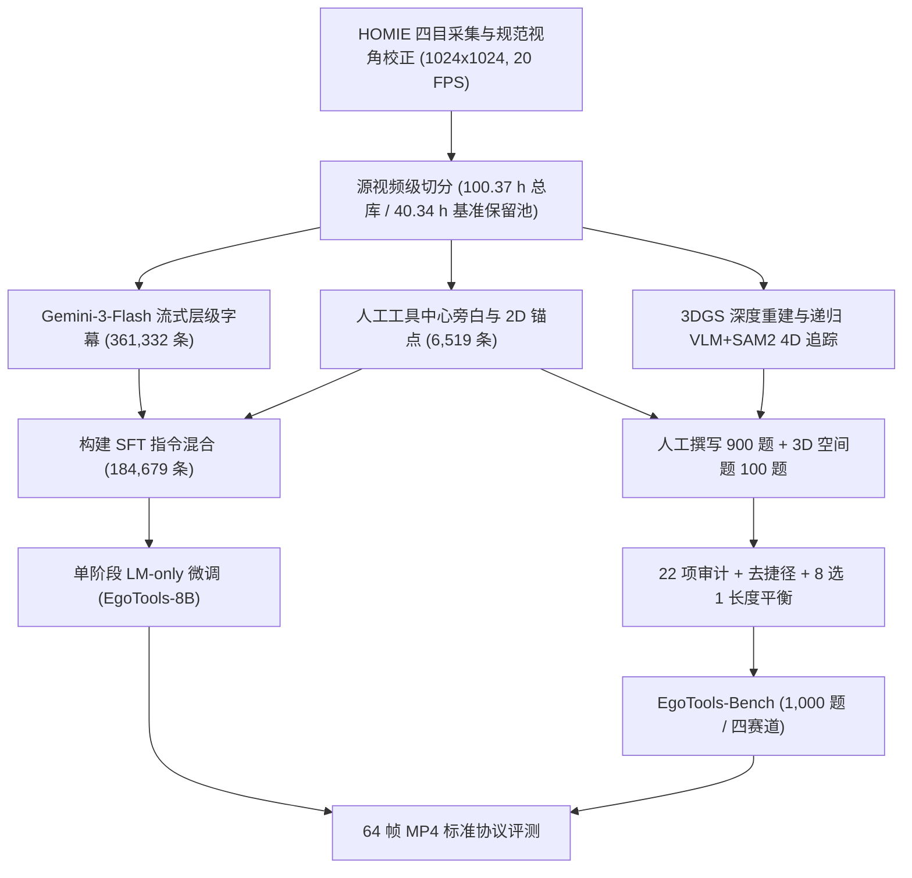
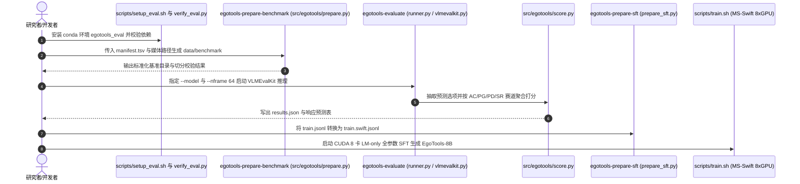

# EgoTools: Towards Tool-Centric Reasoning in Real-World Egocentric Videos

## 一句话定义

**EgoTools** 是由南洋理工大学 S-Lab 等机构联合提出的真实世界第一人称（egocentric）工具中心推理研究套件，包含 **100.37 小时**多模态语料 **EgoTools-Data**、**1,000 题**四赛道诊断基准 **EgoTools-Bench**，以及在源视频严格隔离下监督微调得到的参考模型 **EgoTools-8B**。

## 英文缩写速查

| 缩写 | 英文全称 | 简要说明 |
|---|---|---|
| AC | Affordance & Causality | 基准赛道之一（363 题）：评测工具可供性、选型替代理由与因果结果 |
| PG | Perception & Grounding | 基准赛道之一（236 题）：评测工具/目标实体、属性、接触与局部状态定位 |
| PD | Procedural Dynamics | 基准赛道之一（222 题）：评测工具使用流程顺序、步骤切换与状态演进 |
| SR | Spatial Reasoning | 基准赛道之一（179 题）：评测手–工具–目标物体间的 3D 位置、对齐与空间关系 |
| 3DGS | 3D Gaussian Splatting | 用于将 HOMIE 多视角原始几何重建为时空一致深度图的 3D 场景表示方法 |
| SFT | Supervised Fine-Tuning | 单阶段监督微调范式，本文仅更新 Qwen3-VL-8B-Instruct 的语言模型参数 |

## 为什么重要

- **填补「以工具为中心」的第一人称推理评测与监督缺口：** 现有第一人称数据集（如 EPIC-KITCHENS-100、Ego4D、Ego-Exo4D）与视频问答基准（如 EgoSchema、EgoPlan-Bench、EgoThink）多围绕宏观活动或手部动作组织，往往只标注「cook eggs」而忽略铲子与平底锅的选择依据、接触约束和物理状态改变。
- **揭示多模态大模型的精细视觉定位瓶颈：** 在 8 选 1（随机基线 12.5%）的 **EgoTools-Bench** 上，人类专家自由回看可达 **83.2%**，而闭源模型 Gemini-3.1-Pro 虽总分达 **66.9%**，但在 **PG 赛道仅 51.7%**；开源 7B–8B Instruct 模型整体处于 **38.9%–50.0%**，证明通用活动理解不等于物理工具推理。
- **验证真实工具中心标注的迁移监督价值：** 在严格源视频不重叠前提下，基于 **EgoTools-Data** 构建的 **184,679 条**指令数据可将 Qwen3-VL-8B-Instruct 的 64 帧总准确率从 **50.0% 提升至 60.9%（+10.9 pp）**，同时暴露出单阶段语言侧 SFT 会导致 **SR 赛道下降 11.0 pp** 的明确短板。

## 核心信息

| 项目 | 详细信息 |
|---|---|
| **作者** | Shulin Tian*, Junsu Kim*, Shuai Liu*, Hao Li*★, Yujiao Shen, Sihan Li, Zhe Yang, Yeongon Kim, Feiyu Li, Jialin Wu, Yichi Zhang, Wenhui Wang, Runmao Yao, Yuhao Dong, Zhaoxi Chen★, Fangzhou Hong★, Antonino Furnari, Jingkang Yang, Hongyuan Zhu, Ziwei Liu†★ |
| **机构** | S-Lab (NTU)、A*STAR、KAIST、PKU、FDU、School of Biological Sciences (NTU)、University of Catania（硬件与标注支持：Ropedia） |
| **发表时间** | 2026-09-30 提交 v1，2026-10-02 更新 v2（arXiv:2609.39378v2） |
| **论文链接** | [arXiv:2609.39378](https://arxiv.org/abs/2609.39378) · [arXiv HTML](https://arxiv.org/html/2609.39378) |
| **项目与代码** | [项目页](https://ropedia.github.io/egotools) · [GitHub](https://github.com/Ropedia/egotools) · [Dataset](https://huggingface.co/datasets/ropedia-ai/egotools-data) · [Model](https://huggingface.co/ropedia-ai/egotools-8b) |
| **清单分类** | `data.annotation` |
| **来源条目** | `survey_ax_2609_39378` |
| **开源状态** | **部分开源（官方代码仓已开源，数据/资产分批发布）：** `Ropedia/egotools` 已提供评测、SFT 数据准备与训练脚本（许可证标为 pending）；原始鱼眼流与内部预处理工具不公开，原声旁白音频、精标定位与 3D 轨迹随隐私审查分批发布，且 README 说明完整论文实验尚未仅凭公开发布资源全部复现 |

## 核心原理

### 1. 数据采集、视角校正与源视频隔离
- **硬件与规范视角：** 使用 Ropedia 的头戴式多模态设备 **HOMIE** 采集 4 路同步鱼眼视频、音频及运动/同步信号；选取前左视角经几何校正为规范第一人称视角（附录 D.1 示例参数：输出 `1024×1024`、20 FPS、zoom `0.78125`、FOV `90.0°`、pitch `-5.0°`、yaw/roll `0.0°`），保留手–工具–物体交互区及同步音频。
- **双模式采集（646 段视频，100.37 小时）：** 覆盖 7 个现实场景（Kitchen 32.37 h / 276 段、Research Lab 30.92 h / 61 段、Repair Workshop 12.34 h / 84 段、Craft 10.17 h / 67 段、Classroom 6.86 h / 74 段、Household 4.88 h / 54 段、Office 2.83 h / 30 段）。其中**结构化任务引导**设定明确步骤边界与状态变化，**开放式参与者驱动**则捕捉即兴选具、工具替换与失败恢复行为。
- **源视频级硬切分：** 在构建任何训练样本或基准题目之前，从全库划分 **40.34 小时**高工具密度视频作为基准专用池，确保训练集与 **EgoTools-Bench** 在视频、片段、字幕、旁白与衍生标注上**零重叠**。

### 2. 层级文本标注与 3DGS + 递归 VLM 追踪
- **流式层级稠密字幕（361,332 条）：** 利用 Gemini-3-Flash 将长视频切分为 5 分钟片段（每段均匀采样 32 帧生成全局上下文），再以 5 秒为单位顺序滑动生成字幕（首块参考全局上下文、后续块以前一块字幕作为时序记忆），并配合关键帧物体识别做幻觉核查，最终聚合为 1 分钟窗口与 5 分钟摘要。
- **工具中心旁白（6,519 条）：** 围绕决定性工具交互瞬间，采集者按参考模板记录「工具属性 + 选定工具 + 可行替代工具 + 动作与目标对象 + 物理/流程原因」，支持英/韩/中三语并统一翻译润色为英文；选定片段同时在关键帧标注 2D 工具/目标点锚点。
- **3D 重建与 4D 物体追踪：** 借鉴 Holi-Spatial 管线，基于 HOMIE 原始深度与位姿训练 **3DGS** 以消除漂浮伪影并渲染时空一致的逐帧深度；利用旁白 2D 锚点初始化 **SAM2** 掩码传播，引入 VLM 周期校验语义与追踪漂移（发现漂移即重初始化 SAM2），最终借助深度与相机位姿将 2D 掩码提升为 3D 包围盒与长时程 4D 轨迹。

### 3. 184,679 条 SFT 语料与 1,000 题诊断基准构建
- **SFT 训练混合（184,679 条，仅来自非基准池）：** 包括直接监督四赛道的 69,760 条（37.8%：AC 14,175、PG 14,755、PD 22,943、SR 17,887）、片段级多选 69,554 条（37.7%，含 5,000 条配合当前帧的下一步动作预测）、通用视频 QA 31,281 条（16.9%）、稠密字幕与旁白补全 9,084 条（4.9%），以及单图开放问答 5,000 条（2.7%）。
- **单阶段训练机制：** 以 Qwen3-VL-8B-Instruct 为底座，**冻结视觉编码器与多模态投影器，仅全参数微调语言模型部分**，每段训练视频固定以 2 FPS 目标采样率均匀抽取 64 帧。
- **EgoTools-Bench 质量控制：** 1,000 题由 **900 道人工编写题**（基于 ≥3 分钟局部窗口，平均剪辑时长 **4.19 分钟**）与 **100 道经人工核验的 3D 空间题**组成，统一规整为 8 选 1 单选题（随机猜测 **12.5%**）。全部题目经过 22 项结构审计、Gemini-2.5-Flash-Lite（`temperature=0`）最小原意修复、去文本捷径与选项长度偏差校验（标准长度偏离 $z = (L_{\mathrm{ans}}-\mu_{\mathrm{dist}})/\sigma_{\mathrm{dist}}$ 全部约束在 $|z|\le 1.5$，全库均值 $\bar{z}\approx -0.15$）以及基于 ID 种子的确定性选项打乱。

## 流程总览

## 源码运行时序图

官方仓库 [Ropedia/egotools](https://github.com/Ropedia/egotools)（归档见 [sources/repos/paper-agentic-2609-39378.md](../../sources/repos/paper-agentic-2609-39378.md)）通过 `pyproject.toml` 注册 `egotools-prepare-benchmark`、`egotools-evaluate` 与 `egotools-prepare-sft` 三个 CLI 入口，分别衔接 VLMEvalKit 评测与 MS-Swift 8 卡训练；需注意仓库 README 明确说明完整论文实验尚未仅用当前公开发布资源全部复现。

## 实验与评测

### 1. EgoTools-Bench 主结果与跨基准对比（Table 2 & Table 3）

所有 8 选 1 多选题的随机基线均为 **12.5%**；音频列标注为仅输入同步环境音频（绝不输入旁白、字幕或元数据）。

| 模型 / 人类基线 | 输入帧数 | 音频 | AC (%) | PG (%) | PD (%) | SR (%) | EgoTools Overall (%) | EgoSchema (%) | EgoPlan (%) | EgoThink (%) |
|---|---:|:---:|---:|---:|---:|---:|---:|---:|---:|---:|
| **Human Expert** | Free-view | ✓ | 82.1 | 85.2 | 83.3 | 82.7 | **83.2** | ~76 | – | – |
| **Gemini-3.1-Pro** | 1 fps | ✓ | 69.7 | 51.7 | 72.1 | 74.9 | **66.9** | – | – | – |
| **Gemini-3-Flash** | 1 fps | ✓ | 64.5 | 50.0 | 73.0 | 72.6 | **64.4** | – | – | – |
| **Gemini-3.1-Flash-Lite** | 1 fps | ✓ | 58.1 | 44.5 | 59.9 | 58.7 | **55.4** | – | – | – |
| **GLM4.1V-Thinking** | 64 | ✗ | 46.1 | 50.0 | 57.1 | 53.3 | **50.7** | 66.1 | 25.3 | 62.7 |
| **Qwen3-VL-8B-Instruct** | 64 | ✗ | 46.1 | 45.9 | 57.1 | 55.4 | **50.0** | 69.0 | 42.3 | 61.0 |
| **InternVL3.5-8B-Instruct** | 64 | ✗ | 45.8 | 45.9 | 53.4 | 53.3 | **48.7** | 63.8 | – | 56.0 |
| **Qwen2.5-Omni-7B-Instruct** | 64 | ✓ | 44.7 | 45.9 | 51.8 | 46.7 | **47.1** | 65.2 | – | 58.9 |
| **InternVL3-8B-Instruct** | 64 | ✗ | 44.7 | 44.9 | 51.8 | 48.9 | **47.1** | 69.6 | – | 59.4 |
| **Qwen3-VL-8B-Thinking** | 512 | ✗ | 43.6 | 41.8 | 48.2 | 55.4 | **45.7** | 70.3 | 43.6 | 62.0 |
| **Qwen3-VL-4B-Instruct** | 64 | ✗ | 41.7 | 45.4 | 50.2 | 50.0 | **45.7** | 69.6 | 42.0 | 61.9 |
| **MiMo-VL-7B-RL** | 64 | ✗ | 43.1 | 45.9 | 50.6 | 39.1 | **45.3** | 57.0 | 36.6 | 59.4 |
| **Qwen2.5-VL-7B-Instruct** | 64 | ✗ | 40.1 | 43.3 | 50.2 | 47.8 | **44.3** | 61.0 | 32.0 | 57.7 |
| **LLaVA-OneVision-7B** | 64 | ✗ | 37.6 | 37.1 | 42.9 | 37.0 | **38.9** | 63.4 | – | 54.9 |
| **EgoTools-8B（Ours，SFT）** | 64 | ✗ | **55.4** | **59.7** | **68.1** | 44.4 | **60.9** | 67.6 | 35.2 | **64.0** |

### 2. 消融实验、显隐式线索与信度验证
- **输入证据消融（Table 4，Qwen3-VL-8B-Instruct 预抽帧列表协议）：**
  - Ordered 64 frames：**51.7%**（AC 47.4 / PG 50.0 / PD 57.1 / SR 57.6）
  - Shuffled 64 frames：**49.3%**（AC 45.5 / PG 47.4 / PD 53.9 / SR 56.5）——PD 受时序打乱影响最大（-3.2 pp），SR 仅下降 1.1 pp
  - Middle frame（单帧）：**46.9%**（AC 44.7 / PG 45.9 / PD 51.0 / SR 45.7）——SR 相对有序 64 帧暴跌 **11.9 pp**，说明空间题依赖跨时刻多视角整合
  - Text-only（纯文本）：**42.7%**（AC 39.0 / PG 36.1 / PD 51.4 / SR 47.8）——PG 对视觉证据依赖最强（+13.9 pp）
- **显式 vs 隐式工具线索（Table 5）：** 当题干显式点明工具线索时模型显著更易答对（Gemini-3.1-Pro：**72.9% vs 65.2%**，+7.7 pp；Gemini-3-Flash：**68.0% vs 63.1%**，+4.9 pp；Qwen3-VL-8B-Instruct：**53.1% vs 49.1%**，+4.0 pp；Qwen3-VL-8B-Thinking 几乎无差异：**45.2% vs 45.8%**，-0.6 pp）。
- **模型家族错误重叠（Figure 6）：** Qwen3-VL-8B-Instruct 与 Thinking 错误 Jaccard 重叠高达 **0.63**，Gemini Pro 与 Flash 为 **0.53**，而 Gemini Pro/Flash 与 Qwen3-VL-8B 跨族重叠仅 **0.35–0.38**。
- **独立信度核验（§3.4）：** 250 题分层抽样（含 100 题 AC）由 5 位非出题评审交叉盲评（共 500 判定），与原答案一致率 **89.8%**（AC 86.5%），双评审一致率 **88.4%**，**94.4%** 判定存在唯一视觉支持的正确答案；其余 5.6%（14 题）已人工修订或替换。

## 与其他工作对比

| 资源 / 基准 | 场景与时长 | 规模 (#QA) | 多环境 | 工具中心旁白 | 旁白关联工具定位 | 工具选型与替代推理 |
|---|---|---:|:---:|:---:|:---:|:---:|
| **EPIC-KITCHENS-100** | Kitchen · 100 h | – | ✗ | ✗ | ✗ | ✗ |
| **Ego4D / Ego-Exo4D** | Real-world / Skilled · 3,670 h / 1,286 h | 14.5 K / – | ✓ | ✗ | ✗ | ✗ |
| **HOI4D / Assembly101 / MECCANO** | Indoor HOI / Assembly / Industrial | – | ✗ | ✗ | ✗ | ✗ |
| **EgoSchema / EgoPlan-Bench / EgoTempo** | 第一人称长视频 / 规划 / 时序 | 5,031 / 4,939 / 500 | 部分 | ✗ | ✗ | ✗ |
| **RoboVQA / OpenEQA / RoboCasa365** | 机器人演示 / 室内 EQA / 仿真厨房 | 829 K / 1.6 K / – | 部分 | ✗ | ✗ | ✗ |
| **EgoTools（本文）** | **7 类真实工具场景 · 100.37 h** | **1,000（8 选 1）** | **✓** | **✓（6,519 条）** | **✓（2D→3D/4D）** | **✓（4 赛道）** |

- 相比 [VLA 方法](../methods/vla.md) 与机械臂演示数据集（如 RoboVQA、RoboCasa365），EgoTools 聚焦人类自然视角下的真实工具选择、即兴替代与物理状态演变，为具身策略与世界模型补充「为何选用该工具及物理因果结果」的高阶语义监督。
- 相比 **EgoSchema** 等通用第一人称长视频基准，EgoTools 将评测锚定在工具中介的物理接触与状态变化上，证明在 EgoSchema 达到近 70% 的开源模型在 **PG 定位赛道**仍可能跌破 46%。

## 结论

**一句话总判：EgoTools 用 100 小时真实多域采集与工具中心因果旁白证明，当前多模态大模型在第一人称工具推理上卡在「精细视觉定位（PG）」而非语言常识，且仅靠冻结视觉编码器的单阶段语言 SFT 虽能大幅拉高工具感知与流程推理，却会损伤三维空间推理（SR）。**

1. **PG 才是多模态视频模型的核心短板：** 即便 Gemini-3.1-Pro 总分达 66.9%，其 PG 仅 51.7%（低于 AC/PD/SR 约 18–23 pp），开源 Instruct 模型 PG 普遍在 35.6%–45.9%，说明看清「哪把工具在何时接触了什么并改变何种状态」远难于依靠活动先验猜流程。
2. **「Thinking」模式与单纯堆帧数无法自动解决工具推理：** Qwen3-VL-8B-Thinking（512 帧）总分 45.7% 反而不如 64 帧 Instruct 版本（50.0%），表明未针对精细工具接地优化的长思维链反而可能放大视觉幻觉或偏移。
3. **EgoTools-Data 监督迁移有效，但不能替代视觉/几何表征微调：** EgoTools-8B 在严格源视频隔离下总分跃升 +10.9 pp（PG +13.8、PD +11.0、AC +9.3），但冻结视觉塔的语言侧 SFT 导致 SR 下滑 11.0 pp（55.4%→44.4%），提示后续需解冻视觉侧或引入显式 3D/空间训练信号。
4. **切勿忽略文本先验残余与领域长尾：** Text-only 基线仍有 42.7%（显著高于 12.5% 随机），且基准 83.7% 题目集中在 Kitchen 域，解读分数时应重点看「多帧/有序视觉增益」与四赛道分解而非按领域平均外推。

## 工程实践

- **微调超参配方（Appendix H.1）：** 基于 `Qwen3-VL-8B-Instruct`，冻结视觉编码器与多模态投影器、仅全量更新 LLM 参数；使用 AdamW（常数学习率 `2.3e-6`、无 warmup）、1 epoch、8×GPU（per-device batch 1 × 梯度累积 16 = 有效 batch 128，共 1,443 步）、`bfloat16` + DeepSpeed ZeRO Stage 3 + FlashAttention + gradient checkpointing；输入固定为 64 帧（2 FPS 目标采样，单帧上限 1,024 visual tokens，最大序列长度 8,192）。
- **标准评测与代码入口（`Ropedia/egotools`）：**
  1. `bash scripts/setup_eval.sh && conda activate egotools_eval`，并用 `scripts/verify_eval.py` 校验环境。
  2. `egotools-prepare-benchmark --manifest /path/to/manifest.tsv --assets /path/to/media --output data/benchmark` 校验并组装评测目录。
  3. `egotools-evaluate --dataset-root data/benchmark --model Qwen3-VL-8B-Instruct --nframe 64`（或 `--model EgoTools-8B --model-path /path/to/ckpt`），输出四赛道与总分 `results.json`。
  4. `egotools-prepare-sft` 与 `bash scripts/train.sh` 负责将训练 JSONL 转为 MS-Swift 格式并拉起 8 卡训练。

## 局限与风险

- **基准领域极度不均衡：** 尽管全量语料覆盖 7 个场景（含 30.92 h 实验室与 12.34 h 维修车间），**EgoTools-Bench** 中 Kitchen 题占 **837/1,000（83.7%）**，Office（6 题）与 Household（4 题）样本极少，不能直接当作跨专业领域均衡评测集使用。
- **训练配方导致空间能力回退与跨基准折损：** EgoTools-8B 在 SR 赛道由 55.4% 降至 44.4%（-11.0 pp），在 EgoPlan-Bench 由 42.3% 降至 35.2%（-7.1 pp），在 EgoSchema 由 69.0% 微降至 67.6%（-1.4 pp）。
- **文本先验残余与开放权限边界：** 经去捷径与 $|z|\le 1.5$ 长度平衡后，Text-only 仍获 42.7%（高于 12.5% 随机）；同时本研究**未申请正式 IRB 伦理审查**（依赖自愿无偿知情同意与人工隐私筛查），原始鱼眼视频不公开，原声旁白音频、精标工具锚点与 3D 轨迹需分批授权发布；代码仓 README 亦注明全部论文实验尚未仅以公开发布资产完成端到端复现。

## 关联页面

- [具身大模型评测基准选型闭环](../queries/embodied-eval-benchmark-selection-loop.md)：对照评测基准设计与指标选型闭环。
- [Agentic Robots 综述](paper-towards-agentic-robots-survey.md)
- [全量项目节点清单](../overview/awesome-agentic-robots-node-index.md)
- [VLA 方法背景](../methods/vla.md)
- [视觉表征学习](../methods/visual-representation-learning.md)：对照第一人称感知表征与工具接地方法
- [具身智能体评测体系](../methods/embodied-agent-benchmarking.md)：对照四赛道能力诊断与去捷径基准设计
- [机器人学习数据管线](../methods/robot-learning-data-pipelines.md)：对照多模态同步采集、层级字幕与源视频隔离切分
- [视觉三维重建](../methods/visual-3d-reconstruction.md)：对照 3DGS 一致深度重建与 2D→3D 轨迹提升流程
- [机器人操作任务](../tasks/manipulation.md)：对照以工具为中介的物理操作、可供性与状态因果推理

## 推荐继续阅读

- [EgoTools 论文全文（arXiv HTML）](https://arxiv.org/html/2609.39378)
- [EgoTools 官方项目页与 3D Playground](https://ropedia.github.io/egotools)
- [EgoTools 官方代码仓库（GitHub）](https://github.com/Ropedia/egotools)
- [EgoTools-Data 数据集（Hugging Face）](https://huggingface.co/datasets/ropedia-ai/egotools-data)
- [EgoTools-8B 模型权重（Hugging Face）](https://huggingface.co/ropedia-ai/egotools-8b)

## 参考来源

- [EgoTools 原文精读与核对归档](../../sources/papers/paper-agentic-2609-39378.md)
- [EgoTools 官方源码仓库静态核对](../../sources/repos/paper-agentic-2609-39378.md)
- [官方 Awesome 快照归档](../../sources/repos/awesome-agentic-robots-survey-index.md)
- [论文原始入口（arXiv:2609.39378）](https://arxiv.org/abs/2609.39378)
- [项目主页（ropedia.github.io/egotools）](https://ropedia.github.io/egotools)
