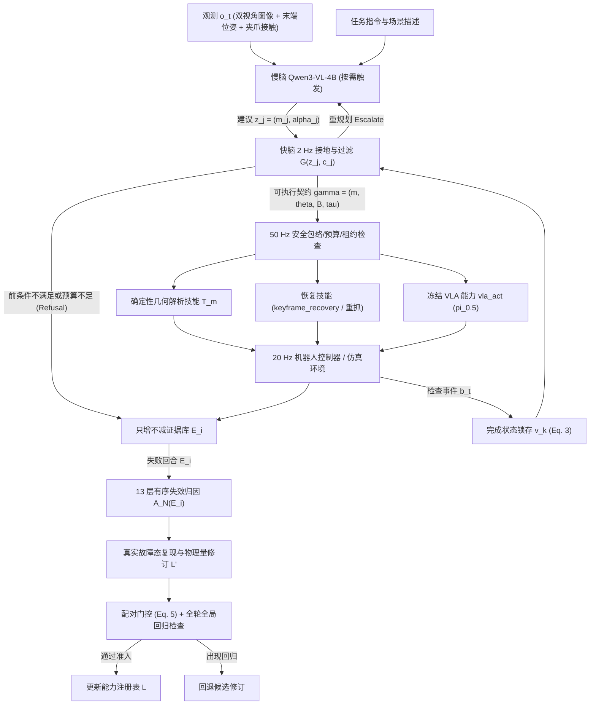

# DynaHarness: A Dynamic Physical Harness for Self-Evolving Robot Agents

## 一句话定义

DynaHarness 是一个面向自演化机器人智能体的**动态物理执行框架（Dynamic Physical Harness）**：它通过统一的物理执行契约（Physical Execution Contract），将按需触发的慢脑语义规划与 2 Hz 确定性快脑物理治理（接地、预算租约约束、状态锁存、显式拒绝与能力替换）耦合在一起，并将全过程执行证据转化为 13 层有序失效归因与配对回归门控驱动的跨回合能力演化。

## 英文缩写速查

| 缩写 | 英文全称 | 简要说明 |
|---|---|---|
| DynaHarness | Dynamic Physical Harness for Self-Evolving Robot Agents | 本文提出的双脑分层物理治理与归因自演化框架 |
| VLA | Vision-Language-Action | 视觉-语言-动作模型；本文中指作为可调用能力接入的冻结 $\pi_{0.5}$ |
| LIBERO-Pro | LIBERO-PRO Perturbed Benchmark | 在 LIBERO 上施加任务改写（T）与物体位置交换（S）扰动的鲁棒性基准 |
| LIBERO-Plus | LIBERO-Plus Robustness Benchmark | 包含视角、初始状态、布局、噪声等 7 类扰动的 10,030 任务评测集 |
| SAM3 | Segment Anything Model 3 | 本文真机实验（UR7e）中用于物体与目标关系识别的视觉分割模型 |
| CI | Confidence Interval | 置信区间；本文配对评测大量采用 Wilson 95% CI 与单元自助法区间 |

## 为什么重要

1. **弥合语义规划与物理交互之间的时间尺度鸿沟：** 现有基于大模型（VLM/LLM）的具身执行框架通常以数秒一次的频率做开环/粗粒度重规划，但物理接触、停滞与成功瞬间往往在百毫秒级发生（例如在 *turn off the stove* 任务中，成功状态仅在控制步 44–55、约 0.55 s 内成立后又被旋回）。DynaHarness 将执行权威下放给 2 Hz 快脑，并以高频状态锁存（latching）保留瞬态成功信号，避免错过终止时机或耗尽回合步数。
2. **用轻量本地 4B 慢脑 + 冻结 VLA 即可稳定跑通长程扰动操作：** 在严格对齐同一本地 `Qwen3-VL-4B` 上层模型与冻结 $\pi_{0.5}$ 策略的 LIBERO-Pro 受控对比中，多个依赖大参数编程/工具智能体的既有框架跌至 0%–20.3%，而 DynaHarness 凭借显式接地、拒绝与几何/恢复/VLA 能力协同达到 **74.25%**（新采样状态 **75.2%**）。
3. **把「回合级失败」转化为「可定位、可回归门控的局部修复」：** 单纯知道“任务失败”无法指明是规划、接地、技能几何还是验证器出错。DynaHarness 通过只增不减的证据存储（evidence store）进行 13 层有序失效归因，并要求每项基于物理量的修订同时通过配对开发集门控与全轮次全局回归检验，有效拦截“局部有效但全局退化”的补丁。

## 核心信息

| 字段 | 内容 |
|---|---|
| 作者 | Haoyuan Deng、Jiebin Liu、Tengxiao Zhang、Langning Yan、Hongye Cao、Ziwei Wang（通讯作者） |
| 机构 | 南洋理工大学（Nanyang Technological University, NTU）、南京大学（Nanjing University, NJU） |
| 发表时间 | 2026-09-30（arXiv:2609.40306v1） |
| 论文链接 | [arXiv:2609.40306](https://arxiv.org/abs/2609.40306) / [HTML v1](https://arxiv.org/html/2609.40306) |
| 项目与代码 | [项目页](https://denghaoyuan123.github.io/Dynaharness_page/) / 仓库链接 `https://github.com/Denghaoyuan123/DynaHarness` |
| 清单分类 | `harness.orchestration, harness.monitoring_and_recovery, harness.layered_systems` |
| 来源条目 | `survey_ax_2609_40306` |
| 开源状态 | **宣称将开源或未公开可访问仓库**：项目页列出了 GitHub 地址 `https://github.com/Denghaoyuan123/DynaHarness`，但截至 2026-11-27 核查尚不可公开访问（`exists: false`）；论文 Reproducibility statement 提及向审稿/评测提供匿名补充材料包（含实现、配置脚本与运行记录） |

## 核心原理

DynaHarness 围绕**多时钟分层控制**、**物理执行契约**与**归因自演化闭环**三部分构建：

1. **多时钟分工（20 Hz 控制 / 50 Hz 安全 / 2 Hz 快脑 / 按需慢脑）：**
   - 系统观测为 $o_t = (I_t, q_t, f_t)$，包含双视角图像、末端执行器位姿、夹爪状态与指尖接触信息；底层环境或控制器以 **20 Hz** 步进（真机伺服 100–1000 Hz 封装在适配器后），底层 **50 Hz** 安全检查持续监督 $2\text{ rad/s}$ 速度包络、租约与预算。
   - **慢脑（Slow Brain，$\Phi, \Pi$）：** 本地部署的 `Qwen3-VL-4B-Instruct` 仅在启动、阶段切换或快脑上报拒绝/无可用能力时**按需调用**（22 通道并发下实测中位耗时 **913 ms**）。它读入自然语言指令 $\ell$、场景描述 $S$、当前观测 $o_t$ 与带时间戳的历史 $h_j$，输出结构化建议：
     $$c_j = \Phi(\ell, S, o_t, h_j), \qquad z_j = \Pi(c_j) = (m_j, \alpha_j), \quad m_j \in \mathcal{L}$$
     慢脑只指定能力名称 $m_j$ 与符号参数 $\alpha_j$（场景实体与目标关系），不直接输出连续空间位姿或高频动作。
   - **快脑（Fast Brain，$G$ 与 2 Hz 调度器）：** 以确定性逻辑在 **2 Hz**（名义 0.5 s 周期，调度函数实测中位耗时 **0.046 ms**）掌握执行权威，负责接地过滤、状态监控与动态路由。

2. **物理执行契约与状态锁存（Eq. 2–3）：**
   - **接地与显式拒绝：** 建议 $z_j$ 通过部分映射 $\gamma_k = G(z_j, c_j) \in \Gamma \cup \{\bot\}$ 绑定可执行命令 $\gamma = (m, \theta, B, \tau)$，其中 $\theta$ 为执行接口解析出的物理几何参数，$B$ 为步数预算，$\tau$ 为租约。若前置条件不满足、目标不可见或剩余预算不足以支撑完成（如单次抓取放置约需 230 步而 LIBERO-Goal 总预算为 300 步），快脑在动作下发前即返回拒绝 $\bot$ 并写入原因，避免空耗预算。
   - **完成状态锁存（Latched Verdict）：** 每次快脑决策周期 $k$ 读取自上次决策以来的全部底层检查集合 $\mathcal{T}_k$，对布尔完成信号 $b_t$ 做锁存累积：
     $$v_k = v_{k-1} \vee \bigvee_{t \in \mathcal{T}_k} b_t, \qquad v_{-1} = \mathrm{false}$$
     一旦任务在动作块执行期间短暂达标，$v_k$ 即保持为真并立刻终止当前命令。
   - **统一封装能力库 $\mathcal{L}$：** 包含三类平等受契约约束的执行体——**确定性几何解析技能** $a_t = T_m(\theta, o_t)$（接近、受保护下降、走廊搬运、放置、推、拉抽屉、旋钮、关门等）、**恢复技能**（如 `keyframe_recovery`、重抓、重对位、释放退避），以及封装冻结 $\pi_{0.5}$ 的 **`vla_act`**（$a_t = \pi(o_t, \ell)$）。冻结 VLA 在本框架中只是一个按预算与租约受控的普通能力，而非全局控制器。

3. **13 层有序失效归因与配对回归自演化（Eq. 4–5）：**
   - 每条回合日志写入只增不减的 evidence store $E_i$（记录观测、能力掩码、拒绝原因、切换动作与终止状态）。
   - **有序归因：** 离线诊断沿 $N=13$ 个有序层级（依次覆盖基础设施、上下文、规划、接地、分发、能力执行、验证与恢复）定位首个触发检验 $d_j(E_i)=1$ 的上游层：
     $$\lambda_i = A_N(E_i) = \min\{j \in \{1, \dots, N\} : d_j(E_i) = 1\}$$
     生成结构化经验三元组 $e_i = (\xi_i, \lambda_i, y_i)$。
   - **物理量探针与两级准入：** 工程师或演化流程从智能体实际停滞的机械臂状态（而非重置初始态）复现故障，以**物理量**（如 15.4 mm 门把手宽度、沿把手偏移 20 mm、闭合阈值、走廊高度、铰链半径）而非任务 ID 特判修改能力库 $\mathcal{L}' = \mathcal{L} \oplus \kappa$。候选修订必须先在配对开发集 $\mathcal{D}$ 上满足 Eq. 5（总成功数不降、harness 归因失败数不增、裸策略原胜单元 $\mathcal{D}_\pi$ 不退化、零污染 $x(\mathcal{L}')=0$），再通过全轮次跨单元回归检查方可合入注册表；未通过者直接回退而非打补丁掩盖。

## 流程总览

## 源码运行时序图

**不适用**（说明核查结果：截至 2026-11-27，项目页所列官方仓库 `https://github.com/Denghaoyuan123/DynaHarness` 尚不可公开访问，未能确认可运行官方源码实现，当前仅公开项目页交互式回合回放与论文中的匿名补充材料说明；注：文献中同时出现的 `PhyAgentOS/PhyAgentOS-core` 为本文评测基线 Liu et al., 2026b 的代码库，并非 DynaHarness 官方源码）。

## 实验与评测

本文主要在 **LIBERO-Pro**（Goal-T、Goal-S、10-T、10-S 四单元各 10 任务 × 20 种子 = 800 局）、**LIBERO-Plus**（10,030 任务）、**标准 LIBERO**（2,000 局）以及 **UR7e 真机平台** 上开展评测；所有对比均统计全部分母（基础设施掉线亦计为失败）。

### 1. LIBERO-Pro 主评测与受控基线对比（Table 1，开发种子 21–40，800 局）

| 方法 | 上层 VLM | 低层策略 | Goal-T | Goal-S | 10-T | 10-S | Avg. |
|---|---|---|---|---|---|---|---|
| OpenVLA（文献参考） | none | OpenVLA | 0.0% | 0.0% | 0.0% | 0.0% | 0.0% |
| $\pi_{0.5}$（作者复测，21–40） | none | 冻结 $\pi_{0.5}$ | 19.5% | 17.5% | 20.0% | 8.0% | 16.2% |
| Fast-WAM（作者提供参考） | none | Fast-WAM | 9.0% | 6.0% | 11.0% | 0.0% | 6.5% |
| ENPIRE（受控复现） | Qwen3-VL-4B | $\pi_{0.5}$ | 10.0% | 11.5% | 0.0% | 0.0% | 5.4% |
| Harness VLA（受控复现） | Qwen3-VL-4B | 冻结 $\pi_{0.5}$ | 14.0% | 7.0% | 3.0% | 0.0% | 6.0% |
| EmbodiedSkills（受控复现） | Qwen3-VL-4B | 未指定 | 11.0% | 19.5% | 14.5% | 12.5% | 14.4% |
| PhyAgentOS（受控复现） | Qwen3-VL-4B | 冻结 $\pi_{0.5}$ | 23.0% | 33.5% | 15.5% | 9.0% | 20.3% |
| PhyAgentOS（受控复现） | GPT-4o-mini | 冻结 $\pi_{0.5}$ | 21.0% | 35.5% | 18.0% | 10.5% | 21.3% |
| Zetta（受控复现，释放代码） | Qwen3-VL-4B | $\pi_{0.5}$ | 0.0% | 0.0% | 0.0% | 0.0% | 0.0% |
| **DynaHarness（归档最终版）** | **Qwen3-VL-4B** | **冻结 $\pi_{0.5}$** | **75.0%** | **81.0%** | **76.0%** | **65.0%** | **74.25%** |
| *参考：ASPIRE（文献参考）* | Claude Opus 4.6 | — | 45.0% | 81.0% | 38.3% | 22.6% | 46.7% |
| *参考：Zetta（文献参考）* | GPT-5.6-sol | — | 92.5% | 89.0% | 63.0% | 40.0% | 71.1% |
| *参考：Harness VLA（文献参考）* | Claude Opus-4.7 | $\pi_{0.5}$-SFT | 87.0% | 87.0% | 71.0% | 62.0% | 76.8% |

> 注：表中受控复现行均使用同一本地 `Qwen3-VL-4B` 与冻结公开 $\pi_{0.5}$（除非另有标注）；ASPIRE、Zetta (GPT-5.6-sol) 与 Harness VLA (Claude Opus-4.7) 为各原论文报告参考值（非同一上层模型或低层权重）。

### 2. 冻结后跨状态迁移、标准 LIBERO 与 LIBERO-Plus（§4.2–§4.3, Table 2A, Table 8, Table 13–15）

- **LIBERO-Pro 冻结新状态迁移（Block C，800 局）：** 在最终版本（`088ef2ea`）完全冻结后新采样 800 个初始状态，DynaHarness 达 **75.2%**（Goal-T 79.0%、Goal-S 78.0%、10-T 77.5%、10-S 66.5%），冻结 $\pi_{0.5}$ 为 **17.5%**，净胜 **+57.75 pp**（473 vs 11 独胜，$p=3.13\times 10^{-124}$）。
- **预注册快照单调迁移：** 四个冻结历史快照 `stat23 → stat28 → stat39 → Final` 在开发集上从 **60.00% → 66.25% → 72.75% → 74.25%**（+14.3 pp），在新状态集上对应 **60.9% → 65.9% → 74.2% → 75.2%**（+14.4 pp，Spearman 秩相关 $\rho = 1.00$）；`stat39 → Final` 最后 1.0 pp 增益在 800 局上 $p=0.0768$（12 vs 4 独胜）。在 261 个未触及官方状态（Block B，31 单元）上达 **77.0%** vs $\pi_{0.5}$ **16.5%**。
- **标准 LIBERO（2,000 局，LIBERO 适配配置 `formal2`，Table 8 & 11）：** DynaHarness 为 **98.05%**（Spatial 98.8%、Object 99.6%、Goal 97.0%、Long 96.8%），与 $\pi_{0.5}$ 复测（98.00%）、PhyAgentOS Qwen3-VL-4B（97.75%）、Fast-WAM（97.60%）处于同梯队高分平台期；需注意直接将 LIBERO-Pro 冻结版 `088ef2ea` 跑标准 LIBERO 仅得 46.70%，因 600-tick 编排预算截断了 1,064 局。
- **LIBERO-Plus（10,030 任务，单独配置，Table 13）：** 总体成功率 **84.4%**（8,462/10,030，95% CI [83.6, 85.1]），其中背景纹理 **97.4%**、光照条件 **96.1%**、语言指令 **88.5%**、传感器噪声 **86.9%**、物体布局 **86.7%**，而机械臂初始状态（**76.1%**）与相机视角（**66.5%**）最为薄弱。

### 3. UR7e 真机实验（Table 3, Appendix B.1，每任务 10 次随机位置测试）

真机采用 UR7e 机械臂 + Intel RealSense D435 / D405 相机 + Qwen 4B 慢脑 + SAM3 分割与基于相机几何测量的完成契约：

| 真机任务 | 试验次数 | 成功率 | 关键执行与终止特征 |
|---|---|---|---|
| Pick and place circle（圆环套柱） | 10 | **90.0%** | 测量圆环相对绿柱空间关系成立后终止 |
| Stack cups（三色叠杯） | 10 | **80.0%** | 连续两帧 SAM3 分割确认嵌套关系后终止 |
| Pick and place bread（面包入烤面包机） | 10 | **70.0%** | 放置与下压拨杆均依赖实时测量目标契约终止 |
| Put in the drawer（拉开抽屉放环） | 10 | **70.0%** | 执行前校核示教场景；把手偏移时 3.2 s 内动前拒绝 |

### 4. 关键机制消融（Table 2B, Table 16–22）

- **能力来源分解（800 开发局，对比 `A2ctrl` 74.0%）：**
  - 移除 7 项几何解析接触技能：暴跌至 **16.6%**（**-57.4 pp**，$p=2.09\times 10^{-124}$），几乎退回裸 $\pi_{0.5}$（16.2%）；
  - 移除 6 项恢复/干预技能：降至 **73.1%**（-0.9 pp，$p=0.21$）；
  - 两者同时移除（仅保留规划、接地、锁存与 VLA）：**15.8%**（-58.2 pp）；
  - 移除 `vla_act`（VLA 不可用）：降至 **70.5%**（-3.5 pp，$p=1.94\times 10^{-6}$，包含慢脑仍提议被移除能力导致的 221 例标记失败）。
- **动态执行器 vs 静态/序列表现（同技能库，800 开发局）：**
  - **Full (`A2ctrl`)：74.0%** vs **名义单步重规划 (`A2static`)：63.9%**（-10.125 pp，89/8 独胜，$p=2.00\times 10^{-18}$）vs **冻结初始序列 (`A2seq`)：63.8%**（-10.25 pp，93/11 独胜，$p=2.49\times 10^{-17}$）。`A2static` 仅比 `A2seq` 多 1 局净胜（$p=1.0$），证明“仅在成功步骤间重新观察规划”远不足以替代失败重规划、能力替换与验证器停滞分支切换。
- **状态锁存与五项演化能力（Table 22）：** 取消锁存使成功率从 73.1% 降至 **69.6%**（-28 净胜局，$p=6.2\times 10^{-5}$）；关闭五项演化能力从 73.6% 降至 **64.8%**（-71 净胜局，$p<10^{-13}$）。
- **VLA 调用分布与学得快脑（§4.5, Appendix D.2）：** 770 局存档控制轨迹中 **570 局（74%）从未调用 VLA**，成功率高达 **96.7%**；调用 VLA 的 200 局多为解析技能受阻的困难回合（成功率 6.0%）。基于 259 万条决策日志用 AWR 训练的学习型快脑在 800 局配对评测中与确定性规则打平（同为 **593/800**，$p=1.0$），且每局向慢脑升级次数更少（12.2 vs 15.4）。

## 与其他工作对比

| 对比维度 | 传统 VLA 微调（如 $\pi_{0.5}$-SFT） | 编排型 Agent Harness（如 PhyAgentOS / Harness VLA） | 既有自改进 Harness（如 Zetta / ASPIRE / ENPIRE） | DynaHarness（本文） |
|---|---|---|---|---|
| **执行权威频率** | 策略自身控制周期开/闭环执行，无独立外部契约 | 高层规划器或代码代理按秒级/回合级调度工具或重试 | 以回合/阶段级重规划、代码修复或生成策略为主 | **2 Hz 快脑**掌握运行期接地、拒绝、替换与锁存终止权威 |
| **VLA 在系统中的角色** | 唯一端到端主控策略 | 多数作为被高层切换或提示词引导的主策略/工具 | 生成代码调用或配合运行时批判器优化策略 | 作为与解析技能、恢复技能平等的**可调用能力 `vla_act`** |
| **受控同模型（4B）表现** | 裸 $\pi_{0.5}$ 在 LIBERO-Pro 仅 16.2% | 同用 Qwen3-VL-4B 时 PhyAgentOS 20.3%、Harness VLA 6.0% | 同用 4B 时 ENPIRE 5.4%、Zetta 0.0%（工具调用失败） | 同用 4B 达 **74.25%**（新初始状态 **75.2%**） |
| **失效诊断与准入门控** | 无结构化分层归因 | 多停留在重试计数器或 VLM 事后判定 | 任务级错误定位或局部验证，较易受模型门限影响 | **13 层有序归因** + **物理量修订** + **配对门控与全局回归** |

## 结论

**一句话总判：DynaHarness 在弱视觉语言模型（4B）与冻结 VLA 组合下取得大幅跃升的核心，并非大模型推理本身，而是“确定性几何接触技能库 + 2 Hz 契约化动态调度/锁存 + 严格全局回归门控的物理量迭代”三者共同作用的结果。**

1. **主要能力来自解析技能库而非单靠动态框架：** 移除 7 项几何解析接触技能后成功率直接从 74.0% 跌至 16.6%，且未经演化的初始框架（13.9%）反而低于裸 $\pi_{0.5}$（17.1%）；框架只有在可靠能力基元配合下才释放收益。
2. **闭环动态治理不可简化为名义单步重规划：** 在完全相同的技能库下，完整动态执行（74.0%）领先名义单步重规划（63.9%）与固定序列（63.8%）超过 10 个百分点，关键差异来自失败即时替换、恢复插入、状态锁存及拒绝不可行动作。
3. **局部任务门控不足以替代全局回归校验：** 实验明确记录了通过局部配对检查的候选修订（误将灶台平面泛化为腔体插入）在全轮评测中造成 5 个灶台单元共失分 79 局；先配对验证、再全量回归并果断回退是自演化系统不退化的底线。
4. **大模型上移的边际收益高度受限：** 将本地 4B 慢脑替换为 Claude Sonnet 5（经 Claude Code）在未调优四单元上耗时增至 5.9 倍（6.68 s vs 1.12 s）、提示词 token 增至 18 倍，但受控四单元对比仅为 80% vs 75%（调优后亦为 75%）。

## 工程实践

1. **分层预算与前置拒绝（Pre-start Refusal）：** 在多步长程基准（如 LIBERO-Goal 300 步）中，单次完整抓取放置耗时约 230 步、旋钮中位耗时约 211.5 步。应在下发前由快脑核对剩余预算 $B$ 与技能预期步数，不可负担时直接返回 $\bot$ 改走替代能力（如在 `goal_swap[5]` 因夹爪过窄拒绝 `push_object` 而改用抓放，将单元成功率从 0% 提至 40%）。
2. **事件锁存防漏判：** 凡存在“瞬态达标即回弹”的操作（如拨杆、旋钮、关门），验证接口须以高频（控制步/chunk 级）采样并做布尔 OR 锁存，切忌仅在 0.5–2 s 调度节点瞬时读取状态。
3. **故障复现必须保留中间物理态：** 对于多步序列中段才会出现的碰撞（如杯子已在盘上、搬运走廊被占），须从证据库保存的中间机械臂构型复现，不可从环境 reset 起测。
4. **真机感知契约替代基准谓词：** 在硬件上部署时（如 UR7e + RealSense D435/D405），不能依赖仿真器特权成功信号，需为每类动作配置基于视觉分割（如 SAM3）或关节/几何测量的显式终止契约与示教场景预检。

## 局限与风险

1. **官方源码尚不可公开获取：** 截至 2026-11-27，项目页给出的 `https://github.com/Denghaoyuan123/DynaHarness` 仓库链接尚无法访问，外部独立复现目前只能依赖论文细节与作者后续开源发布。
2. **迁移验证偏重初始状态而非全新任务族：** 冻结快照跨状态测试（Block C 800 局与 Block B 261 局）验证的是同一 40 个任务-扰动单元下新初始状态的泛化；跨未知任务族与跨物体类别的零样本扩展仍待单独评测。
3. **仿真终止依赖基准谓词且视角/初始位姿仍脆弱：** 仿真实验中的 $b_t$ 直接读取 LIBERO 成功谓词；而在 LIBERO-Plus 评测中，直接依赖执行接口几何测量的解析阶段对**相机视角扰动（66.5%）**与**机械臂初始状态扰动（76.1%）**仍较为敏感。
4. **自演化仍依赖“人/工程闭环写物理修订”与算力/基础设施稳定性：** 论文亦指出，归因与配对门控自动化了诊断与筛选流程，但具体物理量修订仍需从故障现场提炼机制；此外基础设施连接超时（如分析轮次中 88/800 局 socket 断连、标准 LIBERO 冻结版 1,064 例 tick-limit 截断）会显著拉低全分母成功率。

## 关联页面

- [Agentic Robots 综述](paper-towards-agentic-robots-survey.md)
- [全量项目节点清单](../overview/awesome-agentic-robots-node-index.md)
- [VLA 方法背景](../methods/vla.md)
- [机器人智能体执行框架](../methods/robot-agent-harness.md)：对照规划、工具调用与反馈的系统边界
- [pi0 / pi0.5 策略家族](../methods/pi0-policy.md)：本文作为冻结低层策略 `vla_act` 接入的基座动作模型
- [智能体规划与反馈机制](../methods/agent-planning-feedback.md)：分析慢脑按需重规划、2 Hz 监控与状态锁存
- [智能体工具调用接口](../methods/agent-tool-use-interface.md)：解析技能、恢复技能与 VLA 共享的物理执行契约
- [智能体技能封装](../methods/agent-skill-packaging.md)：对比可复用、可归因、可回归准入的能力库设计
- [具身智能体评测基准](../methods/embodied-agent-benchmarking.md)：理解 LIBERO-Pro、LIBERO-Plus 与受控配对评测协议
- [机器人操作任务](../tasks/manipulation.md)：长程多阶段接触操作与真机部署语境

## 推荐继续阅读

- [DynaHarness 项目主页（交互式轨迹回放与真机视频）](https://denghaoyuan123.github.io/Dynaharness_page/)
- [arXiv:2609.40306 原文 HTML 版](https://arxiv.org/html/2609.40306)
- [LIBERO-PRO 基准论文（arXiv:2510.03827）](https://arxiv.org/abs/2510.03827)

## 参考来源

- [DynaHarness 原文核对归档](../../sources/papers/paper-agentic-2609-40306.md)
- [官方 Awesome 快照归档](../../sources/repos/awesome-agentic-robots-survey-index.md)
- [arXiv:2609.40306 摘要与全文](https://arxiv.org/abs/2609.40306)
- [DynaHarness 官方项目页](https://denghaoyuan123.github.io/Dynaharness_page/)
