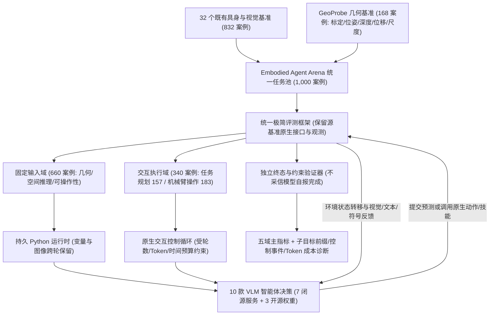
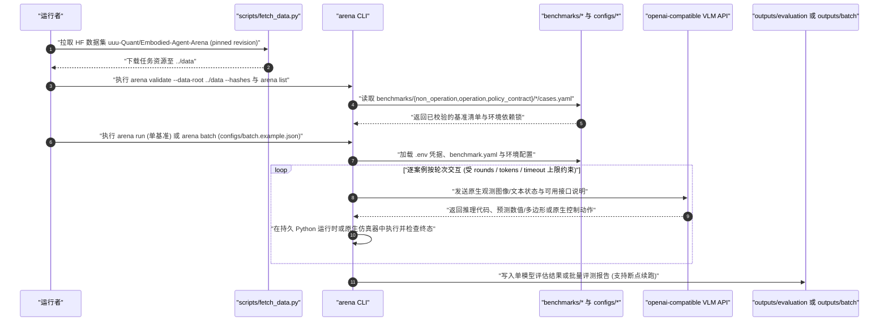

# Are Frontier VLM Agents Ready to Be Robot Generalists? An Empirical Study with the Embodied Agent Arena

## 一句话定义

**Embodied Agent Arena** 是一个面向视觉语言模型（VLM）具身通用能力的千例实证评测基准与极简运行时框架，联合评估 **Geometry、Spatial Reasoning、Affordance、Task Planning 与 Manipulation** 五大能力域，并通过过程轨迹诊断「局部指标领先但终态任务未完成」的真实瓶颈。

## 英文缩写速查

| 缩写 | 英文全称 | 简要说明 |
|---|---|---|
| VLM | Vision-Language Model | 视觉语言模型；本文评测十款闭源服务与开源权重 VLM 智能体 |
| GeoProbe | Geometric Probe Benchmark | 本文自建的 168 案例几何诊断基准，分离相机运动、物体运动、深度与尺度因子 |
| AbsRel | Absolute Relative Error | 绝对相对误差（$\frac{1}{J}\sum |e_j|/|y_j|$），用于评估深度与数值空间估计 |
| IoU | Intersection over Union | 交并比；本文同时评测原生边界框与直接多边形输出相对参考掩码的 IoU |
| MAPE | Mean Absolute Percentage Error | 平均绝对百分比误差（$100 \times \mathrm{AbsRel}$），用于焦距、尺寸与参考尺度估计 |
| RMSE | Root Mean Squared Error | 均方根误差；用于深度与 TraceSpatial 2D/3D 轨迹误差评估 |

## 为什么重要

1. **打通「看懂」与「做完」的评测断层**：传统视觉基准只测单帧空间问答或框定位，而控制套件只报终态成功率（SR）。本文用同一套 1,000 案例体系把底层几何估计、空间关系推理、功能部位定位、长程任务规划与机械臂操作串联起来，证明**感知能力强并不自动等价于执行成功**（例如 Qwen 3.8 Max 在 Spatial Pass@1 达到 68.9%，但 Planning 仅 36.9%、Manipulation 仅 9.3%）。
2. **区分「动作尝试」与「物理终态满足」**：在交互执行中，平均分与模型自报完成常常失真。本文通过独立终态验证器与过程级控制证据表明，模型经常在实现早期子目标后丢失物体抓持（`is_grasped=false`）、把物体放错接收容器（外层 `Bathtub` 而非 `BathtubBasin`），或在未建立坐姿接触时提前宣告完成。
3. **量化额外计算与错误恢复的真实收益**：揭示失败回合消耗了 Planning 总 Token 的 **55.5%–94.3%**，且「代码修复后可继续运行」并不等于「最终完成任务」（CALVIN 65 个报执行错误的回合中有 62 个恢复无错代码运行，但仅 3 个完成全部 5 步序列）。

## 核心信息

| 字段 | 内容 |
|---|---|
| 作者 | Haojian Huang, Pukun Zhao, Zexi Li, Yehang Zhang, Yangkai Wei, Wenqian Li, Han Yang, Kaiwen Zhou, Ying-Cong Chen, Yinchuan Li |
| 机构 | 香港科技大学广州校区（HKUST-GZ）、香港中文大学（CUHK）、Knowin AI |
| 发表时间 | 2026-10-01（arXiv v1），2026-10-23 修订 v3（73 页含附录） |
| 论文链接 | [arXiv:2610.00854](https://arxiv.org/abs/2610.00854)（[HTML 全文](https://arxiv.org/html/2610.00854)） |
| 项目与代码 | [项目页](https://embodied-agent-arena.github.io/embodied-agent-arena/) ｜ [GitHub 仓库](https://github.com/embodied-agent-arena/embodied-agent-arena) ｜ [Hugging Face 数据集](https://huggingface.co/datasets/uuu-Quant/Embodied-Agent-Arena) |
| 清单分类 | `environment.benchmarking`（来源条目 `survey_ax_2610_00854`） |
| 开源状态 | **已开源**（MIT 协议：评测 harness 代码、1,000-case 任务配置、Pinned 数据集修订版 `5f729375...`、十模型结果 CSV 与分析脚本均已公开） |

## 核心原理

### 1. 五大能力域与 1,000 案例构成

Embodied Agent Arena 将 32 个既有具身/视觉来源与自建的 168 例 GeoProbe 组合为 1,000 个评估案例（660 个固定输入探针 + 340 个交互式回合，使用 seed 42 采样分配）：

- **Geometry（370 例，37.0%）**：包含 InFlux-Real（30 例单帧内参，4 例无效标注在连续误差中剔除）、Map-free（30 例相对位姿）、MultiSPA-derived（30 例基于 Map-free 图像与位姿的相机运动角度/距离/位移矢量查询）、**GeoProbe（168 例）** 与 TraceSpatial-Bench（56 场景共 112 例 2D/3D 空间轨迹预测）。其中 GeoProbe 基于 130 张主要为 Blender 渲染的 RGB 图像与 4 对真实桌面照片构建 10 种控制变量协议，覆盖固定/小视角变化/大视角变化物体位移（各 12）、真实桌面位移（4）、完整内参（24）、焦距与居中主点（12）、相对相机位姿（24，含静止、纯旋转、纯平移与复合运动）、稀疏深度（12）、物体尺寸（12）及参考尺度估计（44）。
- **Spatial Reasoning（220 例，22.0%）**：涵盖 3DSRBench（50，28 条翻转标注样本按未翻转展示并修正 5 例参考答案）、MindCube（50）、VSI-Bench（50，初始提供 8 帧视频抽样）、RoboSpatial-Home（30）、BOP-ASK（20）与 MMSI-Bench（20），共含 183 道分类题、27 道数值题与 10 道自由空间点集题。
- **Affordance（70 例，7.0%）**：涵盖 UMD 工具功能部位（30，5 类工具、6 种功能）、ReasonAff-style 指令条件查询（20，基于 3DOI）与 RAGNet-3DOI 动作条件查询（20），在相同 70 个案例上分别评测原生点+边界框以及直接多边形（无外部分割器）定位。
- **Task Planning（157 例，15.7%）**：涵盖视觉家务 ALFRED（20）与 ALFWorld（20）、科学实验文本环境 ScienceWorld（73）、符号程序 VirtualHome（21）、结构化观察 DiscoveryWorld（10）以及 Habitat 导航与坐下交互 HumanCLAW（13：5 导航 + 8 坐下）。复合目标终态 $s_T$ 必须同时满足全部谓词 $g_1,\dots,g_K$：
  $$\mathrm{Success}(s_{T},g)=\mathbf{1}\!\left[\bigwedge_{k=1}^{K}g_{k}(s_{T})\right]$$
- **Manipulation（183 例，18.3%；含 182 二值任务 + 1 连续奖励 `AnymalC-Spin`）**：整合 13 个操作套件，包括 RoboTwin 2.0（50）、VLABench（25）、CLIPort（18）、CALVIN（10 个 5 步序列）、RLBench（10）、RoboCasa（10）、RoboCasa365（10）、RoboWits（10）、VIMA-Bench（10）、ManiSkill（10：9 二值 + 1 连续）、LIBERO-PRO（10）、robosuite（5）与 BEHAVIOR-1K（5）。

### 2. 极简原生评测框架（Minimal Native Harness）与独立判分

- **保留原生接口，衡量原生能力（Native Capability）**：基线评测不外挂额外视觉检测器、深度估计器或规划器，仅保留各源基准自带的观察与原生辅助函数（如 ALFRED/ALFWorld 的观察/导航/记忆原语、RoboTwin 的位姿探测与执行接口、RoboCasa 的固定件接触定位）。
- **持久 Python 会话与原生控制循环**：前四个域运行在持久 Python 运行时中，变量与环境状态跨代码轮次保留，生成的中间图像在回合结束后送入下一轮 VLM 请求；Manipulation 沿用各基准原生智能体循环（其中 Opus 5.5、DeepSeek-1017 与 Gemini 4 Argon 每轮自动接收当前 RGB 图像）。
- **声明与验证解耦**：交互回合可因模型主动停机、环境终态、预算耗尽（轮数 / Token / 环境步数 / 原语调用数 / 超时）或未恢复异常终止；评测器独立检查提交结果或底层模拟器终态，模型自报成功不被采信，所有错误终止回合均留在固定分母内计为失败。

### 3. 多维度诊断与多轮审查对照（Section 4.3–4.4）

- **能力域综合指数（Appendix C.6）**：为可视化十模型能力画像，论文将 Geometry 旋转/平移误差 $(r, t)$、Spatial Pass@1 与数值 AbsRel $(p, a)$、Affordance 框掩码 IoU 与点有效性 $(u, c)$ 分别映射至 $[0,100]$ 尺度：
  $$G = 50\left[\exp\!\left(-\frac{r}{45}\right)+\exp\!\left(-\frac{t}{150}\right)\right],\quad S = \frac{p+100\exp(-a/0.25)}{2},\quad A = \frac{100u+c}{2}$$
- **尺度对齐与过程事件诊断**：在 GeoProbe 深度上通过 Oracle 尺度对齐分离「全局尺度偏差」与「残余形状畸变」；在 TraceSpatial 上通过起止点 20 cm 容差与 20% 点云碰撞率联合检验物理可行性；在 Manipulation 上结合 CALVIN 连续子目标前缀 $\bar{L}$、RoboCasa/RoboCasa365 搬运里程碑（Approach → Grasp & Lift → Stable Release）、ManiSkill 终态分项条件与 BEHAVIOR-1K 六项控制事件进行过程归因。
- **固定输入多轮审查消融（46 案例共享子集）**：在 Astra 与 Qwen-27B 上对比 Initial、Self-review（最多 2 轮自审）、Crop review（加图像裁剪）与 Tool-assisted review（最多 6 轮，引入 SAM 3 掩码、SuperPoint+LightGlue 特征匹配与 GeoCalib 标定），验证计算量增加对语义正确率与几何合法性的双面影响。

## 流程总览

## 源码运行时序图

以下时序基于官方仓库 `README.md` Quick Start 与 `files_sample` 中的已核对文件与 CLI 入口绘制（静态代码核对，未本地运行）：

关键复现路径为：`scripts/fetch_data.py` 拉取固定版本数据集 → `arena validate` 校验数据哈希 → `arena run` / `arena batch` 读取 `benchmarks/*` 与 `configs/*` 驱动评测并输出至 `outputs/`。

## 实验与评测

### 1. 主表跨模型表现（Table 2）

非追踪 Geometry、Spatial Reasoning 与点/框 Affordance 对除 Claude Fable 5.1（3 轮）外的 9 个模型均执行 5 轮重复并报告 `均值 ± 轮间 SD`；TraceSpatial 3D、直接多边形 Affordance、Task Planning（157 例）与 Manipulation（182 个二值任务）为单轮评测：

| 模型（10 款） | 类型 | 几何旋转 (°) ↓ | 几何平移 (cm) ↓ | 空间推理 Pass@1 (%) ↑ | 数值空间 AbsRel ↓ | Affordance 框掩码 IoU ↑ | Affordance 多边形 IoU ↑ | 任务规划 Pass@1 (%) ↑ | 机械臂操作 SR (%) ↑ |
|---|---|---|---|---|---|---|---|---|---|
| **GPT-6 Astra** | 闭源服务 | **17.2 ± 6.7** | 106.9 ± 36.0 | 69.4 ± 1.0 | 0.214 ± 0.016 | 0.286 ± 0.010 | 0.379 | **80.3** (126/157) | 41.8 (76/182) |
| **GPT-6 Sol** | 闭源服务 | 27.0 ± 1.5 | 151.9 ± 6.2 | 60.7 ± 2.5 | 0.273 ± 0.016 | 0.264 ± 0.010 | 0.325 | 44.6 (70/157) | 19.8 |
| **Claude Fable 5.1** | 闭源服务 | 24.2 ± 8.3 | 116.6 ± 42.6 | 62.0 ± 4.6 | 0.185 ± 0.011 | 0.284 ± 0.013 | 0.328 | 63.7 (100/157) | 24.7† |
| **Claude Opus 5.5** | 闭源服务 | 23.4 ± 3.7 | 135.8 ± 12.7 | 67.5 ± 5.1 | 0.184 ± 0.040 | 0.311 ± 0.020 | 0.397 | 48.4 (76/157) | **47.8** (87/182) |
| **Gemini 4 Argon** | 闭源服务 | 18.5 ± 1.8 | **105.6 ± 9.6** | **71.6 ± 0.7** | 0.169 ± 0.023 | **0.356 ± 0.009** | **0.441** | 70.1 (110/157) | 44.0 (80/182) |
| **Gemini 3.8 Flash** | 闭源服务 | 23.7 ± 5.6 | 138.0 ± 41.7 | 65.4 ± 1.3 | **0.161 ± 0.028** | 0.251 ± 0.081 | 0.291 | 48.4 (76/157) | 18.7 |
| **Qwen 3.8 Max** | 闭源视觉 API | 20.5 ± 3.5 | 138.1 ± 10.2 | 68.9 ± 1.1 | 0.206 ± 0.033 | 0.272 ± 0.017 | 0.307 | 36.9 (58/157) | 9.3 |
| **DeepSeek-V4.1-Flash-1017** | 开源权重 | 30.2 ± 3.9 | 182.0 ± 29.0 | 51.6 ± 1.5 | 0.309 ± 0.035 | 0.217 ± 0.011 | 0.249 | 31.2 (49/157) | 20.9 (38/182) |
| **Qwen 3.5 397B-A17B** | 开源权重 | 38.4 ± 1.1 | 249.8 ± 10.2 | 50.6 ± 1.8 | 0.251 ± 0.027 | 0.116 ± 0.014 | 0.092 | 19.1 (30/157) | 9.9 |
| **Qwen 3.5 27B** | 开源权重 | 38.4 ± 3.6 | 213.7 ± 12.6 | 48.0 ± 0.9 | 0.288 ± 0.023 | 0.013 ± 0.006 | 0.051 | 19.1 (30/157) | 11.0 |

*注：† Fable 缺失 9 条 ManiSkill 记录在 182 总分母中计 0 分；DeepSeek-1017 对应 2026-10-17 更新的 `deepseek-flash` 服务。*

### 2. 关键细分诊断与发现（Sections 4.2–4.4 & Appendices C–J）

- **任务配比敏感性（Table A10 & Section 4.2）**：
  - 剔除文本与符号类来源（ScienceWorld 73 例 + VirtualHome 21 例）后，剩余 63 个视觉/具身 Planning 任务上 Astra 降至 66.7%、Gemini 4 Argon 降至 60.3%、Fable 降至 33.3%；仅在 ALFRED+ALFWorld（40 例）上，Astra 完成 29/40、Gemini 4 完成 30/40，而三款开源权重模型各仅完成 4–8/40。
  - 在 Manipulation 中，占 50/182 的 RoboTwin 2.0 偏向 Opus 5.5（46.0%，23/50 vs Gemini 4 的 28.0%，14/50），而 Gemini 4 在 CALVIN（40.0% vs 10.0%）和 RLBench（80.0% vs 30.0%）更强；若对 13 个来源等权平均，Gemini 4 Argon（47.4%）反超 Opus 5.5（44.5%）。
- **Geometry 细粒度分解（Table A8 & A18–A20）**：
  - GeoProbe 深度（12 例）上，Gemini 4 与 Qwen-397B 原始 AbsRel 接近（0.299 vs 0.312），但 Oracle 尺度对齐后 Gemini 4 降至 **0.065**，Qwen-397B 仍为 **0.203**（Astra 从 0.104 降至 0.038，序数准确率 96.3%）。
  - 在 GeoProbe 位移检测中，固定相机下 Astra 与 Gemini 4 对 50 个运动观测零漏检，但在大视角变化下分别漏检 26 与 37 次；Qwen-27B 在所有视角条件下漏检全部 50 个运动观测（表现为检测下限失灵）。
  - 在 TraceSpatial 3D（56 场景）上，Gemini 4 路径 RMSE 最低（**0.310 m**），Astra 为 0.382 m；但两者的图像端点命中（45/56 与 35/56）在 3D 边界与碰撞联合检查后仅 **24/56（42.9%）** 与 **19/56（33.9%）** 全部达标（Gemini 4 出现 10 例纯碰撞失败，Astra 仅 1 例）。
- **Affordance 点/框/多边形错位（Table A17 & A46）**：
  - 直接多边形在 9/10 模型上优于框掩码 IoU（Gemini 4 最高 0.441），但主要得分来自 UMD 工具（Gemini 4 达 73.08%），交互场景 RAGNet（14.03%）与 ReasonAff（30.71%）显著偏低。
  - 350 次预测中，Qwen-397B 出现 96 次「仅点有效、框不通过」vs 18 次双通过；Gemini 4 出现 16 次「框通过但动作点落出功能掩码外」（如 UMD 剪刀 `IoU=0.784` 但点击点偏移）。
- **Planning 互补性与共同盲区（Figure 7 & Table A27）**：
  - 157 个规划任务中，仅 8 个被全部十款模型完成（其中 7 个来自符号化 VirtualHome）；十模型并集覆盖 **142/157**（Astra 单模型 126，加入 Gemini 4 覆盖 137，其余 8 个模型仅补充 5 个），仍有 **15 个任务十模型全败**，包含全部 8 个 HumanCLAW 坐下任务（Astra 5/8 与 Gemini 4 7/8 达到 20 cm 距离且发出 `sit` 指令后仍失败并错误声明已坐下）。
- **Manipulation 长程衰减与接触精度（Figure 8, Table A28–A32, A44–A45）**：
  - 100 个 CALVIN 回合中，60 个完成第 1 子目标，40/25/18 个分别完成第 2/3/4 步，仅 **9 个**完成全部 5 步（Gemini 4 完成 4/10、Astra 3/10、Opus 5.5 与 DeepSeek-1017 各 1/10）。
  - 65 个触发代码执行错误的 CALVIN 回合中，62 个在后续轮次恢复无错执行，但仅 **3 个**最终通过原生任务验证器（Qwen-Max 在 103/200 轮中报错，其中 95 轮为语法错误）。
  - ManiSkill 精细诊断（Table A32）中，Opus 5.5 完成 PickCube、PlaceSphere、StackCube，但在 PegInsertionSide（插孔深度 $x \ge -0.015\text{ m}$）与 PlugCharger（位置误差 $\le 5\text{ mm}$ 且角度误差 $\le 0.2\text{ rad}$）均告失败；PlugCharger 测试显示 DeepSeek-1017 与 Gemini 4 角度已达标（9.76° 与 3.97°），但位置偏差仍高达 12.40 cm 与 15.94 cm。
- **失败 Token 成本与多轮审查消融（Tables A34 & A42–A43）**：
  - 失败回合占 Planning 总 Token 的 **55.5%–94.3%**；Astra 的 31 个失败任务消耗 55.5% Token（单次失败均值 591,162 vs 成功 116,435，达 **5.1 倍**），其中 HumanCLAW 占 Astra 失败 Token 的 81.7%（剔除后失败占比降至 19.4%）；7 条 HumanCLAW 追踪日志显示 **98.23%–99.46%** 为重复输入上下文的 prompt token。
  - 在 46 案例共享审查集上（Table A34），Qwen-27B 9 个 Affordance 中初始 6 个边界框越界，Self-review 将其全部修回图像内（框 IoU 从 0.0336 升至 0.1524，SR@50 仍为 0%）；但在 18 例空间题上，Self-review 修对 1 题却改错 2 题原本正确的回答，Crop review 修对 2 题却改错 4 题；仅 Tool-assisted review 使 Astra 与 Qwen-27B 的 SR@50 分别升至 33.3% 与 11.1%。

## 与其他工作对比

| 基准 | 实例规模 | 固定视角探针 | 区域定位 (Region) | 导航 | 机械臂操作 | 跨会话记忆 | 相机标定 / 位姿 | 开源制品状态（2026-10 核查） |
|---|---|---|---|---|---|---|---|---|
| OpenEQA (2024) | 1,636 QA（HM3D 含 557 主动） | ✓ | ✗ | ✓ | ✗ | ✗ | ✗ | 开源代码、评估脚本与数据下载指引 |
| VLABench (2024) | 100 任务类（60 原子 + 40 复合） | ✓ | ✗ | ✗ | ✓ | ✗ | ✗ | 代码、评估轨迹与固定图像数据 |
| BEAR (2025) | 4,469 QA（另含真机在线验证） | ✓ | ✓ | ✗ | ✓（独立验证） | ✗ | ✗ | 智能体代码、基准数据与评分脚本 |
| EmbodiedBench (2025a) | 1,128 测试实例 | ✗ | ✗ | ✓ | ✓ | ✗ | ✗ | 代码、配置与数据集 |
| EmbodiedEval (2025) | 328 任务 / 125 场景 | ✗ | ✗ | ✓ | ✗ | ✗ | ✗ | 代码、328 测试集与场景资产 |
| CaP-X (2026) | 700/tier（39–187 任务类） | ✗ | ✗ | ✗ | ✓ | ✗ | ✗ | 代码、环境（含 LIBERO-PRO/BEHAVIOR）与评估脚本 |
| WorldLines (2026b) | 331（310 QA + 21 规划） | ✓ | ✗ | ✗ | ✗ | ✓ | ✗ | 论文提供提示词，未定位到作者代码/数据发布 |
| **Embodied Agent Arena (2026)** | **1,000（32 来源 + 168 GeoProbe）** | **✓** | **✓** | **✓** | **✓** | **✗** | **✓** | **MIT 开源 Harness、1,000 例索引、HF 数据集与结果 CSV** |

## 结论

**一句话总判：前沿 VLM 智能体已具备较强的中层语义与局部空间推理能力，但距离“通用机器人控制”仍有明显断层——当前闭源模型在极简原生接口下最高仅达到 47.8% 的综合操作成功率与 42.9% 的 3D 约束轨迹通过率，主要瓶颈已从“看不懂图像”转向“高精度空间/接触条件满足、跨步物理状态维护与目标精确绑定”。**

1. **不能只用单一平均分评估具身智能体** — 评测必须同时报告预测精度、子目标前缀（如 CALVIN $\bar{L}$）、物理接触条件与独立终态成功率，否则局部指标（如 0.310 m 路径误差或 68.9% Spatial Pass@1）会掩盖 57% 的 3D 约束违例与执行崩塌。
2. **代码“能跑通”不等于任务“已恢复”** — CALVIN 中 62/65 个报错回合可自行修复语法或接口错误恢复执行，但仅 3 个最终达标；评测与工程框架应重点监控**物理前提状态（如抓持确认 `is_grasped`、容器层级绑定 `BathtubBasin`）**而非仅检查代码无异常退出。
3. **长预算与盲目自审存在显著负收益风险** — 失败长程任务（如 HumanCLAW）因上下文重复输入占用了高达 98%+ 的 prompt token 成本，且无工具辅助的纯自审/裁剪会推翻原本正确的空间判断；只有提供直接物理反馈或专用几何/分割测量的工具辅助闭环才能稳定提升达标率。
4. **选型需警惕任务配比与模型专长分化** — 没有单一模型在所有域全面占优（Astra 擅长规划 80.3%、Opus 5.5 擅长桌面双臂操作 47.8%、Gemini 4 Argon 擅长多模态几何与可操作性且等权操作率 47.4% 领先），组合不同模型或按任务域路由（如 Astra+Gemini 4 联合覆盖规划 137/157）比单纯堆叠多款同类模型收益更高。

## 工程实践

- **基准复现与极简评测搭建**：
  1. 在 Linux（Python $\ge 3.10$）下安装仓库：`python -m pip install -e '.[offline,test,hub]'`。
  2. 运行 `scripts/fetch_data.py` 从 Hugging Face 拉取固定修订版（`5f729375eb35163a024625dd8ea72ac57a427a24`）的数据集，并用 `arena validate --data-root ../data --hashes` 校验完整性。
  3. 参考 `configs/operation_environment_lock.json` 与 `configs/patches/` 为 CALVIN、RoboTwin 2.0、BEHAVIOR-1K、ManiSkill、CaP-X 等 13 个交互仿真环境配置隔离运行时。
  4. 配置 `.env` 后通过 `arena run` 或 `arena batch --config configs/batch.example.json --execute` 启动评测（支持中断断点续跑）。
- **智能体框架设计建议**：
  - 在技能与规划接口中**显式暴露底层状态反馈**（例如抓持传感器布尔量、容器父子层级路径、末端相对目标位姿偏差），避免模型在未知物理状态时误判任务结束。
  - 针对长期上下文膨胀，对探索类任务引入历史观测裁剪或状态摘要，并对连续多轮无进度（score plateau）回合设置早停熔断，防止 2M 级 Token 空耗。
  - 需要精确几何或部件掩码时，应以专用工具测量（如标定、特征匹配、分割）替代纯文本/纯图像自审。

## 局限与风险

1. **仿真环境依赖与版本演进**：183 个操作案例与 157 个规划案例跨越多套独立仿真器（Habitat、Isaac/RoboDojo、PyBullet、MuJoCo、CoppeliaSim/RLBench），配置成本高；且部分模型评估依托特定日期的云端服务快照（如 `deepseek-flash` 2026-10-17 版本），API 后端迭代可能影响严格复现。
2. **评测批次配置差异与缺失数据**：受限于各模型评测时的历史批次设置，Manipulation 中 CALVIN 前 7 款模型预算为 16–20 轮/640k Token/60 分钟，而 Opus 5.5、DeepSeek-1017 与 Gemini 4 Argon 采用 40 轮/1.28M Token/120 分钟及每轮自动 RGB；Fable 在 ManiSkill 缺失 9 条记录（统一按失败计入总分母）。
3. **未覆盖跨会话记忆与真机闭环**：如 Table 1 所示，该版本 Arena 未评估跨会话长期记忆（Cross-session Memory），且除 4 对真实桌面位移图像及部分真实图像探针外，交互式规划与操作均在仿真环境中完成，未包含真机物理鲁棒性与安全部署验证。
4. **本地复现边界**：本知识节点基于论文 arXiv v3 全文、官方项目页及仓库 `README.md`/文件结构样本完成静态核对，**未在本地实际运行**仿真器或模型 API 评测。

## 关联页面

- [具身大模型评测基准选型闭环](../queries/embodied-eval-benchmark-selection-loop.md)：对照评测基准设计与指标选型闭环。
- [Agentic Robots 综述](paper-towards-agentic-robots-survey.md)
- [全量项目节点清单](../overview/awesome-agentic-robots-node-index.md)
- [VLA 方法背景](../methods/vla.md)
- [具身智能体评测方法](../methods/embodied-agent-benchmarking.md)：对照任务设置、接口与评估指标
- [机器人智能体评测框架（Robot Agent Harness）](../methods/robot-agent-harness.md)：对照极简原生接口设计与工具链约束
- [智能体规划与反馈机制](../methods/agent-planning-feedback.md)：对照错误恢复、状态验证与自审退化现象
- [智能体工具调用接口](../methods/agent-tool-use-interface.md)：对照代码生成、语法失败与工具辅助测量
- [机器人操作任务（Manipulation）](../tasks/manipulation.md)：对照长程序列操作与精密插接挑战

## 推荐继续阅读

- [Embodied Agent Arena 官方项目页与交互式案例图谱（Case Atlas & Execution Explorer）](https://embodied-agent-arena.github.io/embodied-agent-arena/)
- [Embodied Agent Arena 官方开源仓库（embodied-agent-arena/embodied-agent-arena）](https://github.com/embodied-agent-arena/embodied-agent-arena)
- [Hugging Face 数据集：uuu-Quant/Embodied-Agent-Arena](https://huggingface.co/datasets/uuu-Quant/Embodied-Agent-Arena)

## 参考来源

- [论文全文归档：Are Frontier VLM Agents Ready to Be Robot Generalists?（arXiv:2610.00854v3）](../../sources/papers/paper-agentic-2610-00854.md)
- [官方开源仓库归档：embodied-agent-arena/embodied-agent-arena](../../sources/repos/paper-agentic-2610-00854.md)
- [官方 Awesome 快照归档](../../sources/repos/awesome-agentic-robots-survey-index.md)
- [论文官方入口（arXiv:2610.00854）](https://arxiv.org/abs/2610.00854)
- [官方项目页（Embodied Agent Arena）](https://embodied-agent-arena.github.io/embodied-agent-arena/)
