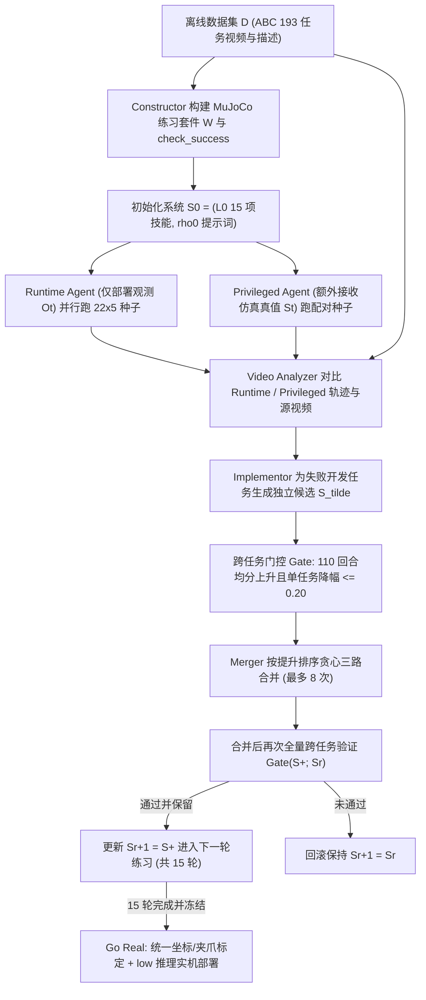

# Reconstruct, Practice, Go Real: Guided Self-Improvement for Embodied Agents

## 一句话定义

**RPG（Reconstruct, Practice, Go Real）** 是一种面向机器人操作系统的无权重微调自主改进框架：从离线数据集中识别操作能力并构建仿真练习任务，在仿真练习中通过特权状态执行对比与视频诊断持续演化共享符号技能库 $\mathcal{L}_r$ 和系统提示词 $\rho_r$，经跨任务回归门控验证后冻结部署到物理双臂机器人上。

## 英文缩写速查

| 缩写 | 英文全称 | 简要说明 |
|---|---|---|
| RPG | Reconstruct, Practice, Go Real | 本文框架：重建练习任务、仿真自主练习与实机冻结部署 |
| MLLM | Multimodal Large Language Model | 多模态大语言模型，在运行时与离线诊断阶段分别承担决策和代码修订角色 |
| CaP | Code as Policies | 以大语言模型生成可执行机器人控制程序与原语接口的范式 |
| ABC | Scalable Behavior Cloning Benchmark / Dataset | 文中用于抽取 193 项源任务、视频与文本描述的离线机器人操作数据集 |
| YAM | YAM Dual-Arm Robot Station | 本文仿真（MuJoCo）与实机评测使用的双 6-DoF 机械臂操作平台 |
| IK | Inverse Kinematics | 逆运动学，底层技能用于检验末端可达性与关节余量 |

## 为什么重要

在基于语言模型的机器人控制中，**Code-as-Policy** 与 **Agent-as-Policy** 长期存在明显权衡：

1. **纯程序执行高效但检查脆弱：** 传统可执行程序能够高效运行闭环逻辑，但像“夹爪是否真正抓稳物体”这类依赖视觉与语义判断的条件往往难以用纯符号规则写全。
2. **纯智能体闭环灵活但低层易错：** 将 MLLM 始终留在控制回路中能提供灵活的视觉判断，但高频调用推理既耗时，又容易在未验证可达性、未校准接触高度或混淆末端位置与物体特征位置时反复失败。
3. **跨任务演化需要防止局部过拟合与回归：** 将可重复执行下沉为共享符号技能、将视觉语义决策留给 Runtime Agent 后，如何让新写或改写的技能在“不破坏已有任务”的前提下跨任务沉淀与迁移，是免权重持续改进的核心难题。

RPG 将离线数据驱动的任务构建、特权仿真对比诊断和软件工程式的跨任务回归门控结合起来，证明无需更新 MLLM 权重或收集额外实机微调数据，仅靠演化共享技能代码与系统提示词即可实现从仿真到实机的高成功率迁移。

## 核心信息

| 字段 | 内容 |
|---|---|
| 作者 | Yen-Jen Wang, Haozhe Jiang, Shuying Deng, Haoru Xue, Weirui Ye, Rocky Duan, Nika Haghtalab, S. Shankar Sastry, Pieter Abbeel, Haozhi Qi |
| 机构 | UC Berkeley、Amazon FAR、MIT、University of Chicago |
| 发表时间 | 2026-10-01（arXiv:2610.02204v1 [cs.RO]） |
| 论文链接 | [arXiv:2610.02204](https://arxiv.org/abs/2610.02204) · [arXiv HTML](https://arxiv.org/html/2610.02204) |
| 项目与代码 | [项目页](https://rpg-robot.github.io/) · 代码尚未公开（标注 `Code coming soon`） |
| 清单分类 | `harness.skills` |
| 来源条目 | `survey_ax_2610_02204` |
| 开源状态 | 宣称将开源或未列链接（截至 2026-11-27 官方项目页标注 "Code coming soon"，未发布可运行代码仓库） |

## 核心原理

RPG 将第 $r$ 轮机器人执行系统形式化为二元组 $S_r = (\mathcal{L}_r, \rho_r)$，其中 $\mathcal{L}_r$ 是共享的可复用符号技能库，$\rho_r$ 是指导智能体如何选择和组合这些技能的系统提示词。整个自改进过程中，底层模型权重、任务定义、初始分布与二值评测器均保持冻结；系统通过六个专职智能体协同完成三阶段演化：

### 1. Reconstruct：构建并冻结仿真练习套件

- **初始底座 $S_0$：** 以 CaP-X 的 9 个底层工具（状态查询、视觉感知、IK、运动控制、夹爪控制）为 $\mathcal{L}_{\mathrm{base}}$，再由 `Constructor` 结合离线数据集 $\mathcal{D}$ 构建 6 个高层基础技能（`pick`、`place`、`pick_and_place`、`transfer_between_arms`、`move_above`、`push`），组成 15 项初始技能库 $\mathcal{L}_0$ 与初始提示词 $\rho_0$。
- **能力抽取与类比任务生成：** `Constructor` 从 ABC 数据集 $\mathcal{D}$（193 个任务）中筛选源任务，审阅 3–8 条轨迹视频及文本描述（单任务时间预算 7.5 分钟），在 MuJoCo 中基于双臂 YAM 机器人（双 6-DoF 机械臂 + 夹爪，14 维绝对关节位置指令，顶部与双腕 RGB 及顶部深度观测）搭建聚焦局部操作能力或类比场景的练习任务 $\mathcal{W} = \{\mathcal{T}_i\}_{i=1}^K$（例如：整理太阳镜对应合上已装载的眼镜盒，整理化妆品对应关闭抽屉，卷毛巾对应单次折叠）。
- **人工核验评测器：** `Constructor` 为每个任务编写二值判定函数 `check_success`（$e_i(\tau) \in \{0, 1\}$），在进入 Practice 阶段前由人工检查评测逻辑是否与目标一致，随后全部任务与评测器冻结。

### 2. Practice：特权对比诊断、修改生成与跨任务门控

在每一轮 $r \in \{1, \dots, 15\}$ 中，系统执行“Rollout → 诊断 → 候选修改 → 跨任务验证 → 贪心合并 → 再次验证”的闭环：

1. **双路并行 Rollout：**
   - `Runtime Agent`（部署同款观测接口 $O_t$：顶视与腕部 RGB、顶部深度、本体感知）在每项任务上运行 5 个固定开发种子。
   - `Privileged Agent` 使用**完全相同的模型、提示词 $\rho_r$ 与部署兼容技能库 $\mathcal{L}_r$**，但在选择技能和参数时额外获得仿真器特权真值状态 $S_t$（物体名称、位姿、尺寸、速度及布料角点位置）。所有技能函数本身严禁读取特权状态。
2. **视频与轨迹归因（Video Analyzer）：** 针对 17 个开发任务（`Development`）中未能全胜（$<5/5$）的回合，`Video Analyzer`（Fable 5.1，`xhigh` reasoning）对比 Runtime Agent 失败轨迹、Privileged Agent 参考轨迹及 $\mathcal{D}$ 中的源任务视频，按动作阶段对齐分析，定位首个可观测失败点并给出带帧/轨迹证据的修订建议。4 个反馈留出任务（`Feedback-held-out`）和 1 个验证任务（`Validation`）不生成定向诊断与候选修改，仅作跨任务回归检查。
3. **独立候选生成（Implementor）：** `Implementor`（Fable 5.1）基于 $S_r$ 与诊断报告，为每个失败开发任务至多生成 1 个独立分支候选 $\widetilde{S}$（可新增技能、修改现有技能或调整 $\rho_r$），并先做语法、接口与“仅使用部署观测”静态检查。
4. **跨任务回归门控与贪心合并（Merger）：**
   每个候选 $\widetilde{S}$ 必须在全部 $K=22$ 个任务 $\times 5 = 110$ 个固定开发种子上由 Runtime Agent 完整跑测，计算单任务成功率 $\widehat{q}_i(S)$ 与平均成功率 $\widehat{J}(S)$：
   $$\widehat{q}_i(S) = \frac{1}{n}\sum_{k=1}^{n} e_i(\tau_{ik}(S)), \qquad \widehat{J}(S) = \frac{1}{K}\sum_{i=1}^{K} \widehat{q}_i(S)$$
   $$\mathsf{Gate}(\widetilde{S}; S_r) = \mathbf{1}\!\left[\Delta\widehat{J} > 0 \;\land\; \min_i \Delta\widehat{q}_i \geq -0.20\right]$$
   即候选必须提升全体任务平均成功率，且**任何单个任务的成功次数降幅不得超过 1/5（20 个百分点）**。`Merger` 按 $\Delta\widehat{J}$ 对入围候选排序，在单轮至多 8 次合并尝试预算内贪心执行三路合并（冲突由编码智能体消解）；合并产物 $S^+$ 必须再次通过同一 $\mathsf{Gate}(S^+; S_r)$ 验证并经 `Merger` 确认保留后，才更新 $S_{r+1} = S^+$，否则回滚至 $S_{r+1} = S_r$。

### 3. Go Real：统一硬件标定与冻结部署

经过 15 轮练习后，技能库从 15 项扩展至 38 项（14 个 Leaf 叶子层、17 个 Composed 组合层、7 个 Compound 复合层；其中 8 个为只读查询技能）。在实机部署阶段，系统与对比基线采用完全相同的坐标系标定与硬件适配（夹爪垫片偏置与空夹爪开度），不做针对具体物体或任务的微调；同时移除 `Privileged Agent` 与 `Video Analyzer`，将在线 Runtime Agent 的推理强度切换为 `low` reasoning effort 以降低物理执行时延。

## 流程总览

## 源码运行时序图

**不适用**（说明核查结果：截至 2026-11-27 官方项目页仍标注 `Code coming soon`，尚未公开可运行的源码仓库；上下文抓取到的 `vision-language-kinematics/vision-language-kinematics.github.io` 仅为项目页 Footer 致谢的静态网页模板仓库，不包含 RPG 框架与技能库实现代码）。

## 实验与评测

### 1. 主基准测试：22 项 MuJoCo 双臂操作任务（Table II）

在 15 轮自改进全部冻结后，作者在未参与筛选和开发的 **10 个留出初始种子/任务（共 $22 \times 10 = 220$ 回合）** 上进行回顾性评测。仿真均采用 `xhigh` reasoning effort，RPG 与 ASPIRE 的单回合预算为 30 轮模型对话、12 次模型观测调用、1,200 s 墙上时间及 20 分钟机器人时间（CaP-Agent0 为 50 轮，RATs 为 50 轮且采用原生 anytime 成功判据）。RPG 在线执行使用 Gemini 3.8 Flash，离线修订使用 Fable 5.1：

| 方法 | 运行时模型 | CaP-X 子集（7 任务） | ABC 派生子集（15 任务） | 总成功率 | 成功回合数 |
|---|---|---:|---:|---:|---:|
| RATs | Gemini 3.8 Flash | 54.3% | 36.0% | 41.8% | 92 / 220 |
| CaP-Agent0 | Opus 5 | 61.4% | 38.0% | 45.5% | 100 / 220 |
| CaP-Agent0 | Gemini 3.8 Flash | 51.4% | 47.3% | 48.6% | 107 / 220 |
| CaP-Agent0 | Fable 5.1 | 65.7% | 41.3% | 49.1% | 108 / 220 |
| CaP-Agent0 | GPT-6 Astra Pro | 72.9% | 54.0% | 60.0% | 132 / 220 |
| ASPIRE | Gemini 3.8 Flash | 78.6% | 74.0% | 75.5% | 166 / 220 |
| **RPG（第 1 轮）** | Gemini 3.8 Flash | — | — | 28.6% | 63 / 220 |
| **RPG（第 5 轮）** | Gemini 3.8 Flash | — | — | 78.2% | 172 / 220 |
| **RPG（第 15 轮）** | Gemini 3.8 Flash | **98.6%** | **93.3%** | **95.0%** | **209 / 220** |

- **轮次演进拆解：** 15 轮内技能库新增 23 项、修改已有技能 66 次，系统提示词仅在前 4 轮修订。其中第 3→4 轮**未做任何技能代码改动**，仅更新系统提示词与有界“感知-行动”预算管理逻辑，成功率便从 43.2% 跃升至 73.6%（+30.5 个百分点）；第 4→15 轮提示词完全冻结，单纯依靠 60 次既有技能修改与新技能补充，成功率再提升 +21.4 个百分点至 95.0%，并在 22 项任务中的 17 项取得 10/10 满分。
- **典型高收益任务：** 与 ASPIRE 相比，RPG 在 `Insert into fixture`（10/10 vs 2/10）和 `Place bottles in bin`（10/10 vs 3/10）两项高精度/遮挡几何任务上就拉开了 15 个成功回合的差距。

### 2. 诊断输入消融（5 轮自改进，220 回合，Table III）

| Video Analyzer | Privileged Agent | 成功率 | 成功回合数 | 相对完整 RPG 变化 |
|---|---|---:|---:|---|
| 是 | 是 | **78.2%** | 172 / 220 | 基准 |
| 否 | 是 | 51.8% | 114 / 220 | -26.4 个百分点 |
| 是 | 否 | 50.9% | 112 / 220 | -27.3 个百分点 |
| 否 | 否 | 50.9% | 112 / 220 | -27.3 个百分点 |

缺少任一组件都会导致 5 轮后成功率跌落至约 51%，说明两者具有强互补性：`Privileged Agent` 提供拥有真值状态时的理想执行参照，`Video Analyzer` 则结合双方轨迹与数据集视频将差距诊断为可落地的代码修改方案。

### 3. 纯技能库对照实验（固定 Runtime 模型、提示词与感知，Table IV）

在 4 项任务 $\times 10$ 配对种子（40 回合）上对比同一套 Runtime 配置（Gemini 3.8 Flash, `xhigh` reasoning）加载修订前后两版技能库快照：
- **整体成功率：** 从 **65.0%（26/40）** 提升至 **92.5%（37/40）**（+27.5 个百分点），其中 `Two-arm lift`（6/10→10/10）、`Place dish on rack`（5/10→9/10）、`Nut assembly`（5/10→8/10）、`Place bottles in bin`（保持 10/10）。
- **特权脚本调用器验证：** 改用确定性特权脚本作为上层调用器时，仅替换技能库就使成功率从 19/40 升至 39/40。同时作者指出，辅助回归测试中 `ABC sorting` 在配对汇总上从 6/6 微降至 5/6，印证了全套跨任务门控的必要性。

### 4. 非直接反馈任务的跨任务迁移（Appendix D, Table VII）

4 个不参与 Video Analyzer 诊断与候选生成（仅参与回归门控）的反馈留出任务均出现明显跨任务迁移增益：`Two-arm handover` 从 R1 的 3/10 升至 R15 的 10/10，`Close sunglasses case` 从 0/10 升至 10/10，`Transfer object` 从 4/10 升至 R4 的 10/10（R15 为 9/10），`Serve onto plate` 从 1/10 升至 9/10。

### 5. 物理 YAM 双臂机器人实机评测（Table V）

在统一坐标系标定与硬件适配、`low` reasoning effort（预算上限 30 次 VLM 调用或 20 分钟）条件下，每项任务实测 10 次：

| 任务（10 次/任务） | CaP-Agent0 (Gemini 3.8 Flash) | CaP-Agent0 (GPT-6 Astra Pro) | RPG (Gemini 3.8 Flash) |
|---|---:|---:|---:|
| Store ball in drawer（放球入抽屉并完全关闭） | 3/10（放入 7/10） | 4/10（放入 6/10） | **10/10**（放入 10/10） |
| Fold towel（折毛巾，面积比 0.40–0.60 且对边平行） | 0/10 | 9/10 | **10/10** |
| Transfer bowl（双臂桌面接力传递碗并单手悬持 $\ge 3$ s） | 0/10（移至中心 6/10） | 1/10（移至中心 8/10） | **10/10**（移至中心 10/10） |
| **实机总计** | **3/30** | **14/30** | **30/30 (100%)** |

此外，冻结系统在 5 项零样本物理任务（Open Scissors、Uncap Marker、Pull out Tissue、Erase Whiteboard、Unscrew Bottle Cap）及 4 项追加演示任务上完成了无任务特调的定性执行。

## 与其他工作对比

| 方法 / 基线 | 核心机制与改进载体 | 诊断/搜索依据 | 是否依赖权重更新 | 22 任务基准对比表现 |
|---|---|---|---|---|
| **CaP-Agent0**（源自 CaP-X） | 基于固定 9+6 基础原语库的在线编码/调用智能体 | 无跨回合持久化代码自改进 | 否 | Gemini 3.8 Flash 48.6%，GPT-6 Astra Pro 60.0% |
| **RATs** | 通过自发探索积累技能与失败记忆 | 无特权状态对比与数据集视频参照 | 否 | Gemini 3.8 Flash 41.8%（anytime 判据） |
| **ASPIRE** | 从多模态轨迹诊断失败并将验证策略存为上下文技能 | 主要积累上下文策略而非深度重构底层控制技能代码 | 否 | Gemini 3.8 Flash 75.5% |
| **RPG（本文）** | 同时演化可复用 Python 技能库 $\mathcal{L}_r$ 与系统提示词 $\rho_r$ | 特权真值执行对比 + 视频分析 + 全任务三路合并回归门控 | 否 | Gemini 3.8 Flash **95.0%（209/220）**，实机 **30/30** |

与同期代码/技能自改进工作相比：Voyager 与 LRLL 侧重探索或人工引导扩充技能库；RHO 与 GRASP 关注多文件代码库搜索或门控式技能更新；ENPIRE 直接在物理世界通过实验反馈改进；Demo2Code、GenSim2 与 Eureka 主要面向示教总结、数据生成或 RL 奖励编写。RPG 的差异在于将“离线数据集能力映射 + 特权/非特权执行差分诊断 + 严苛跨任务合并回归门控”闭环在纯仿真阶段完成，再统一硬件标定零样本冻结迁移至物理机器人。

## 结论

**一句话总判：RPG 证明了在不微调 MLLM 权重的前提下，将“特权仿真参照 + 视频失败归因 + 跨任务回归门控”作用于共享符号技能库与系统提示词，比单纯更换更强的在线基座模型更能提升多阶段机器人操作可靠性。**

1. **技能编码隐式前提胜过盲目调参：** 15 轮演进的核心模式是将“到达目标位姿即视为完成”的开环假设，转化为“路径全段可达性检查、短距试提（test lift）视觉确认、物体特征偏置对齐与释放后物理状态闭环核验”等可跨任务复用的前置条件与保护逻辑。
2. **提示词规范推理预算与技能代码升级高度互补：** 第 3→4 轮仅修改系统提示词（有界感知-行动循环与预算意识）即带来 +30.5 个百分点的跃升，而随后提示词冻结下的 60 次技能重构又贡献了 +21.4 个百分点。
3. **特权智能体与视频分析缺一不可：** 消融实验表明，去掉 Video Analyzer 或 Privileged Agent 均会使 5 轮成功率从 78.2% 跌至约 51%，二者分别提供了“能做什么的真值上界”与“为什么没做到的可定位证据”。
4. **跨任务门控与合并后复验是共享库不崩坏的底线：** 单项修复可能引起其它任务局部退化（如 R6/R14 微降及 `ABC sorting` 6/6→5/6），要求候选修改与贪心合并体都必须经过全量 $\mathsf{Gate}$ 检查。

## 工程实践

1. **三层技能架构分层：** 最终 38 项技能按调用深度划分为 **Leaf（14 项，直连底层控制器/相机/SAM3/VLM）**、**Composed（17 项，仅调用 Leaf，实现单阶段完整带验证动作如 `pick`、`insert_into_container`、`pinch_cloth`）** 与 **Compound（7 项，调用 Composed 编排多阶段流程如 `pick_and_place`、`fold_cloth`）**，其中 8 项为只读查询技能（仅 `verify_grasp` 和 `ask_runtime_model` 调用付费 VLM，其余感知走本地 SAM3 或色彩/深度几何），便于逐层排错与控制推理开销。
2. **明确的双域部署边界：** 仿真练习阶段保留高推理预算（`xhigh`，30 turns / 12 次模型观测 / 400 次技能调用 / 1,200 s 墙上时间）；实机部署只做与基线完全一致的坐标标定、夹爪垫片偏置与空夹爪开度适配，切换为 `low` reasoning effort 即可实现 30/30 完成率，不依赖在线特权信息。
3. **当前复现状态：** 截至 2026-11-27 官方项目页代码仍为 `Code coming soon`，工程上若需参考其范式，需自行准备 MuJoCo 双臂仿真器、SAM3 局部分割服务、CaP-X 风格底层原语接口与带三路合并回滚的跨任务评测流水线。

## 局限与风险

1. **可变形物体操控仍未突破（Appendix F, Table IX）：** 仿真 `Fold towel` 在 15 轮结束时仅达 **3/10**（第 8 轮峰值 5/10），将角点对齐容差从 5 cm 收紧至 1 cm 的 `Fold towel (hard)` 在全部 15 轮中始终为 **0/10**。作者指出，布料在接触下形变剧烈且外观相似构型可能对应不同叠层与夹持层数，仅靠基于刚体和夹爪开度的符号技能难以稳定表征层身份与持续接触状态。
2. **多任务并发与 API 速率瓶颈：** 每轮需对 22 个任务并行执行 Runtime 与 Privileged 轨迹，并对各候选与合并体跑 110 回合全量回归测试，受限于在线/离线大模型 API 速率限制与成本。
3. **非单调演进与共享技能耦合：** 随着技能库扩大，不同任务提交的技能修改易在同一个文件上产生冲突或引发跨任务回归（如单独网格上的 `Grasp plate` 从 R10–R11 的 10/10 回落至 R15 的 6/10，全库结果在 R6 与 R14 也有 1 个回合的小幅波动）。
4. **代码未开源导致的复现门槛：** 论文未公开 `Constructor`、`Video Analyzer`、`Implementor`、`Merger` 提示词工程细节与 38 项技能源码，外部团队尚无法直接验证其跨平台或新硬件复现开销。

## 关联页面

- [Agentic Robots 综述](paper-towards-agentic-robots-survey.md)
- [全量项目节点清单](../overview/awesome-agentic-robots-node-index.md)
- [VLA 方法背景](../methods/vla.md)
- [机器人智能体执行框架](../methods/robot-agent-harness.md)：对照规划、执行接口与反馈机制。
- [ASPIRE 方法页](../methods/aspire.md)：同属无权重微调的轨迹诊断与技能积累基线，在 Table II 中与 RPG 直接对比。
- [Agent Skill Packaging](../methods/agent-skill-packaging.md)：对比可复用机器人技能封装与分层接口设计。
- [Coding Agent Verification Loops](../methods/coding-agent-verification-loops.md)：参考编码智能体在生成、测试、三路合并与回归门控中的闭环验证模式。
- [Agentic Manipulation Policies](../methods/agentic-manipulation-policies.md)：理解 Agent-as-Policy 与 Code-as-Policy 在操作任务中的协同范式。
- [双臂操作（Bimanual Manipulation）](../tasks/bimanual-manipulation.md)：RPG 仿真与实机 22 项任务均围绕双臂 YAM 平台展开。

## 推荐继续阅读

- [RPG 官方项目页](https://rpg-robot.github.io/)：包含 22 项仿真任务、9 项实机任务演示视频以及完整的 38 项三层技能库浏览器。
- [arXiv:2610.02204 原文](https://arxiv.org/html/2610.02204)：重点阅读 Appendix A（跨任务门控与贪心合并协议）、Appendix B（技能演化案例对比）与 Appendix F（布料折叠失败分析）。

## 参考来源

- [论文全文精读归档](../../sources/papers/paper-agentic-2610-02204.md)
- [官方 Awesome 快照归档](../../sources/repos/awesome-agentic-robots-survey-index.md)
- [arXiv:2610.02204 论文页面](https://arxiv.org/abs/2610.02204)
- [RPG 官方项目页](https://rpg-robot.github.io/)
