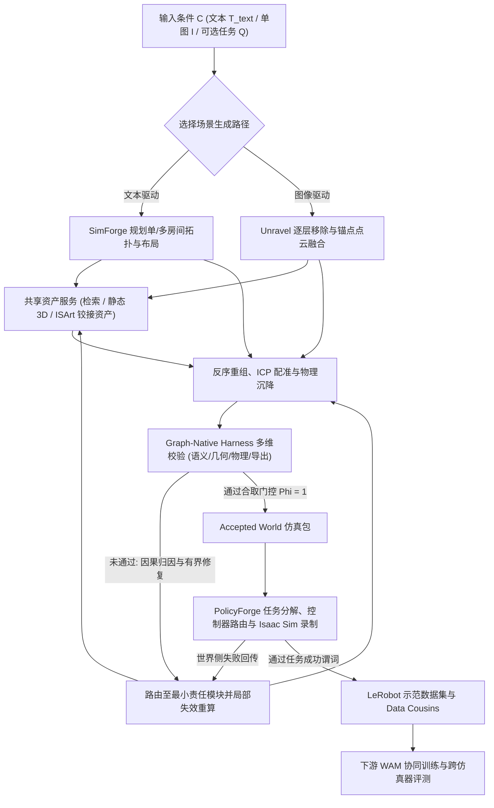

# Awomo-SimDataEngine: Agentic Simulation-Ready World Generation

## 一句话定义

**Awomo-SimDataEngine** 是一个面向机器人训练数据合成的智能体仿真世界构建系统，通过显式图原生调度框架（Graph-Native Harness）串联共享资产服务（含单图铰接物体生成 **ISArt**）、双路径场景生成（图像重建 **Unravel** 与文本生成 **SimForge**）以及自动示范合成管线（**PolicyForge**），将视觉与文本输入编译为通过几何、物理与可重放校验的可交互仿真世界与训练轨迹。

## 英文缩写速查

| 缩写 | 英文全称 | 简要说明 |
|---|---|---|
| ISArt | Single-Image Articulated Assets pipeline | 本文单图铰接物体生成管线，结合 VLM 结构规划、多部件 DiT 与仿真校验输出 URDF |
| WAM | World-Action Model | 世界-动作模型，本文中基于 Wan2.2-TI2V-5B 初始化的双流视频-动作扩散策略 |
| DiT | Diffusion Transformer | 扩散 Transformer，用于 ISArt 多部件几何生成及 WAM 视频与动作生成主干 |
| URDF | Unified Robot Description Format | 统一机器人描述格式，本文用于表达铰接物体连杆树与关节参数 |
| CD | Chamfer Distance | 倒角距离，衡量生成部件网格与真值表面点云的几何偏差（越低越好） |
| VHACD | Volumetric Hierarchical Approximate Convex Decomposition | 体积分层近似凸分解，用于为小物体生成仿真碰撞代理体 |

## 为什么重要

1. **视觉逼真不等于可交互仿真**：普通 3D 生成网格常隐含穿模碰撞体、封闭不可达内部腔体、错误关节轴心或失稳放置，导致仿真环境无法采集可用机器人轨迹。
2. **打通“资产—场景—示范”间的跨阶段因果修复**：资产替换会改变配准几何，场景调整会破坏复位前置条件；Awomo-SimDataEngine 通过显式证据平面与有界修复，将失败精确归因回源头模块而非盲目重试。
3. **验证跨仿真器合成数据的训练增益**：系统在 NVIDIA Isaac Sim 中合成带领域随机化与任务变体的示范，并在基于 MuJoCo 的 LIBERO-Plus 与 LIBERO-Pro 基准上提升策略泛化能力，尤其是目标泛化（+31.66 个百分点）。

## 核心信息

| 字段 | 内容 |
|---|---|
| 作者 | Awomo-PhysicalRSI Team（Danjiao Ma、Enhui Ma、Haohan Liu 等 23 位核心贡献者；Project Leads：Jianhua Xu、Tong Zhang、Xiangru Huang；Project Sponsors：Jianhua Xu、Kaicheng Yu） |
| 机构 | Awomo-PhysicalRSI Team（项目页域名 `awomo-westlakedi.github.io`，论文未另标注标准机构全称） |
| 发表时间 | arXiv:2610.02274v2（v1 提交于 2026-10-01，v2 修订于 2026-11-10） |
| 论文链接 | [arXiv:2610.02274](https://arxiv.org/abs/2610.02274) / [arXiv HTML](https://arxiv.org/html/2610.02274) |
| 项目与代码 | [项目页](https://awomo-westlakedi.github.io/Awomo-SimDataEngine/)（2026-11-27 入库核查不可达，`project_page_status=0`；全文及索引未提供 GitHub 仓库或可执行源码链接） |
| 清单分类 | `environment.reconstruction` |
| 来源条目 | `survey_ax_2610_02274` |
| 开源状态 | 宣称项目页但未列可运行开源代码链接 / 未确认开源代码 |

## 核心原理

系统输入条件定义为三元组 $C = \{T_{\text{text}}, I, Q\}$，其中 $T_{\text{text}}$ 为场景文本描述、$I$ 为单视角场景图像、$Q$ 为可选任务请求（$T_{\text{text}}$ 与 $I$ 至少提供一个；无 $Q$ 时输出纯场景世界，有 $Q$ 时需通过任务合约与验收门控晋升为 Accepted World）。核心由四大模块组成：

1. **共享资产服务与 ISArt 单图铰接资产生成（§4、Appendix B）**：
   - **多分支获取与标准化**：融合 CLIP 检索、图生 3D 静态模型（Hunyuan3D、TRELLIS.2、SAM 3D）、程序化建模以及铰接专用的 **ISArt**；所有候选均经过规范坐标系变换、实测包围盒、凸分解（小物体用 VHACD，大物体按部件分割分解）及质量/摩擦元数据注册（Asset Registry 同步保留被拒负样本证据）。
   - **ISArt 结构规划与条件化生成**：输入单张以物体为中心的图像 $I_0$，输出 $\mathcal{A} = (\mathcal{M}, \mathcal{K}, \Theta)$（纹理部件网格 $\mathcal{M}=\{M_i\}_{i=1}^N$、URDF 运动学树 $\mathcal{K}$ 与关节参数 $\Theta$）。先由 VLM 预测部件数 $N$、类别与逐部件属性（语义、父子连接、4 类关节独热编码、6 向粗略轴、部件框与单腔体框），并借 GPT-image-2 生成可选打开状态图 $I_{\text{open}}$ 与静态主体固定下的“估计—投影—批判”框精修。
   - **双路结构条件 DiT**：在 TripoSG 多部件 DiT 基础上维护 $N$ 组部件隐向量 $\mathbf{Z}_t^i \in \mathbb{R}^{M\times D}$，用冻结 BERT-base 编码文本并用 MLP 投影连续属性，形成 $K=7$ 个部件对齐结构 token $\mathbf{E}_i^{\text{str}} \in \mathbb{R}^{7\times d_s}$，同时用冻结 DINOv2 提取 $[I_0; I_{\text{open}}]$ 视觉特征 $\mathbf{E}^{\text{vis}}$。去噪块通过 **E 支路**（每层注入均值池化结构偏置 $\widetilde{\mathbf{H}}_l^i = \mathbf{H}_l^i + f_E(\bar{\mathbf{e}}_i^{\text{str}})$）与 **C 支路**（局部-全局-视觉注意力后对 $\mathbf{E}_i^{\text{str}}$ 做结构交叉注意力）联合注入几何-运动学约束，采用 Rectified-Flow 速度损失 $\mathcal{L}_{\text{RF}}=\mathbb{E}[\|V_\theta(Z_t,\Phi,t)-U^*\|_2^2]$ 优化，并通过分层运动学记忆绑定 URDF，在 Isaac Sim 中渲染关节运动交由视频批判器检验轴向、支点、行程与干涉。
2. **双路径场景生成（§5、Appendix C）**：
   - **Unravel（单图重建，无训练）**：输出 $\mathcal{W} = (\mathcal{E}, \{(a_i, T_i)\}_{i=1}^N)$，含房间外壳 $\mathcal{E}$ 与独立可编辑资产及位姿 $T_i=(\mathbf{s}_i, R_i, t_i)$。执行“规划—编辑—验证”逐层移除循环（内容物先于容器移除，且用局部探测 IoU 交叉验证抑制框漂移）；在固定相机下用未编辑锚点像素 $\mathcal{A}_k = \{p : M_k(p)\land M_1(p), p\notin \bigcup_{j<k} E_j\}$ 将各轮 MoGe3 点云 $P_k$ 相似对齐到 $P_1$，仅融合新暴露区域，并按射线最早存活移除轮次 $r_i \ge k$ 归属到物体簇 $C_i$。随后自房间外壳逆序重组，以双向中位 Chamfer 距离 + 截断相似性 ICP 配准（约束欠观测轴跨度不小于观测跨度 $\operatorname{span}_u(T_i(X_i)) \ge \operatorname{span}_u(C_i)$），再求解最小总平方位移沉降（支撑接触间隙 $0 \le b_i - \max H_i \le 0.03\text{ m}$，观察一致容差水平 0.3 m / 垂直 0.15 m）并做渲染审计。
   - **SimForge（文本驱动单/多房间生成）**：由 LLM 规划房间拓扑、门窗与物体需求及空间意图，几何例程区分批量小物体的程序化放置与个体约束物体的独立姿态分配，并将可复用资产模板与场景实例（姿态、支撑、关节状态、任务角色）解耦以支持局部变体编辑。
3. **Graph-Native Harness 显式执行与修复（§6、Appendix A）**：
   - 将世界状态 $S=(R,O,A,X,H,J,P,M)$ 与五维证据状态 $E=(E_{\text{sem}},E_{\text{geo}},E_{\text{phy}},E_{\text{vis}},E_{\text{exp}})$ 分离，每步调度状态 $H_k=(S_k,T,E_k,R_k,B_k,\kappa_k)$ 执行原子转移：$\text{Observe}\to\text{Diagnose}\to\text{Attribute}\to\text{Act}_{u_k}\to\text{Validate}\to\text{Select}\to\text{Route}$。
   - 依据证据因果表将故障路由至最小责任模块（Unravel 规划/编辑、资产、配准、物理沉降、批判器或导出打包），仅使受依赖下游记录失效，保留有效检查点 $\kappa_k$。视觉批判不可覆盖硬性几何、物理或导出失败；仅当合取门控 $\Phi(S,T,E)=\mathbf{1}[\text{semantic}\land\text{geometric}\land\text{physical}\land\text{task}\land\text{export}]=1$ 时晋升为 Accepted World。
4. **PolicyForge 自动示范合成（§7、Appendix D）**：
   - 以解耦适配器消费四元组 $(\mathcal{W}, \mathcal{T}, R_{\text{bot}}, \Sigma)$，在 Isaac Sim 中支持 Franka、Piper 双臂、Agibot G1 与 Agibot G2。经 LLM 任务分解为原子序列 $A_1,\dots,A_k$、控制器路由（IK、cuRobo 运动规划、RL 策略或脚本）、可重放重置采样与多视角 RGB/本体感知/末端动作录制，按任务成功谓词筛选并导出 **LeRobot** 格式数据集。
   - 失败归因涵盖 6 类（任务规格、缺失可供性、几何/支撑、物理、重置、控制器），世界侧失败回传至最小责任图边修复；通过 **Scene Cousins**（场景/光照/干扰物变换）与 **Task Cousins**（同场景交互目标变换）构建多级难度数据族。

## 流程总览

## 源码运行时序图

**不适用**（核查结果：截至 2026-11-27，arXiv 全文及索引仅给出项目页 URL `https://awomo-westlakedi.github.io/Awomo-SimDataEngine/` 且该页暂不可达，未列官方 GitHub 仓库或可运行训练/推理源码入口）。

## 实验与评测

论文在组件级（资产几何、铰接绑定、单图重建、文生场景）与下游策略级（跨仿真器 WAM 协同训练）分别展开评测，所有数据均为原文实测报告：

1. **ISArt 部件几何与 URDF 绑定（§4.1、Appendix E.1）**：
   - 在 60 个铰接物体（World-SimReady-Home 30 个 + GAPartNet_PhyScene 30 个，共 12 类）上，ISArt 部件几何对比：
     - **ISArt**：CD **0.163**，F@0.05 **0.604**，F@0.1 **0.789**；
     - TRELLIS.2 + P3-SAM + X-Part：CD 0.268，F@0.05 0.431，F@0.1 0.627；
     - SPARK：CD 0.278，F@0.05 0.314，F@0.1 0.505；OmniPart：CD 0.305，F@0.05 0.306，F@0.1 0.540；PartCrafter：CD 0.421，F@0.05 0.229，F@0.1 0.395。
   - 在给定真值部件网格下评估运动学绑定（隔离几何重建误差）：ISArt 取得 **AxisErr 0.07**、**PivotErr 0.05**、**TypeErr 13.33%**、绑定成功率 **100%**（SPARK 为 0.38 / 0.19 / 23.61% / 100%；Articulate-Anything 为 0.12 / 0.17 / 21.11% / 90%；Articulate AnyMesh 为 0.72 / 0.02 / 46.67% / 80%）。定性消融表明结构偏置 **E** 偏重局部细节、交叉注意力 **C** 偏重全局部件布局一致性。
2. **Unravel 单图重建（§5.1.3、Appendix E.2）**：
   - 5 场景共 160 个物体控制变量对比（统一用 SAM 3 + TRELLIS.2 + MoGe3）：直接重建相对 Unravel 的 VLM 资产保真度均值从 **4.7** 升至 **8.2**，盲评人工评分从 **4.9** 升至 **8.6**（1–10 分）；经 4–8 轮融合后平均场景点数从 **1.53M** 增至 **2.81M**；首轮之后移除物体的直接掩膜面积仅覆盖 Unravel 参考掩膜的 77.2%。
   - 20 场景参考视角图像相似度（Table 2）：Unravel（配合微调 GPT-6）相比 GPT-6 Astra（Ultra/ExtraHigh），CLIP-I 从 0.803 升至 **0.854**（+6.4%），LPIPS 从 0.649 降至 **0.632**（−2.6%），Edge IoU 从 0.107 升至 **0.156**（+45.8%）。
3. **SimForge 文本生成场景（§5.2.3、Table 3）**：
   - **单房间（179 条提示，SceneEval 协议）**：SimForge 相对 SceneSmith 数量一致性（CNT）从 82.9±3.4 提升至 **89.4±4.2**（+6.5 pp），可达性（ACC）从 83.4±1.5 提升至 **98.1±1.4**（+14.7 pp），属性正确率（ATR）76.8±7.1，物体-物体关系（OOR）73.1±5.4，碰撞率（COL）**0.0±0.0**，稳定性（STB）**100.0±0.0**，越界率（OOB）**0.0±0.0**。
   - **多房间住宅（31 条提示，SceneSmith 协议）**：CNT 从 83.3±6.8 提升至 **89.7±6.4**（+6.4 pp），ACC 从 79.9±2.0 提升至 **93.2±2.7**（+13.3 pp），COL **0.0±0.0**，STB **100.0±0.0**（SceneSmith 为 79.8±9.1）。
4. **下游 WAM 跨仿真器协同训练（§8、Appendix D.3 / E.3）**：
   - 策略架构为基于 `Wan2.2-TI2V-5B` 初始化的双流 Video DiT（30 层，$d=3072$）+ Action DiT（30 层，$d=1024$），输入前视与腕部双 $224\times 224$ RGB 及 8 维本体状态，输出 7-DoF 末端增量与绝对夹爪；Isaac Sim 合成数据与基准数据按 **1:1 有效帧比**加权采样混合。
   - **LIBERO-Plus（MuJoCo，1,003 回合，32 GPU，13K 步预算内按总体成功率选最佳 checkpoint，Table 4 & Table 22）**：
     - Baseline（仅基准数据，9K 步）：总体 **77.17%**（Object 84.52%，Spatial 87.08%，Goal 52.51%，LIBERO-10 85.71%）；
     - `+ SimData-Easy`（13K）：**78.76%**（+1.59 pp）；`+ SimData-Lite`（13K）：**78.27%**（+1.10 pp）；`+ SimData-Hard`（13K）：**81.06%**（+3.89 pp）；
     - `+ SimData-Ultra`（13K）：**89.43%**（**+12.26 pp**，14,580 步达 89.63%；且 5K 步即达 84.75%）。各子集同步跃升：Goal 达 **84.17%**（**+31.66 pp**），Object 达 **92.86%**（+8.34 pp），Spatial 达 **93.33%**（+6.25 pp），长时域 LIBERO-10 为 **87.70%**（+1.99 pp）。若固定在 13K 步对比 Baseline（75.97%），Ultra 提升 **+13.46 pp**。
   - **LIBERO-Pro（MuJoCo，1,000 回合，8 GPU，Tables 24–28）**：Baseline 最高 46.7%（15K），SimData-Easy 47.9%、Lite 46.9%、Hard 47.1%，SimData-Ultra 峰值 **48.7%**（13K；14,580 步为 48.0%），增幅明显小于 LIBERO-Plus，且末步在 Swap（1.00% vs 3.00%）与 Task（16.50% vs 18.00%）维度未超越 Baseline。

## 与其他工作对比

| 系统 | 世界构建定位 | 资产与场景路由机制 | 与策略学习的连接 | 与本文主要差异 |
|---|---|---|---|---|
| **Awomo-SimDataEngine（本文）** | ISArt 铰接资产 + Unravel（单图）+ SimForge（文本单/多房间） | Graph-Native Harness 显式状态-证据分离与因果有界修复 | PolicyForge（Isaac Sim 多载体）→ LeRobot 格式；MuJoCo LIBERO 跨仿真器评测 | 统一覆盖单图/文本双输入路径与铰接生成，并给出跨物理引擎协同训练验证 |
| [EmbodiedGen V2](./paper-embodiedgen-v2-sim-ready-world-engine.md) | 仿真就绪资产、可供性与任务驱动世界组装 | 模块化智能体资产生成与可编辑世界流水线 | 支持仿真部署与具身策略训练 | 本文突出 Graph-Native 证据门控与跨仿真器 WAM 定量评测 |
| [SimFoundry](./paper-simfoundry-real2sim-scene-generation.md) | 视频数字孪生与物体/场景/任务 Cousins | 面向 Real-to-Sim 的模块化场景重建 | Real-to-Sim 策略评测与 Sim-to-Real 学习 | Unravel 主打单张静态图像逐层拆解重建，SimFoundry 侧重视频重建与真机评测 |
| [SceneSmith](./paper-agentic-2602-09153.md) | 文本驱动单房间/多房间室内场景生成 | 智能体层级布局与物理安置 | 侧重场景生成（SceneSmith 基准协议） | 本文 SimForge 在同一 179/31 提示集上对比并提升了数量一致性、可达性与零碰撞率 |
| [SAGE](./paper-agentic-2602-10116.md) | 可扩展智能体 3D 场景生成 | 智能体规划与物理检查 | 面向具身智能数据构建 | 表 3 中引用 SAGE 单独 30 场景数据作参考，二者评测集与碰撞口径不直接对齐 |

## 结论

**一句话总判：Awomo-SimDataEngine 的核心工程价值在于把“资产—场景—示范”的脆弱多轮生成拆解为有显式证据门控与因果局部重算的图状态机，并证明 Isaac Sim 合成的跨场景/跨任务数据可有效反哺 MuJoCo 策略的泛化（LIBERO-Plus 总体 +12.26 pp、Goal +31.66 pp）。**

1. **单图铰接资产的关键在显式结构条件化与仿真视频审校**：ISArt 用 VLM 先验 + E/C 双路结构条件把部件几何 CD 从 0.268 降至 0.163，并拒绝将失败铰接体静默降级为刚体，这是可交互场景的基础门槛。
2. **单视角场景重建依赖“逐层剥离暴露遮挡”而非直接一步生成**：Unravel 的内容物优先移除与锚点点云融合使盲评保真度从 4.9 提至 8.6，但仍受限于单视图尺度与补全假设，不能当作真实度量几何真值。
3. **合成数据的收益集中在目标与物体泛化，而非长时域组合**：`SimData-Ultra` 在 LIBERO-Plus 上 Goal 提升 31.66 pp、Object 提升 8.34 pp，但长时域 LIBERO-10 仅 +1.99 pp，且在 LIBERO-Pro 上总提升仅约 2.0 pp（46.7%→48.7%），工程上仍需针对长程子任务序列化与位置交换（Swap）补充专门监督。
4. **落地复现前置风险在于源码与主配置尚未公开**：截至 2026-11-27 官方代码仓库与 `SimData-Ultra` 具体采样配比均未开放，目前只宜借鉴其 Graph-Native Harness 契约设计与 LeRobot 导出/过滤规范。

## 工程实践

- **Harness 与严格导出门控设计参考**：工程实现上可将世界状态 `SceneState` 与诊断日志 `PipelineState` 解耦，规定视觉 VLM 批判仅作软建议、不可绕过碰撞/支撑/URDF 运动学硬校验（合取门控 $\Phi=1$）；并在资产库中保留失败负样本防止重复踩坑。
- **Unravel 关键几何容差参数**：点云置信度阈值 $0.5$，局部框交叉验证确认阈值 $\text{IoU}\ge 0.5$（不一致时采样 3 次取 $\text{IoU}\ge 0.7$ 中位框），物理沉降支撑间隙 $\epsilon_s=0.03\text{ m}$、观测一致容差水平 $0.3\text{ m}$ / 垂直 $0.15\text{ m}$。
- **WAM 协同训练工程配比**：`Wan2.2-TI2V-5B` 初始化下，LIBERO-Plus 采用 32 GPU（全局 batch 768，AdamW + DeepSpeed ZeRO-1，`lr=2.449e-4`，bf16 混合精度，cosine 衰减，flow matching 1000 步 `shift=5.0`），合成数据与基准数据按 `1:1` 有效帧比例混合可在 5K 步即超过基线全周期峰值。
- **可复现边界**：本文仅基于 arXiv HTML 全文完成静态方法与数据核对；尚未发现可执行官方源码或公开数据集权重，未作本地仿真复现。

## 局限与风险

1. **单视角几何与补全的不确定性**：Unravel 的图像移除补全本质是对遮挡区域的生成式假设，且单目深度无法保证绝对物理尺度；ISArt 依赖 VLM 初始部件框/单腔体假设（最多支持单个腔体），先验出错需回退重规划。
2. **修复效率与组件归因缺失**：论文未统计 Graph-Native Harness 的端到端世界接收率、修复重试耗时与失败分布；`SimData-Ultra` 混合了 `SimData-Hard`、内部复杂场景示范、初始状态扰动与语言增强，且缺乏单模块受控消融与多种子置信区间。
3. **长时域、形变体与真机迁移未覆盖**：当前物理建模主要覆盖刚体与铰接体，不支持柔体/液体等可变形交互；PolicyForge 依赖脚本/运动规划教师可达的动作空间，对强接触灵巧操作和长程时序（LIBERO-10 仅 +1.99 pp）改善有限，且全篇未提供真机机器人迁移实验。
4. **评测协议偏差风险**：LIBERO-Plus 主表按评估集总体成功率在 13K 步内选取最佳 checkpoint（非独立验证集选模）；Unravel 的五场景掩膜/点云覆盖度以自身输出为参考基准，不能直接等价于真值几何精度；盲评 160 物体未报告评分者间一致性。

## 关联页面

- [Agentic Robots 综述](paper-towards-agentic-robots-survey.md)：梳理具身智能体与仿真工具链的总体图景。
- [全量项目节点清单](../overview/awesome-agentic-robots-node-index.md)：定位 `survey_ax_2610_02274` 在全量清单中的归属。
- [VLA 方法背景](../methods/vla.md)：下游 World-Action Model 与视觉-语言-动作策略协同训练背景。
- [机器人仿真场景生成](../methods/robot-simulation-scene-generation.md)：对照资产标准、场景生成与物理可运行性检查规范。
- [机器人智能体 Harness](../methods/robot-agent-harness.md)：对照 Graph-Native Harness 的显式状态转移、证据路由与有界修复机制。
- [机器人学习数据管线](../methods/robot-learning-data-pipelines.md)：对照 PolicyForge 自动轨迹采集、成功过滤与 LeRobot 格式导出。
- [视觉三维重建](../methods/visual-3d-reconstruction.md)：对照 Unravel 单视图层解构与锚点点云融合原理。
- [机器人操作任务](../tasks/manipulation.md)：对应 LIBERO-Plus / LIBERO-Pro 桌面与长程操作评测维度。
- [EmbodiedGen V2](./paper-embodiedgen-v2-sim-ready-world-engine.md) / [SimFoundry](./paper-simfoundry-real2sim-scene-generation.md) / [SceneSmith](./paper-agentic-2602-09153.md) / [SAGE](./paper-agentic-2602-10116.md)：同类仿真世界生成与基准对照实体。
- [LIBERO-Plus](./paper-rcl-2510-13626-libero-plus-in-depth-robustness-analysis-of-visi.md) / [LIBERO-Pro](./paper-agentic-2510-03827.md)：下游 MuJoCo 鲁棒性评测基准。

## 推荐继续阅读

- [Awomo-SimDataEngine 论文全文（arXiv HTML）](https://arxiv.org/html/2610.02274)
- [Awomo-SimDataEngine 项目主页](https://awomo-westlakedi.github.io/Awomo-SimDataEngine/)
- [Unravel: Recovering an Interactive 3D Scene from a Single Image（arXiv:2610.16146）](https://arxiv.org/abs/2610.16146)

## 参考来源

- [Awomo-SimDataEngine 论文原文核对归档](../../sources/papers/paper-agentic-2610-02274.md)
- [官方 Awesome 快照归档](../../sources/repos/awesome-agentic-robots-survey-index.md)
- [arXiv:2610.02274v2 摘要与 HTML 全文](https://arxiv.org/abs/2610.02274)
- [Awomo-SimDataEngine 官方项目页](https://awomo-westlakedi.github.io/Awomo-SimDataEngine/)
