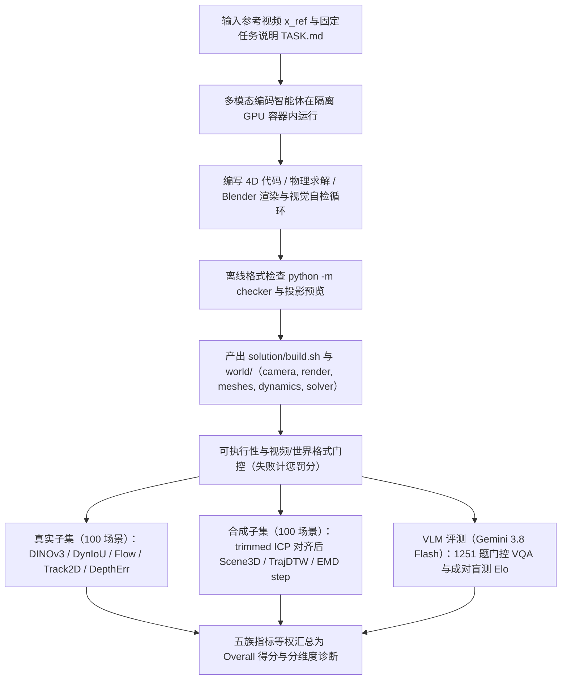

# 4DCodeBench: Benchmarking Agents on Inverse Graphics of Dynamic Scenes

## 一句话定义

**4DCodeBench** 是面向多模态代码智能体的 4D 逆向图形学基准：仅输入一段动态场景视频，要求智能体从零编写可执行的 Blender 图形与动力学程序，显式重建随时间演化的三维几何、物理运动并渲染还原视频，以此检验模型是否真正通过程序抽象理解动态物理世界。

## 英文缩写速查

| 缩写 | 英文全称 | 简要说明 |
|---|---|---|
| MPM | Material Point Method | 物质点法（含 MLS-MPM 等变体），融合拉格朗日粒子与欧拉网格模拟大变形与断裂 |
| SPH | Smoothed Particle Hydrodynamics | 光滑粒子流体动力学，用于合成液体及流固耦合场景的拉格朗日仿真 |
| IPC | Incremental Potential Contact | 增量势能接触方法（含 libuipc），用势垒函数保证大变形下无穿透接触 |
| PBD / XPBD | Position-Based Dynamics / Extended PBD | 基于位置的动力学，常被智能体用于自写布料、绳索和可变形杆件仿真 |
| DTW | Dynamic Time Warping | 动态时间规整，用于对齐并度量 2D/3D 粒子轨迹路径（Track2D 与 Trajectory DTW） |
| VQA | Visual Question Answering | 视觉问答评测，本题库含 1,251 道关于初态、末态、关键事件与接触的二元问题 |

## 为什么重要

- **从被动判别转向可执行的显式物理世界建模：** 传统物理理解基准多停留在选择题或视频生成视觉合理性判断；4DCodeBench 强制智能体把对几何、材质、相互作用和驱动力的理解写成可独立重运行的 4D 程序（4D code），暴露“看起来像”但底层几何与运动错误的伪理解。
- **连接真实复杂视频与精确 4D 真值评测：** 基准同时包含 100 段真实视频（含 21 段机器人操作片段）与 100 个物理仿真合成场景，在保持真实世界视觉和耦合复杂度考察的同时，能在合成子集上直接以 Chamfer 距离、拉格朗日轨迹与欧拉速度分布检验 3D/4D 误差。
- **揭示当前前沿模型的核心短板：** 评测 18 个专有与开源模型共 3,600 次运行表明，模型在外观和静态三维结构上已能取得较高分数，但在动态演化、真实视频泛化以及用物理求解器替代手工拟合轨迹方面仍存在系统性差距。

## 核心信息

| 字段 | 内容 |
|---|---|
| **作者** | Ruihong Shen, Žiga Kovačič, Peter Kulits, Xingrui Wang, Zizhang Li, Joshua B. Tenenbaum, Alan Yuille, Jieneng Chen, Jiajun Wu |
| **机构** | 约翰霍普金斯大学（Johns Hopkins University）、斯坦福大学（Stanford University）、马克斯·普朗克智能系统研究所（Max Planck Institute for Intelligent Systems）、麻省理工学院（MIT） |
| **发表时间** | 2026-10-02（arXiv:2610.03715v1） |
| **论文链接** | [arXiv:2610.03715](https://arxiv.org/abs/2610.03715) / [arXiv HTML 全文](https://arxiv.org/html/2610.03715) |
| **项目与代码** | [官方项目页 4DCodeBench.com](https://4dcodebench.com/)（HTTP 200）；论文与项目页提及代码仓库 `https://github.com/4DCodeBench/4DCodeBench` 及 HF 结果集 `4DCodeBench/Results` |
| **清单分类** | `environment.reconstruction` |
| **来源条目** | `survey_ax_2610_03715` |
| **开源状态** | **宣称将开源 / 未确认官方仓库可运行源码**：项目页公开了排行榜、案例交互对比与 README 运行流程，但截至 2026-11-27 本库缓存核查（`candidate_repos`）尚未收录并确认 `4DCodeBench/4DCodeBench` 的真实代码文件树，仅核实到其依赖框架 `ArtificialAnalysis/Stirrup`、流体库 `SPlisHSPlasH` 与 `NVIDIA/warp` |

## 核心原理

### 1. 4D 逆向图形学形式化定义（§2.1）

给定帧率为 $r$、共 $T$ 帧的参考视频 $x_{\mathrm{ref}} = (x_0, \dots, x_{T-1})$，智能体 $\mathcal{A}$ 在**没有任何场景名、物体清单或物理元数据**的条件下生成可执行图形程序 $\Gamma = (\gamma_1, \dots, \gamma_m) = \mathcal{A}(x_{\mathrm{ref}})$。执行 $\Gamma$ 须在每个离散时间步暴露显式 3D 几何状态 $s_{\Gamma}(t)$，并通过 Blender（5.2.0）渲染管线 $\mathcal{R}_{\Gamma}$ 输出与输入同分辨率、同帧数、同帧率的视频：

$$\hat{x}_k = \mathcal{R}_{\Gamma}\!\left(s_{\Gamma}(k / r)\right), \qquad k = 0, \dots, T-1$$

协议严格禁止程序读取参考视频像素（例如把原视频投影为贴图）或依赖外部资产/网络；动力学实现方式完全开放，智能体可自由选择 Blender 内置求解器、Taichi / Warp 自定义物理模拟、解析表达式或关键帧动画。

### 2. 数据集本体与双源构建（§2.2–§2.3, Appendix C）

4DCodeBench 包含 **200 个动态场景**（最高 60 fps；真实视频上限 300 帧；优先静止机位与连续无剪辑镜头，排除人体与动物并减少手部出镜），按主要动态物体的物质属性划分为四大类：

1. **刚体与铰接体（Rigid and articulated）**；
2. **可变形固体（Deformable solids）**：超弹性、黏弹性、弹塑性体；
3. **余维结构（Co-dimensional structures）**：布料、薄壳、绳索、弹性杆；
4. **流动物质（Flowing materials）**：颗粒介质、牛顿流体、黏塑性流体。

全库 **83%** 的场景包含多个动态物体，**66%** 包含多物质双向/多向耦合（如刚体–流体、刚体–可变形体、可变形体–布料等），并进一步区分**被动动力学**与**外部驱动运动**（如机械臂操作）。

- **100 段真实视频（Table A2）：** 51 段来自物理视频基准（WISA-80K 33、Physics-IQ 12、Phys-AD 3、Phys101 3）、21 段来自机器人操作数据集（ABC-130K 5、T-Rex 4、Robo360 3、AgiBot World 2、RoboCook 2、RoboCraft 2、ALOHA Unleashed 1、ManipArena 1、Task-Level ILC 1）、28 段来自网络开源视频（Pexels 21、YouTube CC 5、Mixkit 1、Pixabay 1）。
- **100 个合成场景（Table A3）：** 全部在 Blender 中渲染，其中超过三分之二采用比 Blender 原生更丰富的专用仿真器生成（Blender 31、Genesis 12、libuipc 10、CK-MPM 9、PPF Contact Solver 9、HOT 7、MPM-lite 4、AnisoMPM 4、CD-MPM 4、SPlisHSPlasH 3、MLS-MPM 3、Silly Rubber 3、IQ-MPM 1）。作者还在 Genesis 中扩展了黏塑性流体、Stomakhin 雪模型与 Drucker–Prager 沙模型三种 MPM 本构。

### 3. 五族自动化指标、VLM 裁判与几何诊断（§2.4, Appendix D）

由于真实视频缺乏 3D 真值而合成场景具备完整 4D 世界状态，基准设计了 **5 个指标族** 的非对称评测体系，等权平均得到 Overall 分数（$[0, 1]$，失败提交计最差惩罚值；6 个含透明物体的真实场景从栅格化几何视频比对中排除）：

| 指标族 | 适用范围 | 具体指标与计算方法 |
|---|---|---|
| **Perceptual** | 全部 200 场景 | `DINOv3` class-token 逐帧余弦相似度线性映射至 $[0,1]$ |
| **2D Dynamics** | 全部 + 真实视频 | 全场景 `Dynamic IoU`（忽略边界窄带 $B_k$）；真实视频叠加解析表面流与 RAFT 光流的归一化切片 Wasserstein 距离（`Flow`），以及与 CoTracker3 轨迹的 DTW 相似度（`Track2D`，阈值 $\kappa=0.03\delta$） |
| **2.5D Geometry** | 真实视频 | 栅格化深度视差与 Video Depth Anything 估计视差经中位数/MAD 归一化后剔除最大 1% 残差的平均绝对误差（`Depth error`，界于 $[0,2]$） |
| **3D Geometry** | 合成场景 | 通过第 0 帧表面或动态轨迹 trimmed ICP 相似变换对齐后，第 0 帧可见表面的对称 Chamfer 距离转化得分（`Scene 3D`，截断 $\kappa=0.5\sigma$） |
| **3D Dynamics** | 合成场景 | 拉格朗日视角 `Trajectory DTW`（Hungarian 最优一对一路径匹配，$\kappa=1$）与欧拉视角 `EMD step`（单步 3D 位移场的归一化切片 Wasserstein 距离） |

此外，基准引入两项互补评测与一组结构诊断：
- **VLM VQA：** 针对 200 个场景人工编写 **1,251 道二元问题**（初始状态 371、末态 354、关键事件 308、接触 218），由 `Gemini 3.8 Flash` 观看均匀采样 16 帧（含首尾帧，不提供参考视频）作答；前置空屏/纯色检查与主体存在性门控（全体提交中 81.0% 正常进入裁判，未通过或无视频则该场景题目全错）。
- **VLM 成对 Elo：** `Gemini 3.8 Flash` 盲评 3 fps 参考视频与两路模型渲染输出，经 Bradley–Terry 模型拟合为 Elo。
- **几何质量诊断（Diagnostic）：** 检查交付网格的水密性（watertight）、流形性（manifold）、非退化、无自交及无物体互穿（1 − 顶点穿透率），不计入 Overall（因简单几何体极易满分而精细破碎/流体网格反而更易出现拓扑缺陷）。

## 流程总览

## 源码运行时序图

**不适用**：截至 2026-11-27，论文（[arXiv:2610.03715](https://arxiv.org/abs/2610.03715)）与项目页（[4DCodeBench.com](https://4dcodebench.com/)）虽给出了仓库地址 `https://github.com/4DCodeBench/4DCodeBench` 及 README 复现步骤概览（`scripts/download_data.py`、`harness/runtime/infer.py`、`harness/runtime/score.py`、`vlm_judge/judge.py`），但本次缓存核查（`candidate_repos`）未能收录并验证该官方仓库的真实代码文件列表与可运行源码实现（仅核实到外部依赖 `ArtificialAnalysis/Stirrup`、`InteractiveComputerGraphics/SPlisHSPlasH` 与 `NVIDIA/warp`），故不编写推测性运行时序图。

## 实验与评测

作者在统一容器环境下评测了 **18 个多模态编程模型**（10 个专有模型配置在各自原生 CLI 运行：Codex CLI / Claude Code / Antigravity CLI；8 个开源权重模型经 `Stirrup` + `SGLang` 运行），共完成 **3,600 次运行**，总耗时 **5,983 小时**，总计 **$16,495** 计算成本（其中 97% token 为缓存读取；另测试了 Kimi K3 但因其轨迹成本较 Fable 高约 50% 且未带来相称收益而未列入正式榜单）。

### 1. 整体表现与静动态落差（§4.1–§4.2）

- **可执行性：** 全库提交总体完全可执行率为 **90.1%**；全部专有模型可执行率均 $\ge 96.5\%$，开源权重模型处于 **29.0%–95.5%** 之间。通过视频门控的运行中，仅 **5.4%** 在 4D 世界结构校验阶段失败（专有模型 $\le 2.5\%$，除 Gemma-4 31B 外的开源模型为 3.5%–7.5%）。
- **总体榜单与模型分层：** `GPT-6 Astra [Max]` 以 Overall **0.791**（0.79）位居第一，其次为 `Claude Opus 5.5 [High]`、`GPT-6 Astra [High]`（0.77）、`Claude Fable 5.1 [High]` 与 `GPT-6 Astra [Low]`（0.726 / 0.73）；开源权重模型整体落后于头部专有模型。
- **静态远优于动态：** 所有 18 个模型的 Perceptual 与 3D Geometry 得分均显著高于 2D/3D Dynamics。即便榜首 `GPT-6 Astra [Max]`，其静态指标族均值达到 **0.91**，而动态指标族均值仅为 **0.67**；在 VQA 中，首帧相关问题的准确率也系统性高于末帧与关键事件问题。
- **VQA 表现：** `GPT-6 Astra [Max]` 平均每场景 VQA 准确率为 **87.6%**（在 **59%** 的场景答对全部问题），`Claude Fable 5.1 [High]` 为 **78.8%**，`GLM-5.3 Flash [Max]` 为 **29.5%**，而 `Mistral Medium 3.5` 在 **94%** 的场景上未答对任何问题。

### 2. 人类偏好对齐与指标相关性（§4.1, §3.2, Appendix D.7）

- 对除 `Opus 5.5 [High]` 外的 **17 个模型**开展大规模众包盲测（76 名参与者，3,587 次判断，10.5% 平局，复测自洽率 95.5%）：**Human Elo 与 VLM Elo 的 Spearman 相关系数达到 $\rho = 0.980$**，Human Elo 与 Overall 自动化分数的相关性为 $\rho = 0.96$。
- 在 916 组人机共享对比中，VLM 与人类判断一致率为 **89.3%**（$\kappa = 0.761$），接近人类标注者内部一致率 **92.1%**（$\kappa = 0.816$）。但当两模型差距在 50 Elo 分以内时，单次 VLM 判断接近随机，需差距达到 132 Elo 才达到 75% 一致率、343 Elo 达到 90% 一致率。
- 各指标间呈正相关（$\rho = 0.39\text{--}0.76$）：`DINOv3` 与 `Dynamic IoU` 相关性达 0.76，而 `Trajectory DTW` 最为独立（0.39–0.50），说明画面表观相似并不代表 3D 物质轨迹准确。
- 几何诊断（Appendix D.8）与重建保真度不呈正相关：生成简单几何基元的 `Muse Glimmer [High]` 在 4 项网格完整性检查上领先或并列第一，而 `GPT-6 Astra [Max]` 因尝试重建断裂碎片、薄壳与流体表面，水密率仅 **0.830**。

### 3. 场景类别与真伪域泛化（§4.3, Appendix F.3）

- **真实 vs. 合成落差：** 相对合成场景，真实视频上的 VQA 与 Perceptual 标准化得分分别下降 **$-0.73$** 与 **$-0.88$**，而模型在真实场景平均反而少消耗 **17%** 的 token。`Claude Opus 5.5 [High]` 在合成场景几乎追平 `Astra [Max]`（VQA **0.88** vs. **0.90**），但在真实视频上明显回落（**0.78** vs. **0.85**），`Astra [Max]` 表现出更强的真实视频泛化能力。
- **场景难点分布：** 多物质交互场景相对单物质场景 VQA 降 **$-0.57$**、Perceptual 降 **$-0.39$**；余维结构（布料/绳索）在 2D Dynamics（**$-0.35$**）和 2.5D Geometry（**$-0.76$**）上明显偏低；外部驱动场景的 3D Geometry 更高（**$+0.46$**）但 VQA 偏低（**$-0.30$**）；流动场景 3D Dynamics 偏低（**$-0.21$**）。

### 4. 动力学建模策略与推理预算消融（§4.4–§4.5, Table A4–A5）

| 模型 / 汇总 | Blender 物理 | 自写物理仿真 | 解析运动拟合 | 关键帧 | 典型特征（原文实测） |
|---|---|---|---|---|---|
| **Claude Opus 5.5 [High]** | 15% | **61%** | 22% | 2% | 仿真占比最高（共 76%），常自写 MLS-MPM / PBD |
| **Claude Opus 5 [High]** | 16% | 51% | 25% | 7% | 偏好显式两阶段混合动力学与 XPBD |
| **Qwen3.8 Flash [XHigh]** | 6% | 45% | 45% | 4% | 平均 752 步、1.51M 输出 token，总体排第 11/18 |
| **Claude Fable 5.1 [High]** | 22% | 44% | 27% | 7% | 综合使用 Blender 刚体/布料与自写求解器 |
| **GPT-6 Astra [Max]** | 8% | 24% | **63%** | 5% | 仿真占比随推理强度上升：Low 13% → High 22% → Max 32% |
| **GPT-5.6 Terra [High]** | 0% | 0% | **100%** | 0% | 全部依赖解析轨迹/曲线公式拟合 |
| **18 模型汇总（Pooled）** | **10%** | **19%** | **67%** | **3%** | 自写仿真中 Taichi 155 次、Warp 102 次；PBD/XPBD 136、MPM 111 |

- **跨模型 vs. 同模型推理规模效应：** 跨模型对比中，步数和 token 总量与 Overall 得分几乎无关（$|\rho| \le 0.10$），每任务开销仅呈中等相关（$\rho = 0.65$；开源均值 247 步 / 39.6M tokens / $2.01 vs. 专有均值 101 步 / 11.8M tokens / $6.65）。但**固定模型提高推理强度**收益单调稳定：`GPT-6 Astra` 从 Low → High → Max，输出 token 从 $13\text{K} \to 29\text{K} \to 67\text{K}$（成本 $\$3.5 \to \$11.3$），Overall 从 **0.726 → 0.77 → 0.791**，2D Dynamics 从 **0.48 → 0.55 → 0.60**，3D Dynamics 从 **0.63 → 0.69 → 0.73**，VQA 从 **78.2% → 85.0% → 87.6%**。

## 与其他工作对比

论文 Table A1 与 §5 将 4DCodeBench 与已有程序化三维/物理世界基准进行了系统对照：

| 基准 | 任务类型 | 真实视频输入 | 3D 几何 | 刚体 | 可变形体 | 余维结构 | 流动物质 | 3D/4D 几何与状态评测 |
|---|---|---|---|---|---|---|---|---|
| **3DCodeBench** (2026) | 文本/图像→3D 代码 | ✗ | ✓ | ✗ | ✗ | ✗ | ✗ | ✓ |
| **PhysCodeBench / Code4D / 4DBuildBench** (2026) | 文本前向生成 | – | ✓ | ✓ | ✓ | ✓ | ✓ | ✓（Code4D 为 ✗） |
| **VisPhyWorld / VisPhyBench** (2026) | 合成视频重建 | ✗ | ✓ | ✓ | ✗ | ✗ | ✗ | ✓ |
| **MPMWorlds** (2026) | 2D 合成视频重建 | ✗ | ✗ | ✓ | ✓ | ✗ | ✓ | ✗ |
| **Δynamics / SceneActBench** (2026) | 视频重建 | 部分真实 / ✗ | ✓ | ✓ | ✗ | ✗ | ✗ | ✓ |
| **BVB** (2026) | 静态室内视频重建 | ✓ | ✓ | ✗ | ✗ | ✗ | ✗ | ✗ |
| **4DCodeBench（本文）** | 动态视频 4D 逆向图形 | **✓（100 真实）** | **✓** | **✓** | **✓** | **✓** | **✓** | **✓（100 合成 4D 真值）** |

此外，并发工作 **Code as Worlds** 主要对真实视频做运动学轨迹拟合；而针对本知识库内的三维重建方法（如 [视觉三维重建流程](../methods/visual-3d-reconstruction.md) 中的 SfM/MVS/3DGS）或 [Genesis World 1.0](./genesis-world-10.md) 等仿真基础设施，4DCodeBench 检验的是编码智能体在无预设模板下**从单目视频反推可读、可重执行程序与显式物理抽象**的综合能力。

## 结论

**一句话总判：4DCodeBench 证明前沿多模态编程模型已能稳定写出可执行的 Blender 场景程序（90.1% 可执行率）并较好还原静态外观与几何，但真正以物理仿真理解动态演化的能力仍远未成熟——67% 的解法仍在用解析曲线“描摹”运动而非求解物理。**

1. **静态分数不可外推至动态理解：** 榜首模型的静态家族均值（0.91）与动态家族均值（0.67）相差 0.24，VQA 首帧题显著高于末帧与事件题，选型和迭代时必须将动态指标（`Trajectory DTW`、`EMD step`、`Track2D`）与表观指标拆开追踪。
2. **高分不等于物理建模：** `GPT-6 Astra [Max]` 在 Overall 领跑但 63% 提交使用解析拟合，而 `Claude Opus 5.5 [High]` 虽将自写仿真推至 61%（含 Blender 共 76%），在真实视频上仍会出现诸如两相沙水拟合失效与真实域泛化下滑（VQA 0.88 → 0.78）的问题。
3. **推理预算只在同模型内稳定换取增益：** 跨模型盲目增加 agent 步数或 token（如 752 步的 `Qwen3.8 [XHigh]`）并不带来更高得分（$|\rho|\le 0.10$），提高单模型的推理深度（Astra Low → Max）才是可控的提升路径。
4. **网格完整性诊断不能代替几何保真：** 水密性、流形性等结构检查会偏向“简单基元”，评价复杂动力学重建时应作为独立诊断项而非主排序依据。
5. **代码与评测边界需审慎核实：** 基准使用 `Gemini 3.8 Flash` 作为 VQA 与 Elo 裁判，近距离差距（<50 Elo）区分度有限；且当前官方主仓 `4DCodeBench/4DCodeBench` 在本库缓存中尚未完成文件级实测，引用复现流程前需先在本地克隆核对。

## 工程实践

- **多模态编程智能体的验证闭环：** 论文环境（Appendix G.1–G.3）将容器隔离（无参考视频访问、无联网）、`python -m checker` 结构校验、`python -m checker.preview` 相机-网格投影对齐检查与离线 API 文档打包给智能体，是构建物理仿真与图形编码 agent 验证闭环的典型工程范式（对照 [Coding Agent 验证闭环](../methods/coding-agent-verification-loops.md)）。
- **4D 世界统一导出契约：** 若将真实视频或仿真重建接入下游机器人策略训练/评测，应参考其将静态渲染拓扑（`meshes/<id>.npz` 允许逐帧拓扑变化）与拉格朗日粒子/顶点身份追踪（`dynamics/<name>.npz` 固定列身份，含 `NaN` 生命周期）以及无身份欧拉流体烘焙（`solver/` + `manifest.json`）分离的数据契约。
- **单模型对比 vs. 众包盲测：** 自动化 VLM Elo 适合低成本快速筛选差距超过 ~130 Elo 的候选版本；当两套方案接近（<50 Elo）时，仍应回退到合成 4D 真值指标（`Scene 3D`、`Trajectory DTW`、`EMD step`）或人工盲测。

## 局限与风险

1. **反事实与长时外推未受约束：** 现行评测仅度量对观测视频的重建保真度，未对初始条件、材料参数或外力施加干预并检验长时预测，导致手工插值或分段样条（如按帧拟合断裂位置）依然能取得高分，难以真正区分“物理求解”与“视觉拟合”。
2. **仅评测终稿而缺乏过程诊断：** 论文只评估最终提交的 `world/` 与 `solution/`，未追踪智能体在多轮 render-and-compare 迭代中质量如何随步数收敛以及何时发生退化。
3. **透明物体与单目估计误差：** 6 个含透明主体的真实场景因表面栅格化遮挡背景而被排除出部分几何/运动指标；真实视频的深度、光流和点轨迹真值分别依赖 `Video Depth Anything`、`RAFT` 与 `CoTracker3` 估计，在剧烈变形或流体飞溅时本身带有估计噪声。
4. **官方代码核实边界：** 截至 2026-11-27 本知识库缓存核查（`candidate_repos`）尚未确认 `https://github.com/4DCodeBench/4DCodeBench` 的完整源码目录与可运行脚本细节，实际本地部署与二次评测前须自行核验仓库可用性与依赖版本（CUDA 13.0、Blender 5.2.0 等）。

## 关联页面

- [具身大模型评测基准选型闭环](../queries/embodied-eval-benchmark-selection-loop.md)：对照评测基准设计与指标选型闭环。
- [Agentic Robots 综述](paper-towards-agentic-robots-survey.md)
- [全量项目节点清单](../overview/awesome-agentic-robots-node-index.md)
- [VLA 方法背景](../methods/vla.md)
- [AI 模型与智能体基准评测](../methods/ai-benchmark-evaluation.md)
- [具身智能体评测方法](../methods/embodied-agent-benchmarking.md)
- [视觉三维重建流程](../methods/visual-3d-reconstruction.md)
- [机器人仿真场景生成](../methods/robot-simulation-scene-generation.md)
- [Coding Agent 验证闭环](../methods/coding-agent-verification-loops.md)
- [机器人操作任务综述](../tasks/manipulation.md)
- [Genesis World 1.0（仿真基础设施）](./genesis-world-10.md)

## 推荐继续阅读

- [4DCodeBench 官方项目页与交互式榜单](https://4dcodebench.com/)
- [4DCodeBench 论文原文（arXiv HTML）](https://arxiv.org/html/2610.03715)
- [ArtificialAnalysis/Stirrup（文中开源模型使用的轻量智能体框架）](https://github.com/ArtificialAnalysis/Stirrup)
- [NVIDIA/warp（容器中预置的 GPU 物理仿真框架）](https://github.com/NVIDIA/warp)
- [InteractiveComputerGraphics/SPlisHSPlasH（合成流体场景采用的 SPH 仿真库）](https://github.com/InteractiveComputerGraphics/SPlisHSPlasH)

## 参考来源

- [4DCodeBench 原文通读与核对归档](../../sources/papers/paper-agentic-2610-03715.md)
- [官方 Awesome 快照归档](../../sources/repos/awesome-agentic-robots-survey-index.md)
- [arXiv:2610.03715 论文摘要页](https://arxiv.org/abs/2610.03715)
- [4DCodeBench 官方项目页](https://4dcodebench.com/)
