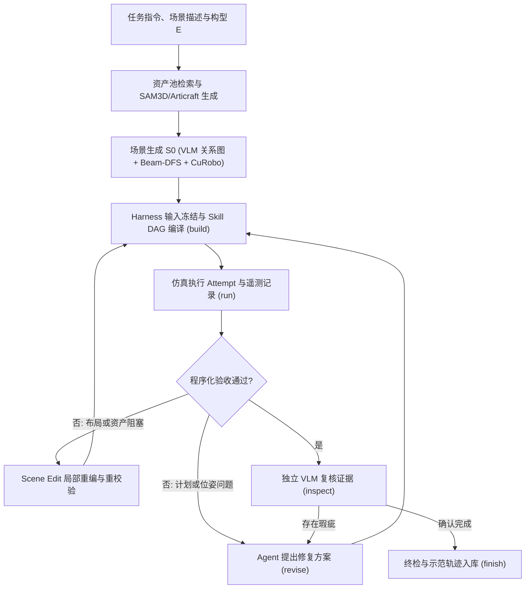

# EmbodiedSmith: Scaling Embodied Data through Recursive Self-Improvement Flywheel in Simulation

## 一句话定义

EmbodiedSmith 是一个面向机器人基础模型的仿真数据生成引擎，通过将资产/场景生成与任务技能规划及执行反馈耦合为递归自改进（RSI）闭环，持续产出经过物理与成功判据校验的多构型操作示范数据。

## 英文缩写速查

| 缩写 | 英文全称 | 简要说明 |
|---|---|---|
| RSI | Recursive Self-Improvement | 递归自改进，文中指场景与任务生成在执行反馈下相互迭代修正的飞轮机制 |
| DAG | Directed Acyclic Graph | 有向无环图，文中指由参数化原子技能及其依赖关系构成的 Skill DAG |
| VLM | Vision-Language Model | 视觉语言模型，用于资产规范化、场景图解析、任务规划与独立评审 |
| ASR | Average Success Rate | 平均成功率，跨候选方案与留出仿真种子的任务完成率均值 |
| VLA | Vision-Language-Action Model | 视觉-语言-动作模型，如下游评测采用的 $\pi_{0.5}$ |
| WAM | World-Action Model | 世界-动作模型，如下游评测采用的 FastWAM |

## 为什么重要

现有仿真数据生成管线长期受限于“资产与技能预定义、场景生成与任务规划脱节、物理与构型覆盖单一”三大瓶颈，导致复杂长程任务规划在生成场景中可执行率低。EmbodiedSmith 将场景构建从一次性前置步骤改为可响应下游执行失败的闭环环节，直接证明了执行反馈与可达性校验对长程示范生成成功率、以及布局随机化数据对下游 VLA/WAM 策略泛化的关键作用。

## 核心信息

| 项目 | 内容 |
|---|---|
| 论文 | EmbodiedSmith: Scaling Embodied Data through Recursive Self-Improvement Flywheel in Simulation（arXiv:2610.07969v1） |
| 作者 | Yikai Qin, Yifei Deng, Mingjian Liang, Wenxuan Song, Zepeng Lin, Zhiyi Jiang, Jiajun Fu, Qiao Sun, Huashuo Lei, Xicheng Gong, Jiayi Chen, Han Zhao, Shuanghao Bai, Pengxiang Ding, Pengwei Wang, Haoang Li |
| 机构 | 香港科技大学广州校区（HKUST-GZ）、小米机器人实验室（Xiaomi Robotics）、Southeastern University、清华大学（Tsinghua）、浙江大学（ZJU）、西湖大学（Westlake University）、共生知行（Symbiosis Robotics）、北京大学（PKU）、西安交通大学（XJTU）、北京智源人工智能研究院（BAAI） |
| 发表时间 | 2026-10-06（arXiv v1 预印本） |
| 论文链接 | [arXiv:2610.07969](https://arxiv.org/abs/2610.07969) / [HTML 全文](https://arxiv.org/html/2610.07969) |
| 项目与代码 | 未发布独立项目页或官方代码仓库（文中 `Genesis-Embodied-AI/genesis-world` 与 `NVlabs/GR00T-WholeBodyControl` 为外部依赖底座） |
| 清单分类 | `environment.task_generation`（来源条目：`survey_ax_2610_07969`） |
| 开源状态 | 未确认开源代码（截至 2026-11-27 核查正文与参考链接未见本文代码发布） |

## 核心原理

EmbodiedSmith 将具身数据生产拆解为环境构建、任务与轨迹生成、多构型执行适配以及分层随机化采样四个相互耦合的子系统：

### 1. 任务条件化的环境构建（Environment Construction）

- **通用资产与物理资产入池：** 对开源资产库，采用 VLM 结合多视角渲染与元数据统一语义类别、朝向、坐标系与真实尺度；检索缺失时先在图像空间生成/精修参考图，再通过 SAM3D 重建带纹理 3D 网格并做自适应凸分解与静态放置/接触/扰动验证。对于铰接物体，借鉴 Articraft 由 LLM 迭代编写领域 SDK 构造程序并结合编译器与运动学校验；可变形体与流体则配套体积表征与求解器参数，并在任务校验阶段由 CuRobo 先行检测无碰撞运动可行性。
- **场景生成与分层几何求解：** 给定自然语言描述 $\mathcal{T}$、任务上下文与机器人构型 $\mathcal{E}$，VLM 先解析出编码功能分区、固定家具、支撑面与机器人接近方向的类型化关系图；随后依次通过 Beam-DFS 搜索优化地面家具布局、墙面构件与支撑面相对位姿，同时施加边界、避碰、净空与 CuRobo 可达性约束，生成初始场景假设 $\mathcal{S}_0 = (\mathcal{G}, \mathcal{O}, \mathcal{X}, \mathcal{Q})$。
- **模式受限的场景编辑（Scene Edit）：** 当下游执行暴露环境缺陷时，场景代理在不重新合成整屋的前提下执行受约束编辑（增删、替换、缩放任务物体及跨支撑面重定位），并记录需重新校验的物理、可达性与导出项。

### 2. 闭环任务与轨迹生成（Robot Trajectory Generation）

系统由 **Task Plan Agent**（定量实验采用 `gpt-5.6-sol` 高推理力度）、**Harness**（中央调度与规则校验器）及 **simengine**（定量基准使用 `Isaac Sim 6.0.1`，物理与渲染均运行在 30 Hz）协同工作：

- **输入冻结与 Skill DAG 构建：** Harness 校验任务提示、场景配置、构型描述、23 种原子技能清单（涵盖 `navigate`、`pick`、`manualpick`、`dexpick`、`place`、`open`、`close`、`rotate`、`press`、`pour_water` 等）与全局视角图像并冻结快照；Agent 据此绑定实体与技能、确定机器人基座工作位姿并输出带有明确完成条件与禁止事件的 Skill DAG。
- **五工具交互闭环：** Agent 仅通过 Harness 暴露的五个接口推进生成：
  1. `inspect`：执行前读取物体位姿、支撑关系与视觉观察以确定放置位姿；执行后触发独立 VLM 评审给出修改意见。
  2. `build`：提交 Skill DAG 与成功判据，由 Harness 校核引用合法性、参数与任务覆盖度并交由 `simengine` 编译与几何检查，通过后冻结为 `Candidate`。
  3. `run`：在指定随机种子下运行仿真 `Attempt`，记录状态、动作、视频、安全事件与程序化验收结果。
  4. `revise`：依据失败遥测申请调整绑定实体、抓取位姿、接近方向或机器人工作位姿（任务成功判据保持锁定不变），经 Harness 审批后重新编译验证。
  5. `finish`：在程序化验收与独立 VLM 评审均通过后触发终检并归档有效轨迹。

### 3. 多构型执行适配与分层随机化（Embodiments & Randomization）

- **人形机器人适配：** 针对 Unitree G1，底层适配器将 Skill DAG 的导航目标转为下肢平衡行走策略的平面速度与朝向指令，并将末端目标经运动学与 CuRobo 解析为双臂规划，在 50 Hz 下合并 15-DoF 下肢与 14-DoF 手臂为 29-DoF 身体动作并独立下发手部指令，使上层原子技能跨构型复用。
- **灵巧手适配：** 在 Split ALOHA（双臂各 6-DoF）+ Sharpa Wave（单手 22-DoF）上结合任务级接触求解器与 CuRobo 规划，并由 PhysX 记录逐连杆接触遥测，强制执行 fail-closed 接触契约（如指定指腹接触与分阶段力阈值）。
- **三层随机化与失败重采样：** 在策略训练数据采集中按“资产组合（干扰物种类与数量）→ 空间布局（物体与基座位姿）→ 观测与初始条件（光照、纹理、相机与基座扰动）”组成大组-小组-回合层级，并按“单回合失败重采样观测 → 连续失败更换布局 → 小组预算耗尽更换资产组合”的策略保证有效入库率。

## 流程总览

依据论文 Figure 1、Figure 2 与 Figure 4 绘制整体闭环工作流：

## 源码运行时序图

**不适用**（截至 2026-11-27 核查 arXiv:2610.07969v1 全文、参考文献及公开索引，尚未确认 EmbodiedSmith 官方可运行源码仓库；论文仅引用外部物理引擎 `Genesis` 与全身控制库 `GR00T-WholeBodyControl` 作为基础组件，不可将该类依赖仓视为本文源码实现）。

## 实验与评测

所有结果均直接摘自 arXiv:2610.07969v1 原文报告，本知识库未在本地复现仿真运行。

### 1. 室内环境生成质量（§4.1，Table 1）

在 20 个不同房间类型与功能需求的室内场景描述（各 3 次独立生成）上，由 GPT-5.5 基于四视图按 1–10 分评价 5 项感知指标，并统计 4 项几何指标：

| 方法 | CF ↑ | SL ↑ | PP ↑ | TF ↑ | VQ ↑ | COL ↓ | NAV ↑ | OOB ↓ | OPN ↑ |
|---|---|---|---|---|---|---|---|---|---|
| Holodeck | 5.56±1.72 | 5.47±1.50 | 6.02±1.09 | 7.32±3.15 | 5.64±0.98 | 0.62±6.24 | 0.9967±0.0073 | 0.37±0.84 | 0.5997±0.2951 |
| LayoutVLM | 5.27±1.84 | 5.32±1.78 | 6.00±1.19 | 7.05±3.66 | 5.50±0.79 | 0.43±0.89 | 0.9954±0.0135 | 0.52±0.70 | 0.5417±0.4147 |
| SAGE | 5.20±1.98 | 5.13±1.60 | 5.92±1.08 | 7.07±3.31 | 5.15±0.78 | 0.35±1.09 | 0.9976±0.0081 | 0.03±0.18 | 0.8500±0.2311 |
| EmbodiedGen V2 | 5.57±1.68 | 5.87±1.65 | 5.43±1.39 | 6.75±3.80 | 5.95±0.98 | 2.37±1.45 | **0.9988±0.0052** | 0.19±0.48 | 0.9145±0.1363 |
| SceneSmith | 5.34±1.44 | 6.18±1.38 | 6.59±1.01 | **8.92±2.33** | 5.52±0.96 | 2.05±1.87 | 0.9916±0.0217 | **0.00±0.00** | 0.9621±0.0742 |
| **EmbodiedSmith** | **7.13±1.48** | **7.27±1.41** | **7.68±0.83** | 8.33±2.88 | **7.32±0.79** | **0.29±0.35** | 0.9984±0.0130 | **0.00±0.00** | **0.9875±0.0481** |

- 相对次优基线，EmbodiedSmith 在功能内容（CF）提升 28.0%，空间布局（SL）提升 17.6%，物理合理性（PP）提升 16.5%，视觉质量（VQ）提升 23.0%，同时保持零越界（OOB=0.00）与最低碰撞物体数（COL=0.29）。

### 2. 机器人示范生成与消融实验（§4.2，Table 2–3）

基准包含 10 个固定基座操作任务与 6 个移动操作任务（两类各半数短程、半数长程，长程主要为记忆回溯任务）；每任务从相同初始场景启动 10 次独立会话（单会话最多 30 轮反馈修订），冻结方案后在 10 个留出仿真种子上评测：

| 方法 | 平均 ASR ↑ | 平均 Top-5 ASR ↑ | 平均输出 Token ↓ | 说明 |
|---|---|---|---|---|
| SceneSmith + Planner | 17% | 23% | 137,062 | 支撑高度或交互距离常超出机械臂可达空间 |
| EmbodiedGen V2 + Planner | 21% | 27% | 91,062 | 不支持 4 项铰接抽屉/柜门任务（记为 `✗`） |
| **EmbodiedSmith** | **67%** | **77%** | **40,204** | 在所有支持任务上均高于对比基线 |

消融实验（Table 3）进一步验证闭环模块作用：

| 设定 | Fixed-Short ASR | Fixed-Long ASR | Mobile-Short ASR | Mobile-Long ASR |
|---|---|---|---|---|
| `w/o Feedback`（关闭执行反馈修订） | 4.0% | 0.0% | 0.0% | 0.0% |
| `w/o Placement Validation`（仅三视图+坐标选位姿） | 48.6% | 13.2% | 67.3% | 47.6% |
| **Ours（完整闭环）** | **69.4%** | **71.6%** | **70.0%** | **54.0%** |

- 固定长程任务在移除放置校验后由 71.6% 骤降至 13.2%（Token 由 78,183 暴增至 208,316），而移动操作下降幅度相对较小，说明底盘导航可部分补偿初始放置偏差，但仍依赖执行反馈修复。

### 3. 下游策略训练与泛化（§4.3，Table 4、Table S5–S6）

在自建书房（A1–A5）与厨房（B1–B5）共 10 个 Franka FR3 任务上全自动采集轨迹，构建等时长（20 小时）的 `clean`（固定布局）与 `mixed`（10 小时固定 + 10 小时三层随机化）数据集，分别微调 $\pi_{0.5}$（batch 256，lr $5\times 10^{-5}$，20k 步）与 FastWAM（batch 64，lr $1\times 10^{-4}$，70k 步）：

| 模型与训练数据 | Simple 均值 | Random 均值 | 总均值 | 关键观察 |
|---|---|---|---|---|
| $\pi_{0.5}$ (Clean) | **61.2%** | 7.2% | 34.2% | 固定布局过拟合图像-轨迹关联，随机化场景崩塌 |
| $\pi_{0.5}$ (Mixed) | 50.8% | **40.2%** | **45.5%** | 随机化评测成功率提升 +33.0 个百分点 |
| FastWAM (Clean) | **25.5%** | 1.0% | 13.3% | 无随机化训练在随机化场景几乎失效 |
| FastWAM (Mixed) | 20.4% | **10.2%** | **15.3%** | 随机化评测提升至 10.2%（总均值 +2.0 个百分点） |

## 与其他工作对比

- **与开环 3D 场景生成（Holodeck、LayoutVLM、SAGE）对比：** 前者偏重静态视觉与文本对齐或稀疏室内布置，缺乏面向机器人运动学工作空间的可达性约束；EmbodiedSmith 在场景图解析后引入 Beam-DFS 几何求解与 CuRobo 校验，并在下游失败时通过 Scene Edit 反向修补环境。
- **与模拟就绪环境引擎（EmbodiedGen V2、SceneSmith）对比：** EmbodiedGen V2 在生成铰接柜体/抽屉等资产时覆盖受限且尺度稳定性较弱；SceneSmith 文本保真度（TF 8.92）突出，但支撑高度与交互点间距常导致机械臂难以触达。EmbodiedSmith 通过统一资产校验与任务侧反馈显著提高了实际示范生成率（67% vs. 17%/21%）。
- **与轨迹扩增管线（HumanoidMimicGen、HumanoidGen）对比：** MimicGen 类方法依赖人工源示范片段做时空变换，HumanoidGen 侧重预设空间约束；EmbodiedSmith 直接由自然语言指令与五工具 Agent 规划 Skill DAG 并经仿真编译/VLM 复核，无需对每个新场景预先录演示范。

## 结论

**一句话总判：EmbodiedSmith 的核心贡献在于用 Harness 驱动的“五工具执行反馈 + 上游场景局部编辑”打破仿真数据生成中环境与任务脱节的僵局，为多构型机器人提供可扩展且经过物理验收的合成数据飞轮。**

1. **闭环反馈不可或缺：** 消融证明关闭执行反馈会使长短程任务生成成功率归零或趋近于零，工程上不应把 VLM 规划当作单次开环调用。
2. **固定基座任务必须做运动学前置校验：** 无碰撞放置校验可避免固定长程任务在无效位姿上浪费大量反思 Token（78k vs. 208k）。
3. **布局随机化决定策略跨场景下限：** 仅用 20 小时固定布局数据会诱导 VLA/WAM 记忆画面坐标；引入多层级随机化混训能大幅拉升随机布局评测表现（$\pi_{0.5}$ Random 7.2% → 40.2%），同时存在 Simple 场景轻度回落（61.2% → 50.8%）的容量权衡。
4. **当前工程落地仍受限于闭源与算力成本：** 尚未开源全部生成与 Harness 管线，且单会话平均仍消耗约 4 万输出 Token 与高阶推理模型。

## 工程实践

- **Skill DAG 与物理器解耦思路：** 工程复现类似系统时，建议将上层原子技能（如 `pick`、`open`、`pour_water`）与具体硬件控制器隔离在 Adapter 层，人形/灵巧手仅在适配器内融合下肢平衡策略与手腕 CuRobo/接触契约。
- **Fail-closed 验收门禁：** 不要仅凭最终物体质心坐标判定任务成功；须如 Table S4 所要求，结合前置顺序事件、释放后静置稳定时间（如 1 秒）及禁止物体瞬移/禁用碰撞等硬约束，否则容易在数据集中混入作弊轨迹。
- **分层采样配额控制：** 批量采集可沿用“大组（资产组合）→ 小组（桌面布局）→ 回合（光照/相机/基座扰动）”结构，设定连续失败阈值逐级升级重采样粒度，避免在不可达几何构型上死循环。

## 局限与风险

- **无公开可运行源码：** 截至 2026-11-27 论文未公开 EmbodiedSmith 代码库、自建资产索引或 Harness 实现，外部团队无法直接端到端复现，且文中提及物理资产生成向场景生成器的完全自动合入仍属后续工作。
- **可变形体与物理保真度简化：** 论文 §3.1 明确记录所评测的可变形体实现采用了均质材料的简化程序化表征，且释放后不完全回弹被列为已知局限（仅作记录而非验收拦截项）。
- **推理与仿真开销偏高：** 单次示范生成会话依赖高推理力度模型（`gpt-5.6-sol`）平均产生约 40k 输出 Token，复杂固定长程任务达 78k Token，并需配合 30 Hz Isaac Sim 多次回放验证。
- **真机 Sim2Real 缺口：** 论文 §4.3 下游策略评测全部在仿真 Simple / Random 设定下完成，未报告将所生成数据用于真实机器人部署的成功率实测。

## 关联页面

- [Agentic Robots 综述](paper-towards-agentic-robots-survey.md)：了解 EmbodiedSmith 在四域十七类全景中的 `environment.task_generation` 定位。
- [全量项目节点清单](../overview/awesome-agentic-robots-node-index.md)：检索同批次 Agentic Robotics 论文与环境生成项目。
- [机器人仿真场景生成](../methods/robot-simulation-scene-generation.md)：对照仿真场景合成、物理合理性与布局优化方法。
- [机器人代理执行底座（Robot Agent Harness）](../methods/robot-agent-harness.md)：对照 Agent 与仿真环境之间的冻结快照、检查与调度层设计。
- [Agent 规划反馈闭环](../methods/agent-planning-feedback.md)：深入了解执行遥测如何驱动规划重修与自我改进。
- [Agent 工具调用接口](../methods/agent-tool-use-interface.md)：对比 `inspect`/`build`/`run`/`revise`/`finish` 等结构化工具原语。
- [机器人学习数据管线](../methods/robot-learning-data-pipelines.md)：关联合成数据筛选、随机化配额与策略训练流。
- [VLA 方法背景](../methods/vla.md)：对照下游评测使用的视觉-语言-动作策略。
- [操作任务（Manipulation）](../tasks/manipulation.md)：了解桌面刚体、铰接体与长程记忆操作任务要求。
- [移动操作（Loco-Manipulation）](../tasks/loco-manipulation.md)：对照移动底座与人形全身协同操作设定。

## 推荐继续阅读

- [EmbodiedSmith 原文（arXiv:2610.07969）](https://arxiv.org/abs/2610.07969) 与 [HTML 全文版本](https://arxiv.org/html/2610.07969)
- [Genesis World 仿真平台（论文引用的外部多物理仿真底座）](https://github.com/Genesis-Embodied-AI/genesis-world)
- [NVIDIA GR00T Whole-Body Control（论文人形控制引用的外部仓库）](https://github.com/NVlabs/GR00T-WholeBodyControl)

## 参考来源

- [EmbodiedSmith 原文核对归档](../../sources/papers/paper-agentic-2610-07969.md)
- [官方 Awesome Agentic Robots 快照归档](../../sources/repos/awesome-agentic-robots-survey-index.md)
- [arXiv:2610.07969v1 HTML 全文](https://arxiv.org/html/2610.07969)
- [arXiv:2610.07969 摘要页](https://arxiv.org/abs/2610.07969)
