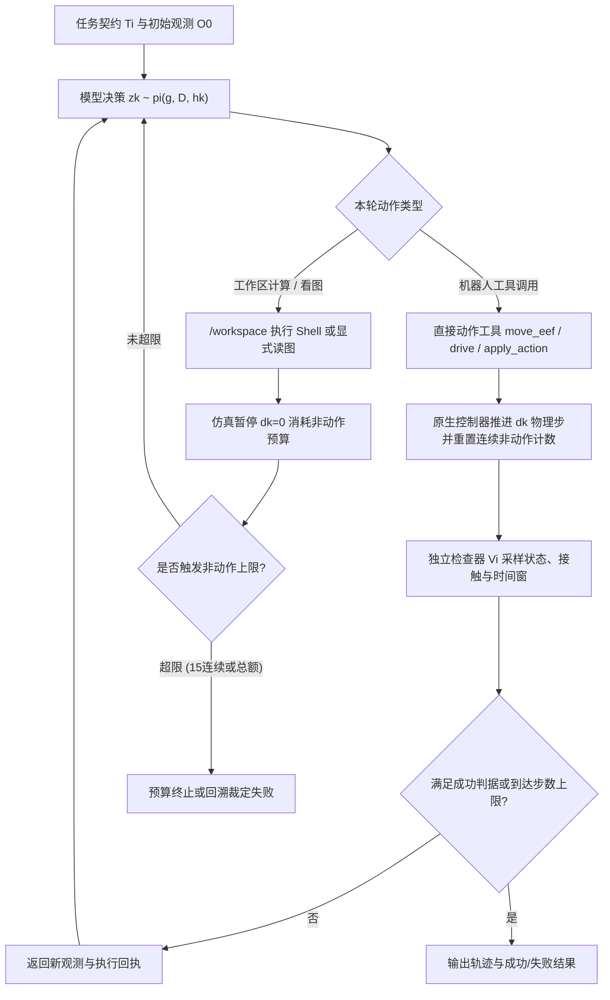

# RobotWorld: Benchmarking Multimodal Agents for Robot Use Across Diverse Tasks and Embodiments

## 一句话定义

**RobotWorld** 是一个面向「机器人使用（robot use）」的多本体、多领域仿真评测基准，通过统一的交互契约、显式非动作预算和可执行状态/时序检查器，在 84 项物理任务上检验通用多模态智能体能否将图像观测、代码计算与工具调用转化为可靠的物理闭环控制。

## 英文缩写速查

| 缩写 | 英文全称 | 简要说明 |
|---|---|---|
| EEF | End-Effector | 机器人末端执行器，桌面与移动操作适配器按法兰或夹持点控制其位姿 |
| IK | Inverse Kinematics | 逆运动学，将目标末端位姿求解为关节角（如 RoboLab、BEHAVIOR-1K） |
| OSC | Operational Space Control | 操作空间控制，RoboCasa 以基座系归一化增量输入驱动末端运动 |
| VLA | Vision–Language–Action | 视觉-语言-动作模型，直接从视觉与指令映射动作的端到端策略范式 |
| WAM | World–Action Model | 世界-动作模型，将动作生成与未来观测预测耦合的策略框架 |
| IQR | Interquartile Range | 四分位距（第 25–75 百分位区间），文中用于报告跨任务资源消耗分布 |

## 为什么重要

1. **填补「数字智能体向物理控制迁移」的系统性度量空白：** 通用多模态大模型在编程与浏览器操作中已具备「观察—调用工具—纠错」能力，但此前缺少跨本体、跨动力学机制的统一试金石，无法回答「哪些能力可迁移、哪些环节会在闭环中失效」。
2. **打破单一 Pick-and-Place 演示的局限：** 84 项任务中除固定臂/灵巧手与移动操作外，还显式纳入双足/四足抗扰恢复、轮腿车辆漂移与窄路停车、四旋翼悬吊载荷稳定及无人机颠球对抗等持续稳定与定时交互任务。
3. **以执行轨迹归因替代孤立聚合分数：** 论文将 420 条评测轨迹与最终检查器结果对齐，揭示「能写分割/标定/LQR 控制脚本」不等于「能完成任务」，精确定位出状态保持丢失、准备耗尽预算、误判完成与恢复超时四大失效机制。

## 核心信息

| 字段 | 内容 |
|---|---|
| 作者 | Zhiqin Yang, Chenxin Li, Xiaomeng Hu, Yibin Liu, Weidong Huang, Jiankai Sun, Haitao Li, Zijian Wu, Yuzhi Huang, Fanding Huang, Hanwen Sun, Jiashun Liu, Jingqi Tong, Mingxin Huang, Shaoli Hu, Shijue Huang, Tianyi Bai, Xinyuan Wang, Yunlong Lin, Zhengyang Tang, Zhexin Zhang, Zhuo Chen, Xierui Song, Juntao Dai, Boyuan Chen, Jiaming Ji, Fangneng Zhan, Mengkang Hu, Wei Xue, Yonggang Zhang, Han Hu, Tsung-Yi Ho, Yike Guo |
| 机构 | arXiv HTML 原文未列明作者所属机构（通讯邮箱 `robotworld.ai@gmail.com`） |
| 发表时间 | 2026-10-07（arXiv:2610.10409v1，62 页，25 图） |
| 论文链接 | [arXiv:2610.10409](https://arxiv.org/abs/2610.10409) · [arXiv HTML](https://arxiv.org/html/2610.10409) |
| 项目与代码 | 原文及抓取元数据未列出独立项目页 URL 或官方 GitHub 仓库链接 |
| 清单分类 | `environment.benchmarking` |
| 来源条目 | `survey_ax_2610_10409` |
| 开源状态 | 未确认开源代码（截至 2026-11-27 未公布公开代码库；附录提及归档快照 `snapshot-20261006T025143Z` 与补充接口清单 `appendix_interfaces.json`） |

## 核心原理

### 1. 任务契约与交互循环（§3.1–3.4）

RobotWorld 将每个任务形式化为一个八元组任务契约，显式暴露不同仿真环境在感知与控制辅助上的差异：

$$\mathcal{T}_i = (\mathcal{E}_i, \rho_i, g_i, O_i, A_i, C_i, B_i, V_i)$$

其中 $\mathcal{E}_i$ 为仿真环境，$\rho_i$ 为初始状态分布，$g_i$ 为任务目标，$O_i$、$A_i$、$C_i$ 分别规定观测接口、动作接口及原生控制器辅助程度，$B_i$ 为控制步与非动作交互预算，$V_i$ 为独立可执行成功检查器。在第 $k$ 轮交互中，智能体按 $z_k \sim \pi_\theta(\cdot \mid g_i, D_i, h_k)$ 决策（$D_i$ 为接口文档，$h_k$ 为保留的当前观测及每两轮采样一次的至多 4 条历史观测）：

- **离线分析工作区（`/workspace`）：** 模型在执行 shell 脚本（图像分割、相机几何拟合、LQR 动力学求解）或显式看图工具期间，物理仿真处于**暂停**状态（累计控制步增量 $d_k = 0$），推理耗时不引入真实物理延迟，但计入非动作交互预算。
- **有界物理执行：** 模型调用机器人工具推进 $d_k$ 个原生控制步（$n_{k+1} = n_k + d_k$）。框架同时支持「直接动作调用（direct actions）」与「逐控制步回调生成程序（`coding_control`）」接口设计；但在本文的五模型统一对比中，所有 420 条记录均**关闭环境侧 `coding_control`**，仅开放直接机器人工具调用与局部工作区 shell 分析。

### 2. 跨 20 个源组的工具与语义异构（Appendix A–C）

基准汇集了 20 个源项目共 84 项任务（涵盖固定基座机械臂、双臂灵巧手、移动操作机、人形/双足、四足、轮腿/无人车及旋翼无人机七类本体），但特意保留各源系统原生控制语义而不强行拉平：

- **同名工具的物理语义差异：** 例如 `move_eef` 在 RoboDojo（15 项任务）中控制世界系下两指间的夹持点且 `0` 为闭合夹爪、由规划器自动决定步数；在 RoboLab（10 项任务）中控制机器人根系下的法兰位姿且 `gripper_close=0` 为张开（15 Hz，每次 1–30 步）；在 RoboCasa（10 项任务）中则是基座系归一化 OSC 增量（每步最大平移 0.05 m、旋转 0.5 rad）。BEHAVIOR-1K（10 项任务）则提供 30 Hz 的 `move_robot` 联合控制双臂、移动底盘速度与躯干关节。
- **原生向量动作空间：** 13 个源组（共 24 项任务，如 Bench2Dex 52 维、SteadyTray 29 维、Digit 26 维、TTRL 21 维、Go2 Push 12 维、OmniDrones 与 VolleyBots 4 维转子输入等）仅注册 `observe` 与 `apply_action(note, action, steps)`，每次可连续保持 1–50 步。例如在 OmniDrones 中，转子输入 `0` 对应最大稳态推力的一半而非悬停推力，且保留一阶电机响应滞后。

### 3. 六类可执行成功判据与预算裁定（§4.3, §5.2, Appendix B.7, H.5）

RobotWorld 拒绝使用连续奖励均值或模型自报「任务完成」作为评测依据，68 项任务采用原生成绩检查器（`N`），16 项任务采用统一 `world-state-v1` 检查器（`W`），综合六类可观测证据：

1. **位置与朝向：** 如厨房导航需同时满足位置与朝向阈值，充电器插接需满足 1.5 cm 插入深度与 10° 轴向对齐。
2. **物体状态：** 抽屉归一化开度 $\le 0.05$、电器开关状态及精确物体计数。
3. **接触与释放：** 如白马克杯居中放置必须同时检测桌面接触支撑与夹爪脱离，而非仅靠悬空对准。
4. **持续时间窗（Persistence）：** 如四足抗扰恢复与悬吊载荷悬停要求多项目标指标在**最后连续 2 秒**内同时达标，中途越界即重置计时。
5. **事件计数与顺序：** 如无人机颠球要求至少 4 次高度超过 3.5 m 的合规击球且相邻触球间隔超过 25 步，并在最后 0.6 s 保持球体悬空。
6. **路径与安全边界：** 如倒车入库与绕行路线不仅检查终点位姿，还回溯途径检查点顺序与边界碰撞历史。

为防止模型无限消耗分析轮次，83 项任务限制**连续 15 次 / 总计 30、60 或 120 次**非动作事件（排球 1v1 为 20 / 150）。当运行日志越过该预算边界时，评测执行回溯裁定（共涉及 21 条记录，其中 3 条在超限后才完成的 Opus 5.5 历史轨迹被判定为失败）。

## 流程总览

## 源码运行时序图

**不适用**（说明核查结果：截至 2026-11-27，arXiv:2610.10409v1 原文及抓取元数据未公布官方 GitHub 仓库或可运行源码实现入口；论文仅在附录 B 记录了 420 条离线归档快照 `snapshot-20261006T025143Z` 及接口描述文件 `appendix_interfaces.json` 等结构，故无法开展源码级时序分析）。

## 实验与评测

论文于 2026 年 9 月 30 日至 10 月 6 日评测了 **GPT-6 Astra、Claude Opus 5.5、Kimi K3、DeepSeek V4.1 Flash、Gemini 3.8 Flash** 五个多模态模型，每个模型在 84 项任务上各运行 1 个 episode（共 420 条受评轨迹）。

### 1. 总体与五大领域成功率（Table 3, §5.3–5.4）

| 模型 | Manipulation (38) | Mobile manip. (20) | Locomotion (11) | Driving (11) | Aerial (4) | Overall (84) |
|---|---|---|---|---|---|---|
| **GPT-6 Astra** | **9/38 (23.7%)** | **4/20 (20.0%)** | 0/11 | **2/11 (18.2%)** | 1/4 | **16/84 (19.0%)** |
| **Claude Opus 5.5** | 7/38 (18.4%) | 0/20 | **1/11 (9.1%)** | **2/11 (18.2%)** | **3/4 (75.0%)** | **13/84 (15.5%)** |
| **Kimi K3** | 0/38 | 1/20 (5.0%) | 0/11 | 1/11 (9.1%) | 0/4 | 2/84 (2.4%) |
| **DeepSeek V4.1 Flash** | 0/38 | 0/20 | 0/11 | 0/11 | 1/4 | 1/84 (1.2%) |
| **Gemini 3.8 Flash** | 1/38 | 0/20 | 0/11 | 0/11 | 0/4 | 1/84 (1.2%) |

- **整体头部空间与模型互补：** Astra 与 Opus 5.5 共同完成 8 项任务，Astra 独有完成 8 项，Opus 5.5 独有完成 5 项，二者并集为 **21/84（25.0%）**；Kimi、DeepSeek 与 Gemini 的成功任务均落入该并集内，全基准仍有 **63/84（75.0%）** 任务无一模型通过。
- **能力需求分组表现（§6.6, Fig. 19）：** Astra 在空间目标（13/45 vs Opus 5.5 的 6/45）与受限接触（6/41 vs 1/41）表现显著更强；Opus 5.5 则在连续平衡/跟踪（4/20 vs Astra 的 1/20）与定时交互（4/7 vs 2/7）上更占优势。

### 2. 资源消耗与交互效率（Tables 12–14, Table 16）

| 模型 | 中位耗时 (min, IQR) | 中位机器人请求 / 总调用 | 中位控制步 / Shell 调用 | 汇总 Token 量 | 估算 API 费用 (USD) | 累计耗时 (h) |
|---|---|---|---|---|---|---|
| **GPT-6 Astra** | 30.9 [15.2, 61.2] | 58 / 70 | 627 / 4.5 | 941M | $9,912.80 | 54.6 |
| **Claude Opus 5.5** | 54.0 [24.5, 137.3] | 37 / 57.5 | 458 / 15 | 1.63B | $2,916.43 | 140.3 |
| **Kimi K3** | 67.6 [21.3, 181.7] | 42.5 / 61.5 | 449.5 / 1 | 2.00B（57 任务外推） | $624.09 | 163.8 |
| **DeepSeek V4.1 Flash** | 16.0 [11.1, 40.5] | 22 / 33 | 347 / 8.5 | 907M | $34.49 | 35.7 |
| **Gemini 3.8 Flash** | 12.8 [10.0, 25.8] | 11 / 31 | 315 / 15 | 303M | $66.68 | 28.7 |

- **工具调用与物理步数的分离（§6.5–6.6, Table 16）：** 在 Astra 与 Opus 5.5 共同成功的 8 项任务中，Astra 在 7 项任务上使用了更少的总工具调用，但在物理控制步数上仅在 6 项中更少（如 `Cube left of bowl` 中 Astra 用 24 次调用 / 286 步，而 Opus 5.5 用 31 次调用 / 239 步）。Opus 5.5 全库累计调用 2,095 次 shell 与 568 次显式看图（Astra 为 1,435 次与 56 次），倾向于先写分割与相机标定程序再行动，但也因此在 `BlockStackingSpecifiedOrderTask` 等任务中触及非动作总预算上限（第 313 步截断，尽管第 602 步历史轨迹完成了堆叠）。

### 3. 典型成功策略与四大失败模式（§6.1–6.4, Appendix E & H）

- **有效反馈闭环示例：** Astra 在 `plug_in_charger` 第 196 步手腕俯仰旋转被规划器拒绝后，先降低并移近空闲臂（第 207 步），再重试旋转于第 230 步成功并最终在第 323 步完成插接；Gemini 3.8 Flash 在 `match_and_pick_from_conveyor` 第 550 事件收到 `right arm pose unreachable` 后将抬升高度从 0.95 m 下调至 0.85 m 并于第 511 步成功；Opus 5.5 在 `drone_volleyball_solo_juggle` 中借助短分段转子指令实现 15 次合规击球（14 次高度达标），在 `drone_payload_hover` 结合离线 LQR 计算达成 2.15 s 联合稳定（超过 2 s 要求）。
- **四大失败机制：**
  1. **到达位姿但丢失物体状态：** Kimi K3 在 `pour_liquid_into_cup` 第 42 步碰倒水瓶，多次左臂复抓落空并于第 240 步切换右臂，耗尽 400 步仍未完成倾倒。
  2. **准备与分析耗尽预算：** Kimi K3 在 `slicing_vegetables` 全部 69 次正步长调用（2,000 步）均消耗在进入厨房导航，未发出任何切菜动作；DeepSeek 在 Bench2Dex `task-232` 编写运动学脚本与裁剪查图耗尽 15 次连续非动作预算，物理步数为 `0`。
  3. **误判完成并停止纠偏：** Kimi K3 在 `sweep_blocks` 第 861 步宣称已完成，随后发出 69 次仅改变空臂高度的调用推进 139 步至超时；DeepSeek 在厨房炉灶导航第 345 步判定无需移动，后续发出 105 步零速度底盘指令导致任务失败。
  4. **恢复过晚或不满足持续窗口：** Astra 在人形乒乓球回击于 3.58 s 基座跌落至 0.50 m 以下；在 `drone_inverted_pendulum_tracking` 末端误差仅 2.45 cm，但中期越过 20 cm 边界且最终联合稳态仅维持 0.565 s（未满足 1 s 要求）。

## 与其他工作对比

### 1. 同类具身智能体评测基准对比（Table 1）

| 基准 | 直接动作控制 | 代码生成控制 | 混合调用 | 导航任务 | 身体平衡任务 | 驾驶 / 飞行 |
|---|---|---|---|---|---|---|
| CaP-X (2026) | ✗ | ✓ | ✗ | ✓ | ✗ | ✗ |
| EmbodiedBench (2025) | ✓ | ✗ | ✗ | ✓ | ✗ | ✗ |
| VLABench (2024) | ✓ | ✓ | ✗ | ✗ | ✗ | ✗ |
| EmbodiedEval (2025) | ✓ | ✗ | ✗ | ✓ | ✗ | ✗ |
| Embodied Agent Interface (2024) | ✓ | ✗ | ✗ | ✓ | ✗ | ✗ |
| EmbodiedSWE-Bench (2026) | ✗ | ✓ | ✗ | ✓ | ✗ | ✗ |
| **RobotWorld (本文)** | **✓** | **✓（框架支持，主实验关闭）** | **✓** | **✓** | **✓** | **✓** |

### 2. 与站内相关工作及同名概念辨析

- **与真机配对盲测（[RoboArena](../methods/roboarena.md)）互补：** RoboArena 聚焦相同 DROID 真机平台上的匿名 A/B 策略配对与开放场景泛化；RobotWorld 侧重单一受控协议下多模型在异构仿真本体（含动力学强相关领域）的绝对完成率与执行轨迹归因。
- **与 [机器人智能体执行框架](../methods/robot-agent-harness.md) 的关系：** 两者均强调将「模型自报完成」与「独立可执行后置检查」隔离。RobotWorld 通过实证指出，即便模型在 `/workspace` 具备完整 Python 感知与控制计算能力，若框架缺少针对物体保持与时间窗的显式状态核验，仍会在物理长程任务中大面积失效。
- **同名辨析（勿混淆）：** 本页指代多智能体物理执行评测基准 **RobotWorld（arXiv:2610.10409）**，不同于通义发布的语言条件视频世界模型 **[Qwen-RobotWorld](qwen-robot-world.md)**。

## 结论

**一句话总判：RobotWorld 用 84 项跨本体仿真任务证实，2026 年主流多模态智能体虽能编写分割、几何标定与动力学控制程序，但尚不具备稳定的物理闭环组合执行能力，得分最高的 GPT-6 Astra 与 Claude Opus 5.5 总体通过率仅 19.0% 与 15.5%，且各自呈现明显的「空间接触型」与「连续动态定时型」能力偏科。**

1. **不能将局部编码/视觉估计等同于物理控制能力：** 在构建闭环智能体时，必须显式追踪受控物体的物理保持状态（如抓握是否脱落、倾倒后是否需重新规划），而不能以末端到达目标位姿作为子目标完成信号。
2. **引入强制性的外部状态核验与预算守卫：** 智能体极易在未达标时产生「完成幻觉」或陷入纯分析循环；工程执行框架应限制连续非动作工具预算，并将完成判定完全交由传感器/状态谓词检查器而非模型文本输出。
3. **针对异构控制界面做模型选型或路由：** 面向桌面精密对准与受限接触任务时可优先侧重空间几何接地较强的策略（如 Astra 类特征）；面对高速、多自由度连续平衡或定时交互任务时，则需依赖高频短步长调节与动力学建模（如 Opus 5.5 类特征）。
4. **填补从「暂停式仿真」到「真机实时闭环」的剩余鸿沟：** 本文允许模型在仿真暂停期间耗费数十秒乃至数分钟执行推理与脚本分析（中位单任务耗时 12.8–67.6 分钟），未来训练与系统优化必须同时压缩交互成本、推理延迟并恢复环境侧实时反馈控制。

## 工程实践

1. **工具文档必须明确物理锚点与极性约定：** 接入多源机器人适配器时，务必在系统提示中显式标注末端目标指代的是法兰中心还是指尖夹持点、位置是绝对坐标还是步长增量、夹爪 `0/1` 极性以及电机是否存在一阶响应延迟（`move_eef` 在 RoboDojo、RoboLab 与 RoboCasa 间语义完全不同）。
2. **区分「动作调用次数」与「物理消耗步数」双指标审计：** 减少工具调用次数不等于降低物理控制步数或 API 费用；在评测与调优执行框架时应同时记录确认执行的控制步数、非动作分析轮次与回溯截断边界。
3. **用「状态检查 + 后撤确认」替代盲目连续推进：** 如 Kimi 在关抽屉和 Astra 在有序堆叠中的有效片段所示，接近接触后缩短单步段长、并在释放后加入短程垂直回撤以通过视觉复核支撑状态，可显著降低误判与碰撞风险。

## 局限与风险

1. **单次试验与非受控消融限制：** 五模型评测对每个任务-模型对仅执行了 1 个 episode，未提供重复试次的方差与置信区间；且 5 模型在提供商、采集时段与预算校准基准（总预算档位基于 Astra 记录标定）上存在差异，跨模型对比属于观察性剖析而非受控单因素消融。
2. **仿真时间暂停带来的真机迁移失真：** 模型在思考与调用 `/workspace` 期间仿真时钟完全冻结，掩盖了真实物理世界中的推理延迟、传感器噪声及不可逆动力学失稳风险；直接套用于真机高动态控制会面临严重时延瓶颈。
3. **数据分布不均与训练集污染风险：** 操作与移动操作合计占 84 项任务的 69.0%（58 项），而空中飞行仅 4 项（单任务即影响 25 个百分点）；此外基准基于 20 个公开源项目构建，部分任务说明或开源代码可能已进入受测大模型的预训练语料，且官方评测代码尚未公开核验。

## 关联页面

- [具身大模型评测基准选型闭环](../queries/embodied-eval-benchmark-selection-loop.md)：对照评测基准设计与指标选型闭环。
- [Agentic Robots 综述](paper-towards-agentic-robots-survey.md)
- [全量项目节点清单](../overview/awesome-agentic-robots-node-index.md)
- [VLA 方法背景](../methods/vla.md)
- [机器人智能体执行框架](../methods/robot-agent-harness.md)：对照规划、工具调用与反馈的系统边界
- [具身智能体评测方法](../methods/embodied-agent-benchmarking.md)：对比固定协议回归评测与配对盲测方法
- [智能体工具使用接口](../methods/agent-tool-use-interface.md)：解析多本体异构机器人工具契约设计
- [智能体规划与执行反馈](../methods/agent-planning-feedback.md)：关联失败恢复、重规划与终止判定机制
- [机器人操作任务](../tasks/manipulation.md)
- [移动操作任务](../tasks/loco-manipulation.md)
- [足式运动任务](../tasks/locomotion.md)

## 推荐继续阅读

- [RobotWorld 论文主页（arXiv:2610.10409）](https://arxiv.org/abs/2610.10409)
- [RobotWorld 全文 HTML 版本（含 Appendix A–H 全部 84 任务规格与轨迹记录）](https://arxiv.org/html/2610.10409)
- [CaP-X: Benchmarking and Improving Coding Agents for Robot Manipulation（arXiv:2603.22435）](https://arxiv.org/abs/2603.22435)
- [RoboDojo: Unified Sim-and-Real Benchmark（arXiv:2607.04434）](https://arxiv.org/abs/2607.04434)

## 参考来源

- [RobotWorld 论文全文精读归档](../../sources/papers/paper-agentic-2610-10409.md)
- [官方 Awesome 快照归档](../../sources/repos/awesome-agentic-robots-survey-index.md)
- [arXiv:2610.10409 论文官方 HTML 原文](https://arxiv.org/html/2610.10409)
