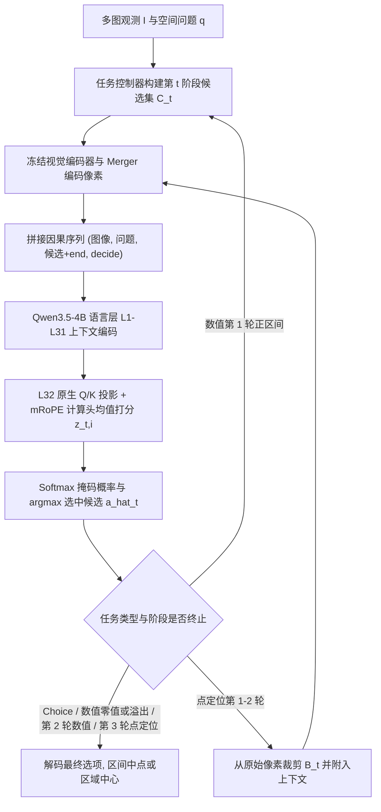
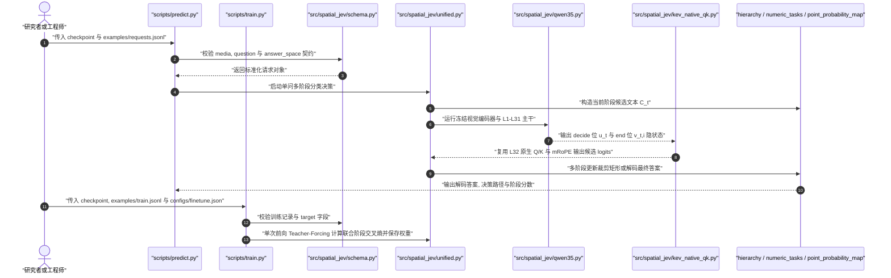

# MJev-Spatial: System One Spatial Intelligence via Native Attention Matching

## 一句话定义

**MJev-Spatial** 是一种面向物理空间理解的 System 1 多模态决策模型，它把空间选择题、数值估计与 2D 图像指向统一建模为有限候选集分类问题，直接复用骨干网络预训练的 Query/Key 注意力投影完成候选打分，无需自回归文本解码或新增预测头。

## 英文缩写速查

| 缩写 | 英文全称 | 简要说明 |
|---|---|---|
| MJev | Multimodal Joint Evaluation / Jev-style Multimodal Decision | 面向多模态有限候选空间直接概率决策的 System 1 范式 |
| VLM | Vision-Language Model | 视觉语言模型，传统基线通常以自回归生成文本作答 |
| GQA | Grouped-Query Attention | 分组查询注意力，本文每 4 个 Q 头共享 1 个 K 头 |
| mRoPE | Multimodal Rotary Position Embedding | 多模态旋转位置编码，Qwen3.5 对每头前 64 维做旋转 |
| RMSNorm | Root Mean Square Layer Normalization | 均方根层归一化，读出阶段复用骨干原生输入与头归一化 |
| MAE | Mean Absolute Error | 平均绝对误差，本文用于长度预测（VST-300）与计数误差评测 |

## 为什么重要

1. **交互帧率瓶颈与自回归冗余：** 具身智能体在导航与操作中需要高频判断空间关系、距离和放置点。传统 VLM（如 SpatialVLM、RoboPoint、RoboRefer）哪怕面对紧凑输出空间，仍需逐 token 自回归生成格式文本再做字符串解析，引入显著时延与格式耦合噪声。
2. **统一接口打通三类空间输出：** 现有感知模型常为选择、回归与指向分别设计输出头。MJev-Spatial 用同一套「文本化候选描述 + 单轮前向注意力匹配」机制，在不新增参数的前提下统一处理离散选项、多尺度物理量与像素级坐标定位。
3. **无损扩展至多目标点预测：** 凭借分层条件概率树与连通域提取，同一训练权重无需针对多点序列重训即可支持多目标点定位，为下游操作与空间规划提供轻量化感知接口。

## 核心信息

| 项 | 内容 |
|---|---|
| **作者** | Luozheng Qin, Yuhan Zhu, Changhai Zhou, Qian Qiao, Jun Gao, Yuhua Zhou, Harry Zhang, Xiangyu Zeng, Yuxuan Liu, Yuxin Lu, Kaijie Chen, Andrew Chen, Pony Ma |
| **机构** | 复旦大学（Fudan University）；MindLab |
| **发表时间** | 2026-10-15（arXiv v1）/ 2026-10-26（arXiv v2） |
| **论文链接** | [arXiv:2610.22276](https://arxiv.org/abs/2610.22276)（[HTML 全文](https://arxiv.org/html/2610.22276)） |
| **项目与代码** | [Fr0zenCrane/MJev-Spatial](https://github.com/Fr0zenCrane/MJev-Spatial)（Apache-2.0）；权重 [mindlab-research/MJev-Spatial-4B](https://huggingface.co/mindlab-research/MJev-Spatial-4B) |
| **清单分类** | `model.perception`（来源条目：`survey_ax_2610_22276`） |
| **开源状态** | **已开源**（模型运行时、推理/微调/评测脚本与 4B 检查点已公开；12.3M 训练转化数据未在公共仓打包） |

## 核心原理

### 1. 统一有限候选分类框架

给定有序图像 $I=(I_1,\dots,I_m)$ 与空间问题 $q$，确定性任务控制器在第 $t$ 阶段根据问题与历史选择 $h_{<t}$ 构造合法候选集 $\mathcal{C}_t=\{c_{t,1},\dots,c_{t,K_t}\}$ （单轮上限 32 个候选，填充槽位 logit 置 $-\infty$）。模型在单一前向传播内为所有候选计算分数 $z_{t,i}$ 并做 softmax 分类：

$$
p_\theta(i \mid I, q, h_{<t}, \mathcal{C}_t) = \frac{\exp z_{t,i}}{\sum_{j=1}^{K_t} \exp z_{t,j}}, \qquad \hat{a}_t = \operatorname*{arg\,max}_{i} p_\theta(i \mid I, q, h_{<t}, \mathcal{C}_t)
$$

三类空间任务的阶段与码本结构如下：

- **选择题（Choice，1 阶段）：** 直接将输入提供的选项文本放入候选槽位，单轮决策即终止；训练阶段随机打乱候选顺序，评测遵循原基准选项序。
- **数值估计（Numerical，1–2 阶段）：** 按物理量与声明单位分别维护独立码本。
  - **长度（m）：** 覆盖 $(0, U]$（$U=16384\text{ m}$，$s=0.01\text{ m}$），由 30 个对数间隔正粗区间 $e_j = s[\exp(\frac{j}{30}\log(1+U/s))-1]$ 加上 `exact-zero` 与 `overflow` 共 32 个根类构成；若选中正粗区间 $[e_j, e_{j+1}]$，第二阶段将其线性切分为 $F_j \in \{4,8,16,32\}$ 格，使 $\frac{e_{j+1}-e_j}{2F_j} \le \max(0.01\text{ m}, 0.05 e_j)$（前 6 区间各 4 格、后 24 区间各 8 格，合计 216 个正叶格），两阶段均取 $\arg\max$ 并返回精细格中点 $\hat{y}=e_j + \frac{k+1/2}{F_j}(e_{j+1}-e_j)$，将码本理论量化误差上界控制在 $\max(1\text{ cm}, 5\% y)$。
  - **计数（Count）：** 针对整数 $n\in[0, 1023]$ 采用 32 粗组 × 32 整数编码 $(\lfloor n/32\rfloor, n\bmod 32)$，两阶段均预测正确时可无损重构 $32a_1+a_2$。
  - **角度（Angle）：** $(0, 360^\circ]$ 按每 $30^\circ$ 划分 12 个正区间加 zero/overflow（共 14 根类），每正区间细分为 32 个线性格。
- **单点定位（Point，3 阶段九宫格视觉细化）：** 从全图 $B_0=[0,0,1,1]$ 出发，每轮在固定序的 9 个方位子区域（$3\times 3$ 网格）中分类；前两轮决策后均从**原始图像像素**裁剪选中矩形 $B_t$（避免连续二次重采样模糊），送入冻结的视觉编码器与 merger 编码后附于上下文末端，最终取 $B_3$ 中心作为归一化坐标（等效 $27\times 27$ 网格，单轴正确格最大中心误差 $1/54$）。
- **无训练多点扩展（概率树解码）：** 面向计数型定位（如 Point-Bench counting），在同一模型权重上展开 3 层条件概率树（完整 91 决策节点 / 729 叶格；评测采用根剪枝，丢弃 $p(a_1) < 0.01\max_j p(j)$ 的一级分支，使平均决策节点降至 51.10），再对保留地图取全局峰值 10% 以上的 8 连通域并输出各连通域峰值格中心。

### 2. 零新增参数原生注意力匹配读出

MJev-Spatial 基于 `Qwen3.5-4B`（32 层语言骨干，隐层维度 $D=2560$；L4/L8/…/L32 为 Full Attention，其余 24 层为 Gated DeltaNet）。输入采用复用词表既有词元的因果序列格式：

`[state, I_1, ..., I_m, question, q, opt, c_1, end, ..., opt, c_K, end, decide]`

前向执行 L1–L31 层后，在 L32 输入端仅抽取各候选结束位状态 $v_{t,i} \in \mathbb{R}^{2560}$ 与决策位状态 $u_t \in \mathbb{R}^{2560}$，直接复用第 32 层全注意力块的预训练输入 RMSNorm $N_{\mathrm{in}}$、头归一化 $N_Q, N_K$、部分多模态 RoPE $R_p$（仅旋转每头前 64 维）及投影矩阵 $W_Q \in \mathbb{R}^{4096 \times 2560}$（取原 Q+gate 投影中每个头的 256 维查询行）和 $W_K \in \mathbb{R}^{1024 \times 2560}$（$H=16$ 查询头，$G=4$ 键值头，$d=256$）：

$$
Q_{t,h} = R_{p_t}\!\left[N_Q\!\left(W_Q^{(h)} N_{\mathrm{in}}(u_t)\right)\right], \qquad K_{t,i,g} = R_{p_{t,i}}\!\left[N_K\!\left(W_K^{(g)} N_{\mathrm{in}}(v_{t,i})\right)\right]
$$

$$
z_{t,i} = \frac{1}{16}\sum_{h=0}^{15}\frac{Q_{t,h}^\top K_{t,i,\lfloor h/4\rfloor}}{\sqrt{256}}
$$

由于读出位于 L32 注意力聚合与 FFN 之前，L32 的 $V$ 投影、output gate、输出投影、post-attn norm、SwiGLU FFN（仅该 FFN 即占 70,778,880 参数）以及最终 LM norm 均被安全裁剪，可训练语言参数共 4,111,374,336（比完整语言侧 KEV 少 95,688,192 参数），且无需生成任何词表输出或构造全序列 $L\times L$ 注意力矩阵。

### 3. 12.3M 数据管线、联合监督与负载均衡调度

- **多源清洗语料：** 从 Molmo2-ER 收集的数据转化并经内容级选项清洗与 64-bit dHash 近重复去重后，形成 **12,304,058 条 QA**（Choice 7.1M / 57.65%、Point 3.5M / 28.34%、Length 1.6M / 12.71%、Angle 120K / 0.98%、Count 38K / 0.31%），主来源为 RefSpatial（11M）、SenseNova-SI（484K）、VST-P（388K）、VSI-590K-image（255K）与 SAT（168K）。
- **单次前向 Teacher-Forcing 联合监督：** 利用真值路径与真值局部裁剪按因果顺序串联同一问题的全部阶段，在一次前向中联合计算所有阶段交叉熵并按阶段数 $S_q$ 归一化，使 3 阶段点定位与 1 阶段选择拥有均等样本权重：

$$
\mathcal{L} = \frac{1}{N_{\mathrm{actual}}} \sum_{q} \frac{1}{S_q} \sum_{t=1}^{S_q} -\log p_\theta\!\left(a_{q,t}^* \mid I_q, q, h_{q,<t}^*, \mathcal{C}_{q,t}\right)
$$

- **高效批调度：** 因为 Qwen3.5 含 Gated DeltaNet 循环状态，不采用跨 QA 样本拼接，而在每个全局优化步（global batch 512，8 卡 × microbatch 8 × 8 步累积）内做**全局长度排序分组 + 最长工作量优先跨卡分配**（代价 $C(B)=|B|\max_{q\in B}L_q + 0.25\sum_{q\in B}V_q$）。

## 流程总览

## 源码运行时序图

官方仓库 [`Fr0zenCrane/MJev-Spatial`](https://github.com/Fr0zenCrane/MJev-Spatial) 通过 `scripts/predict.py`、`scripts/train.py` 与 `scripts/evaluate.py` 暴露统一 JSONL 契约接口，核心推理与微调执行链路均经由 `src/spatial_jev/` 内的契约校验、骨干封装与原生 Q/K 读出模块完成（静态代码核对，详情见 [`sources/repos/paper-agentic-2610-22276.md`](../../sources/repos/paper-agentic-2610-22276.md)）：

## 实验与评测

### 1. 12 项空间理解基准综合表现与推理时延（Table 2 & Table 11）

在 12 项公开空间理解基准与 NVIDIA B200（batch size = 1）端到端单问时延评测中，基于 Qwen3.5-4B 训练的 MJev-Spatial 取得 **65.64%** 最高总均分（在 7/12 基准排名第一，全部 12 项均超越未改动基座 Qwen3.5-4B），平均单问时延仅 **160.6 ms**（比最快的 AR 基线快 2.47 倍，比基座 Qwen3.5-4B 快 5.57 倍）；在 VST-300 长度开发集上取得 **0.103 m** MAE。

| 模型 | SAT | CV-Bench | Robo-VQ | BLINK | MMSI | RefSpatial | Where2Place | Robo-POI | Point-Bench | ERQA | EmbSpatial | VSI full | 12 项均分 (%) | B200 平均时延 (ms) |
|---|---|---|---|---|---|---|---|---|---|---|---|---|---|---|
| **MJev-Spatial** | 79.33 | **88.82** | **79.06** | 67.17 | **45.60** | **58.50** | **67.96** | 55.74 | **64.38** | **46.75** | 78.46 | 55.93 | **65.64** | **160.6** |
| Qwen3-VL-8B-Instruct | **83.33** | 86.37 | 74.72 | 61.76 | 31.40 | 49.00 | 67.07 | 59.02 | 61.54 | 43.25 | **78.90** | 57.07 | 62.79 | 442.0 |
| Spatial-SSRL-Qwen3VL-4B | 79.67 | 85.52 | 65.26 | 60.39 | 26.70 | 48.75 | 66.54 | **61.48** | 60.60 | 41.25 | 78.10 | 46.65 | 60.08 | 397.4 |
| Molmo2-ER | 80.00 | 88.31 | 62.01 | **72.17** | 42.90 | 52.00 | 46.64 | 26.23 | 53.47 | 46.50 | 77.99 | **60.55** | 59.06 | 777.3 |
| SenseNova-SI Qwen3-VL-8B | 79.67 | 83.15 | 75.68 | 56.08 | 35.30 | 33.00 | 45.92 | 45.90 | 52.34 | 41.00 | 75.33 | 59.38 | 56.90 | 749.9 |
| Qwen3.5-4B（基座 AR） | 43.00 | 85.56 | 56.17 | 63.11 | 33.90 | 46.00 | 55.98 | 50.00 | 62.65 | 45.50 | 75.82 | 39.93 | 54.80 | 894.1 |
| InternVL3.5-8B | 83.00 | 74.66 | 71.67 | 56.08 | 29.90 | 23.80 | 27.48 | 14.75 | 32.93 | 39.00 | 72.14 | 53.46 | 48.24 | 3368.4 |
| SpatialThinker-7B | 78.00 | 78.17 | 64.94 | 56.02 | 27.80 | 0.50 | 2.66 | 13.93 | 14.46 | 40.25 | 69.89 | 29.56 | 39.68 | 406.7 |

### 2. 受控消融实验关键定量结果（72K-QA 试点集，2.2K 更新步）

- **读出头对照（Table 3）：** 原生 Q/K（L32 mean）无新增参数且训练成本最低，RefSpatial 达 **51.00%**、VST-300 MAE 为 **0.3341 m**、CV-Bench 为 **85.38%**；相比之下线性位置头在 Where2Place（67.99% vs 59.98%）与 RoboSpatial pointing（65.57% vs 62.30%）占优但长度 MAE 升至 0.3668 m；新增 1,311,232 参数的 KEV 指针头在 RoboSpatial VQA 达 68.54%，但在 RefSpatial（45.50%）与长度 MAE（0.3614 m）落后。
- **读出深度与跨层融合（Table 14–17）：** 浅层读出无法支撑几何定位（L4 mean 在 RefSpatial 仅 4.50%、CV-Bench 51.41%）；L32+L28/L24 等权融合虽能局部抬高 Where2Place（65.98%），但均恶化长度 MAE（0.3344 → 0.3550–0.3993 m）。16 个头方向高度一致（中心化余弦均值 0.994–0.999），但单头屏蔽均未通过近零影响阈值，故全数保留。
- **数值离散与解码（Table 4 & Table 23–25）：** 保持 30 个 log1p 粗区间，将每区间 32 格精简为 4/8 格（960 → 216 叶格）后，尽管码本 Oracle 量化 MAE 从 0.0391 m 升至 0.1540 m，模型实际预测 MAE 反从 0.3277 m 降至 **0.3202 m**；细阶段改用条件期望会把 MAE 抬升至 0.3300 m（10 cm 内命中率从 59.00% 降至 55.67%，但 $|e|/y \le 25\%$ 命中率从 68.12% 升至 70.81%）。
- **视觉细化策略对照（Table 5 & Table 18–20）：** 推理直接去掉裁剪使 RefSpatial 从 51.00% 跌至 9.00%；仅原图文本坐标重训恢复至 46.50%，ViT 特征重放为 47.00%，注意 K/V 重放为 45.50%（Where2Place 升至 68.95% 但 RoboSpatial pointing 跌至 54.92%、长度 MAE 恶化至 0.4097 m）；直接视觉 token 候选（任务路由）在 Point-Bench 宏平均为 54.63%，仍低于分层像素裁剪的 56.74%。
- **多点概率树（Table 21–22）：** 用 3 层条件概率树替代 continue/stop 循环，使 Point-Bench 计数成功率从 **19.39%** 翻倍至 **38.78%**（精确计数准确率 46.43%，计数 MAE 从 11.643 降至 1.735）；根剪枝将平均决策节点从 91 减至 51.10（-43.84%），单问耗时从 4.716 s 降至 **2.638 s**（提速 1.79 倍），仅损失 0.588% 概率质量且成功率保持 38.78%。
- **训练批调度吞吐（Table 6，8× L20D，global batch 256）：** 原顺序为 99.06 QA/s（padding 35.17%）；仅卡内长度分组提至 116.91 QA/s（padding 12.36%，但尾部等待从 39.5 ms 飙升至 157.6 ms）；全局长度分组 + 跨卡负载均衡达到 **129.54 QA/s**（吞吐提升 **+30.78%**，padding 降至 **1.77%**，尾部等待降至 85.5 ms）；追加 128-QA 跨步缓存反而使步时变异系数从 6.07% 升至 19.77%。

## 与其他工作对比

| 对比维度 | MJev-Spatial（本文） | 自回归空间 VLM（如 Qwen3.5-4B / Molmo2-ER / Spatial-SSRL） | KEV 指针读出（Palmer, 2026） | 视觉词元直接指向（Visual-Token Pointing） |
|---|---|---|---|---|
| **决策形式** | 有限候选集分类，无文本生成与解析 | 逐 token 自回归生成文本或坐标串再正则解析 | 完整骨干末端新增 2 个投影矩阵做点积打分 | 直接对单图视觉 token 网格单步分类 |
| **新增参数** | **0**（复用 L32 原生 Q/K 并裁剪 FFN，少 95.7M 参数） | 无新头，但保留完整自回归词表输出头 | 新增 1,311,232 参数的仿射投影头 | 取决于所搭读出投影 |
| **精细定位机制** | 3 轮 $3\times 3$ 原始像素裁剪重编码 | 文本整数坐标或专门 grounding token（如 MolmoPoint） | 依赖所配候选空间定义 | 依赖固定网格 token 分辨率，难区分同格多目标 |
| **典型优劣势** | 12 基准均分最高（65.64%）且 B200 时延最低（160.6 ms）；多点计数仍弱于强 AR 基线 | 具备自由多点生成与思维链潜力，但高分辨率与多点场景时延高（397–3368 ms） | RoboSpatial VQA 表现相近（68.54%），但 RefSpatial 与长度 MAE 略逊 | 免裁剪推理，但 RefSpatial（45.50%）与 Point-Bench（54.63%）精度落后 |

## 结论

**一句话总判：在目标输出可枚举或可粗到精离散化的空间感知任务中，直接复用 VLM 末层原生注意力 Q/K 投影做有限候选分类，可在不增加参数的前提下同时换取更高的精度与数倍推理加速，但多目标计数与像素级精细定位仍显著依赖局部裁剪重编码与概率树扩展。**

1. **零参数原生 Q/K 是性价比最优的候选读出接口** — 相比自回归生成与额外线性/KEV 分类头，L32 原生 Q/K 在裁剪 95.7M 尾部参数的同时维持了 65.64% 的 12 基准均分，适合作为低时延具身空间前端。
2. **离散码本「少而准」胜过「细而密」** — 长度预测把叶格从 960 精简为 216（4/8 划分）加上两阶段 argmax，虽然提高了理论量化误差，却降低了学习分类难度与实测误差（72K 试点 MAE 0.3277 → 0.3202 m）。
3. **局部细节无法靠原始图像特征重放替代** — 推理去裁剪会导致 RefSpatial 崩溃至 9.00%，ViT/KV 特征重放仅恢复至 45.5–47.0%，工程上必须为高精指向保留从原像素触发的局部裁剪预算。
4. **混合架构模型切忌跨样本拼接打包** — 针对含 Gated DeltaNet 的 Qwen3.5 骨干，保持单 QA 独立行并用「全局长度分组 + 跨卡最长工作量均衡」即可在零状态污染下取得 +30.78% 训练吞吐增益。

## 工程实践

- **模型加载与依赖：** 安装 `pip install -e '.[inference,train]'`（Python $\ge 3.10$ + 匹配 CUDA 的 PyTorch），从 Hugging Face 拉取 `mindlab-research/MJev-Spatial-4B` 检查点后直接调用 `scripts/predict.py` 执行 JSONL 推理。
- **自定义数据微调配方：** 默认配置（`configs/finetune.json`）冻结视觉编码器与视觉-语言 merger，仅更新语言侧骨干与读出参数；论文全量训练使用 BF16 计算与 FP32 权重/梯度/AdamW/读出，backbone 学习率 $5\times 10^{-6}$（前 20 步置零预热），readout 学习率 $2\times 10^{-4}$。
- **多目标与长距离扩展：** 针对多点任务启用 `point_probability_map` 的 3 层根剪枝概率树（根阈值 $0.01\max$、连通域峰值阈值 10%）；对于超过 $200\text{ m}$ 的室外大尺度估计需保留论文的 $(0, 16384\text{ m}]$ log1p 码本而非旧版 $200\text{ m}$ 上限。

## 局限与风险

1. **受限于预定义候选契约：** 模型无法生成自由格式自然语言解释，未纳入码本的物理量（如面积、体积或未声明单位）会被契约适配器直接拒绝。
2. **多目标计数能力相对偏弱：** 模型主要在单点监督上训练，尽管概率树把 Point-Bench 计数从 19.39% 提至 38.78%，在 72K 对照中仍明显落后于基座自回归模型（66.84%），且结果对连通域峰值阈值（5%/10%/20%）敏感。
3. **多图复杂关系与局部视角外推理有限：** 在 MMSI-Bench 上虽相对基座提升至 45.60%，但 72K 消融显示其在度量属性与相机-物体空间关系上仍有较大下降风险；此外 64-bit dHash 去重不能彻底排除同一物理场景或视频相邻帧的数据重叠。
4. **未包含真机闭环控制验证：** 论文评测完全在静态图像/视频空间理解基准与 B200 离线推理时延上完成，尚无真机操作或导航闭环控制成功率数据。

## 关联页面

- [Agentic Robots 综述](paper-towards-agentic-robots-survey.md)
- [全量项目节点清单](../overview/awesome-agentic-robots-node-index.md)
- [VLA 方法背景](../methods/vla.md)
- [视觉表征学习](../methods/visual-representation-learning.md)：对照视觉特征编码与空间表征提取机制
- [机器人视觉感知](../methods/robot-visual-perception.md)：定位 MJev-Spatial 在几何定位、距离估计与可操作点预测中的角色
- [AI 模型服务化与推理部署](../methods/ai-model-serving-inference.md)：对照单次前向无文本生成与 B200 低时延服务取舍
- [具身智能体基准评测](../methods/embodied-agent-benchmarking.md)：RefSpatial、RoboSpatial、Point-Bench 与 VSI-Bench 等空间评测协议
- [操作任务](../tasks/manipulation.md)：指向落点（Where2Place / RoboSpatial）与空间关系判断的下游具身操作需求

## 推荐继续阅读

- [MJev-Spatial 官方代码仓库（Fr0zenCrane/MJev-Spatial）](https://github.com/Fr0zenCrane/MJev-Spatial)
- [MJev-Spatial-4B 模型权重卡片（Hugging Face）](https://huggingface.co/mindlab-research/MJev-Spatial-4B)
- [MJev-Spatial arXiv HTML 原文](https://arxiv.org/html/2610.22276)

## 参考来源

- [论文全文精读归档](../../sources/papers/paper-agentic-2610-22276.md)
- [官方 Awesome 快照归档](../../sources/repos/awesome-agentic-robots-survey-index.md)
- [官方仓库静态核查归档](../../sources/repos/paper-agentic-2610-22276.md)
- [arXiv:2610.22276 论文原始入口](https://arxiv.org/abs/2610.22276)
- [Fr0zenCrane/MJev-Spatial 官方源码仓库](https://github.com/Fr0zenCrane/MJev-Spatial)
