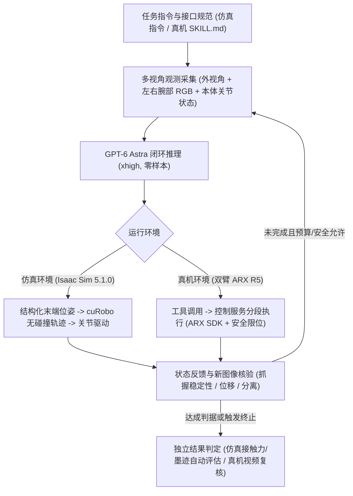
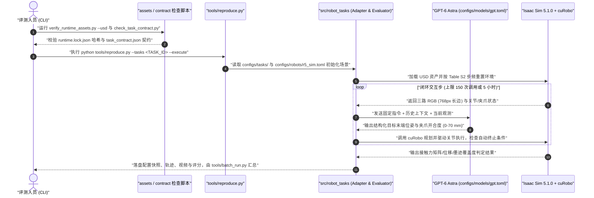

# LLM4Robot-Bench: How Far Can GPT-6 Astra Go in Robotic Manipulation? A Hierarchical, Paired Sim–Real Benchmark

## 一句话定义

**LLM4Robot-Bench**（v1/v2 原名 **PhysLadder**）是一个面向通用基础模型的分层、成对仿真–真机（Sim–Real）接触密集型操作评测基准，按「接触选择与几何对齐（L1）→ 持续接触下的力调控（L2）→ 协调的接触重构与力调控（L3）」三层累积交互要求组织 16 项双臂家庭任务，用于诊断模型在持续物理交互中的能力边界与瓶颈。

## 英文缩写速查

| 缩写 | 英文全称 | 简要说明 |
|---|---|---|
| **Sim–Real** | Simulation-to-Real / Paired Simulation and Reality | 仿真与真实世界成对评测体系，本文通过几何、物理参数与相机视角匹配保持两端任务可比 |
| **L1–L3** | Interaction Levels 1 to 3 | 本文定义的三个累积物理交互难度层级，逐级叠加接触选择、力调控与接触重构要求 |
| **FEM** | Finite Element Method | 有限元方法，本文在 NVIDIA Isaac Sim 中用于仿真橙瓣与果冻等可变形物体的接触形变 |
| **TGS** | Temporal Gauss-Seidel | Isaac Sim 采用的约束物理求解器，本文配置为 32 次关节位置迭代 |
| **RGB** | Red, Green, Blue | 三通道彩色图像观测，本文真机与仿真均仅向模型提供 RGB 图像（不提供深度图或力传感器读数） |
| **USD** | Universal Scene Description | 通用场景描述格式，本文仿真环境与物体资产（`PhysLadder-Assets`）以此格式存储并校验 |

## 为什么重要

1. **突破「只看抓取与放置成功率」的评测盲区**：现有具身评测多聚焦于语义理解、目标定位或基础抓取放置，汇总成功率无法揭示通用基础模型（如 GPT-6 Astra）在克服阻力、无损操作软体、双臂协同及多次换抓等物理约束下的具体失效机制。
2. **以物理交互第一性原理分层诊断**：不按任务名称或动作步数划分难度，而是锚定「接触配置（contact configuration）」与「力调控（force regulation）」两个耦合维度，使研究者能区分「局部物理进展」与「完整任务达成」。
3. **验证可控仿真对高成本真机评测的替代诊断价值**：针对 GPT-6 Astra，物理与视觉匹配的 Isaac Sim 环境在 16 项任务中与真机取得 10 项完全一致的成功次数（其余 6 项仅差 1/3 次），并在 L1→L2→L3 上呈现一致的下降曲线，表明匹配仿真可作为研究交互瓶颈的可重复测试平台。

## 核心信息

| 项目 | 详情 |
|---|---|
| **作者** | Haibao Yu*, Jiaqi Meng*, Zijian Zhang*, Bowen Jing, Lei Yang, Yue Hu, Chenchen Ge, Yiming Hou, Chenbo Xin, Dawen Ye, Haifang Qin, Jin Li, Weitao Zhou, Jianing Qiu, Jiankai Sun, Dandan Zhang, Zaiqing Nie, Ping Luo, Ding Zhao |
| **机构** | 拓境智能、香港大学、中国科学院、南洋理工大学、密歇根大学安娜堡分校、东南大学、Sapient Intelligence、SimpleAI、MBZUAI、斯坦福大学、帝国理工学院、清华大学、卡内基梅隆大学 |
| **发表时间** | 2026-10-25（arXiv v1）；2026-11-03（arXiv v3，由 PhysLadder 更名为 LLM4Robot-Bench） |
| **论文链接** | [arXiv:2610.34527](https://arxiv.org/abs/2610.34527) · [arXiv HTML 全文 (v3)](https://arxiv.org/html/2610.34527) |
| **项目与代码** | [项目主页](https://llm4robot.github.io/bench/) · [官方代码库 (LLM4Robot-Bench)](https://github.com/LLM4Robot/LLM4Robot-Bench) · [历史归档仓 (PhysLadder)](https://github.com/PhysLadder-Benchmark/PhysLadder) |
| **清单分类** | `environment.benchmarking`（来源条目：`survey_ax_2610_34527`） |
| **开源状态** | **已开源（Apache-2.0）**：仿真框架、16 项任务及 `variant01` 共 32 组配置、自动评测器及资产/媒体 Git 子模块均已公开 |

## 核心原理

### 1. 两维耦合的三层交互难度体系
作者将接触密集型操作分解为两个耦合维度，并据此构建累积式 L1–L3 层级（Section 3.1，Table 1 & Table S1）：
- **接触配置（Contact Configuration）**：机器人直接或经由工具/容器在物体表面建立的位置与姿态约束。有效的接触不仅要稳固，还不能阻碍后续主操作；当单次接触无法完成全程而必须释放并重新建立接触时，即构成**接触重构（contact reconfiguration）**。
- **力调控（Force Regulation）**：超越常规支撑、搬运与几何放置的力/力矩调节，涵盖克服插拔或导轨摩擦阻力、通过容器姿态与运动控制松散颗粒倾倒、限制软体压缩形变以免损伤，以及在表面施加持续法向擦拭压力。
- **三层累积定义**：
  - **L1（5 项任务：接触选择与几何对齐）**：Marker Placement、Charger Alignment、Hat Hanging、Cup Nesting、Flower Transfer。仅需不妨碍放置/对准的抓握与精确几何对位，不涉及额外力调控或主操作中的接触重构。
  - **L2（7 项任务：持续接触下的力调控）**：Marker Cap Removal、Book Pulling、Marble Pouring、Orange Handling、Drawer Pull & Return、Jelly Handling、Whiteboard Wiping。在单次或持续接触中调节力/运动以完成分离、抗阻抽拉、倾倒、无损搬运或擦拭。
  - **L3（4 项任务：协调的接触重构与力调控）**：Bottle Cap Unscrewing、Nut Unscrewing、Stacked-Book Pushing & Rotation、Block Sweeping。因末端旋转行程受限或物体分散，必须多次变换接触并在换抓/换位间隙保持既有旋转扭矩或物理进展。

> **层级绑定任务版本而非任务名称**：交互层级取决于初始状态、目标约束与当前两指夹爪平台。例如两块积木聚集在簸箕口附近只需局部单次扫掠（L2），而三块分散积木需要多次换位扫掠（L3）；同理，预拧松至只需单次小角度旋转的瓶盖也降为 L2。

### 2. 物理与视觉匹配的 Sim–Real 环境构建
- **硬件与感知对齐**：真机采用双臂 ARX R5（每臂 6 DoF + 1 DoF 耦合两指夹爪，最大开合 0–70 mm），配置 1 台外视角 Orbbec Gemini Pro（640×480 @ 30 fps）和 2 台腕部 Orbbec Gemini 305（848×480 @ 15 fps）。两侧均**仅向模型输入 RGB 图像**，不提供深度图和专有力传感器读数。
- **仿真重建与参数校准**：仿真基于 NVIDIA Isaac Sim 5.1.0，利用多视角视频重建桌面与物体纹理，按实物尺寸（如记号笔长 150 mm）与实测质量（如果冻 26.4 g）校准刚体；常规步频 240 Hz，拔笔帽/拧瓶盖/拧螺母提升至 1920 Hz，果冻操作为 360 Hz。橙瓣与果冻采用 GPU 有限元（FEM）建模（果冻：$E=3\text{ kPa}, \nu=0.45, \rho=1030\text{ kg/m}^3, \mu_d=0.6$）；白板擦拭采用法向力 $F>0.1\text{ N}$ 与滑动死区（0.5–20 mm）加权累计覆盖度代理模型（阈值 2.5）。

### 3. 零样本闭环执行与接口机制
- **模型配置**：以 GPT-6 Astra（`reasoning effort = xhigh`）通过 OpenAI Codex CLI 接入，执行任务级 zero-shot 闭环决策（无任务示例或先验轨迹）。
- **任务无关接口注入**：仿真通过 policy adapter 在系统指令中注入坐标约定、动作格式与观察指导；真机通过预先构建并固定不变的 Codex Agent Skills（`SKILL.md`）提供本体与接口规范、主动观测、抓握验证、双臂避碰与局部恢复准则。
- **动作执行与验证**：仿真每次调用输出 1 个结构化目标位姿与夹爪开合度，由 **cuRobo** 规划无碰撞关节轨迹并交由 Isaac Sim 关节驱动跟踪（默认预算 150 次模型调用或 5 小时）；真机通过工具调用驱动控制服务与 ARX R5 SDK 分段运动，运动超限将触发保护性急停。

## 流程总览

## 源码运行时序图

`LLM4Robot/LLM4Robot-Bench` 提供了完整的离线契约校验、仿真复现启动（`tools/reproduce.py`）以及批量结果汇总（`tools/batch_run.py`）流水线，以下基于仓库实际文档与目录入口展示一次仿真任务的启动与执行时序。

## 实验与评测

作者在 16 项任务上分别于仿真和真机环境各运行 **3 次独立试验（共 48 组真机、48 组仿真）**，按任务等权统计零样本成功率（Table 2）与平均模型调用次数（Table S3）：

| 层级 / 任务 | 仿真零样本成功率 (成功/总次) | 真机零样本成功率 (成功/总次) | 仿真均值调用 | 真机均值调用 | 典型观测与主导瓶颈 |
|---|---:|---:|---:|---:|---|
| **L1 平均** | **66.7% (10/15)** | **80.0% (12/15)** | 46 | 203 | 基础抓放稳健，空间朝向对齐是主要分化点 |
| L1-01 Marker Placement | 100% (3/3) | 100% (3/3) | 18 | 124 | 宽口杯放置稳定成功 |
| L1-02 Charger Alignment | 66.7% (2/3) | 100% (3/3) | 74 | 188 | 仿真因固定几何容差微调耗尽 150 次调用预算 |
| L1-03 Hat Hanging | 0% (0/3) | 0% (0/3) | 84 | 311 | 能抓取帽檐，但难以对齐帽口与斜向挂钩分叉 |
| L1-04 Cup Nesting | 66.7% (2/3) | 100% (3/3) | 35 | 236 | 仿真出现 1 次释放后杯体倾倒 |
| L1-05 Flower Transfer | 100% (3/3) | 100% (3/3) | 16 | 156 | 双环境稳定插枝并撤离 |
| **L2 平均** | **47.6% (10/21)** | **47.6% (10/21)** | 93 | 203 | 阻力克服、双臂支撑协调与软体无损抓取受限 |
| L2-01 Marker Cap Removal | 0% (0/3) | 0% (0/3) | 102 | 392 | 笔帽抓握构型失效，未能沿轴线分离 |
| L2-02 Book Pulling | 33.3% (1/3) | 0% (0/3) | 86 | 137 | 难以协同右臂稳压上书与左臂抽拉中书 |
| L2-03 Marble Pouring | 100% (3/3) | 100% (3/3) | 80 | 149 | 能通过纸杯倾转控制玻璃球倾倒并复位 |
| L2-04 Orange Handling | 66.7% (2/3) | 100% (3/3) | 108 | 243 | 仿真竖放橙瓣出现无损抓握失败 |
| L2-05 Drawer Pull & Return | 33.3% (1/3) | 66.7% (2/3) | 92 | 168 | 可产生局部拉推位移，但完整往返不稳定 |
| L2-06 Jelly Handling | 0% (0/3) | 0% (0/3) | 72 | 179 | 抓握位置与夹紧力耦合失当，果冻滞留支撑盒 |
| L2-07 Whiteboard Wiping | 100% (3/3) | 66.7% (2/3) | 114 | 154 | 真机擦拭存在法向压力不足与残余字迹 |
| **L3 平均** | **0.0% (0/12)** | **0.0% (0/12)** | 113 | 245 | 跨重抓阶段的物理进展难以保持与累积 |
| L3-01 Bottle Cap Unscrewing | 0% (0/3) | 0% (0/3) | 94 | 146 | 拧动后瓶盖打滑/掉落，无法完成整程脱离 |
| L3-02 Nut Unscrewing | 0% (0/3) | 0% (0/3) | 80 | 284 | 双臂接触后后续旋转轨迹超出可行位姿 |
| L3-03 Stacked-Book Pushing & Rotation | 0% (0/3) | 0% (0/3) | 136 | 309 | 仅能完成局部平移和旋转，未能达成整圈目标 |
| L3-04 Block Sweeping | 0% (0/3) | 0% (0/3) | 140 | 242 | 工具握持、路径规划与连续扫掠施力协同失败 |
| **总平均 (Overall)** | **41.7% (20/48)** | **45.8% (22/48)** | **83** | **213** | **10/16 任务 Sim–Real 成功数完全一致** |

> 注：仿真每次调用直接下发 1 个结构化动作，而真机单次动作通常需多次工具调用完成分段移动与拍照刷新，故两侧调用次数不可直接横向对比；另外在初始条件对照实验（Figure 9）中，当积木简化为聚拢在簸箕口附近的两块时，L2 局部扫掠即可将其扫入，但分散三块（L3-04）即暴露出接触重构瓶颈。

## 与其他工作对比

| 维度 | 通用具身/操作基准（如 EmbodiedEval、EmbodiedBench、RobotWorld） | 传统接触操作基准（如 NIST 装配、FMB、FurnitureBench） | LLM4Robot-Bench（本文） |
|---|---|---|---|
| **评测焦点** | 侧重视觉理解、导航与多步骤任务序列决策 | 侧重单点高精度插装、长时技能组合或铰接体操作 | 围绕**接触配置 × 力调控**构建三层累积物理交互阶梯 |
| **环境配对** | 多为纯仿真或单端环境 | 部分具备真机复现协议，但少见像素/物理级双端对齐 | 16 项任务均实现物理与视觉匹配的 Sim–Real 成对评测 |
| **对象与物理覆盖** | 刚体为主 | 刚体装配或木质家具为主 | 覆盖刚体、螺纹/导轨受约束机构与 FEM 软体食品（橙瓣/果冻） |
| **诊断粒度** | 偏重端到端最终成功率 | 偏重技能切换或装配公差 | 区分「有效接触（局部进展）」与「完全成功」，定位四大交互瓶颈 |

## 结论

**一句话总判：LLM4Robot-Bench 用严格配对的 Sim–Real 三层交互基准证明，GPT-6 Astra 在零样本条件下能够胜任基础语义抓取与放置（L1 真机 80.0%），但在持续力调控（L2 47.6%）尤其是协调接触重构与力调控（L3 0.0%）上存在显著能力断崖，且物理与视觉匹配的仿真能够高度还原这些核心交互瓶颈。**

1. **优先关注跨步物理状态保持**：L3 任务 0/12 全败的共性并非「完全找不到目标」，而是局部转动、推动或清扫的进展无法跨越重抓或换位过程持续累积。
2. **补齐无力觉闭环的视觉推断局限**：在仅提供 RGB 图像、夹爪仅支持位置开合控制且无深度/力传感器的设定下，模型对打滑、压溃阈值和擦拭法向力的视觉反推仍极不可靠。
3. **利用匹配仿真做高效消融与回归**：10/16 任务 Sim–Real 成功数完全一致、其余 6 项仅差 1/3 次，说明研究团队可将 `LLM4Robot/LLM4Robot-Bench` 的 32 组仿真配置作为低成本回归测试床，再在真机上复核边界案例。
4. **评估提示词与容差对指标的放大效应**：L1-02 在仿真因固定容差不断微调而耗尽 150 次调用，L2-07 真机则受目视擦净判据影响，设计自动评测时需同步对齐终止条件与观测粒度。

## 工程实践

- **硬件复现门槛**：仿真依赖 NVIDIA Isaac Sim 5.1.0、兼容 NVIDIA GPU、独立 pinned cuRobo 环境以及 `git submodule update --init assets` 下载的 `PhysLadder-Assets`（不可直接用 GitHub Download ZIP，因为 ZIP 不含子模块内容）。
- **低成本 CPU 校验流**：无需 GPU 即可通过 `python tools/verify_runtime_assets.py --usd`、`python tools/release/check_task_contract.py` 和 `python tools/reproduce.py --tasks <ID>`（不加 `--execute`）检验资产哈希、任务契约与执行计划。
- **真机 Basic Skills 封装经验**：真机侧将机械臂坐标系、腕部相机映射、夹爪位置语义（非力控制）、有界分段逼近及故障保护封装进固定 `SKILL.md`，为无微调基础模型接入真机提供了可复用的任务无关接口范式。
- **扩展实验入口**：针对 L3-01 的 270° 预松动对照实验可通过 `configs/experiments/l3_01_preloosen_270.json` 与 `tools/experiments/bottle_preloosen.py` 独立检查与启动，而不覆盖论文主实验的 32 组默认设置。

## 局限与风险

1. **单模型与小样本统计精度限制**：受真机时间与并行度约束，每项任务每环境仅评测了 3 次 trial，且仅评估了 GPT-6 Astra 单个模型；仿真结果能否同样准确预测其他基础模型或 VLA 策略的真机排序尚未实证。
2. **真机缺失硬件力反馈与深度观测**：ARX R5 平台未安装接触力传感器且接口屏蔽了深度流，模型只能通过视觉位移与关节追踪误差间接推断力调控效果。
3. **跨环境非对称终止与人工判定误差**：仿真存在 150 次调用 / 5 小时硬预算并由接触力矩阵/几何阈值自动判定；真机无硬调用上限，部分任务（如 L1-02 对齐与 L2-07 擦净）依赖人工观察员目视叫停与事后视频评分，带来轻量评估粒度差异。
4. **仿真代理模型近似性**：果冻弹性模量（$E=3\text{ kPa}$）与白板墨迹擦除覆盖率公式为经验估计/视觉代理模型，而非直接实测的材料力学与擦除物理定律。

## 关联页面

- [具身大模型评测基准选型闭环](../queries/embodied-eval-benchmark-selection-loop.md)：对照评测基准设计与指标选型闭环。
- [Agentic Robots 综述](paper-towards-agentic-robots-survey.md)
- [全量项目节点清单](../overview/awesome-agentic-robots-node-index.md)
- [VLA 方法背景](../methods/vla.md)
- [具身智能体评测方法](../methods/embodied-agent-benchmarking.md)：对照任务设置、接口与评估指标。
- [Agentic 操作策略（Agentic Manipulation Policies）](../methods/agentic-manipulation-policies.md)：讨论基础模型作为闭环操作策略的规划与执行边界。
- [Sim2Real 迁移工作流](../methods/sim2real-transfer-workflow.md)：对应本文物理参数校准与视觉匹配方法。
- [机器人仿真集成（Robot Simulation Integration）](../methods/robot-simulation-integration.md)：参考 Isaac Sim 5.1.0 与 cuRobo 集成架构。
- [Agent 技能打包（Agent Skill Packaging）](../methods/agent-skill-packaging.md)：对照本文真机端 `SKILL.md` 任务无关接口封装。
- [双臂操作（Bimanual Manipulation）](../tasks/bimanual-manipulation.md)：覆盖双臂稳压与协同操作任务设定。
- [机器人操作（Manipulation）](../tasks/manipulation.md)：接触密集型物体操作任务背景。

## 推荐继续阅读

- [LLM4Robot-Bench 交互式项目主页与成对视频](https://llm4robot.github.io/bench/)
- [LLM4Robot-Bench 官方 GitHub 仓库](https://github.com/LLM4Robot/LLM4Robot-Bench)
- [arXiv:2610.34527 论文原文（HTML v3）](https://arxiv.org/html/2610.34527)
- [NVIDIA Isaac Sim 开源仓库](https://github.com/isaac-sim/IsaacSim)

## 参考来源

- [LLM4Robot-Bench 论文原文精读核对笔记](../../sources/papers/paper-agentic-2610-34527.md)
- [LLM4Robot-Bench 官方开源仓库核对笔记](../../sources/repos/paper-agentic-2610-34527.md)
- [官方 Awesome 快照归档](../../sources/repos/awesome-agentic-robots-survey-index.md)
- [arXiv:2610.34527 官方页面](https://arxiv.org/abs/2610.34527)
- [历史归档仓库 PhysLadder](https://github.com/PhysLadder-Benchmark/PhysLadder)
