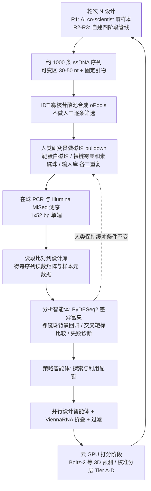
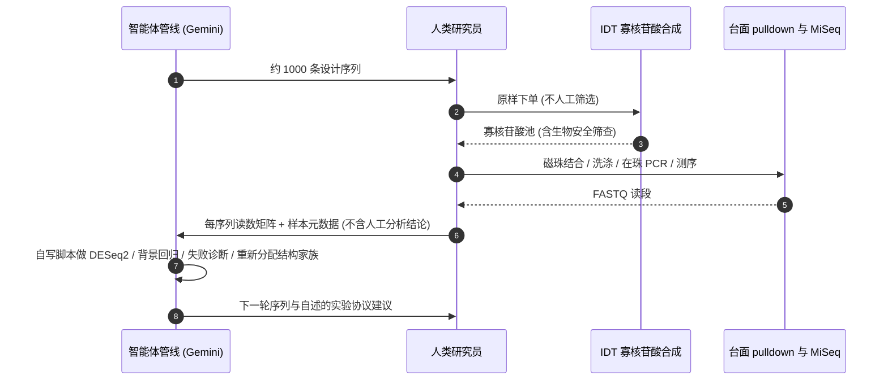

# Aptamers as a sandbox for lab-in-the-loop agentic molecular discovery

**论文：** [arXiv:2610.24806](https://arxiv.org/abs/2610.24806)（q-bio.BM，v1，2026-10-17）／[PDF（gstatic，27 页，首页日期 2026-10-12）](https://www.gstatic.com/science-ai/agentic_aptamer_sandbox.pdf)／[Google Research 论文页](https://research.google/pubs/aptamers-as-a-sandbox-for-lab-in-the-loop-agentic-molecular-discovery/)。作者 Cutts、Coller、Chen、Tang 等，共同高级作者 Pooja Rao、Annalisa Pawlosky（Google Research，另有 Stanford、Google Cloud、Google DeepMind 作者）。本页依据 gstatic 版全文（正文、Methods、补充图表）逐页通读写成，归档见 [sources 归档](../../sources/papers/agentic_aptamer_sandbox_gstatic_2026.md)。

## 一句话定义

**这是一项「智能体 + 真实湿实验」的闭环可行性研究：用能被化学合成、序列即功能分子的 DNA 适配体做沙盒，让 LLM 智能体连续三轮读取上一轮测序结果、自己诊断失败并重新设计约 1000 条序列，命中率因此逐轮提高。**

## 英文缩写速查

| 缩写 | 英文全称 | 简要说明 |
|------|----------|----------|
| SELEX | Systematic Evolution of Ligands by EXponential enrichment | 经典适配体筛选：随机库反复结合-扩增，需 8–15 轮 |
| ssDNA | single-stranded DNA | 本文的适配体形态，可变区 30–50 nt |
| NGS | next-generation sequencing | 本文用 Illumina MiSeq 读出富集 |
| LFC / log2 FC | log2 fold change | 目标磁珠相对输入库的富集倍数（取 log2） |
| G4 | G-quadruplex | 富 G 序列形成的四链结构，本文发现它易成多聚阴离子「粘性」交叉结合物 |
| TBA / NU172 | thrombin-binding aptamer / NU172 | α-凝血酶的文献适配体核心 |
| KD | dissociation constant | 解离常数，本文所有 KD 均为「初步表观值」 |
| iPTM | interface predicted TM-score | Boltz-2 的界面置信度 |
| MFE / ED | minimum free energy / ensemble defect | ViennaRNA 的二级结构稳定性与折叠纯度指标 |
| BLI / SPR | bio-layer interferometry / surface plasmon resonance | 论文列为后续要做的无标记动力学验证 |

## 为什么重要

- **回答「智能体能否在多轮真实实验中学习」：** 此前 AI co-scientist、Virtual Lab 等系统大多只在流程末尾做一次实验验证（原文引言）；本文把验证放进循环，且每轮对每个假设都返回正负标签。
- **沙盒思路：** 作者认为需要「计算预测器不够可靠」的设计空间，加上「快到能多轮迭代、读数定量」的实验（引言）；适配体满足这两点。
- **与机器人学的接口：** 论文自述其三步台面流程「可端到端映射到机器人液体处理机并直接接测序」，但**本文本身没有这样做**（见「工程实践」与「局限」）。对本库而言，它是「LLM 智能体 + 实验室自动化」叙事里一个有真实数据的案例，而不是自动化硬件论文。

## 流程总览

图依据：论文 Fig.1B、Methods「Closed-loop pipeline overview」与「Agentic design platforms」。

### 闭环里谁提出、谁执行、谁判断

提出者是智能体；执行者是人类研究员（论文 Methods：「human researchers executed the wet-lab pulldown, PCR amplification, and sequencing workflow」）；对「命中」的最终统计判定由作者用统一的两阶段流程对所有轮次重算（Methods），智能体的轮间分析是另一套自写脚本。此图依据论文文字，不是源码。

## 为什么用适配体做沙盒（R.1，Fig.1A）

| 路线 | 候选到读出的步骤 | 每轮时间 | 信息量 |
|------|------------------|----------|--------|
| 蛋白 / 抗体 | 基因合成、克隆、转化、培养表达、裂解、柱纯化、结合实验（7 步） | 3–6 周 | 表达 / 折叠 / 溶解度 / 纯化环节会丢设计 |
| 经典 SELEX | 每轮 6 步（结合、PCR、λ-核酸外切酶再生单链等），需 8–15 轮 | 多轮串联 | 随机库 10^13–10^15 分子，几乎不知道个别序列为何成败 |
| 本文适配体沙盒 | 池合成 → 多重磁珠 pulldown → 测序（3 步） | 约 10 天 | 约 1000 条设计各得正负标签，约 3 美元/候选 |

原文还给出两个靶标做难度对照（Discussion、Methods）：α-凝血酶（36.7 kDa，两个带正电的外位点，文献阳性对照）、肌红蛋白（17.2 kDa，无天然核酸结合沟，4 个文献适配体全部不富集）、HER2 胞外域（约 70 kDa，净负电，R2 起作为反筛靶，24 个文献/文献种子对照均失败）。

## 智能体管线与工具（Methods）

- **R1：** Google AI co-scientist（引用其 Nature 655, 487–496 (2026)）由靶蛋白序列与结构上下文零样本生成 642 条初始库。
- **R2–R3：** 自建四阶段管线，实现在模块化 Python 智能体编排框架上：analyst（PyDESeq2 差异富集、裸磁珠回归、比值门控、交叉靶标、失败诊断；不接收人工分析结果）→ strategist（探索 / 利用配额）→ 并行 designer（生成、折叠、过滤）→ 打分阶段（在智能体循环之外，云 A100 GPU，Boltz-2 / ESMFold2-NA 标注并构造 Tier A–D 校准层）。
- **模型：** Google Gemini Pro 与 Flash，经 Gemini API。
- **工具箱：** 仅用许可宽松的开源工具：ViennaRNA v2.6.4（折叠与 ED，Mathews 2004 DNA 参数）、Boltz-2、ESMFold2-NA、RhoDesign、RiboDiffusion、DNABERT-2、HyenaDNA、RNA-FM、G4Hunter（自行用 Python 实现）及结构化蛋白查询工具（PDB 信息、静电图、文献适配体）。
- **未做对照：** 作者明说 R1 与 R2–R3 用了不同系统，没有做智能体架构的受控比较，也没有「等预算无反馈」「非推理」对照臂。

## 实验与评测

### 轮次与命中率（Supplementary Table S3，Fig.2B）

命中 = DESeq2 相对输入 padj<0.05 且 log2FC≥1.0，且裸磁珠 OLS 残差 >1.00（凝血酶 R2、R3 另有附加门槛，见 Methods）。

| 轮 | 池规模（测序条目） | α-凝血酶 新设计命中 | 肌红蛋白 新设计命中 |
|----|--------------------|----------------------|----------------------|
| R1 | 642 | 0 / 167（0.0%） | 20 / 196（10.2%） |
| R2 | 981（肌红蛋白侧池 977） | 54 / 208（26.0%） | 9 / 244（3.7%） |
| R3 | 1,441（去重 1,405） | 131 / 311（42.1%） | 184 / 549（33.5%） |

- 严格从头（不含文献基序后代）：凝血酶 R3 为 106 / 286（37.1%）；肌红蛋白 R3 的命中全部为从头，184 / 547（33.6%）（S3 表）。
- 随机 / 乱序阴性对照：各轮 0.0%（例：R1 肌红蛋白侧 0/53，R3 肌红蛋白侧 0/78）。
- 原始富集比例（log2FC≥1，未做裸磁珠扣除，Fig.2C）：肌红蛋白 6.5%→12.4%→29.9%；凝血酶 0.3%→53.1%→80.7%。
- 总规模：四个合成池共 4,405 条测序构建体（4,425 条订购；去重后 4,279 条唯一变区序列），正文简称约 4,400（S3 表脚注）。含 R1b 肌红蛋白扩展池（1,341 条）。
- HER2：R2 反筛起，严格 HER2 选择性结合物 1.3%（13 条）→ R3 5.1%（71/1,405），最高 +4.59 log2FC（Supplementary Fig. S3、Table S2）。

### 零样本预测器 vs 湿实验（Fig.2D，R3 肌红蛋白库 N=1,441，292 个命中）

| 类别 | 指标（ROC-AUC） |
|------|------------------|
| Boltz-2 共折叠 | iPTM 0.499，ΔiPTM 0.391 |
| 3D 逆折叠 / 结构 | ESMFold2-NA、RhoDesign、RiboDiffusion 0.496–0.510 |
| 核酸基础模型 | DNABERT-2、HyenaDNA、RNA-FM 0.364–0.523 |
| G4 打分 | G4Hunter 0.366，ΔΔG_G4 0.476 |
| 目标无关 2D 热力学 | −ΔG_MFE 0.729，−ED 0.763（唯一有信号，但不知道靶标） |

作者结论：Boltz-2 iPTM 反而偏向紧凑 G4（会非特异粘在固相上），Table 1 记录了智能体自己写下「Boltz2 iptm 作为设计过滤器是有害的」。前瞻校准的 Tier A（iPTM>0.7）在 R3 为 0/25 命中。

### 特异性与结构家族（Fig.3，Table 1）

- 肌红蛋白特异性 75.0%→19.1%→72.4%；R2 反筛基准中 80.9%（72/89）为交叉反应，97% 为 G4（智能体自主诊断）。
- R3 把肌红蛋白池 72.3% 转向非 G4；未夹持 G4 从 20.4% 降到 1.3%；非 G4 家族命中率：H 型假结 37/46（80.4%）、扩展回文发夹 47/76（61.8%）、凸起发夹 67/146（45.9%）；夹持 3 层 G4 嵌合体 3/124（2.4%）、未夹持 G4 0/7。
- 凝血酶特异性 0.0%→76.7%→98.5%；R1 的 0.0% 命中归因于固定引物与核心基序杂交（85 nt 全构建体折叠，S1 中 ΔG=−7.8 kcal/mol），R2 起用 5′–3′ 双链夹持修复；R3 中 25/25 个夹持的 TBA/NU172 核心设计均为命中。

### 单克隆验证（Fig.4，Supplementary Table S4）

- 8 条 5′-FAM 全长序列（75–85 nt），0/1/10/100/1000 nM 共 5 点，对生物素化 α-凝血酶磁珠，室温 1 h；6/8 有浓度依赖结合。
- 1 μM 终点荧光与 R3 池化富集 Pearson r=0.90（p=0.0021），Spearman ρ=0.88（p=0.0038）。
- T01（R3_095_var3，NU172 衍生 G4-双链嵌合体，log2FC +16.27，占 R3 凝血酶读段 44.55%）KD=24.6±8.2 nM；T02（11 bp 夹持 TBA）47.4±14.6 nM；T03（8 bp）132.7 nM；T04（G8A 环编辑）132.5±52.8 nM；严格从头 T05、T06 KD>1 μM；T07、T08 低于 1 μM 检测上限。
- **全部 KD 均为作者标注的「初步」值**：荧光未达平台；滴定仅在 α-凝血酶上做，未做 BLI / SPR。

### 复现性（Methods）

两名操作者独立筛 R3 池，log2FC 相关 r=0.84–0.85（全池），新设计肌红蛋白与凝血酶子集 r=0.920 与 0.964；二值预命中一致率肌红蛋白 90.4%（κ=0.740）、HER2 88.1%、凝血酶 77.4%。

## 智能体做了什么推理（Table 1，R.4）

- 提出非典型结构：宽铰链三向接头、双非对称内环、H 型假结等。
- 自写统计滤波：从原始计数发现肌红蛋白 R2 中 R²=0.635 的裸磁珠亲和性方差；凝血酶上线性回归斜率为负（−0.263）时放弃回归、改用比值门控（LFC_beads/LFC_thrombin>0.5）。
- 把序列设计与物理约束挂钩：自互补度极高的序列在固相合成中掉库（零读数孔中 96% 自互补）；加 7 nt 绝缘间隔反而降低读数 2.7–5.9 倍；区分合成掉库（1.1%）与 PCR 偏倚（74.0%）。
- 提出协议改动（仅记录，**未被执行**）：在 Hamilton Star / Opentrons OT-2 机器人液体处理机上自动化磁珠洗涤、补 20 mM KCl、改用 Li+ 抑制 G4、慢速降温复性、加鲑精 DNA 等；原文明确这些是「autonomous experimental recommendations」，三轮湿实验缓冲条件固定。

## 湿实验平台与自动化硬件

- **合成：** IDT oPools 寡核苷酸阵列，下单时不做逐条人工整理。
- **筛选：** Dynabeads M-280 Streptavidin，50 pmol 生物素化靶蛋白（凝血酶 AssayPro PT62011BIO、肌红蛋白 Molecular Depot P2010022B、HER2 Sino Biological 10004-HCCH-B-100）；每反应 5 pmol 复性 ssDNA；洗去未结合后**直接在珠上 PCR**；MiSeq 1×52 bp。三个核心条件：凝血酶磁珠、肌红蛋白磁珠、裸链霉亲和素磁珠（基质背景）。流程沿用 Cutts 等 STAR Protocols 2022（论文参考文献 35）。
- **自动化：** 全文未出现 PyLabRobot；只在智能体建议（Table 1 行 3）中提到 Hamilton Star / Opentrons OT-2，并在 Discussion 称流程「可映射到机器人液体处理机」。**实际执行全部是人工台面操作**，不是自驱动实验室。

## 工程实践

1. **可借鉴的最小闭环：** 每轮「智能体设计 → 外包池合成 → 磁珠 pulldown + 测序 → 计数矩阵返还」。返还给智能体的是读数矩阵与元数据，而不是人写好的富集表（Methods）。
2. **必备实验设计：** 同时测序输入库与靶标磁珠、裸磁珠的三重复；加入随机 / 乱序阴性对照、文献阳性对照与上一轮阳性内标；加反筛靶蛋白。作者论证，没有裸磁珠去耦，基于数据的主动学习会收敛到实验假象（Discussion）。
3. **统计门控：** 先 PyDESeq2（中位数比值、Cox–Reid 离散度、Wald 检验、BH 校正），再做裸磁珠 OLS 回归（斜率 0.40–0.73，R3 肌红蛋白 0.430）取残差>1.00；凝血酶 R3 对同时是裸磁珠预命中的序列要求 y−x>1.0。
4. **序列设计注意：** 变区约 40 nt 加固定 23 nt 5′ 与 22 nt 3′ 恒定区（全长约 85 nt）；必须按全构建体折叠评估引物侵入；避免极端回文；近似突变体（R3 含 88 条）用「精确优先、平局丢弃」的比对防止读段串扰。
5. **想复现需要补的东西：** 论文没有发布智能体代码、提示词或原始序列-活性表（见「开放状态」）；可依据 Methods 的四阶段架构与 Table 1 自行实现，且应预期结果依赖具体 LLM 与 IDT 合成批次。
6. **预期周期与成本（作者表述）：** 约 10 天/轮（含合成与交付）、约 3 美元/候选（摘要为 1–3 美元）。

## 结论

**这篇论文真正给出的证据是「三轮真实湿实验闭环里命中率随反馈提高」，而不是「智能体找到了高亲和力分子」；读数前先看命中定义与基线。**

1. **主指标是校正后命中率**（DESeq2 相对输入 padj<0.05、log2FC≥1.0，且裸磁珠 OLS 残差>1.00），凝血酶 0.0%→26.0%→42.1%；其中 R1 的 0.0% 源于引物侵入这类工程失误，基线本就极低。
2. **肌红蛋白一侧不单调**（10.2%→3.7%→33.5%），R2 下降是加 HER2 反筛提高严格度的结果，须与未扣背景的原始富集比例（6.5%→12.4%→29.9%）一起读。
3. **第二项代价是特异性与结构家族**：交叉结合的 G4「粘性」序列会虚高命中，R2 反筛基准中 80.9% 为交叉反应、97% 为 G4；靠转向非 G4 家族才把肌红蛋白特异性拉回 72.4%。
4. **不要用共折叠置信度做设计过滤**：Boltz-2 iPTM ROC-AUC 0.499、前瞻 Tier A（iPTM>0.7）0/25 命中，唯一有信号的是目标无关的 2D 热力学（−ED 0.763）。
5. **亲和力证据有限**：纳摩尔级（T01 KD=24.6±8.2 nM）来自给定 TBA/NU172 起点后的局部优化，严格从头仍 >1 μM，且全部为作者标注的初步表观值。
6. **部署视角**：三轮湿实验全部由人工台面完成，机器人液体处理只出现在智能体建议里；接自动化前应先验证样品追踪与批次重复性（两操作者全池 log2FC r=0.84–0.85）。

## 与其他工作对比

| 项目 | 定位区别 |
|---|---|
| [VERID](./paper-verid-semantic-representation-lab-self-play.md) | 同为智能体 + 湿实验工作站，重点在语义孪生与仿真门等执行层基础设施；本文没有自动化层，执行靠人工台面 |
| [Epitope Excision 结合体设计](./paper-epitope-excision-binder-design.md) | 同博客的蛋白结合体设计，预算单位是 GPU 小时、湿实验只在末端一次；本文的预算单位是湿实验轮次与每候选成本 |
| [PyLabRobot](./pylabrobot.md) | 硬件无关的液体处理机器人接口；本文全文未使用，仅在智能体协议建议中提到机器人液体处理机 |
| [AI Agent 评测](../concepts/ai-agent-evaluation.md) | 智能体评测的通用口径；本文缺等预算无反馈对照与智能体架构的受控比较 |

## 局限

**原文自述：**

- 没有受控的智能体对比（R1 与 R2–R3 用不同系统）；缺等预算无反馈对照与进化 / 贝叶斯 / 监督学习基线（Discussion）。
- 单克隆验证只做了 α-凝血酶，上限 1 μM、未饱和，KD 属初步；未做截短最小核心、BLI、SPR。
- 湿实验缓冲条件三轮固定；协议改动只是建议，未让智能体共同优化。
- 未测近同源蛋白区分（肌红蛋白 vs 血红蛋白、凝血酶 vs 凝血酶原）。
- 因许可限制，计算基准只含开源工具，未含 RoseTTAFoldNA 等。
- 严格从头序列只达微摩尔级（KD>1 μM）；纳摩尔亲和力来自给定 TBA / NU172 起点后的局部优化。
- 凝血酶 R1 的 0.0% 主要是引物侵入这类工程失误，而非「智能体学不会」，读命中率曲线时需注意这个基线很低。

**我的核对与推测：**

- 肌红蛋白命中率不是单调上升（10.2%→3.7%→33.5%）；R2 的下降是反筛提高严格度的结果，作者用原始富集比例单调上升（Fig.2C）来佐证。
- 命中率的分母是「新设计候选」，各轮队列组成不同（R3 含 88 个突变变体和 60 个校准层条目，另算），三轮数字不是同一批序列的前后对比（我对 S3 的读法）。
- 作者全部为 Google 员工或访问学者，结果为自述，未见独立复现；论文是预印本，截至入库日未见同行评审版本。
- 推测：把流程接到液体处理机上，台面步骤本身并不难，真正的难点更可能在样品追踪、批次差异与重复性，这在论文中未被检验。

## 开放状态

| 项 | 状态（读自论文 Data and code availability，入库日 2026-11-07） |
|----|------|
| 论文 | arXiv:2610.24806v1 与 gstatic PDF 均可公开读取 |
| 项目页 | 有 Google Research 论文页，仅为元数据与摘要；本次未发现 GitHub 链接 |
| 代码 | 未发布专属代码；作者称基于标准 LLM API 与编排模式，靠 Methods 复现 |
| 数据 | 汇总统计、代表序列、滴定数据、智能体推理摘录在正文与补充表 S1–S4；完整序列-活性与差异富集表待同行评审发表后提供 |
| 结构 | PDB 1PPB、3RGK、1N8Z 公开 |
| 工具许可 | 所用计算工具均为 MIT / Apache-2.0 / BSD-3 / ViennaRNA 商用许可 |
| 生物安全 | BSL-1 人源蛋白；IDT 自动序列生物安全筛查（IGSC、HHS 框架） |

## 源码运行时序图

不适用：论文没有发布任何可运行代码（仓库、笔记本或提示词均无），因此无法按真实入口画源码时序图。上文「闭环里谁提出、谁执行、谁判断」是依据论文 Methods 的流程时序，不是源码。

## 关联页面

- [ai-agent-evaluation](../concepts/ai-agent-evaluation.md)：智能体评测的通用口径，可对照本文缺失的受控对照臂
- [llm-robotics-control-interfaces](../concepts/llm-robotics-control-interfaces.md)：LLM 作为控制接口的另一端
- [paper-agentic-real2sim](./paper-agentic-real2sim.md)、[paper-agentic-roborl](./paper-agentic-roborl.md)：机器人侧的智能体闭环工作，做横向参照
- [paper-verid-semantic-representation-lab-self-play](./paper-verid-semantic-representation-lab-self-play.md)：同一 Google 博客下的另一篇智能体自博弈论文
- [paper-epitope-excision-binder-design](./paper-epitope-excision-binder-design.md)：同一博客下的 de novo 结合物设计论文
- [google-grounding-ai-agents-wet-labs](./google-grounding-ai-agents-wet-labs.md) — Google Research 博客：湿实验自主化的三条研究线（接地到机器人 / 适配体闭环 / 蛋白结合剂）
- [pylabrobot](./pylabrobot.md) — PyLabRobot：硬件无关的液体处理机器人开源接口

## 参考来源

- [agentic_aptamer_sandbox_gstatic_2026.md](../../sources/papers/agentic_aptamer_sandbox_gstatic_2026.md)：论文归档（核对范围、版本、开放状态）
- [arXiv:2610.24806](https://arxiv.org/abs/2610.24806)
- [PDF（gstatic）](https://www.gstatic.com/science-ai/agentic_aptamer_sandbox.pdf)
- [Google Research 论文页](https://research.google/pubs/aptamers-as-a-sandbox-for-lab-in-the-loop-agentic-molecular-discovery/)

## 推荐继续阅读

- Gottweis 等，*Accelerating scientific discovery with Co-Scientist*，Nature 655, 487–496 (2026)：本文 R1 所用系统（论文参考文献 1）
- Swanson 等，*The Virtual Lab of AI agents designs new SARS-CoV-2 nanobodies*，Nature 646, 716–723 (2025)（参考文献 2）
- Tom 等，*Self-driving laboratories for chemistry and materials science*，Chem. Rev. 124, 9633–9732 (2024)（参考文献 11）：自驱动实验室硬件侧综述
- Cutts 等，*Target-switch SELEX*，STAR Protocols 3, 101724 (2022)：本文磁珠 pulldown 的方法来源（参考文献 35）
