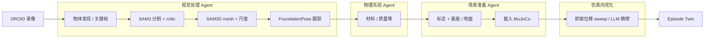
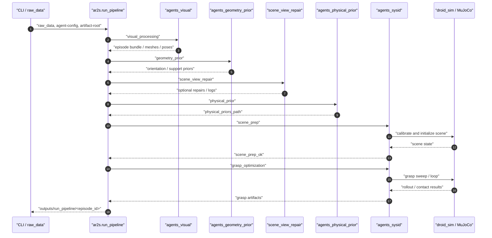

# Agentic Real2Sim（VLM Agent 编排的物理 Real2Sim）

**Agentic Real2Sim**（*Physics-based World Modeling with Vision-Language Agents*，[arXiv:2607.19190](https://arxiv.org/abs/2607.19190)，2026；[项目页](https://agentic-real2sim.github.io/)）把「真机机器人–物体交互录像」写成 **可仿真的 episode twin**：在共享产物合约下，用 **VLM agent 做有界决策**、用 **确定性感知/仿真工具做几何与物理**，把 DROID 类 episode 装进 **MuJoCo**，并演示同一框架向 **可变形（PhysTwin 风格）** 与 **人形运动（BFM-Zero 风格）** 扩展。

## 一句话定义

**用可替换 VLM 后端编排「视觉→物性→场景→仿真内修复」流水线，把真实交互 episode 自动转成可回放、可查询的物理数字孪生。**

## 英文缩写速查

| 缩写 | 英文全称 | 简要说明 |
|------|----------|----------|
| Real2Sim | Real to Simulation | 从真机观测构造可对齐仿真资产/场景 |
| VLM | Vision-Language Model | 本框架中的 agentic 决策后端 |
| DROID | Distributed Robot Interaction Dataset | 主评测刚性操作 episode 源 |
| SAM | Segment Anything Model | 开放词表分割（文中 SAM 3） |
| EMPM | （PhysTwin 系）可变形仿真设定 | 可变形适配器对照设定之一 |
| BFM | Behavioral Foundation Model | 人形适配器运动上下文（BFM-Zero） |
| USD | Universal Scene Description | 项目页浏览器孪生预览格式 |

## 为什么重要

- **单位是 episode，不是孤立物体扫描：** 相对只重建资产或只生成空场景，这里保留 **执行器、轨迹、接触与任务语义**，直接服务「回放 / 策略评测 / 学策略」叙事。
- **Agent 与工具解耦：** VLM 只做物体发现、关键帧、掩码/跟踪 critic、地面参考等 **schema 约束问题**；几何与抓取 sweep 仍走确定性工具——因此开源 31B 与 GPT-5.4 成功率接近，成本差一个数量级。
- **跨域合约：** 刚性 / 可变形 / 人形共用文件夹与回放修复接口，是「一个 Real2Sim 系统覆盖多物理域」的早期样本。

## 核心信息

| 字段 | 内容 |
|------|------|
| 机构 | 英属哥伦比亚大学（UBC）；约翰霍普金斯大学（Johns Hopkins）；埃尔朗根-纽伦堡大学 / NHR@FAU（FAU）；哥伦比亚大学（Columbia）；加州大学洛杉矶分校（UCLA）；新加坡国立大学（NUS）；剑桥大学（Cambridge）；凌迪科技（Style3D） |
| arXiv | [2607.19190](https://arxiv.org/abs/2607.19190) |
| 项目页 | <https://agentic-real2sim.github.io/> |
| 仿真后端（刚性） | MuJoCo |
| 开源（2026-11-16 核查） | **已公开**：[官方 GitHub 仓库](https://github.com/agentic-real2sim/agentic_real2sim)；带 CLI，依赖外部模型权重与 GPU |
| 主指标（v5） | **DROID-500 242/500（48.4%）** 成功；四 VLM 成本对照另取 100 条（Gemma **48/100**，账单 **$2.62**） |

## 核心原理

### Episode twin

\[
\mathcal{T}=(\mathcal{O},\mathcal{A},\mathcal{G},\mathcal{S}_{1:T},\Theta,\mathcal{B},\mathcal{M})
\]

分别对应真实观测、执行器、几何外观、时序仿真状态、物性/对齐参数、仿真后端与成功判定痕迹。

### 四阶段流水线（刚性）

| 阶段 | 工具（示例） | Agent 技能（示例） |
|------|--------------|-------------------|
| 物体发现 | — | object_discovery / relevance / pickup_object |
| 分割 / 几何 | SAM 3、SAM 3D、FoundationStereo | keyframe + mask/scale critic |
| 姿态 | FoundationPose | tracking_critic |
| 物性 | — | material_classify |
| 场景 / 抓取 | calibration、grasp sweep | camera_select、ground_ref |

### 多 VLM 与成本

四后端仅在**相同 DROID-100 子集**比较：Gemma 4 31B / Qwen 3.6 35B / GPT-5.4 / Claude Haiku 4.5 分别 **48/45/43/37** 次回放成功，Gemma 的模型账单 **$2.62**，GPT-5.4 为其 **31.4×**。Agent 负责有界决策，几何/物理/抓取 sweep 由专用工具执行。

## 评测与结果（arXiv v5）

- **刚体主基准：** DROID-500 中 Gemma 4 31B **242/500（48.4%）** 成功、28/500（5.6%）部分成功、230/500（46.0%）失败；349 条可评估数据平均 PSNR **14.069**、SSIM **0.650**、ADD-S **107 mm**。回放成功由三独立 VLM 裁判评分，任一最佳候选 ≥8/10 视为成功。
- **模型对照：** 四 VLM 后端的 100 条相同 episode 测试是**另一统计口径**，不应写成主基准只有 DROID-100。
- **跨硬件：** AIRBOT Play + AIRBOT G2 夹爪 + ZED 2i 的自采录像经 DROID-shaped 入口复用管线，真机取木勺动作在 MuJoCo 中生成对应 twin。
- **闭环策略：** 用转换 episode 生成位姿、抓取、3DGS 背景与相机增强的仿真轨迹，微调 DROID 预训练 **π0.5**；仿真环境有外部/腕部图像、关节与夹爪状态、语言指令，控制在 action-chunk 级闭环。
- **评测代理：** 另用**仅真实数据微调**的 π0 策略，在**六项** pick-and-place 任务比较真机/仿真成功率，报告 **Pearson r=0.920、p=0.009**。六任务相关性并不等于对其他任务有保证。
- **跨域与局限：** PhysTwin 可变形与 Unitree G1（LAFAN1 重定向）主要是定性展示；论文承认尚无物体级系统辨识或物理参数直接验证。

## 源码运行时序图

官方已公开 [`agentic-real2sim/agentic_real2sim`](https://github.com/agentic-real2sim/agentic_real2sim)，核查 [README](https://github.com/agentic-real2sim/agentic_real2sim/blob/main/README.md) 与 [`ar2s/run_pipeline.py`](https://github.com/agentic-real2sim/agentic_real2sim/blob/main/ar2s/run_pipeline.py)（commit `880389b`）。入口 `python -m ar2s.run_pipeline --raw-data ... --agent-config ... --artifact-root ...` 按源码中的 `_STAGE_ORDER` 固定执行六阶段，VLM 子代理位于各阶段内。

README 的主要产物在 `sysid_inputs/manifest.yaml`、`objects/`、`physical_priors.json`、`calibration.yaml` 和 `artifacts/sweep-*/`；`--start-from` / `--until` 支持分段执行。代码静态阅读**不等于**本次已复现整条流水线；权重与 GPU 环境尚未配置。

## 工程实践

| 项 | 建议 |
|----|------|
| 选型定位 | 需要 **episode 级物理回放** 与 **可换 VLM 编排** 时对照；若只需操作场景 + cousins + 策略相关评测，优先看 [SimFoundry](./paper-simfoundry-real2sim-scene-generation.md) |
| 复现边界 | **已有官方 CLI**，但要求 Linux/NVIDIA GPU、Python 3.12+、约 80 GB 工作空间、外部视觉权重（部分需授权）；本次未实测运行 |
| 评测阅读 | 「回放成功」≠「闭环策略成功率」；v5 另报六任务 Pearson，且不等同 SimFoundry 的评测设置 |

## 结论

**Agentic Real2Sim 将真实交互转换为可运行的物理 episode twin；v5 已从回放实验拓展到策略学习/评测，但回放与闭环策略指标必须区分。**

1. **大规模转换：** DROID-500 上 242/500（48.4%）成功，绝对成功率尚有较大改进空间。
2. **模型选择：** 100 条同集对照为 48/45/43/37；Gemma 4 31B 成本 $2.62，仅约 GPT-5.4 的 3.2%。
3. **工程架构：** 顶层六阶段固定调度，VLM 做 schema 受限决策，专用工具做网格、位姿、碰撞和抓取。
4. **策略评测：** 六任务 sim/real π0 成功率 Pearson r=0.920，p=0.009；需要扩大任务与机器人样本确认外推性。
5. **复现：** 已发布 [源码](https://github.com/agentic-real2sim/agentic_real2sim)，部分权重须独立获取；可先从 AIRBOT 数据导出和单阶段 `--until` 调试。
6. **局限：** 可变形与人形定性为主，物体级系统辨识与物理参数直接验证仍缺失。

## 与其他工作对比

| 维度 | Agentic Real2Sim | [SimFoundry](./paper-simfoundry-real2sim-scene-generation.md) | [SceneAgent](./paper-sceneagent-real2sim-capture-physics.md) | [CRISP](../methods/crisp-real2sim.md) | [R2S-EGO](./paper-r2s-ego.md) | [Lucida](./paper-lucida-r2s.md) |
|------|------------------|-----------|-------|---------------------|----------------|----------------|
| 产物单位 | **episode twin**（含执行器/轨迹/接触/任务） | sim-ready 场景 + cousins | **USD 场景** + splat/mesh 演示 | 单目人–场景平面原语 | 既有场景的 **ego 视觉资产 + 碰撞面** | 可编辑物体资产 + 场景图 |
| 底座 | MuJoCo 物理引擎 | 仿真场景生成 | Isaac Lab / MuJoCo / Unreal（USDZ） | RL + 平面原语 | 3DGS + 固定动力学/控制 | Seed3D mesh + GizmoAct |
| 决策方式 | **VLM agent 编排 + 确定性工具** | 场景生成管线 | **VLM agent swarm** + 捕获工具链 | 单目重建 + RL | **robot/geometry 双代理** 预算化生成 | VLM **操作 3D gizmo** 闭环放置 |
| 评测口径 | **DROID-500 回放成功**；另有六任务 sim/real 策略相关实验 | Pearson / MMRV 策略相关 | sim-only VLA→真机（**Pearson 待发布**） | 人–场景重建质量 | 冻结 ego PSNR + 真机策略成功率 | 检测 mAP / ADD-SB / 场景 F-Score |
| 后端可替换性 | **开源 31B ≈ 闭源**（DROID-100 对照）；官方代码已公开，权重需另备 | — | **管线待发布**（GitHub 仅静态站） | — | 组件冻结公开 checkpoint；**管线本身未开源** | **整管线未开源** |

> 定位：需要 **episode 级物理回放 + 可换 VLM 编排** 时选本工作；只需操作场景 + 策略相关评测优先 SimFoundry；产物是物理引擎 episode，勿与像素视频世界模型混谈。

## 局限与风险

- **绝对成功率仍低（<50%）：** 分割/跟踪失败会直接拖垮下游。
- **主定量实验偏刚性 DROID；** 可变形与人形以定性为主。
- **开源不等于免配置：** 代码已发布，外部大模型权重、授权、GPU 与多环境依赖仍是复现门槛；本次未进行端到端部署。
- **勿与像素视频世界模型混谈：** 本工作产物是 **物理引擎 episode**，不是 [Video-as-Simulation](../concepts/video-as-simulation.md) 式像素 rollout。

## 关联页面

- [Real2Sim 纵深路线](../../roadmap/depth-real2sim.md) — 本论文已挂载 Stage 3
- [Sim2Real](../concepts/sim2real.md) — Real2Sim 资产与迁移总图
- [CRISP](../methods/crisp-real2sim.md) — 单目人–场景 Real2Sim（平面原语 + RL）
- [SimFoundry](./paper-simfoundry-real2sim-scene-generation.md) — 真机视频 → sim-ready 孪生 + cousins + 策略评测
- [R2S-EGO](./paper-r2s-ego.md) — 稀疏捕获双代理 ego 场景细化（外观 + 真机坐姿）
- [Lucida](./paper-lucida-r2s.md) — 室内物体级 Real2Sim；VLM 做 gizmo 放置而非 episode 编排
- [SceneAgent](./paper-sceneagent-real2sim-capture-physics.md) — 3D 捕获 → USD 场景 + agent 审查（非 episode twin）
- [Articraft](./articraft.md) — agentic VLM 铰接资产生成
- [AgentSTAR](./paper-agenticstar.md) — 单目视频 agentic shape + pose track（GLB + 关节轨迹，非 episode twin）
- [Video2DoorTraversal（论文实体）](./paper-video2door-traversal.md) — 同属 simulator-in-the-loop agent，单位是单门视频孪生再学穿门策略，不是 DROID episode twin
- [BFM-Zero](./paper-bfm-zero.md) — 人形适配器运动上下文
- [HomeBody](./paper-homebody.md) — 同属 VLM agent 做 Real2Sim 的谱系，但粒度不同：人形自采探索数据（SLAM 几何、关节、ego 视频）→ Astra agent 建 Isaac Sim 场景级孪生，供长程 loco-manipulation 任务，而非逐条 episode 回放
- [Manipulation](../tasks/manipulation.md) — 操作任务入口

## 参考来源

- [Agentic Real2Sim 论文摘录](../../sources/papers/agentic_real2sim_arxiv_2607_19190.md)
- [Agentic Real2Sim 项目页归档](../../sources/sites/agentic-real2sim-github-io.md)
- [Agentic Real2Sim 源码归档](../../sources/repos/agentic-real2sim.md)

## 推荐继续阅读

- [项目页](https://agentic-real2sim.github.io/) — 对照视频与浏览器孪生
- [arXiv:2607.19190](https://arxiv.org/abs/2607.19190) — v5、DROID-500 与策略评测
- [官方 GitHub 代码](https://github.com/agentic-real2sim/agentic_real2sim) — 运行入口与六阶段源码
