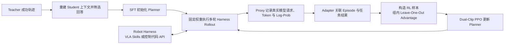
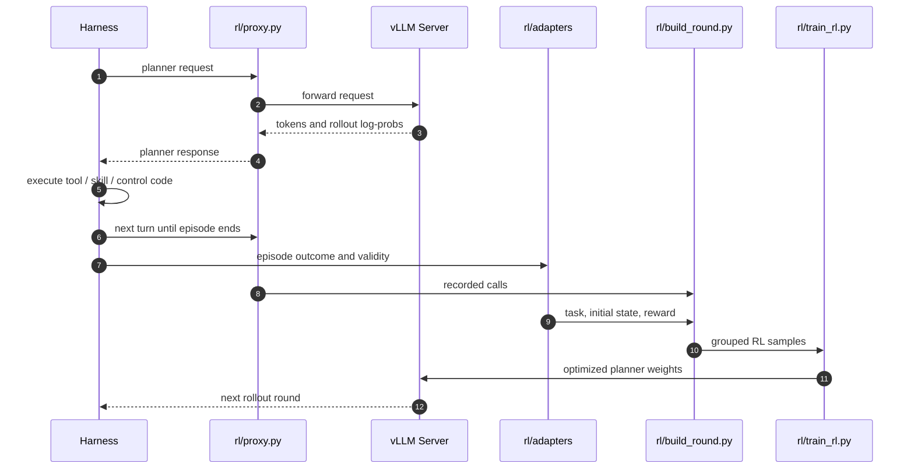

# AgenticRoboRL：把 Coding-Agent 后训练用于机器人 Planner

**AgenticRoboRL**（[arXiv:2610.28589](https://arxiv.org/abs/2610.28589)，[项目页](https://xinxinliu-ai.github.io/AgenticRoboRL/)，[官方代码](https://github.com/xinxinliu-ai/AgenticRoboRL)，[模型](https://huggingface.co/ciciciciliu/AgenticRoboRL-Qwen3.5-9B)）由美国中佛罗里达大学（University of Central Florida）、南加州大学（USC）和密歇根州立大学（Michigan State University）团队提出。它在机器人 harness 中后训练语言模型 planner：先用 teacher 成功轨迹做 SFT，再用多轮交互 RL 更新 planner；VLA skill、感知/控制 API 和 harness 执行循环保持固定。

## 英文缩写速查

| 缩写 | 英文全称 | 简要说明 |
|---|---|---|
| SFT | Supervised Fine-Tuning | 用 teacher 成功轨迹初始化 planner |
| RL | Reinforcement Learning | 按任务结果进一步优化 planner |
| VLA | Vision-Language-Action | RPent harness 中被 planner 调用的冻结策略 |
| PPO | Proximal Policy Optimization | 以 dual-clip token loss 更新 planner |
| LIBERO-PRO | Perturbed LIBERO benchmark | 评估操作规划在物体位置与任务扰动下的表现 |

## 为什么重要

- **把训练对象放到 planner。** 既有机器人 agent 工作常增强 harness、工具或外部记忆；AgenticRoboRL 直接提高 planner 使用现有能力的水平。
- **不要求统一机器人动作空间。** RPent 通过工具调用冻结 VLA，CaP-X 生成控制 API 程序；共同训练接口放在模型请求处，并由 harness-specific adapter 把请求关联到 episode outcome。
- **能对照学习阶段。** Qwen3.5-9B 在 RPent / LIBERO-PRO 从 18.1% 基线，经 SFT 到 65.1%，再经 RL 到 71.0%；SFT 与 RL 的增益可以分开观察。
- **可沿用已有控制栈。** 框架训练 planner，底层 VLA、运动控制和环境执行模块维持原样。

## 方法栈 / 流程总览

执行路径有两类：RPent 让 planner 调用冻结的 VLA skill；CaP-X 让 planner 生成控制代码，由 harness 的控制器执行。二者的低层工具接口不同，但都通过 model-call proxy 记录 planner 请求，使用各自 adapter 输出训练样本。

## 方法

### SFT：从 teacher 轨迹构造学生上下文

SFT 的样本目标是 teacher 在某一轮给出的回应，输入则是 student 在部署时真正会收到的上下文。RPent 的 teacher 可以访问成功经验记忆而 student 不使用该记忆，因此离线重建 student context，并识别依赖 teacher-only memory 的回复；相关文本经过改写与审核后才作为监督目标。CaP-X 中 teacher 与 student 使用相同 harness 配置，可从成功 episode 的正常调用中直接整理目标。

### RL：在模型调用边界关联结果

1. **采集 rollout：** 固定一版 planner 权重运行一轮环境任务；一个任务与初始状态组成一组，组内采集多次 attempt。
2. **记录调用：** rl/proxy.py 捕获每个请求的真实上下文、输出 token、rollout log-probability，以及可用的图像和工具定义。
3. **适配结果：** harness adapter 返回任务、初始状态、attempt、reward、validity；任务失败保留为零奖励，基础设施故障剔除。
4. **构造优势：** 对组内有效 episode 使用 leave-one-out advantage；不使用 learned critic 或 reward 标准差归一化。
5. **优化 planner：** 每个 episode 最多选择 16 个合格 response，以 dual-clip PPO token loss 更新。若训练时重新渲染的请求与记录 token 不一致，该样本优化权重置零。

奖励为终局任务成功指示，不加中间奖励或长度惩罚。policy 在一个 episode 执行期间不更新；完成这一轮采样、样本整理和优化后，再用新权重进入下一轮。

## 源码运行时序图

官方仓库已包含可运行的 minimal harness、RPent/CaP-X 配置、adapter、训练器与控制器。下图按 README 运行入口概括 planner rollout 到 RL 更新的数据流：

**复现路径：** 先运行 README 的 harnesses/minimal/harness.yaml quick start 检查训练回路，再按需求配置 harnesses/rpent_libero/ 或 harnesses/capx_libero/。项目需 Python 3.11；README 列出 PyTorch 2.13、Transformers 5.17、vLLM 0.28 等训练/服务环境版本。

## 工程实践

| 项目 | 复现 / 解读 |
|---|---|
| Planner | 论文使用 Qwen3.5-9B student；teacher 为 Qwen3.8-27B |
| Rollout 服务 | 每个模型调用经过 rl/proxy.py，保存实际 prompt 和输出概率 |
| 数据处理 | adapter 把不同 harness 的 episode 结果转换成统一训练元数据，不统一底层执行接口 |
| RL 更新 | 组内 leave-one-out advantage；每 episode 最多 16 个 response；dual-clip PPO |
| 评测设置 | RPent / LIBERO-PRO 报告 800 episodes；LIBERO-Plus 覆盖 10,030 配置；CaP-X 每个单元格 100 episodes |
| 开源状态 | **代码与 checkpoint 已发布**（Apache-2.0）；teacher SFT trajectories 未发布，完整复现需自行准备或从发布的 SFT checkpoint 开始 |

## 实验与评测

| Harness / Benchmark | 基线 Qwen3.5-9B | + SFT | + SFT + RL | 条件 |
|---|---:|---:|---:|---|
| RPent / LIBERO-PRO | 18.1% | 65.1% | **71.0%** | 800 episodes；student 不使用外部记忆 |
| RPent / LIBERO-Plus | 19.2% | 66.7% | **72.2%** | 10,030 配置，同一 checkpoint、无额外训练 |
| CaP-X / LIBERO-PRO | 2.7% | 18.7% | **28.5%** | 生成控制代码；privileged state 设置 |

论文还将 RPent 上的 71.0% 与使用外部记忆的 Codex (GPT-5.5) 72.1% 对照。该对照使用不同模型和记忆条件，不能单独用于判断两种后训练方法的净差异。CaP-X 测试表明流程可迁移到代码控制接口；其整体成功率仍低，且 teacher 数据只覆盖部分任务。

## 结论

**在固定机器人执行栈的前提下，后训练 planner 可以显著提升两个不同 harness 上的仿真操作成功率；主要证据来自 LIBERO 系列 benchmark。**

1. **先 SFT 再 RL 有清楚的阶段增益：** RPent 从 18.1% 到 65.1%，再到 71.0%。
2. **跨 harness 复用的是训练接口：** adapter 统一 episode 元数据，低层 skill 与控制代码保持各自形式。
3. **真实请求记录是训练关键：** harness 可能裁剪历史、图像或工具上下文，保存模型服务端看到的输入并在训练时校验 token 对齐。
4. **任务结果足以构造主实验奖励：** 论文使用终局成功奖励和组内相对 advantage，没有 learned critic。
5. **复现要区分代码和训练数据开放度：** 代码与 checkpoint 已发布，teacher SFT trajectories 未发布。

## 局限与风险

- 评测集中于 LIBERO-PRO、LIBERO-Plus 仿真 benchmark；当前结果不能直接推出真机操作性能。
- teacher 监督轨迹未发布；从头复现 SFT 阶段受到数据限制。
- RPent 的外部记忆对照与本方法 student 的无记忆条件不一致，71.0% 与 72.1% 仅是结果参照。
- CaP-X 使用 privileged state，且 teacher trajectories 覆盖 60 个任务中的 26 个；跨 harness 结果受数据和环境设置影响。
- 仅 planner 被优化，底层视觉、VLA skill、运动控制器的能力不在本方法改进范围内。

## 与其他工作对比

| 工作 | 关系 |
|---|---|
| [Agent Lightning](./agent-lightning.md) | 通用 agent 训练编排与轨迹优化框架；AgenticRoboRL 把类似模型调用记录/训练接口应用到机器人 harness |
| [HarnessEval-W](./paper-harnesseval-w.md) | 机器人 harness 的评测与能力归因；AgenticRoboRL 关注 planner 后训练 |
| [强化学习](../methods/reinforcement-learning.md) | 终局回报、组内 advantage 与 PPO 更新的通用算法背景 |
| [模仿学习](../methods/imitation-learning.md) | SFT 通过 teacher 轨迹为 RL 提供 planner 初始化 |

## 关联页面

- [强化学习](../methods/reinforcement-learning.md)
- [模仿学习](../methods/imitation-learning.md)
- [Agent Lightning](./agent-lightning.md)
- [HarnessEval-W](./paper-harnesseval-w.md)

## 参考来源

- [论文摘录](../../sources/papers/agenticroborl_arxiv_2610_28589.md)
- [项目页核查](../../sources/sites/agenticroborl-project.md)
- [官方仓库核查](../../sources/repos/agenticroborl.md)
- [arXiv:2610.28589 v2](https://arxiv.org/html/2610.28589v2)

## 推荐继续阅读

- [AgenticRoboRL GitHub](https://github.com/xinxinliu-ai/AgenticRoboRL)
- [AgenticRoboRL 项目页](https://xinxinliu-ai.github.io/AgenticRoboRL/)
- [强化学习](../methods/reinforcement-learning.md)
