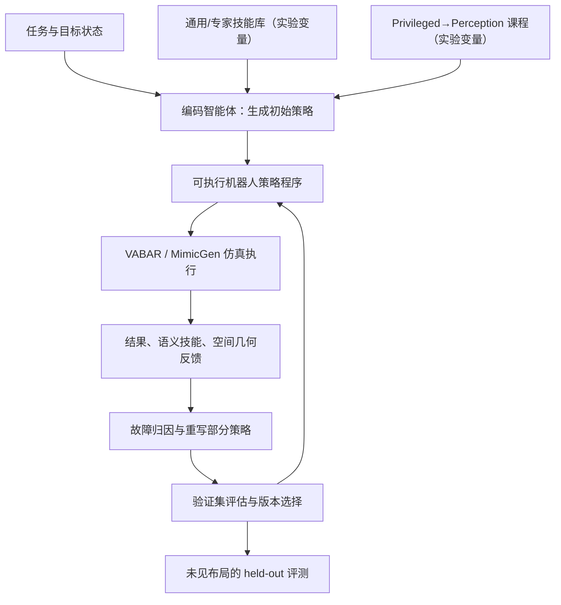

# 智能体机器人中模型、技能、反馈与课程的对照研究 / A Controlled Study of Models, Skills, Feedback, and Curriculum in Agentic Robotics

## 一句话定义

**这项控制变量研究把机器人 coding agent 的“生成策略—仿真执行—收集反馈—改写代码”拆解为模型、技能先验、反馈结构和训练课程四类因素，研究为什么有反馈也不一定能学会修复物理操作失败。**

## 英文缩写速查

| 缩写 | 英文全称 | 简要说明 |
|------|----------|----------|
| AR | Agentic Robotics | 智能体通过代码构建及修改机器人策略 |
| VLM | Vision-Language Model | 多模态决策模型 |
| IK | Inverse Kinematics | 几何和姿态到关节解 |
| RGB-D | Red Green Blue + Depth | 带深度的视觉观测 |
| DoF | Degrees of Freedom | 机器人关节自由度 |

## 核心信息

| 字段 | 内容 |
|------|------|
| 作者 | Kaiyuan Chen 等，含 Ken Goldberg |
| 原文 | [arXiv:2611.09030v1](https://arxiv.org/html/2611.09030v1) |
| 任务 | 9 项：VABAR 5 项、MimicGen 4 项 |
| 实验 | **631 个配置、27,620 次 coding-agent rollouts**（原文摘要取整为 28K） |
| 变量 | 模型能力、技能先验、反馈粒度、privileged-to-perception 课程 |

## 为什么重要

coding agent 能生成程序不等于能依据机器人真实/仿真失败证据修复程序：接触失败可能源于很早的夹取姿态、碰撞体积或坐标框架。论文把这个“故障归因→正确改写”拆成独立实验，而非只报告 benchmark 总成功率。

## 核心原理

1. coding agent 从任务定义和可用 skill 文档/源码组合出初始可执行策略 `π0`。
2. 在不同仿真实例中执行，记录成功/失败、阶段执行与空间关系；保留训练、验证和未见布局评测的边界。
3. 根据不同粒度的反馈修改代码，得到 `πk+1`；用验证集控制回退/选择。
4. 比较不同基座模型、技能提供范围、语义反馈与对象相对空间表达。
5. privileged exact state 训练再迁移到 perception，与 perception-only 的对照分析其结构固化效应。

### 流程总览

## 源码运行时序图

**不适用（2026-11-10）：** 论文提供实验协议和技能格式，但 arXiv 页面未给出可核对的**本研究完整运行入口**；VABAR/MimicGen、open-robot-skills 的外部源码不足以还原作者批量实验 harness 时序，不以通用示意代替源码图。

## 实验与评测

| 对照 | 论文发现 | 条件限制 |
|------|----------|----------|
| 模型能力 | 相近零样本起点在策略自修复阶段拉开差距 | 模型 × harness × 环境整体测试 |
| 专家技能 | 强模型将其作脚手架，弱模型更易被既有技能形式限制 | 提供接口与源码范围不同 |
| 时间反馈 | Per-episode **25%**、Per-motion **36%**、Per-skill **52%** | 特定五项操作实验的 held-out 成功率 |
| 空间反馈 | 对象相对位置、功能几何比原始世界坐标更有助于修复 | 信息组织方式不同 |
| 课程 | privileged 迁移可帮助或妨碍 perception 学习 | 取决于预先习得的控制结构 |

## 结论

**瓶颈不总是缺数据或缺反馈，而是能否将物理失败归因到上游决策并做结构性的策略改写。**

1. 优先在 skill/子任务语义边界记录反馈，而不是只增加每个运动时间步的日志。
2. 报告物体相对位姿、夹持物外形、目标功能面和避障空间关系。
3. 给 agent 可复用技能的同时保留组合与改写权限。
4. 明确验证集、held-out 场景与版本回退规则，避免对训练布局过拟合。
5. privileged-to-perception 课程应检查是否保留了不可用的“精确状态”假设。
6. 631 是实验配置数量、27,620 是 rollout 数，不是物理机器人试验次数。

## 工程实践

- 在操作前定义任务成功、超时、部分完成和接触失败判据，保留每个 skill 的输入输出、机器人状态和异常。
- 针对最初的失败技能向前追查上游感知、抓取与规划错误，记录“因果失败位置”和“可观测失败位置”区别。
- 已验证的是论文报告的仿真实验；没有可核实的本研究完整官方代码仓，无法直接复现其 631 配置。

## 局限与风险

- 任务和模型选择有限；不同模型的工具环境与订阅/推理预算也可能影响独立归因。
- 有效反馈仍需要几何推理、碰撞检查与安全执行，不自动迁移到真机实时反馈。
- 部分课程收益依赖 privileged state 的有效性，可能出现过度依赖精确状态的结构锁定。
- 未独立重跑或审核作者每轮策略改写与评测日志。

## 关联页面

- [Apple AMP1：直接用代码闭环操作](paper-apple-amp1.md)
- [Steel：异构仿真引擎](steel-newton-solver.md)
- [Agentic Manipulation Policies 方法](../methods/agentic-manipulation-policies.md)

## 参考来源

- [arXiv 论文阅读与数据核验](../../sources/papers/agentic_robotics_controlled_study_arxiv_2611_09030.md)

## 推荐继续阅读

- [论文 HTML 与附录](https://arxiv.org/html/2611.09030v1)
