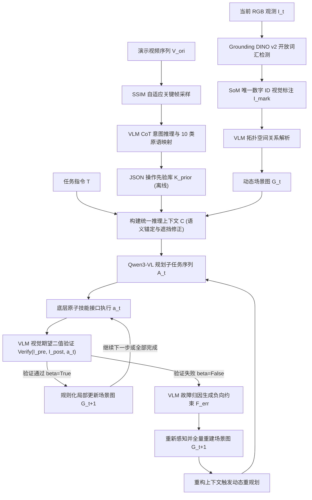

# Adaptive Task Planning for Long-Horizon Robotic Manipulation Based on Video Priors and Dynamic Scene Graphs

## 一句话定义

**ATP-VPDSG** 是一个面向长程机器人操作的零微调 VLM 任务规划框架，通过**离线视频演示先验**补充任务时序逻辑、**Set-of-Mark 动态场景图**提供实例级空间几何约束，并借助**双轨视觉期望闭环**实现快速规则更新与故障重规划。

## 英文缩写速查

| 缩写 | 英文全称 | 简要说明 |
|---|---|---|
| ATP-VPDSG | Adaptive Task Planning based on Video Priors and Dynamic Scene Graphs | 本文提出的基于视频先验与动态场景图的自适应任务规划框架 |
| VLM | Vision-Language Model | 视觉-语言模型，本文采用 Qwen3-VL 作为规划与验证核心 |
| SoM | Set-of-Mark | 视觉提示范式，在图像上叠加唯一数字 ID 与类别标签以消除指代歧义 |
| SSIM | Structural Similarity Index Measure | 结构相似性指标，用于计算相邻帧差异以自适应提取演示关键帧 |
| CoT | Chain-of-Thought | 思维链推理，用于引导 VLM 结合环境上下文推断操作意图与碰撞遮挡 |
| IRaaS | Industrial Robot-as-a-Service | 工业机器人即服务架构，作者讨论了该模块化框架的云边部署潜力 |

## 为什么重要

直接将预训练 VLM 用作长程操作任务的高层规划器时，通常存在两类结构性缺陷：

1. **时序与工艺先验缺失：** VLM 本质上是概率序列生成器，虽具通用常识，但缺乏具体任务的操作顺序与接触前置条件（例如先开炉灶旋钮再放摩卡壶），容易生成"语义听起来合理但违背操作逻辑"的子任务序列。
2. **实例指代与空间拓扑模糊：** 在包含同类多物体或遮挡的场景中，纯文本描述或原始 RGB 图像难以精确区分"左边的红碗"与"右边的红碗"，也容易误判包含、支撑与碰撞遮挡关系；同时，现有闭环重规划方法（如 ReplanVLM、DEPS）缺少标准化流程参照，失败诊断容易陷入反复试错。

ATP-VPDSG 将"视频示范里的流程逻辑（时间维）"与"场景图里的实体索引和拓扑关系（空间维）"解耦提取后再融合进同一推理上下文，在无需微调 VLM 参数的前提下同时提升了初始规划准确率与长程执行鲁棒性。

## 核心信息

| 字段 | 内容或状态 |
|---|---|
| 作者 | Guanghui Ma, Jiahui Guo, Xinhua Tang, Huaidong Zhou, Yongfeng Rong |
| 机构 | Anhui Polytechnic University（安徽工程大学）、西北工业大学（NPU）、深圳大学（SZU）、清华大学（Tsinghua）（通讯作者邮箱 `hdzhou@buaa.edu.cn`） |
| 发表时间 | 2026 年 9 月 3 日（*Sensors*, 26(17), 5595；DOI: `10.3390/s26175595`） |
| 论文链接 | [MDPI Sensors 原文](https://www.mdpi.com/1424-8220/26/17/5595)（PMC 全文归档：`PMC13568281`） |
| 项目与代码 | 未公开独立项目页或 GitHub 代码仓库（Data Availability Statement 声明研究数据可向通讯作者合理申请） |
| 清单分类 | `model.planning`（来源条目：`survey_doi_07c1d81a50e5849a`） |
| 开源状态 | 未确认开源代码（截至 2026-11-27 原文与检索材料均未提供可运行代码仓库） |

## 核心原理

ATP-VPDSG 由三个解耦模块组成，形成"离线知识沉淀 + 在线空间锚定 + 执行期双轨闭环"的认知规划流水线：

### 1. 视频演示操作先验提取（Video Prior Extraction）

- **基于 SSIM 的自适应关键帧采样：** 对原始演示视频 $V_{\mathrm{ori}} = \{I_1, I_2, \dots, I_T\}$ 计算相邻帧结构差异 $D(t) = 1 - \mathrm{SSIM}(I_t, I_{t-1})$，结合自适应阈值与局部峰值保留机制跳过平滑过渡、保留接触与显著位移突变时刻，压缩为紧凑关键状态序列 $V_{\mathrm{key}} = \{I_1, \dots, I_N\}$（$N < T$）。
- **标准化基础技能原语集：** 为消除 VLM 动词表述歧义，约束输出仅能选自 4 大类共 10 个基础原语：
  - **Spatial Motion：** `Move`、`Lift`
  - **Grasping and Placing：** `Grasp`、`Place`
  - **Assembly and Adjustment：** `Align`、`Insert`
  - **Interaction：** `Push`、`Pull`、`Rotate`、`Press`
- **三段式结构化系统提示：** 通过（1）"具身操作分析专家"角色定义与视觉注意力清单（忽略背景纹理、光照与操作者外观，聚焦末端轨迹、物体接触状态与几何构型变化）；（2）CoT 推理协议与少样本示例（状态差记录 -> 环境因果归因 -> 意图确认）；（3）逻辑合并与 JSON 封装，生成含前置条件与视觉证据的先验知识库 $K_{\mathrm{prior}}$。

### 2. 基于视觉提示的动态场景图构建（Dynamic Scene Graph Construction）

- **开放词汇检测与 SoM 唯一 ID 标注：** 使用 VLM 提示 Grounding DINO v2 检测场景中的可交互物体，为每个实体分配全局唯一数字 ID 与高对比度语义标签并叠加到原图轮廓旁，得到标记图像 $I_{\mathrm{mark}}$，建立类似编程语言句柄的"所见即所指"映射。
- **拓扑空间关系解析与 JSON 建图：** VLM 结合标记像素位置与视觉语义推断相对方位（`left/right`、`front/behind`）及嵌套/支撑关系（`inside(A, B)`、`on top of`），形式化为包含节点属性与全局排序列表的动态场景图 $G_t$。

### 3. 双轨闭环自适应任务规划（Adaptive Closed-Loop Task Planning）

- **语义锚定与遮挡预修正：** 给定任务指令 $T$ 与初始观测 $I_0$，检索匹配的通用先验 $K_{\mathrm{prior}}$，借助场景图 $G_t$ 的节点 ID 将泛化类别名词绑定至具体实例，并利用 VLM CoT 检查潜在碰撞或遮挡（如动态插入"移开遮挡物"子任务），在 `temperature = 0`、`max_length = 4096` 下生成初始子任务序列 $A_t$。
- **基于视觉期望的二值执行验证与双轨更新：** 每个原子子任务 $a_t$ 执行前后采集 $I_{\mathrm{pre}}$ 与 $I_{\mathrm{post}}$，由 VLM 依据针对该原语类型的结构化检查清单（例如 `Place` 检查夹爪张开、到达目标位与放置稳定性）输出二值验证信号 $\beta = \mathrm{Verify}(I_{\mathrm{pre}}, I_{\mathrm{post}}, a_t) \in \{\mathrm{True}, \mathrm{False}\}$：
  - **快轨（$\beta = \mathrm{True}$）：** 免去全图重感知，直接按操作原语后置条件对场景图执行规则化局部更新 $G_{t+1} \leftarrow \mathrm{Update}_{\mathrm{logic}}(G_t, a_t)$，降低在线耗时。
  - **慢轨（$\beta = \mathrm{False}$）：** 触发视觉-语义故障分析器对比 $I_{\mathrm{pre}}$ 与 $I_{\mathrm{post}}$ 生成故障原因反馈 $F_{\mathrm{err}}$ 注入历史上下文作为负向约束，随后强制调用底层感知全量重建场景图 $G_{t+1} \leftarrow \mathrm{Perception}(I_{\mathrm{post}})$，并重构推理上下文重新规划后续序列。

## 流程总览

## 源码运行时序图

**不适用**（说明核查结果：截至 2026-11-27 未确认可运行官方源码实现；原文仅在 4.1.2 节说明实验环境为 Python 3.10、PyTorch 2.1、Transformers 4.40 与 Grounding DINO v2，且 Data Availability Statement 仅声明数据可向通讯作者申请，论文正文与相关检索清单均未提供官方代码仓库或可运行脚本。）

## 实验与评测

原文在 **LIBERO-10** 长程操作仿真基准（基于 MuJoCo）与真机工业滑块-导轨装配平台上评估了以 **Qwen3-VL**（`temperature = 0`、`max_length = 4096`）为决策核心的 ATP-VPDSG 框架：

### 1. 视频先验提取与初始规划准确率（LIBERO-10，Table 2）

对全部 10 个任务各评估 50 次规划输出：
- **视频压缩率：** 65%（Task 3）至 74%（Task 9），10 个任务平均压缩率为 **70.1%**（正文描述整体处于 60–75% 区间）。
- **规划准确率：** 85.3%（Task 9）至 96.0%（Task 8），10 个任务平均规划准确率达到 **91.2%**。涉及旋钮旋转、合盖等细微状态变化的任务（如 Task 3 为 88.0%、Task 9 为 85.3%）准确率相对较低。

### 2. 故障诊断分类准确率（Table 3）

对实验过程中收集并人工标注的四类典型执行异常进行归因测试：
- **障碍物碰撞（Collision with Obstacles）：** 92.1%
- **物体位置混淆（Object Position Confusion）：** 90.2%
- **抓取滑脱（Grasp Slippage）：** 88.6%
- **遮挡干扰（Occlusion Interference）：** 79.5%
- **总体分类准确率：** **87.3%**

### 3. LIBERO-10 任务执行成功率对比（Table 4，每任务 30 次、最大 600 步）

注意：仿真执行层通过 LIBERO 预定义原子技能 API 与环境特权物体位姿接口完成底层动作执行，用以聚焦对比高层规划器质量：

| 任务 | VILA | ReplanVLM | Prompt2Act | ATP-VPDSG |
|---|---|---|---|---|
| Task 1（开灶并放摩卡壶） | 0.00% | 0.00% | 0.00% | **53.33%** |
| Task 2 | 26.67% | 23.33% | 30.00% | **56.67%** |
| Task 3 | 33.33% | 30.00% | 36.67% | **63.33%** |
| Task 4 | 56.67% | 53.33% | 56.67% | **73.33%** |
| Task 5 | 63.33% | 60.00% | 73.33% | **86.67%** |
| Task 6 | 66.67% | 63.33% | 70.00% | **86.67%** |
| Task 7 | 60.00% | 60.00% | 66.67% | **83.33%** |
| Task 8 | 53.33% | 50.00% | **86.67%** | 80.00% |
| Task 9 | 66.67% | 66.67% | 80.00% | **83.33%** |
| Task 10 | 56.67% | 60.00% | **80.00%** | **80.00%** |
| **平均成功率** | 48.33% | 46.67% | 58.00% | **74.67%** |

在剩余 **25.33%** 的失败试验中（Table 5），**底层执行误差**占失败总数的 45.2%（占总试验 11.4%），**规划逻辑错误**占 30.1%（7.6%），**场景图感知误判**占 24.7%（6.3%）。

### 4. 消融实验与模块延迟（Table 6 & Table 7）

- **消融实验（Table 6）：** 完整 ATP-VPDSG 平均成功率为 **74.67%**；移除演示视频先验降至 **65.33%**（下降 9.34 个百分点；注：原文 4.6 节正文中曾笔误写作 58.33%）；移除视觉标记与动态场景图降至 **64.33%**（下降 10.34 个百分点）。
- **推理延迟（Table 7，单张 RTX 5090 32 GB，仅计 VLM 推理，不含 Grounding DINO 与图像预处理）：**
  - 视频先验提取（离线，每类任务一次）：8.2–12.5 s
  - 初始场景图构建（在线，每个实例一次）：1.2–1.8 s
  - 全序列初始规划（在线，每个实例一次）：2.5–3.2 s
  - 单步视觉验证（在线，每个子任务一次）：0.6–0.9 s
  - 故障诊断与重规划（在线，仅失败时触发）：2.1–2.8 s

### 5. 真机工业滑块-导轨装配实验（Table 8）

使用 6-DOF 机械臂、平行夹爪与固定外置 RGB 相机，在 200 mm × 35 mm 直线导轨（配合公差 2 mm、滑块位姿随机摆放）上完成 7 步长程装配，**未对 VLM 进行任务微调**，每组测试 50 次：
- **30 条遥操作演示视频：** 成功率 **64.0%**（32/50），平均成功耗时 **21.32 s**。
- **50 条遥操作演示视频：** 成功率 **82.0%**（41/50），平均成功耗时 **18.32 s**。

## 与其他工作对比

| 对比维度 | 传统场景图规划（SayPlan / ConceptGraphs / Statler） | 闭环反思规划（ReplanVLM / DEPS） | 视觉提示规划（Prompt2Act） | ATP-VPDSG（本文） |
|---|---|---|---|---|
| 时序操作逻辑先验 | 依赖模型零样本常识，缺少演示先验 | 无标准化演示步骤参照，易重复试错 | 无独立视频演示先验提取 | SSIM 关键帧 + CoT 提取 10 类原语 JSON 先验 |
| 空间实体消歧与拓扑 | 依赖 3D 场景图或状态机 | ReplanVLM / DEPS 主要依赖原始图像 | 使用 SAM 分割并叠加名称与中心坐标 | Grounding DINO v2 + SoM 数字 ID + 空间关系 JSON 图 |
| 闭环更新策略 | 侧重静态/状态机维护 | 视觉反馈触发代码或计划重生成 | 动态混合执行策略，无显式拓扑图 | 成功时无感知规则快更新；失败时归因 + 全量重感知 |
| LIBERO-10 平均成功率 | 未在同表直接对比 | ReplanVLM: 46.67% | 58.00%（Task 8 达 86.67%） | **74.67%**（Task 1 从 0% 提升至 53.33%） |

## 结论

**一句话总判：在长程操作任务规划中，把"演示视频里的动作顺序先验"与"SoM 索引的场景图空间约束"同时显式结构化，比单纯堆叠零样本 VLM 反思更能决定复杂流程的成败。**

1. **演示先验与场景图高度互补：** 消融显示去掉视频先验与去掉场景图分别导致成功率下降 9.34 与 10.34 个百分点；在必须先激活开关再放锅的 LIBERO-10 Task 1 上，基线全为 0.00%，而 ATP-VPDSG 达到 53.33%。
2. **双轨闭环降低了高频在线感知成本：** 将验证拆分为针对原语后置条件的受限二值判断（单步 0.6–0.9 s），成功时只做规则化局部图更新，仅在 $\beta = \mathrm{False}$ 时触发全量重感知与重规划。
3. **剩余瓶颈已转向底层执行精度：** 在仿真剩余失败中 45.2% 来自抓持滑脱、搬运位移等底层执行误差（仅 30.1% 为规划逻辑错误），真机 2 mm 公差装配的剩余失败也主要源于位姿对齐与柔顺控制不足。
4. **少样本跨场景迁移可行，但前提是原子技能库完备：** 在不微调 VLM 的条件下，仅凭 50 条遥操作视频即可在真机工业装配中达到 82.0% 成功率，但高层原语仍依赖预设底层技能映射与稳定检测。

## 工程实践

- **关键配置要点：** 若复现同类 VLM 规划流水线，建议固定 `temperature = 0` 以保证规划与验证可复现性，并将 `max_length` 设至 `4096` 以容纳完整 CoT 推理与场景图 JSON。
- **原语库扩展方式：** 当迁移至拧螺丝、倾倒或移动操作等新领域时，无需改动"关键帧采样 + CoT 提示 + JSON 封装"主干，只需在原语映射接口与少样本提示模板中按参数级、原语级或类别级补充定义。
- **工程落地建议：** 将视频先验提取保留在离线阶段（8.2–12.5 s/任务类型）；在线端配合高频底层视觉伺服或力/柔顺控制器弥补纯位置原子技能的接触误差，并注意优化 Grounding DINO 检测预处理耗时（Table 7 未计入该部分）。

## 局限与风险

1. **尚未公开官方源码与数据：** 原文未附带开源仓库，仅说明数据可向作者申请，工程复现需自行编写提示词模板、SSIM 采样器与 LIBERO/真机技能映射接口。
2. **仿真评测依赖底层特权信息接口：** 在 LIBERO-10 对比实验中，底层原子技能通过基准环境特权接口获取被操作物体位置，不能等价于完全无特权的端到端 RGB 闭环控制结果；且缺少与 VLA 端到端微调策略的直接对比。
3. **单骨干与有限基准验证：** 全文仅在 Qwen3-VL 单一 VLM 骨干与 LIBERO-10、单类滑块装配任务上验证，尚未在多 VLM 家族、RoboCasa 或系统化 OOD 基准上开展跨模型与跨领域评测。
4. **故障归因与消融粒度仍待补全：** 故障分类准确率（87.3%）仅在自建失败样本上统计，未与外部反射方法在同一故障基准上横向评测；场景图内部三个子模块（Grounding DINO、ID 标注、拓扑关系解析）的贡献目前仅为定性归因，尚缺细粒度定量消融。
5. **模型缺乏状态演进预测能力：** 当前场景图仍依赖"执行后验证"被动修正，作者在 5.3 节指出未来需构建基于场景图拓扑转移规律的结构化世界模型以主动规避死锁。

## 关联页面

- [Agentic Robots 综述](paper-towards-agentic-robots-survey.md)
- [全量项目节点清单](../overview/awesome-agentic-robots-node-index.md)
- [VLA 方法背景](../methods/vla.md)
- [智能体规划与反馈机制](../methods/agent-planning-feedback.md)
- [智能体化操作策略](../methods/agentic-manipulation-policies.md)
- [机器人操作系统架构](../methods/robotic-manipulation-systems.md)
- [开放词汇与目标检测](../methods/object-detection.md)
- [机器人操作任务](../tasks/manipulation.md)

## 推荐继续阅读

- [MDPI Sensors 原文主页：Adaptive Task Planning for Long-Horizon Robotic Manipulation Based on Video Priors and Dynamic Scene Graphs](https://www.mdpi.com/1424-8220/26/17/5595)
- [PubMed Central 全文存档（PMCID: PMC13568281）](https://pmc.ncbi.nlm.nih.gov/articles/PMC13568281/)
- [LIBERO 基准官方论文（NeurIPS 2023）](https://arxiv.org/abs/2306.03310)

## 参考来源

- [论文全文精读归档（ATP-VPDSG）](../../sources/papers/paper-agentic-survey-doi-07c1d81a50e5849a.md)
- [官方 Awesome 快照归档](../../sources/repos/awesome-agentic-robots-survey-index.md)
- [MDPI Sensors 26(17), 5595 官方页面](https://www.mdpi.com/1424-8220/26/17/5595)
