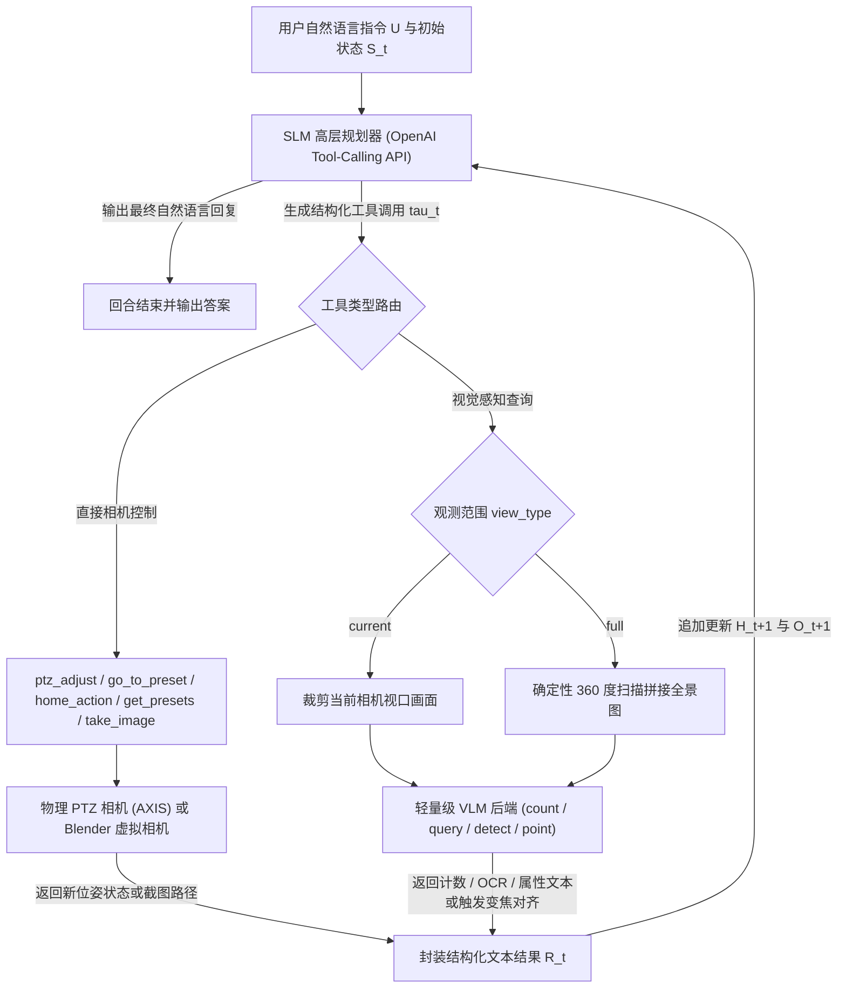
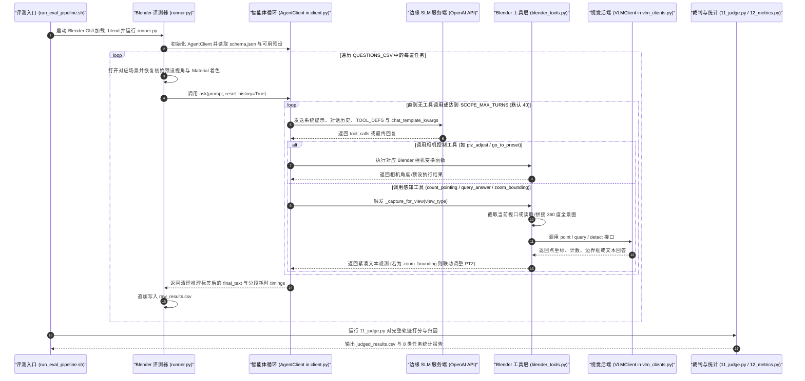

# SCOPE: Real-Time Natural Language Camera Agent at the Edge

## 一句话定义

**SCOPE**（Simulation and Camera Operations for Perception and Evaluation）是一个面向边缘部署的模块化自然语言云台变焦相机（PTZ）智能体框架与数字孪生评测基准，由轻量级小语言模型（SLM）规划器按需调度视觉-语言模型（VLM）工具与 1:1 映射的相机控制原语，从而在真机与 Blender 仿真环境间实现可复现的闭环主动感知。

## 英文缩写速查

| 缩写 | 英文全称 | 简要说明 |
|---|---|---|
| SCOPE | Simulation and Camera Operations for Perception and Evaluation | 本文提出的面向边缘侧自然语言 PTZ 相机控制的智能体框架与评测基准 |
| PTZ | Pan-Tilt-Zoom | 水平转动（Pan）、俯仰（Tilt）与光学/数字变焦（Zoom）云台相机控制自由度 |
| SLM | Small Language Model | 参数量紧凑的语言模型（如 Qwen3-4B/30B-A3B），在边缘端担任工具调度规划器 |
| VLM | Vision-Language Model | 视觉-语言模型（如 Moondream2/3、Qwen2.5-VL），作为按需调用的视觉感知工具后端 |
| MoE | Mixture-of-Experts | 混合专家架构，每次推理仅激活部分参数（如 30B-A3B 仅激活 3B），兼顾规划能力与低延迟 |
| OCR | Optical Character Recognition | 光学字符识别，用于远距拉近后读取商店招牌、车牌等文本信息 |

## 为什么重要

用自然语言驱动物理 PTZ 相机（例如“切换到公路预设位，然后每隔 15 度向右旋转直到数到至少 6 个交通锥桶”）并非单纯的图像问答，而是把**主动视角控制、按需视觉感知、多轮状态记忆与边缘延迟约束**耦合在一起的闭环控制问题。现有评价体系与早期系统存在三方面结构性缺口：

1. **静态或移动导航基准无法刻画 PTZ 控制难点：** 通用多模态评测（如 MMMU-Pro）和工具调用基准（BFCL）不测量闭环物理动作；视觉语言导航（VLN）与具身问答（EQA）聚焦可移动机器人导航，缺乏固定位姿下围绕视野切换、变焦精读（OCR）与全景/局部范围选择的定标约束。
2. **多轮直接传图会引发边缘算力爆炸：** 若把每帧图像 Token 直接流式输入多模态对话上下文，单帧就会带来数百至数万 Token 并随交互轮次线性累积，在本地边缘设备上迅速超出显存与 2 Hz 实时控制预算（单次推理 $\le 500\text{ ms}$）。
3. **前代系统缺乏可扩展性与量化可比性：** 作者早先工作 OPUS（Buynitsky et al., 2025）绑定少样本微调与封闭类别 YOLO 检测器，每新增工具都需重新采集训练数据；而直接在真机测试只能定性判断“是否合理”，难以在受控条件下剥离规划误差、感知误差与不同模型量化方案的影响。

SCOPE 通过“规划-感知解耦”与“真机-Blender 同一 JSON 工具契约”解决了上述问题，首次在 536 个闭环任务上系统定位了当前开源边缘智能体的主要性能天花板。

## 核心信息

| 字段 | 内容或状态 |
|---|---|
| 作者 | Nikolaj Hindsbo, Sina Ehsani, Pragyana Mishra |
| 机构 | Armada AI（Bellevue, Washington, USA） |
| 发表时间 | 2026 年 3 月（HRI '26，Edinburgh；DOI: `10.1145/3757279.3785641`；arXiv: `2606.02951v1`，2026-06-01） |
| 论文链接 | [ACM DOI 入口](https://doi.org/10.1145/3757279.3785641) / [arXiv:2606.02951](https://arxiv.org/abs/2606.02951) |
| 项目与代码 | [HindsboNikolaj/SCOPE](https://github.com/HindsboNikolaj/SCOPE)（MIT 协议）；[Hugging Face 场景数据集 `scope-benchmark`](https://huggingface.co/datasets/HindsboNikolaj/scope-benchmark) |
| 清单分类 | `model.perception, model.robot_control`（来源条目：`survey_doi_353abec881f4d997`） |
| 开源状态 | **已开源**（公开智能体核心代码、9 类工具接口、Blender 评测驱动、536 任务 v1/v2 数据集及 Docker/GPU 并行加速脚本；4 个 `.blend` 场景文件托管于 Hugging Face） |

## 核心原理

SCOPE 采用**规划器与感知器解耦（Decoupled Planner–Perception）**的多模态智能体架构，将长上下文语言推理保留在轻量 SLM，将高维像素解析封装为无状态或短输出的工具调用。

### 1. 离散时间递归状态机（Agent Loop）

在每个控制步 $t$，系统维护由初始用户目标 $U$、累计对话与工具调用历史 $H_t$、以及历史工具观测输出序列 $O_t$ 构成的状态：

$$S_t = (U, H_t, O_t)$$

SLM 规划器根据 $S_t$ 要么输出最终自然语言回答终止回合，要么生成结构化工具调用序列 $\tau_t$。运行时执行 $\tau_t$ 并得到结构化文本/状态回执 $R_t$，随后同步追加更新内部上下文：

$$H_{t+1} = H_t \,\|\, [\tau_t, R_t], \qquad O_{t+1} = O_t \,\|\, [R_t]$$

循环持续直至模型给出最终答案或达到最大步数上限 $T_{\max}$（代码实现 `AgentClient` 中由 `SCOPE_MAX_TURNS` 控制，默认 40 轮）。与直接流式传入图像帧的做法不同，每次视觉工具调用只向规划器上下文返回紧凑文本（计数、点位/目标反馈、OCR 文本或属性描述），从而使规划器上下文维持紧凑、可解释且可在不同后端间独立替换评测。

### 2. 统一工具接口与双范围观测

智能体通过 OpenAI 兼容 JSON Schema 暴露 9 个固定工具，真机（AXIS M5075-G PTZ 相机 + Streamlit 控制面板）与 Blender 仿真环境共享完全一致的工具名与参数规范：

| 工具类别 | 论文命名（代码函数名） | 核心功能与输入输出机制 |
|---|---|---|
| **直接相机控制** | `ADJUST_PTZ` (`ptz_adjust`) | 执行相对水平/俯仰/变焦增量调节（如 `pan=+10°`, `tilt=+10°`） |
| **直接相机控制** | `GO_TO_PRESET` (`go_to_preset`) | 切换相机至命名预设视角 |
| **直接相机控制** | `GO_HOME` (`home_action`) | 将云台恢复至初始基准朝向 |
| **直接相机控制** | `GET_PRESETS` (`get_presets`) | 查询当前场景可用预设名称列表（启动时亦会注入系统提示） |
| **直接相机控制** | `TAKE_IMAGE` (`take_image`) | 截取当前相机视口画面并保存截图路径 |
| **视觉感知工具** | `COUNT_OBJECTS` (`count_pointing`) | 调用 VLM 对指定描述物体进行计数，支持 `current` 与 `full` 范围 |
| **视觉感知工具** | `QUERY_ANSWER` (`query_answer`) | 调用 VLM 针对当前视野或全景图像回答自然语言属性/OCR 查询 |
| **视觉感知工具** | `ZOOM_TO_OBJECT` (`zoom_bounding`) | 由 VLM 检测目标边界框并自动换算为 PTZ 平移与变焦动作对准目标 |
| **视觉感知工具** | `TRACK_OBJECT` (`track_object`) | 持续定位并发送 PTZ 增量保持目标居中（仓库 README 注明在 Blender 静态场景中为 stub 占位） |

针对跨单帧视野的全局统计或搜寻需求，若简单拼接不同时刻的连续帧，会引入场景状态变化与视角重叠导致的重复计数误差。SCOPE 在仿真端实现了**确定性全景扫描拼接工具**（`view_type: "full"`），在固定静态场景下执行单次确定性旋转采样并拼接为 360° 条带图，同时评测 VLM 理解宽幅拼接图像的能力与 SLM 判断何时需要从 `current` 切换至 `full` 范围的决策能力。

### 3. Blender 数字孪生与 536 任务基准构建

- **1:1 PTZ 运动学映射：** 在 Blender 中固定相机三维位置 $(x, y, z)$，开放偏航（yaw）、俯仰（pitch）与镜头焦距调节，并使用 `screenshot_camera_view` 严格按相机框裁剪 3D 视口截图（强制使用 `Material Preview` 着色，避免 `Solid` 模式下玻璃渲染为不透明而丢失橱窗内部细节）。
- **四场景预设与否定存在标注：** 选取 4 个风格各异的城市 Blender 场景（`book-nook` 170 题、`city-street` 120 题、`postwar-city` 109 题、`whitechapel` 137 题），预先为每个预设视角记录实体数量、颜色、空间方位（左/右、远/近、遮挡）、OCR 文本及特定旋转角度下的视野变化，并显式记录“不存在的对象”（如“停车场内无行人或摩托车”），确保答案严格锚定可验证真值。
- **三轮精炼 536 任务集：** 结合真机部署日志与人工设计的类别模板生成初始 541 题，经多组 SLM–VLM 试跑与人工审计剔除歧义/不可达题目后定稿为 **536 题**（见表 2：Counting 95、Descriptor 89、Single Call 72、Comparative Relational 62、Multi-step Command 57、Multi-step Reasoning 54、OCR Identification 54、Location/Spatial 53）。

## 流程总览

## 源码运行时序图

官方仓库 `HindsboNikolaj/SCOPE` 的标准串行评测入口为 `scripts/run_eval_pipeline.sh`（v0.2.0 另提供多 GPU 并发版本 `scripts/run_fast.py`）：由宿主脚本以 GUI 模式启动 Blender 并执行 `src/scope/eval/runner.py` 遍历基准 CSV，内部实例化 `src/scope/agent/client.py` 中的 `AgentClient` 通过 OpenAI 兼容接口调度工具，并调用 `src/scope/tools/blender_tools.py` 与 `src/scope/tools/vlm_clients.py` 完成渲染抓帧与 VLM 推理，最终交由 `scripts/11_judge.py`（或 `scripts/13_judge_panel.py`）与 `scripts/12_metrics.py` 输出评测指标。

## 实验与评测

### 1. 论文基线评测（v0.1.0，19 组 SLM–VLM 配对，536 题，单裁判 `gpt-oss-120B`）

论文表 5 报告了 6 个 SLM 规划器配置（覆盖 `4B`/`30B-A3B`/`32B`/`Next-80B-A3B` 及 FP8 变体）分别搭配 `Moondream2`、`Moondream2-4bit`、`Moondream3`，以及 `Qwen3-Next-80B-A3B` 搭配 `Qwen2.5-VL-7B` 共 19 组配对在 8 个任务类别上的准确率（%）：

| 规划器（SLM） | 视觉后端（VLM） | Comparative Relational | Counting | Descriptor | Location / Spatial | Multi-step Command | Multi-step Reasoning | OCR | Single Call | 8 类均分 |
|---|---|---:|---:|---:|---:|---:|---:|---:|---:|---:|
| `Qwen3-30B-A3B` | `Moondream3` | **56.5** | **76.8** | 37.1 | **66.0** | **98.2** | 79.6 | 77.8 | 98.6 | **73.8** |
| `Qwen3-Next-80B-A3B` | `Moondream2` | 46.8 | **76.8** | 48.3 | 58.5 | 96.5 | **83.3** | 55.6 | 98.6 | 70.6 |
| `Qwen3-30B-A3B-FP8` | `Moondream2` | 50.0 | 72.6 | 50.6 | 56.6 | 89.5 | 79.6 | 59.3 | 98.6 | 69.6 |
| `Qwen3-Next-80B-A3B` | `Moondream3` | 45.2 | 72.6 | 34.8 | 47.2 | **98.2** | 74.1 | **83.3** | 98.6 | 69.3 |
| `Qwen3-30B-A3B-FP8` | `Moondream3` | 48.4 | 74.7 | 38.2 | 52.8 | 86.0 | 75.9 | 77.8 | 98.6 | 69.1 |
| `Qwen3-32B` | `Moondream3` | 45.2 | 68.4 | 39.3 | 52.8 | 89.5 | 72.2 | **83.3** | **100.0** | 68.8 |
| `Qwen3-Next-80B-A3B` | `Qwen2.5-VL-7B` | 33.9 | 52.6 | 52.8 | **66.0** | 93.0 | 72.2 | 75.9 | **100.0** | 68.3 |
| `Qwen3-32B` | `Moondream2-4bit` | 37.1 | 60.0 | **59.6** | 64.2 | 87.7 | 68.5 | 51.9 | 98.6 | 65.9 |
| `Qwen3-4B` | `Moondream2` | 27.4 | 68.4 | 38.2 | 52.8 | 89.5 | 64.8 | 38.9 | 97.2 | 59.7 |
| `Qwen3-4B-FP8` | `Moondream3` | 30.6 | 73.7 | 34.8 | 58.5 | 87.7 | 59.3 | 57.4 | 98.6 | 62.6 |

### 2. 错误拆解与瓶颈分析（第 6.1–6.2 节）

- **从“规划受限”向“感知受限”跃迁：** 工具控制为主的类别成功率已接近饱和（`Single Call` 97.2–100.0%，`Multi-step Command` 86.0–98.2%）；弱 SLM（如 4B）常出现幻觉、缺失工具调用或空间参数错误，但随规划器能力增强，工具路由与范围选择错误大幅下降，视觉错误成为剩余失败的主导项。
- **固定视角与 Oracle 感知验证：** 在固定 VLM 下切换 SLM 带来 **5.6–12.4%** 的准确率跨度，而跨 VLM 家族最大差异为 **6.9%**。若将判定为 `VLM – Counting` 和 `VLM – Query` 的失败案例视为 Oracle 正确，全组平均准确率从 **66.2%** 提升至 **82.0%（+15.8 个百分点）**，意味着视觉感知平均贡献了 **46.7%** 的总失败。
- **全景观测范围效应：** 当前视野（`current`）查询平均准确率为 **66.9%**，而需要 360° 全景拼接（`full`）的任务降至 **58.3%**；由于 `Scope` 选择错误很少，这主要反映现有轻量 VLM 在长条幅全景拼接图上的计数与细粒度文字识别退化。

### 3. 延迟与算力效率（表 6、第 6.3–6.4 节）

| 评估对象 | 指标（中位单次延迟 / 平均工具调用次数） | 关键观察 |
|---|---|---|
| SLM: `Qwen3-4B` / `Qwen3-4B-FP8` | 1.94 s (1.44) / **0.96 s** (1.41) | 4B FP8 延迟最低，但幻觉与推理失误多 |
| SLM: `Qwen3-30B-A3B` / `FP8` | **1.39 s** (1.61) / 2.62 s (1.54) | MoE 仅激活 3B 参数，FP16 下快于 4B 且取得 73.8% 最高均值；FP8 在 A100 上受算子与服务路径影响耗时反而升至 2.62 s |
| SLM: `Qwen3-32B` / `Qwen3-Next-80B-A3B` | 3.00 s (1.51) / 1.42 s (1.63) | 稠密 32B 延迟达 MoE 30B 的两倍以上；80B-A3B 未带来比 30B-A3B 更高的端到端精度 |
| VLM: `Qwen2.5-VL-7B` / `Moondream2` / `2-4bit` / `3` | 5.46 s (1.34) / 5.96 s (1.43) / 6.87 s (1.45) / 9.18 s (1.50) | 表中含共享云集群排队与未优化自托管开销；作者指出在独立 A100-80GB 本地隔离测试中轻量 VLM 单次推理稳定在 **200–500 ms**（约 2 Hz） |
| 观测范围对比（`current` -> `full` 全景） | **6.07 s -> 7.43 s（+22.4%）** | 拼接全景图显著增大输入分辨率，抬高 VLM 延迟 |

### 4. 开源仓库 v0.2.0 后续评测进展（来自仓库 `README.md`，2026 年 11 月）

仓库在论文之后更新了修正版 536 题数据集 v2（`benchmark/scope_v2.csv`）与三评委多数投票机制（`scripts/13_judge_panel.py`）：`Qwen3.8-27B` + `Qwen3.6-35B-A3B` 达到 **81.5%**，单服务默认配置 `gemma-4-26B-A4B-it`（同时兼任规划与视觉模型）达到 **77.6%**；借助 6 worker GPU 并行离屏渲染（`scripts/run_fast.py`），A100 80GB 上跑完全套 536 题的时间由 v0.1.0 的 157 min（单帧 14.6 s）缩短至 30 min（单帧 0.2 s）。

## 与其他工作对比

| 对比维度 | **SCOPE**（本文） | **OPUS**（Buynitsky et al., 2025） | **VLN / EQA**（Anderson et al., 2018; Das et al., 2018） | **端到端多模态流式 Agent** |
|---|---|---|---|---|
| **载具与动作空间** | 固定基座 PTZ 相机（Pan / Tilt / Zoom / Preset） | 固定基座 PTZ 相机 | 移动机器人三维空间导航 | 通用桌面/移动 GUI 或机械臂 |
| **感知与工具耦合** | SLM 规划 + 独立 VLM 工具（按需返回短文本） | 少样本工具调用 + YOLO 封闭检测器 | 端到端或图文联合导航策略 | 每轮对话直接传入原始图像 Token |
| **扩展新工具成本** | 仅需在 `schema.json` 与工具函数注册，免微调 | 需重新生成任务数据并微调模型 | 需重训导航策略 | 依赖提示词或上下文微调 |
| **仿真与真机一致性** | Blender 数字孪生与 AXIS 真机共享 1:1 工具 Schema | 主要面向真机原型验证 | 多基于 Matterport3D / AI2-THOR 静态或室内漫游 | 较难直接在边缘端保持稳定低延迟 |

## 结论

**一句话总判：SCOPE 证明了“紧凑 MoE 语言规划器 + 按需调用轻量 VLM 视觉工具”是当前边缘端实时自然语言 PTZ 相机控制的高性价比可行路线，且一旦规划器达到 30B-A3B 规模，系统天花板即从语言工具路由转向 VLM 的细粒度计数、OCR 与全景理解能力。**

1. **边缘部署优先选 MoE 规划器而非大稠密模型：** 在本文测试中，`Qwen3-30B-A3B`（激活 3B）以 1.39 s 中位延迟取得 73.8% 最高论文均分，显著优于 4B 模型（59.7–62.6%）与高延迟稠密 32B 模型（3.00 s，68.8%），继续放大到 `Qwen3-Next-80B-A3B` 并未带来更高精度。
2. **用短文本工具回执替代每轮流式图像上下文：** 将 `count_pointing`、`query_answer`、`zoom_bounding` 封装为文本返回接口，不仅避免上下文 Token 随步数膨胀，还允许在不重训规划器的前提下独立替换与对比 VLM 后端。
3. **重视全景拼接退化与硬件推理核匹配：** 全景查询准确率比单帧视野低 8.6 个百分点且耗时增加 22.4%，工程上应鼓励规划器优先在局部预设视角变焦采样后再做全局扫描；同时 FP8 量化在特定 GPU/服务后端上可能触发延迟倒挂，上线前必须实测端到端 Serving 延迟。
4. **复用其 Blender 数字孪生作为 CI 回归测试平台：** 仓库提供的 4 场景 536 题（及 24 题冒烟集 `scope_v2_smoke.csv`）与 `Material Preview` 强制渲染规范可直接用于验证提示词改动或模型替换是否破坏方向控制与工具格式。

## 工程实践

- **防静默退化与提示词约束（来自源码核查）：**
  - `AgentClient._seed` 将思考指令与系统提示合并为单条 `system` 消息，避免部分模型模板（如 Qwen3.5）因多条 `system` 消息报错；并在每次请求通过 `chat_template_kwargs` 显式重申 `/no_think` 等设置，防止多轮工具调用后思考模式“衰减反弹”。
  - `runner.py` 强制将 Blender 3D 视口着色设为 `MATERIAL`（纹理颜色），防止用户本地“Load UI”配置差异导致在 `Solid` 模式下把玻璃窗渲染为不透明黑色而丢掉室内物体语义。
  - `AgentClient` 内置 `SCOPE_MAX_TURNS`（默认 40）与 `_strip_channels`，防止模型死循环调用工具或将 `<think>` / Harmony 通道标记泄露到最终答案影响裁判判定。
- **快速复现路径：** 本地有 Blender 4.0+ GUI 时可运行 `scripts/01_install.sh`、`03_download_scenes.sh`、`04_install_presets.py` 后执行 `QUESTIONS_CSV=benchmark/scope_v2_smoke.csv bash scripts/run_eval_pipeline.sh` 完成 24 题冒烟测试；无显示器 GPU 服务器则建议使用 `docker/build-gpu.sh` 配合 `scripts/run_fast.py` 运行硬件 OpenGL 并发评测。

## 局限与风险

1. **指令受限与真实场景歧义差距：** 基准题目基于工作表结构化标注生成，表述比真实安防或现场操作员的模糊/口语化多轮指令更规整，论文指出实际部署中的指令歧义恢复与长程状态管理挑战仍未充分暴露。
2. **评测延迟受 Serving 基础设施偏差影响：** 论文实验中 Qwen 系列运行在优化后的 vLLM 服务上，而 Moondream 运行在非优化自托管且存在多任务抢占资源的环境中，导致表 6 中的 VLM 耗时高于隔离本地 A100 上的实测 200–500 ms。
3. **动态目标跟踪与闭源大模型缺失：** 开源 Blender 仿真中场景保持静态，`track_object` 工具仅为占位 stub，无法评估真实运动目标持续追踪与多帧时序遮挡；同时论文未纳入闭源云端前沿大模型作为高精度参考上限（因网络与排队延迟不符合边缘实时定义）。
4. **非确定性 LLM 裁判与单/三评委方差：** 论文 v0.1.0 依赖单一开放权重裁判 `gpt-oss-120B` 打分；即使在 v0.2.0 升级为三评委面板后，默认配置在 24 题冒烟集上的两次重复运行仍有一定波动（21/24 与 19/24）。

## 关联页面

- [机器人视觉感知栈选型闭环](../queries/robot-perception-stack-selection-loop.md)：对照视觉感知与开放词汇定位选型闭环。
- [具身大模型评测基准选型闭环](../queries/embodied-eval-benchmark-selection-loop.md)：对照评测基准设计与指标选型闭环。
- [Agentic Robots 综述](paper-towards-agentic-robots-survey.md)
- [全量项目节点清单](../overview/awesome-agentic-robots-node-index.md)
- [VLA 方法背景](../methods/vla.md)
- [智能体工具调用接口](../methods/agent-tool-use-interface.md)：对照 OpenAI 兼容工具 Schema 与规划-执行解耦契约。
- [智能体规划与闭环反馈](../methods/agent-planning-feedback.md)：对照离散时间状态机与多轮感知反馈循环。
- [机器人视觉感知](../methods/robot-visual-perception.md)：对照开放词汇检测、点定位与全景拼接感知难点。
- [具身智能体评测基准](../methods/embodied-agent-benchmarking.md)：对照仿真数字孪生评测与 LLM-as-Judge 错误归因体系。
- [AI 模型推理服务](../methods/ai-model-serving-inference.md)：对照边缘端 SLM/VLM 服务部署与延迟拆解。
- [AI 模型压缩与量化](../methods/ai-model-compression.md)：对照 FP8 与 INT4 量化在准确率和算子延迟上的权衡。
- [机器人仿真集成](../methods/robot-simulation-integration.md)：对照 Blender Python API 视口渲染与相机运动学模拟。
- [Sim2Real 迁移工作流](../methods/sim2real-transfer-workflow.md)：对照物理 AXIS PTZ 相机与仿真环境 1:1 工具接口对齐。

## 推荐继续阅读

- [SCOPE 官方 GitHub 仓库与 v0.2.0 文档](https://github.com/HindsboNikolaj/SCOPE)（含 `docs/architecture.md`、`docs/RESULTS.md` 与 `docs/RUN_FAST.md`）
- [SCOPE Hugging Face 基准场景数据集](https://huggingface.co/datasets/HindsboNikolaj/scope-benchmark)
- [OPUS: Camera Control at the Edge with Language Models for Scene Understanding（arXiv:2505.06402）](https://arxiv.org/abs/2505.06402)（SCOPE 前代原型工作）

## 参考来源

- [论文全文归档与核对笔记](../../sources/papers/paper-agentic-survey-doi-353abec881f4d997.md)
- [官方代码仓归档与入口核查](../../sources/repos/paper-agentic-survey-doi-353abec881f4d997.md)
- [官方 Awesome 快照归档](../../sources/repos/awesome-agentic-robots-survey-index.md)
- [ACM HRI '26 论文页面（DOI: 10.1145/3757279.3785641）](https://doi.org/10.1145/3757279.3785641)
- [arXiv 预印本（arXiv:2606.02951）](https://arxiv.org/abs/2606.02951)
