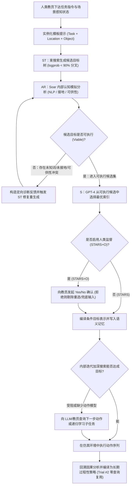
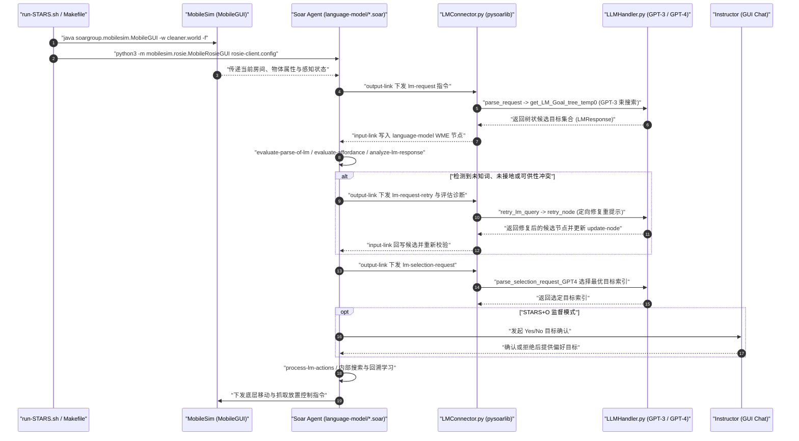

# STARS: extending interactive task learning with large language models

## 一句话定义

**STARS**（Search Tree, Analyze, Repair, and Select）是一种面向具身交互式任务学习（ITL）的大语言模型知识抽取与校验框架，通过在认知架构内部模拟验证并定向修复束搜索候选目标，在不预先微调模型的前提下实现单样本在线任务学习、长期策略沉淀与低负担人类偏好对齐。

## 英文缩写速查

| 缩写 | 英文全称 | 简要说明 |
|---|---|---|
| STARS | Search Tree, Analyze, Repair, and Select | 本文提出的核心四阶段框架：束搜索树、分析校验、定向修复与候选选择 |
| ITL | Interactive Task Learning | 交互式任务学习，通过自然语言对话等实时交互让智能体单样本学习新任务 |
| TBP | Template-Based Prompting | 模板化提示基线，利用任务上下文与示例引导 LLM 生成目标和动作描述 |
| LLM | Large Language Model | 大语言模型，在本文中作为外部常识来源提供候选任务目标与动作知识 |
| HRI | Human-Robot Interaction | 人机交互，关注人类教员在指令成本、监督负担与偏好定制中的交互体验 |
| Soar | State, Operator, And Result（Soar Cognitive Architecture） | 本文底层采用的认知架构，支持工作记忆推理、迭代加深规划与回溯过程性学习 |

## 为什么重要

传统交互式任务学习（ITL）智能体能够从人类单次自然语言教学中实时习得新任务，并将因果经验编译为长期策略实现零额外教示复现，但其瓶颈在于高度依赖人类教员逐一给出精确、繁琐的目标与步骤指令。而若直接将大语言模型（LLM）接入具身机器人，虽然获得了广泛的先验常识，却会同时触发三类结构性失效：

1. **具身可操作性脱节：** LLM 训练语料默认以人类身体尺度与能力为前提（例如默认双手可同时扶门与拿物，或直接指令移动不可抓取的大型物体），生成响应往往与单臂移动机器人的实际物理可供性（affordance）及现有词库/语法不匹配。
2. **情境接地与用户偏好缺失：** 预训练 LLM 不了解机器人当前房间的具体物体与特定用户习惯（例如脏杯子进洗碗机而干货放食品柜还是橱柜），简单基于模板提示与对数概率排序（TBP）在无监督时任务完成率仅约 35.7%–66.7%，超过 70% 的厨房整理候选目标甚至无法通过基本可执行性校验。
3. **一次性在线学习需求：** 家庭与办公服务机器人在部署后需要即时、单样本（one-shot）学会用户定制的新任务，不能依赖离线批量强化学习或任务微调；同时学会的知识应沉淀为结构化记忆，避免下次执行相同任务时重复询问 LLM 或人类。

STARS 的核心价值在于将 LLM 从“唯一且脆弱的规划器”降维定位为“多知识源之一”，借助认知智能体的内部解析、情景接地与可供性推理在执行前拦截并修复错误知识，将宝贵的人类交互集中用于确认个人偏好与安全边界。

## 核心信息

| 字段 | 内容或状态 |
|---|---|
| 作者 | James R. Kirk, Robert E. Wray, John E. Laird |
| 机构 | Center for Integrated Cognition, IQM Research Institute（Ann Arbor, MI, United States） |
| 发表时间 | 2026 年 8 月 4 日（*Frontiers in Computer Science*, Vol. 8, Article 1848830；DOI: `10.3389/fcomp.2026.1848830`；扩展自 Kirk et al., AAAI 2024） |
| 论文链接 | [Frontiers in Computer Science 原文](https://www.frontiersin.org/journals/computer-science/articles/10.3389/fcomp.2026.1848830/full) |
| 项目与代码 | [GitHub 官方仓库（Center-for-Integrated-Cognition/STARS）](https://github.com/Center-for-Integrated-Cognition/STARS) |
| 清单分类 | `model.planning`（来源条目：`survey_doi_ddc6fc88fa219f08`） |
| 开源状态 | 已开源（`ITL-agent`、`mobile-sim` 仿真器与 `DataAnalysisScripts` 已发布于官方 GitHub 仓库；第 5.2 节 AI2-THOR 扩展以补充视频展示） |

## 核心原理

本文围绕具身 ITL 智能体对 LLM 响应的四项核心要求展开：**语言可解析（Interpretable）**、**环境可接地（Situated）**、**匹配本体与可供性（Matched to Embodiment and Affordances）**——前三者合称 **可执行（Viable）**——以及 **符合个体用户偏好（Aligned with Human Preferences，与前三者合称情境相关 Situationally Relevant）**。在此基础上，STARS 在 Soar 认知架构（Rosie ITL 智能体）之上构建四阶段协同机制：

### 1. Search Tree（ST：束搜索候选树）

针对早期 TBP 通过提高采样温度（temperature = 0 / 0.9 / 1.0）重复请求导致候选高度雷同且大量偏离格式的问题，ST 在单次模板提示上执行基于 token 对数概率（logprob）的递归束搜索：

- 当主生成序列中任一 token 的条件概率低于 **90%** 阈值时触发分叉；
- 过滤掉概率低于 **5%** 的低置信补全分支；
- 每个分支点最多保留 **4** 个替代词元展开新路径，最大递归深度限制为 **3**，从而用更低冗余获取多样化的高概率目标描述候选树。

### 2. Analyze and Repair（AR：内部认知模拟校验与定向修复）

智能体不直接将 LLM 候选目标送入物理执行，而是复用自身语言理解与知识推理链路开展“心理模拟（mental simulation）”，诊断三类不可执行（unviable）失配：

- **语言失配（Language）：** 使用智能体原生 NLP 解析器解析候选句，识别语法不可解析（`uninterpreted`）或词典外未知词（`unknown-word`）。
- **情景失配（Situation）：** 检查解析出的指代短语（如 `"cabinet"`）能否在当前感知环境与工作记忆中锚定到具体物体实例，失败则标记为 `ungrounded-object`。
- **本体与可供性失配（Embodiment & Affordance）：** 结合语义记忆与感知属性检验动作/目标前提，例如若目标要求移动 `"dish rack"`，但环境感知属性缺少 `grabbable` 标签（或容器需先开启而当前状态/容器类型不符），则判定为 `affordance-mismatch`。

对每一类被检出的失配，智能体调用对应的定向修复模板，将原失败候选连同具体诊断反馈（如 `"No. Cannot see a cabinet."` 或 `"No. Rack is not grabbable."`）拼装成修复提示，再次驱动 ST 生成可行的替换候选。

### 3. Selection（S）与 User Oversight（O）

- **Selection：** 将经过 AR 筛选与修复后留存的所有可执行（viable）候选整理为编号列表，交由 GPT-4（chat endpoint）结合任务上下文返回最合理的候选整数索引，替代 TBP 简单的平均对数概率排序。
- **User Oversight：** 在 `STARS+O` 模式下，智能体向人类教员以极简的是/否问句确认选定目标（如 `"For a mug in the dish rack, is the goal that the mug is in the cupboard and the cupboard is closed?"`）。若用户拒绝，则移除该项并重跑 Selection（最多审查 5 个候选；全部拒绝则由教员口述目标），借此以极低词数捕获高度个性化的家庭/办公偏好。

### 4. 在线规划、回溯学习与长期记忆沉淀

一旦目标描述通过确认，Soar 智能体先使用**迭代加深内部搜索**（如最大深度 `d <= 4`）寻找满足目标的动作序列；仅当内部搜索受限或失败（或遇到第 5.2 节中未知动作如 `"Rinse"`）时，才向 LLM 或人类查询单步动作。目标达成后，智能体执行**回溯分析（retrospective analysis）**，抽取动作之间的因果依赖并通过 Soar 过程性学习（procedural chunking）编译进长期记忆。此后面对相同或同类物体（如从盘子迁移到餐叉，或二次运行 `Trial #2`）时，智能体可直接依托既有策略与语义记忆完成任务，无需再调用 LLM 或打扰用户。

## 流程总览

## 源码运行时序图

官方仓库通过任务目录脚本（如 `ITL-agent/examples/tidy-kitchen/run-STARS.sh`）复制对应配置并调用 `Makefile` 中的 `make run_example` 并行拉起 `MobileGUI` 仿真器与 `MobileRosieGUI` 认知智能体，核心运行交互由 Soar 语言模型规则目录与 Python `LMConnector.py` / `LLMHandler.py` 通过 `input-link` / `output-link` 驱动：

## 实验与评测

论文在两个阶段依次验证了将 LLM 接入 ITL 的可行性与 STARS 框架的有效性（全部主要定量结果均基于 APRIL MAGIC / MobileSim 移动单臂机器人仿真环境）：

### 1. 预研实验（第 3 节，单一厨房整理任务，Table 5）

- **任务设置：** 办公室厨房含 30 个待整理物体与 5 个须关闭的门/抽屉（共 **35** 条目标断言），使用 GPT-3（`text-davinci-002`）搭配 TBP 提示模板与最大深度 `d <= 4` 的内部搜索。
- **关键结果：**
  - `Instruction`（纯人类指令）：完成率 **100.0%**，共 **76** 条指令、**757** 词；
  - `Inst+Search d<=4`：完成率 **100.0%**，降至 **40** 条指令、**603** 词；
  - `Search d<=4 +LLM`（无监督直接采用最高概率目标）：完成率仅 **54.3%**（14 条任务框架指令、76 词），大量失败源自忽视无盖垃圾桶、未区分空瓶或违背单臂物理约束；
  - `Inst+Search d<=4 +LLM`（TBP 加人类监督）：完成率恢复 **100.0%**，总词数降至 **360** 词（含 **43** 次 yes/no 确认），但目标响应被人类接受的相关率仅 **30.2%**（而动作首查正确率达 **96%**，说明瓶颈集中在目标描述不可靠）。

### 2. STARS 主实验（第 4 节，三项多室/多场景任务，Table 7 & Table 8）

实验扩展至 **Tidy kitchen**（35 物体，含 4 类须按初始位置区分目标的同型物体，如桌上马克杯去洗碗机而沥水架马克杯去橱柜）、**Store groceries**（15 物体）与 **Organize office**（12 物体），三项任务共覆盖 **58** 个独特物体类型；其中 ST 与 Repair 使用 GPT-3（completions API 获取 token logprobs），Selection 使用 GPT-4：

| 任务 | 条件 | 完成率 (%) | 检索目标数 | 总 Token 消耗 | 人类指令数 | 人类总词数 |
|---|---|---|---|---|---|---|
| **Tidy kitchen** | `TBP` | 52.5 | 93 | 41K | 14 | 76 |
| **Tidy kitchen** | `TBP+O` | 100.0 | 89 | 42K | 92 | 403 |
| **Tidy kitchen** | `STARS` | **77.5** | 368 | 139K | 14 | 76 |
| **Tidy kitchen** | `STARS+O` | **100.0** | 361 | 138K | 65 | **127** |
| **Tidy kitchen** | `Trial #2` | **100.0** | **0** | **0** | **1** | **2** |
| **Store groceries** | `TBP` | 66.7 | 39 | 17K | 6 | 28 |
| **Store groceries** | `TBP+O` | 100.0 | 37 | 19K | 29 | 92 |
| **Store groceries** | `STARS` | **94.4** | 171 | 62K | 6 | 28 |
| **Store groceries** | `STARS+O` | **100.0** | 177 | 64K | 22 | **44** |
| **Store groceries** | `Trial #2` | **100.0** | **0** | **0** | **1** | **2** |
| **Organize office** | `TBP` | 35.7 | 34 | 13K | 6 | 28 |
| **Organize office** | `TBP+O` | 100.0 | 35 | 12K | 41 | 184 |
| **Organize office** | `STARS` | **92.9** | 201 | 76K | 6 | 28 |
| **Organize office** | `STARS+O` | **100.0** | 206 | 78K | 22 | **60** |
| **Organize office** | `Trial #2` | **100.0** | **0** | **0** | **1** | **2** |

- **稳定性（10 次独立运行，Table 8）：** `STARS` 无监督完成率均值与标准差在 Kitchen、Groceries 与 Office 上分别为 `77.5% ± 2.04%`、`93.89% ± 1.76%` 与 `92.14% ± 2.26%`，方差较小。
- **上下文消融（`STARS*`）：** 在 Tidy kitchen 的 GPT-4 选择系统提示中补充一句任务常识（如“桌台餐具默认为脏、瓶罐默认为空、非易腐食品放食品柜”），`STARS` 无监督完成率从 `77.5%` 跃升至 **92.5%**。
- **人类监督负担与命中率：** `STARS+O` 相比 `TBP+O` 将人类输入词数分别降低 **68.5%**（403 → 127）、**52.2%**（92 → 44）与 **67.4%**（184 → 60）；Yes/No 一次接受率由 `33% / 62% / 18%` 提升至 `69% / 94% / 73%`。
- **候选响应质量分析：** 在厨房/杂货/办公室任务中，LLM 原始输出中分别有 **>70% / 58% / 85%** 属于不可执行（unviable）响应，仅 **13% / 14% / 5%** 直接满足全部四项条件；经 STARS 过滤修复后，厨房任务 **100%（35/35）** 物体均至少获得 1 个情境相关候选（TBP 仅 15/35），且智能体实际采用的目标 **100%** 达到“至少合理（reasonable）”级别。

### 3. 扩展能力定性验证（第 5.2 节，AI2-THOR 厨房演示）

论文在 AI2-THOR 仿真厨房中演示了两类拓展（尚未开展大规模统计评测）：
- **动作与递归子任务学习（`"Cook a carrot"`）：** 遇到未知动词 `"Rinse"` 时递归触发 STARS 学习洗胡萝卜，AR 自动将 `"Turn on the stoveburner"` 修复为 `"Turn on the stoveknob"`、将 `"onto the metal pan"` 修复为 `"into the metal pan"`，教员通过监督补全“关闭水龙头与炉灶”以消除危险后置失误（post-completion error），学成后可直接迁移至 `"cook a potato"`。
- **类别概念接地定义（`"all recyclables are in the recycling bin"`）：** 无人类监督（0 次后续交互）下通过对比可见物体集合过滤误泛化定义（如拒绝将金属锅误归入可回收物的 `"if an object is metal, then it is recyclable"`），实现跨物体类别的通用目标迁移，但会遗漏诸如“关闭橱柜门”等后置动作。

## 与其他工作对比

论文在第 2.2 节（Table 3）与第 5.1 节从**具身性、多任务、多知识源、单样本、在线学习、LLM 使用、显式验证、知识迁移**八个维度系统对比了相关路线：

- **对比纯传统 ITL（无 LLM）：** 具备单样本在线学习、多知识源整合与长期知识迁移能力，但缺乏显式外部知识预检验，且重度依赖人类教员输入完整目标与步骤，教学认知负荷高。
- **对比 SayCan、Inner Monologue、SayPlan 与 TidyBot：** SayCan 依赖离线强化学习预训练技能可供性打分；Inner Monologue 注入环境与人类反馈实现在线重规划但非单样本学习且不沉淀长期任务表征；SayPlan 依托 3D 场景图在仿真中校验动作序列；TidyBot 主要通过人类示例汇总偏好。四者大多直接生成或重排**动作序列**且缺乏跨任务持久化的目标/策略记忆（知识迁移 `N`），而 STARS 学习**结构化目标与过程性策略**，在 `Trial #2` 上实现零 LLM 查询复用。
- **对比 Tree of Thoughts（ToT）与 RCI：** ToT 在非具身推理任务（如 24 点、填字）上展开思维树；RCI 通过让 LLM 自我批判修复电脑操作错误（Stechly et al., 2025 已指出 LLM 自我批判在复杂规划中不可靠）。STARS 则依赖**外部具身认知架构（NLP 解析、感知接地、可供性记忆）**进行确定性验真，并做定向诊断修复，而非纯依赖 LLM 自检。
- **与近期趋势（Verbalized Sampling / LLM+RL）的关系：** 第 2.2.1 节指出，当代基于 RL 探索的 LLM 智能体仍偏离“单样本在线学习”目标；而 STARS 的 Search Tree 依赖 completions API 的 token logprobs（GPT-4 chat 与 GPT-5 等新型接口已不再开放该参数），作者明确提出可结合 **Verbalized Sampling**（直接提示模型输出带概率的多候选）来替代底层 logprob 分叉以适配当代大模型接口。

## 结论

**一句话总判：STARS 证明了在具身交互式任务学习中，决定实用性的关键不在于单靠提示工程逼近完美回答，而在于由认知架构对 LLM 候选树实施“解析—接地—可供性”前置验真与定向修复，将人类监督精确收敛至偏好确认与安全兜底。**

1. **前置认知过滤优先于盲目采样：** 超过 58%–85% 的原始 LLM 候选在具身环境下不可执行；只有结合本地 NLP 解析、情景接地与可供性记忆拦截无效候选，才能避免执行期崩溃并把正确率推升至可用区间。
2. **用轻量 Yes/No 监督换取 100% 完成率与偏好对齐：** 在涉及个人习惯（脏杯去向、食品分区）和关键安全边界（关闭炉灶）的任务上，LLM 自身无法确定特定用户偏好，保留 `STARS+O` 确认可将教员输入词数压缩一半以上同时保证零失误。
3. **学目标+内部搜索+回溯编译是降本关键：** 相比每次执行都调用 LLM 规划动作序列，学得条件目标后通过 Soar 过程性学习固化策略，可使二次执行（`Trial #2`）的 LLM token 与人类交互成本同时归零。
4. **工程迁移时须替换 completions logprob 机制：** 原版 Search Tree 强依赖 GPT-3 completions API 的 token 对数概率分叉（且单任务 token 开销约为 TBP 的 3–6 倍）；在现代仅开放 chat 接口的模型上落地时，需采用 Verbalized Sampling 或结构化多候选采样替代。

## 工程实践

- **运行环境与依赖栈：** 官方仓库基于 **Ubuntu Linux + Soar 9.6.1（Python 3.10 SML + Java 17 + Ant）+ `pysoarlib`（PR #7 分支）+ LCM + April Robotics Toolkit**，并在 `ITL-agent/python/rosie/lm/APIKey.py` 中配置 `OPENAI_API_KEY`。
- **任务复现与日志分析：** 在 `ITL-agent/examples/{tidy-kitchen,store-groceries,organize-office}/` 目录下直接执行 `sh run-STARS.sh` 即可启动 MobileSim 与 Rosie 交互窗口；结束后运行 `sh post-process-data.sh STARS` 整理日志，并可用 `DataAnalysisScripts/ITLAgent-LogProcessingScripts/DialogProcessing-VerificationAnalysis.ipynb` 复现论文统计图表。
- **跨模型提示适配建议：** 若将底座替换为现代指令微调或推理大模型，建议参考第 4.3 节 `STARS*` 做法，在 Selection 系统提示中显式注入环境默认常识（如台面餐具脏污假设、干湿分区规则），可减少无意义的候选分歧。

## 局限与风险

- **Token 成本放大：** `STARS` 与 `STARS+O` 为构造候选树与执行修复/选择，单任务总 token 消耗达到 `TBP` 的 **3.3 倍至 6.0 倍**（如厨房 `41K → 139K`、办公室 `13K → 76K`），对高频实时查询的推理延迟与 API 费用提出更高要求。
- **API 接口与模型代际限制：** Search Tree 的中词分叉依赖旧版 completions API 的 token logprobs；如论文脚注指出，GPT-4 chat 端口与 GPT-5 不再提供该能力，直接制约原版 ST 在当代前沿模型上的即插即用（作者正以 Verbalized Sampling 替换）。
- **环境假设与任务复杂度边界：** 主实验任务中各物体基本相互独立、无强耦合时序约束，且依赖感知系统提供准确的对象类别与可供性标签（如 `grabbable`）；第 5.3 节指出多物体强交互场景可能导致内部搜索复杂度爆炸，且无监督模式下仍存在“忘记关门/关火”等危险后置误差（post-completion error）。
- **真机验证缺口：** 本次报告的全部定量评测与第 5.2 节扩展均在仿真器（APRIL MAGIC / MobileSim 与 AI2-THOR）中完成，尚未给出跨真实硬件传感噪声与机械臂抓取误差下的真机定量成功率。

## 关联页面

- [Agentic Robots 综述](paper-towards-agentic-robots-survey.md)
- [全量项目节点清单](../overview/awesome-agentic-robots-node-index.md)
- [VLA 方法背景](../methods/vla.md)
- [机器人智能体执行框架](../methods/robot-agent-harness.md)：对照规划、执行接口与反馈机制。
- [智能体规划与反馈机制](../methods/agent-planning-feedback.md)：对照验证循环与失败修复策略。
- [具身智能体评测基准](../methods/embodied-agent-benchmarking.md)：参考室内整理与多步具身任务评测设计。
- [机器人操作任务](../tasks/manipulation.md)：对照抓取放置与容器交互等操作任务需求。
- [移动操作任务](../tasks/loco-manipulation.md)：对照单臂移动机器人在多房间环境下的导航与操作协同。

## 推荐继续阅读

- [STARS 期刊论文原文（Frontiers in Computer Science, 2026）](https://www.frontiersin.org/journals/computer-science/articles/10.3389/fcomp.2026.1848830/full)
- [STARS 官方开源仓库（Center-for-Integrated-Cognition/STARS）](https://github.com/Center-for-Integrated-Cognition/STARS)
- [STARS 基础任务交互演示视频（YouTube）](https://youtu.be/bx7af5XAELY)
- [STARS AI2-THOR 烹饪与子任务学习演示视频（YouTube）](https://youtu.be/SV0KlVYP0EM)

## 参考来源

- [STARS 论文全文精读笔记](../../sources/papers/paper-agentic-survey-doi-ddc6fc88fa219f08.md)
- [官方 Awesome 清单快照归档](../../sources/repos/awesome-agentic-robots-survey-index.md)
- [STARS 官方代码仓结构与入口核对归档](../../sources/repos/paper-agentic-survey-doi-ddc6fc88fa219f08.md)
- [Frontiers in Computer Science 原文全文](https://www.frontiersin.org/journals/computer-science/articles/10.3389/fcomp.2026.1848830/full)
- [GitHub 官方源码仓库](https://github.com/Center-for-Integrated-Cognition/STARS)
