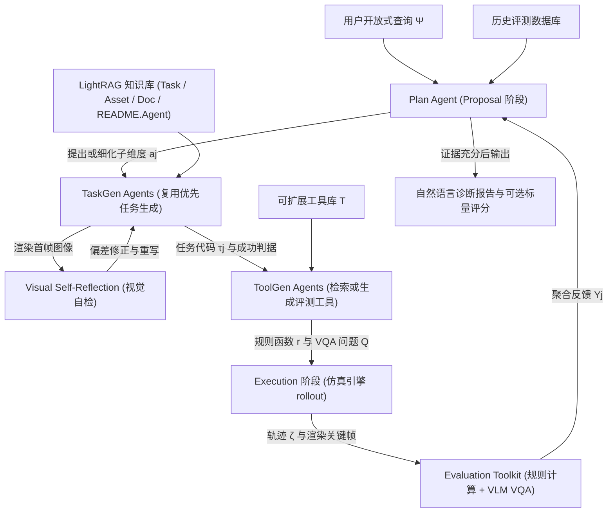

# ManipEvalAgent: Promptable and Efficient Evaluation Framework for Robotic Manipulation Policies

## 一句话定义

ManipEvalAgent 是一个面向机器人操作策略的**可提示、多轮自适应**智能体评测框架，通过规划代理拆解自然语言查询、代码生成代理动态构造仿真任务与评测工具，结合规则指标与视觉问答（VQA）在少样本条件下给出与全量基准一致的结论及细粒度诊断报告。

## 英文缩写速查

| 缩写 | 英文全称 | 简要说明 |
|---|---|---|
| VLM | Vision-Language Model | 视觉语言模型，用于规划拆解、代码生成与执行视频关键帧问答 |
| VQA | Visual Question Answering | 视觉问答，面向仿真接口难以直接量化的执行现象生成结构化分析 |
| RAG | Retrieval-Augmented Generation | 检索增强生成，从任务库、资产列表与仿真文档中检索示例与接口约束 |
| VLA | Vision-Language-Action | 视觉-语言-动作策略模型，文中评测对象涵盖单任务策略及 RDT-1B、$\pi_0$ 等多任务 VLA |
| AUROC | Area Under the Receiver Operating Characteristic Curve | 受试者工作特征曲线下面积，用于评估不同阈值下 VQA 判别与人工标注的一致性 |
| BDDL | Behavior Domain Definition Language | LIBERO 基准的任务逻辑与目标谓词规范语言 |

## 为什么重要

随着扩散策略（Diffusion Policy）与通用 VLA 模型快速发展，现有仿真评测流程在研究迭代中暴露出三类瓶颈：

1. **全量采样成本高：** 传统基准（如 RoboTwin 2.0、LIBERO）在固定任务集上穷举大量 rollout，尤其在多任务 VLA 设定下动辄耗时数千分钟（例如 RoboTwin 上评测 RDT-1B 耗时 11,102 分钟）。
2. **流程固化、难以响应开放需求：** 现有基准只支持预设任务与固定评测管线，研究人员无法通过自然语言定向追问“物体反光材质泛化如何”或“是否接近工作空间安全边界”等具体问题。
3. **单一标量缺乏诊断解释：** 仅报告平均成功率（Success Rate）难以定位策略究竟是在位姿变化、外观纹理、几何尺度还是干扰物遮挡上失效。

ManipEvalAgent 模仿人类专家通过“少量交互试探 + 依据中间现象追问细节”的评测方式，在保持与大型静态基准高度一致排序结论的同时，显著压缩评测时间与样本预算。

## 核心信息

| 字段 | 内容 |
|---|---|
| 作者 | Yiteng Chen\*、Huiping Zhuang\*、Wenbo Li\*、Shiyi Wang、Xiangyu Zhao、Qingyao Wu† |
| 机构 | 华南理工大学（SCUT）、复旦大学（Fudan） |
| 发表时间 | ICLR 2026（Published as a conference paper at ICLR 2026） |
| 论文链接 | [ICLR 2026 摘要页](https://proceedings.iclr.cc/paper_files/paper/2026/hash/8833c8aa10542d24d693bbaf6a4598f5-Abstract-Conference.html) · [会议全文 PDF](https://proceedings.iclr.cc/paper_files/paper/2026/file/8833c8aa10542d24d693bbaf6a4598f5-Paper-Conference.pdf) |
| 项目与代码 | 暂未公开独立项目页或官方代码仓库（`survey_iclr_2026_8833c8aa` 未列 GitHub） |
| 清单分类 | `environment.benchmarking` |
| 来源条目 | `survey_iclr_2026_8833c8aa` |
| 开源状态 | 未确认开源代码（截至 2026-11-27 核查 ICLR 2026 摘要页与全文均未列官方仓库链接；文中仅评测了第三方开源策略与仿真基准） |

## 核心原理

在形式化设定中，仿真器表示为 $S=(\Omega, \Gamma)$（能力集合 $\Omega$ 与资产/接口约束 $\Gamma$），被测策略为语言条件策略 $\pi(a_t \mid o_t, l)$ 或无语言条件策略 $\pi(a_t \mid o_t)$。ManipEvalAgent 将传统基于固定集合 $\mathcal{C}$ 的评测重构为动态多轮闭环，由 **Proposal、Generation、Execution** 三个阶段协同完成：

1. **Proposal 阶段（Plan Agent）：**
   - 读取系统提示（含仿真器接口能力约束及被测策略类型元信息）与用户自然语言查询 $\Psi$。
   - 从**历史评测数据库**检索相似历史查询的拆解方案以保持跨查询、跨策略的一致性（Appendix A.3.3）。
   - 将抽象查询动态拆解为子维度集合 $A=\{a_j\}$（例如先测物体位置泛化，观察结果明确后再探查外观泛化，若外观结果存在歧义则进一步细化材质光泽度与尺寸缩放），直至收集足够证据后汇总生成自然语言诊断报告（优势、弱点、改进建议）及可选的 $[0,1]$ 标量分。

2. **Generation 阶段（TaskGen Agents & ToolGen Agents）：**
   - **TaskGen Agents（任务代码生成）：** 对每个子维度 $a_j$ 生成可执行任务 $\tau_j = \text{TaskGen}(a_j, S, \mathcal{K}_{\text{task}}, \mathcal{K}_{\text{asset}}, \mathcal{K}_{\text{doc}})$，包含场景初始化与布尔判据 `check_success`。系统遵循**复用优先**原则，能复用已有任务则直接采用，并引入三项机制提升代码生成可靠性：
     - **RAG：** 使用 LightRAG（本地部署 `Qwen2.5-7B-Instruct` 降低 API 成本）对仿真器文档做分块检索，对任务库 $\mathcal{K}_{\text{task}}$ 与资产列表 $\mathcal{K}_{\text{asset}}$ 做文档级检索，避免引用不存在的资产。
     - **Visual Self-Reflection（视觉自检）：** 渲染生成场景的首帧图像，由 VLM 核对实际画面与任务提案意图是否一致，若发现穿模、物体缺失或布局偏差则触发诊断与重生成。
     - **`README.Agent`：** 由人类专家与离线自动化提取程序定期生成的面向智能体的结构化文档，显式总结接口规范、常见用法与易错点。
   - **ToolGen Agents（评测工具生成）：** 维护可扩展工具库 $\mathcal{T}$，遵循检索优先原则按需复用或少样本生成两类评测工具：
     - **规则型 Python 工具 $r:\zeta \mapsto \mathbb{R}^d$：** 调用仿真器状态接口计算距离、安全裕度（如 `safety_margin`）、抓取可达性（`check_grasp_reachability`）或接触状态，并通过极简仿真场景单元测试校验（Appendix A.1.3）。
     - **VQA 型视觉工具 $q:(I_{0:T}, Q) \mapsto \mathbb{R}^d$：** 针对仿真 API 难以直接提取的语义或时序现象，将规则工具输出与首帧、末帧及中间关键帧组成提示词输入 VLM 进行问答评估。

3. **Execution 阶段（仿真执行与信号聚合）：**
   - 对每个任务 $\tau_j$ 默认执行 $M_j = 5$ 次独立 rollout（$\zeta_{j,m} = \text{Rollout}(\pi, \tau_j, \text{seed}_m)$，次数可由用户配置，单回合 100 步）并渲染图像/视频 $I_{0:T}$。
   - 分别计算规则指标 $r(\zeta_{j,m})$ 与 VQA 指标 $q(I_{0:T}, Q)$，通过聚合算子得到单维度结果 $Y_j = \text{Aggregate}\{y_{j,m}\}_{m=1}^{M_j}$ 及全局汇总 $Y = \text{Aggregate}\{Y_j\}_{j=1}^N$，回传给 Plan Agent 决定继续追问或结束评测。

## 流程总览

依据原文 §3（Figure 2–4）与 Appendix A.3.3–A.3.5 绘制系统闭环：

## 源码运行时序图

**不适用**（截至 2026-11-27 核查 ICLR 2026 论文摘要页与会议全文，均未公布本框架的官方源码仓库或独立项目页链接，无法对实际入口脚本与模块调用关系进行静态源码核对。）

## 实验与评测

作者在 **RoboTwin 2.0**（主实现平台）与 **LIBERO** 上评测了 5 个开源策略：单任务策略 ACT、Diffusion Policy（DP）、DP3，以及 VLA 模型 RDT-1B 和 $\pi_0$（单回合均统一设为 100 步，硬件环境为 Ubuntu 22.04 + Intel Core i9 14th gen + NVIDIA RTX A6000）。

### 1. 评测耗时与采样效率（Table 1 & Table 4）

| 设定 | 策略 | RoboTwin 2.0（时间 / 样本数） | LIBERO（时间 / 样本数） | ManipEvalAgent（时间 / 样本数） |
|---|---|---|---|---|
| 单任务（Table 1） | ACT | 167 min / 56,592 | 117 min / 29,546 | **42 min / 16,927** |
| 单任务（Table 1） | DP | 171 min / 55,551 | 132 min / 29,059 | **45 min / 16,895** |
| 单任务（Table 1） | DP3 | 159 min / 52,087 | 113 min / 28,343 | **44 min / 15,638** |
| 单任务（Table 1） | RDT | 210 min / 55,435 | 132 min / 28,878 | **63 min / 16,676** |
| 单任务（Table 1） | $\pi_0$ | 164 min / 51,087 | 103 min / 26,732 | **43 min / 15,336** |
| 多任务（Table 4） | RDT | 11,102 min / 2,763,623 | 4,909 min / 1,073,428 | **97 min / 27,037** |
| 多任务（Table 4） | $\pi_0$ | 7,900 min / 2,445,809 | 4,330 min / 992,816 | **68 min / 21,745** |

### 2. 结论一致性与策略排序相关性（Table 2, Table 5, Table 9）

- **10 次试验与基准成功率的偏差范围（1 个标准差内 / 3 个标准差内）：**
  - 单任务设定（Table 2）：RoboTwin 成功率上 5 策略分别有 50%–70% 落在 1 个标准差内、60%–100% 落在 3 个标准差内（例如 DP 为 60% / 100%，$\pi_0$ 为 70% / 100%）；LIBERO-Spatial 达到 60%–100% / 80%–100%。
  - 多任务设定（Table 5）：RDT 与 $\pi_0$ 在 RoboTwin 与 LIBERO 四子集上整体有 40%–70% 落在 1 个标准差内、70%–100% 落在 3 个标准差内。
- **策略排序一致性（Table 9，Spearman 相关系数 $\rho$，固定 seed=0）：** 在 RoboTwin 短/中/长时域与 LIBERO-Object/Spatial/Goal/Long 共 7 个任务簇上，对 5 个策略进行排序，10 / 20 / 50 rollouts 下的 $\rho$ 分别为 **0.76–0.86**（90% CI）、**0.73–0.91**（95% CI）和 **0.79–0.85**（95% CI），在不同 rollout 预算下均保持较高排序稳定性。

### 3. 子模块精度、消融实验与误差分析（Table 3, 6–8, Figure 6）

- **Plan Agent 子维度拆解一致性（Table 6）：** 在作者构建的数百条开放式用户查询数据集（覆盖 Generalization、Performance、Safety、Robustness to Distractors、Multi-Task 五大类，由 4 名具身操作研究生/博士生多数投票标注）上，GPT-4o、Gemini 1.5 Pro 与 GPT-4o mini 的 Precision 分别为 **0.943**、**0.927** 和 **0.924**。
- **VQA 扰动鲁棒性（Table 7–8）：** 在 RoboTwin 2.0 的 Clean、Scene Clutter、Background Textures、Lighting 四种条件下，三款 VLM 的二分类准确率均在 **0.980–0.998** 之间，AUROC 均在 **0.966–0.987** 之间。
- **代码生成消融（Table 3）：**
  - `TaskGen`：完整版成功率 **98%**；去掉 RAG 降至 95%，去掉 Visual Self-Check 或 `README.Agent` 均降至 96%，仅基线 Few-shot（Base）为 93%。
  - `ToolGen`：完整版成功率 **96%**；去掉 RAG 降至 92%。
- **系统误差分布（Figure 6）：** 总体约 **5%** 的评测流程受到不同程度错误影响；在全部错误中，生成阶段占比高达 **69.8%**（其中 TaskGen Agents 占 **42.8%**，ToolGen Agents 占 **27%**），其余来自 Simulation Engine（**13.5%**）、Plan Agent（**9.5%**）和 Others（**7.2%**）。

## 与其他工作对比

作者在 Appendix A.5（Table 10）与 A.3.2、A.6 中明确将 ManipEvalAgent 与现有仿真基准及生成式仿真工作进行了定位区分：

| 对比维度 | 传统静态基准（如 [RoboTwin](robotwin.md) / [LIBERO](libero-benchmark.md)） | ManipEvalAgent |
|---|---|---|
| 用户查询驱动评测 | 否（固定任务集与固定流程） | **是**（自然语言驱动多轮探索） |
| 可解释诊断输出 | 否（主要输出单一标量成功率） | **是**（优势/弱点诊断文本 + 可选分数） |
| 动态生成与评测 | 否 | **是**（动态生成任务与自适应规划） |
| 开放工具接入 | 否 | **是**（规则函数 + VLM/VQA 混合工具库） |
| 绝对确定性（Absolute Correctness） | **是**（固定代码与全量采样） | 否（受生成成功率与少样本波动影响） |

- **定位差异：** ManipEvalAgent 不是要取代 RoboTwin 2.0 或 LIBERO 等标准化静态基准，而是作为**互补型诊断评测器**，用于开发阶段的快速迭代归因与定制化压力测试。
- **与策略及基准迁移的关系：** 相较于在 [LIBERO](libero-benchmark.md) 中需同时合成 BDDL 任务描述文件与 Python `Problem` 类并基于 `BDDLBaseDomain` / `eval_predicate_fn` 编写工具，[RoboTwin](robotwin.md) 的接口更加清晰，使 ManipEvalAgent 更易完成全链路适配；论文亦验证了其在 [ACT](paper-act.md)、[RDT-1B](paper-rdt-1b.md) 与 [$\pi_0$](paper-pi0.md) 等不同范式策略上的评估效率提升。
- **与数据生成框架的差异：** 相较于 GenSim、RoboGen 或 Gen2Sim 等面向训练数据扩增的生成式仿真流程，ManipEvalAgent 将“提案—生成—执行—归因”耦合为面向策略评测的闭环，目前复用仿真器既有 3D 资产而非实时生成新网格。

## 结论

**一句话总判：ManipEvalAgent 证明了用规划代理、RAG 增强代码生成与规则/VQA 混合工具替代固定全量采样，能够在大幅降低多任务操作策略评测耗时（1–2 个数量级）的同时保留与静态基准高度一致的排序信号，但其定位仍是静态基准的“高效诊断补充”而非确定性替代。**

1. **适用场景选型：** 适合在策略研发期快速回答开放式能力诊断问题（如材质、尺寸、光照或安全边界退化），或在全量跑通 RoboTwin/LIBERO 前做多任务初筛；正式榜单对比仍需回归固定静态基准以保证绝对确定性。
2. **代码生成稳定性决定系统上限：** 全系统约 5% 的故障中近七成（69.8%）发生在 TaskGen（42.8%）与 ToolGen（27%），因此复用优先策略、LightRAG 检索约束、首帧视觉自检及 `README.Agent` 文档缺一不可。
3. **混合评分机制的必要性：** 规则型 Python 工具保证碰撞、距离等几何量精确性，关键帧 VQA 则补足“物体是否滑移、轨迹是否绕行”等难以硬编码的语义诊断。
4. **工程移植成本取决于仿真器抽象：** 仿真器接口越统一（如 RoboTwin 2.0），越容易构建文档库与工具库；像 LIBERO 这类分离 BDDL 与 Python 场景定义的基准则需更高的提示工程与双端同步成本。

## 工程实践

- **硬件与推理配置：** 论文在 Ubuntu 22.04、Intel Core i9（14 代）与 NVIDIA RTX A6000 上运行实验，建议至少 **24 GB 显存** 以避免加载被测 VLA 模型失败；RAG 索引与检索通过本地部署 **Qwen2.5-7B-Instruct**（配合 LightRAG）运行以控制 API 开销。
- **默认预算与容错恢复：** 每个生成任务默认采样 5 次 rollout（每回合 100 步），可按时间—精度需求配置；各阶段均设容错回退（Appendix A.3.4）：Plan Agent 拆解偏离过高时重启规划，TaskGen 首帧视觉自检失败时重新生成，ToolGen 单元测试失败时重写工具，仿真异常则统一计为策略执行失败。
- **跨基准一致性控制：** 通过历史评测数据库复用相似查询的维度拆解，并通过任务/工具库检索相似范本，减少不同策略评测时因任务差异带来的方差。

## 局限与风险

1. **未公开官方源码与提示词资产：** 截至 2026-11-27，论文及 ICLR 2026 页面未提供官方代码仓库、Open-Ended User Query 数据集与 `README.Agent` 提取器实现，当前无法直接复用其现成代码进行本地复现。
2. **无绝对确定性保证与约 5% 系统报错：** 无法像静态基准那样完全消除任务生成偏差（TaskGen 占系统错误的 42.8%）；Plan Agent 的高人工一致性也部分依赖专家手工编写的系统提示词。
3. **资产与仿真器绑定：** 当前只能检索仿真器既有资产库而无法生成新 3D 物体，跨仿真器迁移仍需人工适配接口（例如 LIBERO 仅完成基础适配，尚未达到 RoboTwin 2.0 同等规模验证）。
4. **纯仿真与仅 RGB 限制：** 框架尚未部署到真机闭环评测，且 VQA 仅依赖 RGB 关键帧（论文在 Appendix A.6.3 指出未来可接入深度估计或事件相机信号以增强高速与几何感知）。

## 关联页面

- [Agentic Robots 综述](paper-towards-agentic-robots-survey.md)
- [全量项目节点清单](../overview/awesome-agentic-robots-node-index.md)
- [VLA 方法背景](../methods/vla.md)
- [机器人操作](../tasks/manipulation.md)
- [具身智能体评测方法](../methods/embodied-agent-benchmarking.md)
- [AI 模型与智能体基准评测](../methods/ai-benchmark-evaluation.md)
- [机器人仿真场景生成](../methods/robot-simulation-scene-generation.md)
- [智能体工具调用接口](../methods/agent-tool-use-interface.md)
- [智能体规划与反馈](../methods/agent-planning-feedback.md)
- [双臂协同操作](../tasks/bimanual-manipulation.md)
- [具身智能评测与基准总览](../overview/hub-embodied-eval-benchmark.md) · [具身评测选择闭环](../queries/embodied-eval-benchmark-selection-loop.md)
- [RoboTwin 双臂基准](robotwin.md) · [LIBERO 基准](libero-benchmark.md)

## 推荐继续阅读

- [ICLR 2026 官方论文摘要页](https://proceedings.iclr.cc/paper_files/paper/2026/hash/8833c8aa10542d24d693bbaf6a4598f5-Abstract-Conference.html)
- [ManipEvalAgent ICLR 2026 会议全文 PDF](https://proceedings.iclr.cc/paper_files/paper/2026/file/8833c8aa10542d24d693bbaf6a4598f5-Paper-Conference.pdf)

## 参考来源

- [ManipEvalAgent 原文核对归档](../../sources/papers/paper-agentic-survey-iclr-2026-8833c8aa.md)
- [官方 Awesome 快照归档](../../sources/repos/awesome-agentic-robots-survey-index.md)
- [ICLR 2026 论文摘要页](https://proceedings.iclr.cc/paper_files/paper/2026/hash/8833c8aa10542d24d693bbaf6a4598f5-Abstract-Conference.html)
- [ICLR 2026 论文全文 PDF](https://proceedings.iclr.cc/paper_files/paper/2026/file/8833c8aa10542d24d693bbaf6a4598f5-Paper-Conference.pdf)
