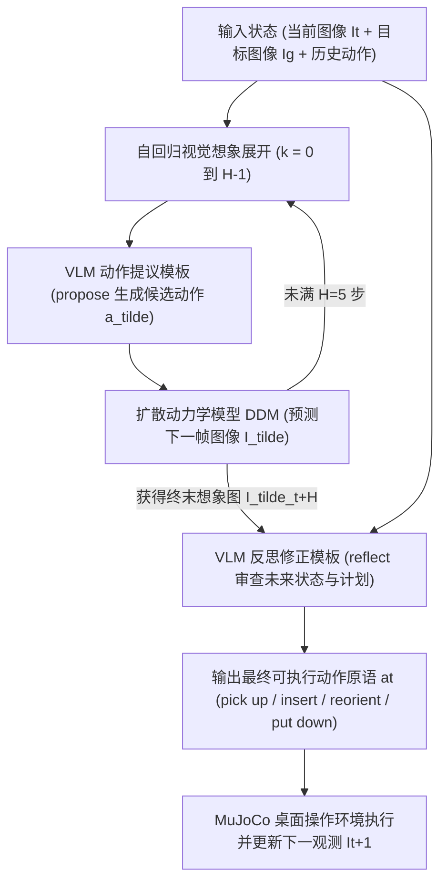
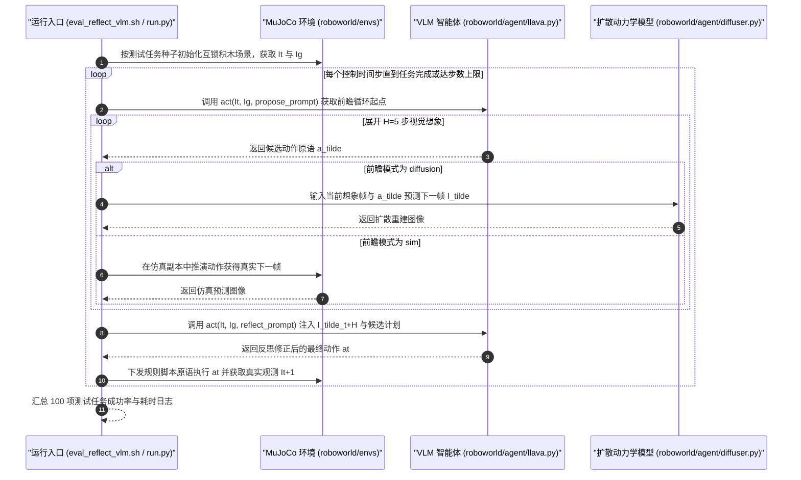

# Reflective Planning: Vision-Language Models for Multi-Stage Long-Horizon Robotic Manipulation

## 一句话定义

**ReflectVLM** 是一个面向多阶段长程物理操作任务的视觉-语言模型（VLM）测试时反思规划与交互式后训练框架：通过扩散动力学模型（DDM）自回归推演未来 $H$ 步的视觉状态，让同一 VLM 在真实执行前审查并修正初始动作提案。

## 英文缩写速查

| 缩写 | 英文全称 | 简要说明 |
|------|----------|----------|
| VLM | Vision-Language Model | 接收多模态图像与文本指令并输出高层文本动作原语的模型（本文基于 LLaVA-1.5-13B） |
| DDM | Diffusion Dynamics Model | 基于 InstructPix2Pix 微调的扩散前向动力学模型，由当前帧与动作预测下一帧图像 |
| POMDP | Partially Observable Markov Decision Process | 部分可观测马尔可夫决策过程，策略仅观测 RGB 图像而非物理真值状态 |
| MCTS | Monte Carlo Tree Search | 蒙特卡洛树搜索，本文用于对照的传统基于模型搜索规划基线 |
| BC | Behavior Cloning | 行为克隆，本文指仅在 5,000 条固定专家演示上做监督微调的基础 VLM 策略 |
| LoRA | Low-Rank Adaptation | 低秩自适应参数微调方法，本文在 Vicuna-13B 语言侧以 rank 128 高效微调 |

## 为什么重要

1. **揭示零样本 VLM 在物理依赖长程规划上的脆弱性：** 即使具备推理能力的前沿闭源 VLM（如 GPT-o1、Gemini-2.0-flash-thinking）在 100 项需要拆解阻挡件与理解互锁顺序的操作任务上零样本成功率也仅为 6%–15%，说明单纯依赖语言推理难以弥补细粒度物理交互常识的缺失。
2. **用轻量「视觉想象 + 单轮反思」替代高开销树搜索：** 传统 MCTS（50 次迭代）每步推理耗时长达 391.42 s，且因状态价值难以精确区分反而使基础微调策略成功率从 47.8% 退化至 24.0%；ReflectVLM 通过 $H=5$ 步视觉想象加单轮反思仅需 11.10 s/步（使用仿真器前瞻为 6.05 s/步），即可在复杂长程任务（$\ge 15$ 步）上将成功率从无反思的 37.5% 提升至 65.0%。
3. **验证训练期反思重标定对隐式推理的塑造：** 即便测试阶段关闭显式前瞻反思（`w/o reflect@test`），仅在交互后训练阶段引入反思问答样本就能使总成功率从 77.8% 升至 82.2%（且推理耗时保持在 0.45 s/步），为低延迟部署提供了折中方案。

## 核心信息

| 字段 | 内容 |
|------|------|
| 作者 | Yunhai Feng, Jiaming Han, Zhuoran Yang, Xiangyu Yue, Sergey Levine, Jianlan Luo |
| 机构 | Cornell University、香港中文大学（CUHK）、Yale University、UC Berkeley |
| 发表时间 | CoRL 2025（PMLR v305；官方代码仓标注 arXiv:2502.16707） |
| 论文链接 | [PMLR v305: feng25b](https://proceedings.mlr.press/v305/feng25b.html) · [PDF 原文](https://raw.githubusercontent.com/mlresearch/v305/main/assets/feng25b/feng25b.pdf) · [arXiv:2502.16707](https://arxiv.org/abs/2502.16707) |
| 项目与代码 | [GitHub: yunhaif/reflect-vlm](https://github.com/yunhaif/reflect-vlm) · [项目主页](https://reflect-vlm.github.io/) · [Hugging Face 权重合集](https://huggingface.co/collections/yunhaif/reflectvlm-67b95e4316ab2d5f71ad4b25) |
| 清单分类 | `model.planning`（来源条目 `survey_pmlr_v305_feng25b`） |
| 开源状态 | **部分开源**（MIT 协议公开 MuJoCo 仿真任务环境、交互脚本、评测脚本与 Hugging Face 预训练/后训练/扩散检查点；仓库 README 中「Policy training」标注为 Coming soon） |

## 核心原理

### 1. POMDP 建模与高层动作原语

任务被形式化为部分可观测马尔可夫决策过程 $(S, A, T, O, Z)$：真实状态 $s_t \in S$ 包含桌面积木位姿与拓扑互锁关系，但 VLM 策略仅接收目标 RGB 图像 $I_g$、当前 RGB 图像 $I_t$ 与最近 $h=10$ 步历史动作文本 $a_{t-h:t-1}$。动作空间为：

$$A = \{\text{pick up}, \text{insert}, \text{reorient}, \text{put down}\} \times \{\text{objects}\}$$

底层由带真实执行失败率 $\epsilon$ 的规则脚本控制器执行（表 5 实测成功率：`pick up` 98.4%、`reorient` 90.4%、`insert` 90.1%、`put down` 97.5%）。训练阶段允许查询读取真实环境状态与依赖图的符号专家策略 $\pi_E(s_g, s_t)$（评测集成功率为 97%）。

### 2. DAgger 式交互式后训练与反思重标定（Algorithm 1）

1. **基础策略预训练（BC）：** 在 1,000 个独特装配任务 × 5 种随机初始桌面布局（共 5,000 条专家轨迹）上对 `LLaVA-1.5-13B`（`clip-vit-large-patch14-336` + `vicuna-13b-v1.5`，LoRA rank 128）做 1 个 epoch 监督微调。
2. **交互采样（$K=3$ 轮）：** 每轮从 1,000 个训练任务中随机采样 200 个，滚动采集 1,000 条交互轨迹；在时间步 $t$ 以概率 $p$ 执行 VLM 学习者动作 $a^\dagger_t \sim \pi_{\text{VLM}}(I_g, I_t)$，以概率 $1-p$ 执行专家动作 $a^*_t \sim \pi_E(s_g, s_t)$，缓解分布偏移。
3. **双模板轨迹重标（Fig. 2 & Eq. 1）：** 轨迹终止后，对每个时间步 $t$ 同步构造两类问答样本并由同一 VLM 联合优化交叉熵损失：
   - **动作提议（$Q_1 \to a^*_t$）：** 仅给定 $(I_g, I_t, a_{t-h:t-1})$ 预测专家动作 $a^*_t$；
   - **反思修正（$Q_2 \to a^*_t$）：** 额外将后续 $H=5$ 步动作 $a_{t:t+H-1}$ 及执行后的真实未来图像 $I_{t+H}$ 写入提示上下文，仍监督 VLM 输出 $a^*_t$：

$$\min_{\pi_{\text{VLM}}} \mathbb{E}_D \left[ L_{\text{CE}}\!\left(\pi_{\text{VLM}}^{\text{propose}}(a_t \mid I_g, I_t),\, a^*_t\right) + L_{\text{CE}}\!\left(\pi_{\text{VLM}}^{\text{reflect}}(a_t \mid I_g, I_t, I_{t+H}, a_{t:t+H-1}),\, a^*_t\right) \right]$$

### 3. 扩散动力学模型（DDM，Section 4.2 & Appendix H.2）

为使测试时无需接触真实环境即可推演未来状态，论文基于 `timbrooks/instruct-pix2pix` 训练单步视觉动力学模型 $\tilde{T}(I_t, a_t) \to \tilde{I}_{t+1}$：
- **架构与冻结策略：** 冻结预训练图像 Latent Encoder（$I_t \to z_t$）与 Text Encoder（$a_t \to z_{a_t}$），将 $z_t$、噪声 $N$ 与 $z_{a_t}$ 送入 Diffusion UNet 去噪预测 $z_{t+1}$，再由 Latent Decoder 重建 512 px 图像。
- **双阶段并行微调：** UNet 训练 20K 步（batch size 640，LR `1e-4`）学习动作条件下的场景演化；Latent VAE Decoder 独立微调 4K 步（batch size 160，LR `1e-7`），专门修复小尺寸积木的纹理与边界失真。
- **数据分布：** 使用带随机噪声动作替换（替换概率 $p \in \{0.2, 0.5, 0.7, 0.9, 1.0\}$）的次优策略在 10,000 个装配板上采集 50,000 条轨迹（约 100 万条转移，其中 50K 留作验证；第 4.2 节亦说明混入了少量测试状态点以提升生成保真度）。

### 4. 测试时反思规划（Algorithm 2）

在每个真实决策步 $t$，令 $\tilde{I}_t \leftarrow I_t$，自回归展开 $H=5$ 步前瞻想象：
1. 对 $k = 0, \dots, H-1$：由 $\pi_{\text{VLM}}^{\text{propose}}(I_g, \tilde{I}_{t+k})$ 生成候选动作 $\tilde{a}_{t+k}$，再由 DDM 生成下一步想象图像 $\tilde{I}_{t+k+1} = \tilde{T}(\tilde{I}_{t+k}, \tilde{a}_{t+k})$。
2. 将初始观测 $I_t$、目标图 $I_g$、想象终点图 $\tilde{I}_{t+H}$ 及完整候选计划 $\tilde{a}_{t:t+H-1}$ 拼接输入 $\pi_{\text{VLM}}^{\text{reflect}}$，审查原计划是否导致无进展或死锁状态，并输出最终执行动作 $a_t$。

## 流程总览

## 源码运行时序图

官方仓库 `yunhaif/reflect-vlm` 提供了完整的评测与仿真交互入口：通过 `scripts/eval_reflect_vlm.sh {sim|diffusion}` 或 `scripts/eval_base_vlm.sh` 调用根目录 `run.py` 启动 100 项程序化生成任务的评测循环，并在 `roboworld/agent/` 中封装 `llava.py`、`diffuser.py`、`oracle.py` 等策略实现（仓库结构归档见 [sources/repos/paper-agentic-survey-pmlr-v305-feng25b.md](../../sources/repos/paper-agentic-survey-pmlr-v305-feng25b.md)；训练流水线在官方 README 中标注为 Coming soon）。

- **最短体验与评测路径：** 安装环境后，运行 `python scripts/interact.py --env_seed 1000001` 可交互式体验 MuJoCo 程序化积木任务；运行 `bash scripts/eval_reflect_vlm.sh diffusion`（或 `sim`）可自动从 Hugging Face 拉取权重并评测 100 项测试任务；`python scripts/diffusion_demo.py` 可单独测试扩散模型预测效果。

## 实验与评测

论文在 MuJoCo 中程序化生成了 **100 个训练阶段未见的桌面互锁装配任务**（每题含 5–8 块积木、均值 5.53 块；专家完成步数 4–22 步、均值 12.13 步；包含必须先移开阻挡件再重排的困难场景）。

### 1. 主结果与基线对比（Fig. 5 & Table 2）

| 方法 | 评测设定 / 种子数 | 成功率 (%) | 单步推理耗时 (A100, s) | 核心表现说明 |
|------|-------------------|------------|------------------------|--------------|
| LLaVA-OneVision | 零样本，1 次 | 0.0 | — | 无法稳定输出合规动作指令格式 |
| Gemini-2.0-flash | 零样本，1 次 | 6.0 | — | 仅完成少量浅层简单任务（平均 8.2 步） |
| GPT-4o | 零样本，1 次 | 6.0 | — | 缺乏物理阻挡与长程序列推理（平均 7.3 步） |
| Gemini-2.0-flash-thinking | 零样本，1 次 | 8.0 | — | 具备思考链但物理空间落地有限（平均 10.4 步） |
| GPT-o1 | 零样本，1 次 | 15.0 | — | 零样本最强基线，仍局限于低复杂度样本（平均 13.1 步） |
| MCTS（预训练 VLM + 仿真器启发价值） | 50 次搜索迭代，1 次 | 24.0 | 391.42 | 启发价值难以刻画物理约束，且常错误覆盖正确计划 |
| BC（LLaVA-1.5-13B，5k 专家演示） | 5 种子均值 | 47.8 | — | 分布偏移与复合误差导致长程容易陷入死锁 |
| Ours w/o reflect（无反思交互微调） | Iter. 3，5 种子均值 | 77.8 | — | DAgger 交互纠错显著缓解分布偏移 |
| Ours w/o reflect@test（训练含反思、测试关闭） | Iter. 3，5 种子均值 | 82.2 | **0.45** | 训练期反思提示词提升了策略隐式规划能力 |
| **Ours w/ diffusion（ReflectVLM 完整版）** | Iter. 3，5 种子均值 | **82.4** | 11.10 | 无需环境真值交互的视觉前瞻反思，耗时仅为 MCTS 的 2.8% |
| Ours w/ sim（使用仿真器前瞻上界） | Iter. 3，5 种子均值 | 85.4 | 6.05 | 反映前瞻动力学无误差条件下的反思增益上限 |

### 2. 迭代演进与按难度分层消融（Table 1 & Table 3，5 种子均值）

| 变体 | Iter. 1 (%) | Iter. 2 (%) | Iter. 3 (%) | 简单 (24 题, 0–9 步) | 中等 (60 题, 10–14 步) | 困难 (16 题, $\ge 15$ 步) |
|------|-------------|-------------|-------------|-----------------------|------------------------|---------------------------|
| w/o reflect | 58.2 | 74.4 | 77.8 | 83.3 | 86.3 | 37.5 |
| w/o reflect@test | 64.4 | 76.0 | 82.2 | 85.8 | **88.7** | 52.5 |
| reflect w/ diffusion | 66.2 | 75.8 | 82.4 | 93.3 | 82.7 | **65.0** |
| reflect w/ sim | 66.8 | 75.4 | **85.4** | **97.5** | 85.0 | **68.8** |

- **核心消融读数：** 在 16 项高难度长程任务上，引入测试时反思使成功率从 `w/o reflect` 的 **37.5%**（及 `w/o reflect@test` 的 **52.5%**）跃升至 **65.0%**（diffusion）与 **68.8%**（sim）；而中等难度任务上 `reflect w/ diffusion` 略低于 `w/o reflect@test`（82.7% vs 88.7%），主要受限于扩散生成误差带来的偶发误修正。

## 与其他工作对比

| 对比维度 | 零样本商业 VLM（GPT-o1 / Gemini-2.0） | VLM + MCTS（启发式价值搜索） | 端到端单步模仿 / [VLA](../methods/vla.md)（含 BC 基线） | **ReflectVLM（本文）** |
|----------|----------------------------------------|-------------------------------|----------------------------------------------------------|------------------------|
| **未来状态预测机制** | 隐式语言思维链，无显式未来视觉生成 | 依赖真实仿真器展开并构建搜索树 | 无显式前瞻，直接由当前观测映射动作 | 轻量 DDM 生成未来 $H=5$ 步终末图像 $\tilde{I}_{t+H}$ |
| **纠错与重规划方式** | 单步开环输出或局部文本自检 | 靠 $Q(s,a)$ 树回溯，易受价值估计偏差误导 | 依赖 [DAgger](../methods/dagger.md) 等交互式数据聚合被动修正 | 单一 VLM 共享提议与反思模板，对照想象图主动否决劣质动作 |
| **100 项测试成功率** | 6.0%–15.0% | 24.0% | 47.8%（BC）/ 77.8%（DAgger 无反思） | **82.4%**（DDM 前瞻）/ **85.4%**（仿真器上界） |
| **测试时计算代价** | 低至中等（单步 API 往返） | 极高（391.42 s/步，50 轮树扩展） | 极低（0.45 s/步） | 中等可控（11.10 s/步，仅线性展开 $H=5$ 步） |

## 结论

**一句话总判：ReflectVLM 证明了在长程物理操作中，用轻量单分支视觉前瞻（$H=5$）配合反思式后训练比高开销 MCTS 更有效且更稳健，但当前收益集中在高复杂度多步重排任务上，且仍受限于单步扩散生成累积误差与低频推理延迟。**

1. **交互式后训练是底座，反思机制解锁长程难题：** 从 BC（47.8%）到交互微调（77.8%）解决了主要分布偏移，而显式反思在 $\ge 15$ 步困难任务上把成功率从 37.5% 推高到 65.0%（DDM）/ 68.8%（sim）。
2. **训练期注入反思数据本身即有价值：** 仅用反思问答对联合微调、测试时关闭前瞻（`w/o reflect@test`），即可在 0.45 s/步延迟下获得 82.2% 的总成功率，适合实时性要求高的场景。
3. **世界模型保真度决定测试时前瞻上限：** `reflect w/ diffusion`（82.4%）在中等任务上略逊于 `w/o reflect@test`（88.7%），与 `reflect w/ sim`（85.4%）的 3.0 pp 差距直接来自扩散模型在多步展开时的物理误差累积。
4. **工程复现需注意训练脚本边界：** 官方代码与 Hugging Face 权重已支持完整的仿真交互与评测复现，但 3 轮 DAgger 反思后训练脚本尚未在主仓发布。

## 工程实践

- **环境配置与交互验证：** 使用 Python 3.9 与 `pip install -e .` 安装 `reflect-vlm` 包（如需本地跑 LLaVA 微调需附加 `pip install -e ".[train]"` 及 `flash-attn`）；通过 `python scripts/interact.py --env_seed <seed>` 可在 MuJoCo 中交互式检查积木互锁依赖与动作原语执行效果。
- **推理前瞻权衡：** 部署或做基线对照时，若算力或延迟受限（要求 `< 0.5 s/步`），优先采用经反思联合训练的 `w/o reflect@test` 模式；若面对高耦合长程装配且可容忍约 11 s/步的推理延时，再启用 `bash scripts/eval_reflect_vlm.sh diffusion`。
- **扩散动力学模型微调经验：** 论文指出直接复用预训练 VAE 解码器会导致桌面小积木失真，因此保持编码器冻结并将 Latent Decoder 单独微调 4K 步（LR `1e-7`）是保证视觉反思可用的关键工程细节。
- **自定义智能体扩展：** 仓库在 `roboworld/agent/` 下约定统一的 `act(img, goal_img, inp)` 字符串接口，可快速接入 GPT、Gemini 或其他开源 VLM 做同构基准对比。

## 局限与风险

1. **仅使用终末想象帧导致细粒度信用分配受限：** 受限于 VLM 上下文窗口长度，反思模板只接收展开第 $H=5$ 步后的单个图像 $\tilde{I}_{t+H}$，难以定位前瞻序列中具体哪一步动作引发了错误。
2. **单轮反思与扩散误差累积：** 推理期仅进行 1 轮反思修正，且 DDM 在多步自回归生成中会累积几何/位置幻觉，可能误导反思判断（如中等难度任务上 `reflect w/ diffusion` 低于 `w/o reflect@test`）。
3. **纯仿真评测与特权专家依赖：** 所有实验均在 MuJoCo 桌面规则原语环境完成，尚未在真机机械臂闭环验证；训练过程依赖读取全局物理状态的符号专家策略（97% 成功率），在缺乏真值状态估计的真实开放场景中需改用人类遥操作或纠错数据。
4. **开源范围边界：** 官方仓库已开源仿真环境、评测脚本与三套 Hugging Face 权重，但论文中 3 轮交互式反思后训练及 DDM 数据生成完整脚本尚标注为 `Coming soon`。

## 关联页面

- [Agentic Robots 综述](paper-towards-agentic-robots-survey.md)
- [全量项目节点清单](../overview/awesome-agentic-robots-node-index.md)
- [VLA 方法背景](../methods/vla.md)
- [智能体规划与反馈](../methods/agent-planning-feedback.md)：了解视觉/语言反思与反馈纠错的通用机制
- [智能体操作策略](../methods/agentic-manipulation-policies.md)：理解高层视觉-语言规划与底层操作原语的衔接
- [DAgger 交互式模仿学习](../methods/dagger.md)：本文交互式后训练与分布偏移缓解的算法基础
- [生成式世界模型](../methods/generative-world-models.md)：对照扩散动力学前瞻预测的建模范式
- [行为克隆（Behavior Cloning）](../methods/behavior-cloning.md)：本文预训练阶段与 47.8% 基线的核心范式
- [机器人仿真场景生成](../methods/robot-simulation-scene-generation.md)：对照程序化互锁装配任务构造思路
- [机器人操作](../tasks/manipulation.md)：了解物体操作和抓取任务

## 推荐继续阅读

- [ReflectVLM 官方项目主页（含任务可视化与交互演示）](https://reflect-vlm.github.io/)
- [ReflectVLM 官方 GitHub 仓库（yunhaif/reflect-vlm）](https://github.com/yunhaif/reflect-vlm)
- [Hugging Face 模型合集（base / post-trained / diffusion 权重）](https://huggingface.co/collections/yunhaif/reflectvlm-67b95e4316ab2d5f71ad4b25)

## 参考来源

- [ReflectVLM 论文原文通读归档](../../sources/papers/paper-agentic-survey-pmlr-v305-feng25b.md)
- [ReflectVLM 官方代码仓归档（yunhaif/reflect-vlm）](../../sources/repos/paper-agentic-survey-pmlr-v305-feng25b.md)
- [官方 Awesome 快照归档](../../sources/repos/awesome-agentic-robots-survey-index.md)
- [PMLR v305 论文页面（CoRL 2025）](https://proceedings.mlr.press/v305/feng25b.html)
- [GitHub: yunhaif/reflect-vlm](https://github.com/yunhaif/reflect-vlm)
