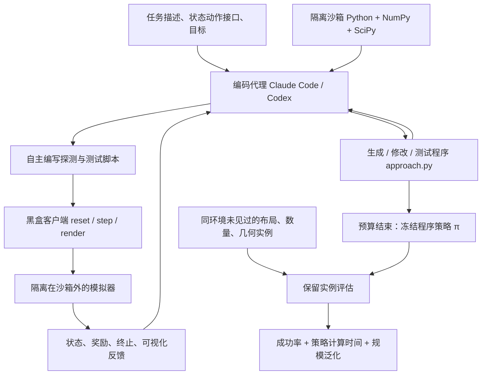
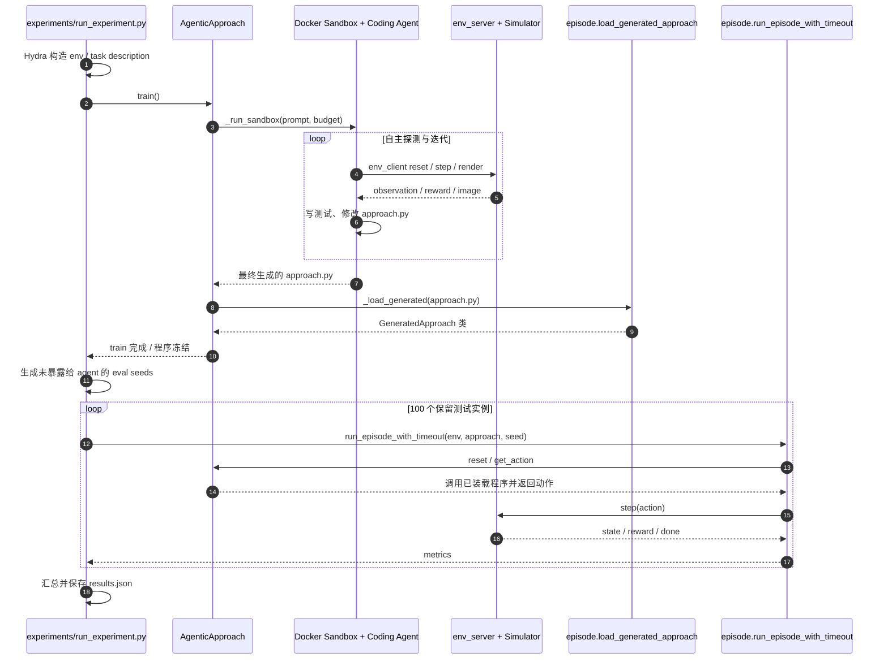

# AgenticGenPlan：代码代理能否写出跨实例可复用的任务与运动规划程序？ / Coding Agents for Generalized Task and Motion Planning Problems

**AgenticGenPlan**（Matteo Merler、Bowen Li、Josh Roy、Yichao Liang、Qianwei Wang、Yixuan Huang、Tom Silver；Princeton University、Carnegie Mellon University、Fondazione Bruno Kessler、University of Cambridge；2026）是对通用代码代理物理推理与程序策略合成的系统性评测：[论文 arXiv:2609.30233v1](https://arxiv.org/html/2609.30233v1)、[官方项目](https://agenticgentamp.github.io/)、[RoboCode 源码](https://github.com/tomsilver/robocode)。

## 一句话定义

**编码代理借助仿真器反复探测、写代码、测试和修正，合成一个无需评估时 LLM 的程序式 TAMP 策略，在同一任务环境里应对从未见过的物体数量、布局和几何配置。** **不是**“在 A 仿真环境写好程序，不改动就能在 B 仿真器和另一类任务上运行”。

## 英文缩写速查

| 缩写 | 英文全称 | 简要说明 |
|---|---|---|
| TAMP | Task and Motion Planning | 联合离散任务选择与连续可执行运动约束 |
| GenTAMP | Generalized Task and Motion Planning | 将一个求解过程复用于同类任务的多个实例 |
| MDP | Markov Decision Process | 环境状态、动作、转移、奖励及任务时长的统一定义 |
| IK | Inverse Kinematics | 根据目标末端位置反求机械臂关节配置 |
| API | Application Programming Interface | reset/step/render 仿真调用接口 |
| LLM | Large Language Model | 合成期代理使用的大语言模型；评估期无需调用 |
| KinDER | Kinesthetic Inference through Dynamics and Embodied Reasoning | 本文采用的对象中心物理推理基准 |
| PDDL | Planning Domain Definition Language | 经典符号任务规划表示；PDDLStream 混合采样与符号规划 |

## 为什么重要

- **TAMP 工程代价高：** 传统方法常需人工定义谓词、动作算子、几何采样器和技能，每换任务要重新工程化。此工作检验 coding agent 能否自己形成可复用的程序。
- **“可泛化”必须有边界：** 一个 Obstruction 环境可有 1、2、4 个障碍物以及不同位置，而机器人接口和任务目标相同；这是**同环境跨实例**，不能把 28 个独立环境误读成“一份程序跑通 28 个场景”。
- **把代码代理与在线控制分离：** 合成期间有模型调用和尝试；评估期间执行冻结的 Python 程序，动作决策不依赖 LLM 网络请求。
- **有实验日志可审计：** 自主设计边界测试、建立运动学近似、根据失败回退的具体案例比笼统的“LLM 会规划”更值得研究。

## 核心原理

### 研究问题：同一 MDP 的实例泛化

论文 §II 将环境写为 `M = (S, A, P, R, ρ, H)`。任务实例来自初始状态分布 `ρ`，**共享**状态/动作空间 `S/A`、转移 `P`、奖励 `R`；物体数量、位姿和几何布局可变。程序输入当前对象中心状态及自身历史，输出连续或离散动作，允许内部记忆：

```text
a_t = π(h_t),    h_t = (s_0, a_0, ..., s_t)
```

实验提供完全可观测的对象特征（如 pose、几何、关节状态、速度），不要求模型从真实相机估计状态。

### 合成期与评估期分离

| 阶段 | 可用能力 | 不可用或限制 | 产物 |
|---|---|---|---|
| 合成（主设置） | 任务描述；黑盒模拟器 reset/step/render；Python、NumPy、SciPy；编码代理自主执行实验 | 无环境源码、网络、宿主机文件、TAMP 预制谓词/采样器/技能；模型使用限额 20 美元/次 | `GeneratedApproach.reset/get_action` 的程序及演化日志 |
| 合成（+ source） | 同上，额外可读环境实现、调用 IK 等辅助函数、设置模拟器状态 | 同样受 20 美元合成预算 | 可复用源码助手的程序 |
| 保留测试 | 冻结程序；同环境随机隐藏实例；评估 harness | 不再调用 LLM、不允许继续修改代码；每实例 60 秒时间预算 | 成功率、计算开销、按对象数量拆分的指标 |

代码代理方案不规定必须用经典符号规划，也不强制搜索：可以直接合成几何启发式、IK、反馈逻辑、逐物体排序或显式搜索。

## 流程总览

以下来自论文 §II–IV；循环在**合成阶段**。评估时程序已冻结，不是在线重新求助编码代理。



## 源码运行时序图

以下调用依据官方 RoboCode 的实际运行入口 `experiments/run_experiment.py`、`AgenticApproach.train`、`GeneratedProgramApproach._run_sandbox`、`env_client.BlackboxEnv`、`episode.run_episode_with_timeout`，核对快照 `d3d42dd`。黑盒服务在代理沙箱外，测试 seed 在合成结束后由实验者进程派生。



上图以代码审读为依据，不代表实际运行了完整模拟实验。严格黑盒请显式指定 `primitive_level=none`、`approach.blackbox=true`、`approach.blackbox_strict=true`；仅指定 `approach=agentic` 会使用上游默认非黑盒设置。

## 工程实践

| 工作项 | 作者源码 / 论文依据 | 落地建议 |
|---|---|---|
| 运行入口 | Python 3.11；`python experiments/run_experiment.py`；Hydra 配置 | 先用 `--cfg job --resolve` 核实实际条件，避免默认参数混入 |
| 隔离模式 | `docker/build_strict_blackbox.sh`；`primitive_level=none`；`blackbox=true` + `blackbox_strict=true` | 核查 agent 不可读环境实现/测试种子，黑盒必须真的黑盒 |
| 生成策略 | `AgenticApproach.train()` 一次 → `sandbox/approach.py` | 保留生成代码、Git 修订历史、探测与失败日志 |
| 环境接口 | `env_client.make_env()` / `reset` / `step` / `render_state` | 明确 object-centric state/action 格式及奖励终止判据 |
| 评估 | 5 次独立合成/条件/环境，每程序 100 个 held-out seed，60 秒/实例 | 按物体数量分桶汇报成功率、超时和策略计算成本 |
| 预算 | 每次合成模型使用预算 20 美元 | 预算只限定模型合成用量，不等于全部算力和真机成本 |
| 公开材料 | RoboCode 源码；Hugging Face runs；作者持有论文保留 seed | 用自选 seed 可以复核方法，不能声称精确重跑作者保留套件 |

**最小复现示例和经核对的源码调用链**见 [RoboCode 来源归档](../../sources/repos/tomsilver-robocode-agenticgenplan.md)。

## 实验与评测

作者在 28 个独立模拟环境中评估 7 种程序合成条件、每条件/环境 5 次生成、每程序 100 次评估，共 **980 个程序 / 98,000 个 evaluation episodes**（论文 §IV-A）。

### 同 16 个具备传统 planner 的环境对比

| 方法 | 平均成功率 | 条件 |
|---|---:|---|
| 人工工程化 TAMP planner | 47% | 使用基准提供的谓词、采样器和技能 |
| Codex / GPT-5.6 Sol | 56% | 主设置，黑盒 |
| Claude Code / Opus 5 | 82% | 主设置，黑盒 |
| Codex / GPT-6 Astra | 95% | 主设置，黑盒 |

该 16 环境子集的成功率**不能**当成全部 28 环境的平均分，也不意味着“某一个统一程序解决了全部环境”。其中 Astra、Opus、Sol 分别在 15、12、9 个环境中跑赢 planner。

### 所有 28 环境与源码访问

- Opus：严格黑盒 **74%**，+source **84%**。
- Astra：严格黑盒 **86%**，+source **95%**。
- LLMGenPlan：即使有源码，同预算下平均 **28%**，没有自主决定测试、执行和工具修复能力。因比较条件同时改变了工具/测试/迭代机制，不能单独把差异归因于“代码可见性”。

**主要短板：** Astra 的 Dynamic3D 家族平均成功率只有 65%；部分扫物、倒物与接触丰富任务依然低成功率，见原文 Table II。

### 运行时计算量：不同统计口径

- **14 个可变物体数且具备 planner 的环境，按实例平均：** Opus 2.1 s、Astra 0.5 s、传统 planner 29 s（论文 §IV-B）。
- **另一个 15 环境、仅统计能在全部保留实例成功的 run 的子集，按动作平均：** Opus 11.741 ms、Astra 1.299 ms；同条件下 +source 为 42.480/50.392 ms（论文 Table III）。不能拿此数当真机完整控制回路时延。

## 与其他工作对比

| 路线 | 合成阶段 | 每个新实例 | 关键代价 |
|---|---|---|---|
| 传统 TAMP planner（SeSamE / PDDLStream） | 人工设计算子/采样器/技能 | 重新任务+运动搜索 | 泛化新对象数量需实际搜索；工程依赖较重 |
| One-shot 生成 | 模型一次性写程序 | 冻结程序 | 无主动修复，失败边界较多 |
| LLMGenPlan | 固定脚本运行、预定义错误反馈 | 冻结程序 | 不允许自行写/执行探测程序 |
| **AgenticGenPlan** | 编码代理主动实验、修改程序并封存 | 冻结程序直接决定动作 | 前期模型/模拟器探测成本，仍依赖同环境状态与物理设定 |
| AgenticGenPlan + source | 可以导入官方环境辅助函数 | 冻结程序可依赖环境实现 | 提高部分成功率但可能降低执行速度与可移植性 |

## 结论

**此研究支持“同一仿真任务分布内，可由编码代理合成可复用的规划程序”，但并未证明程序不改即可跨任意仿真器或真实机器人。**

1. **先统一 MDP 与 API，再谈复用：** 若换场景只改变障碍物数量/布局、几何配置，程序可根据状态适配；若换动力学/奖励/动作接口，则超出直接验证范围。
2. **自主测试是关键实验变量：** 边界种子、物理探针和失败回退是程序性能提升的重要证据；单次生成不等价。
3. **用逐实例成功率而不是演示视频判断：** 五轮独立合成 × 100 held-out，报告不同对象数量和失败边界。
4. **运行时可不依赖 LLM：** 写完并冻结的程序与在线反复询问模型不同，更有利于分析执行成本。
5. **源码访问是取舍：** 原文的 +source 常提升平均成功率，却可能令执行期依赖模拟器内部函数并变慢。
6. **不要把完全状态访问外推到真机：** 真实传感误差、接触偏差、控制安全和新任务迁移仍须重新验证。

## 局限与风险

- 全部实验在简化物理模拟中完成，完全状态可观测；没有直接评估视觉检测误差、人机共域安全、真实执行器故障或 Sim2Real。
- “不同场景”必须解释为同一任务环境下的实例分布；跨引擎、跨机器人结构、跨定义不同的任务，论文无直接证据。
- 作者不能排除模型预训练已见过部分公开基准代码的可能；修订轨迹与新策略只能增强证据，不能排除全部污染可能。
- 20 美元是每次合成**模型调用预算**，不包含实验环境维护、计算硬件及额外验证成本。
- 个别策略在模拟器中发现意外近路（如不用工具而直接夹取物体），现实部署还需额外安全与规范约束。
- 源码和运行数据公开，但原论文实验所用 held-out suite seed 未公开；未经独立执行不能声称完全复现统计表。

## 关联页面

- [运动学可行与动力学可行](../concepts/kinematic-vs-dynamic-feasibility.md) — 约束类型区别；为什么可抓/可达不等于真实可执行
- [Agentic Coding 时代的软件工程基础](../concepts/agentic-coding-software-fundamentals.md) — 编码代理的自主测试与可审计软件交付
- [AI Agent 评测](../concepts/ai-agent-evaluation.md) — 预算、工具权限、种子隔离与评测口径

## 参考来源

- [论文原文通读归档（arXiv v1）](../../sources/papers/agenticgenplan_coding_agents_generalized_tamp_arxiv_2609_30233.md)
- [作者官方项目页归档](../../sources/sites/agenticgentamp.md)
- [RoboCode 源码入口与运行链审读](../../sources/repos/tomsilver-robocode-agenticgenplan.md)

## 推荐继续阅读

- [论文官方全文 HTML（包含所有实验表）](https://arxiv.org/html/2609.30233v1)
- [作者项目页及 rollout 演示](https://agenticgentamp.github.io/)
- [RoboCode README、实验配置与源代码](https://github.com/tomsilver/robocode)
- [官方公开实验运行数据](https://huggingface.co/datasets/prpl-group/agentic-gentamp-runs)
