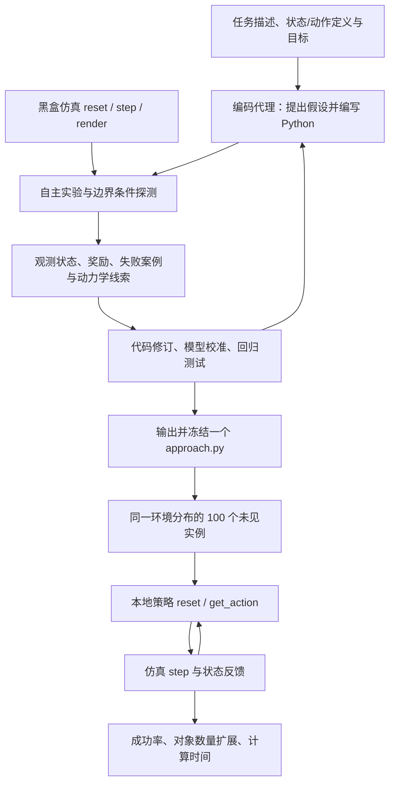

# AgenticGenPlan：编码代理合成可泛化任务与运动规划程序 / Coding Agents for Generalized Task and Motion Planning Problems

**AgenticGenPlan**（Matteo Merler、Bowen Li、Josh Roy、Yichao Liang、Qianwei Wang、Yixuan Huang、Tom Silver，2026；[arXiv:2609.30233v1](https://arxiv.org/abs/2609.30233)）的作者来自普林斯顿大学（Princeton University）、卡内基梅隆大学（Carnegie Mellon University）、布鲁诺·凯斯勒基金会（Fondazione Bruno Kessler）、剑桥大学（University of Cambridge）。官方开源实验系统叫 **RoboCode**，采用 MIT 许可证。

## 一句话定义

**给编码代理一项任务的描述和可调用的仿真器，让其自行设计试验、测试失败边界、编写和修订 Python 策略；合成后冻结该程序，在同一任务族的新物体数量、配置和几何布局上独立执行，无需在线再调用大模型。**

这里的“换个仿真场景还能用吗”要分清：**同一任务、同一状态/动作与动力学接口，仅初始物体布局/数量变化**是本文评测的泛化；**换成另一项任务、不同仿真引擎或未知动力学**未得到直接证明。

## 英文缩写速查

| 缩写 | 英文全称 | 简要说明 |
|---|---|---|
| TAMP | Task and Motion Planning | 联合离散任务决策与连续几何、运动学、动力学约束 |
| MDP | Markov Decision Process | 用状态、动作、转移、奖励等表述待解决环境 |
| IK | Inverse Kinematics | 从末端目标位姿反求关节配置，源码开放时可复用求解器 |
| API | Application Programming Interface | 代理通过 reset/step/render 访问黑盒仿真器 |
| LLM | Large Language Model | 合成期间的代码代理模型，测试期不再调用 |
| PDDL | Planning Domain Definition Language | PDDLStream 三个任务领域的符号规划背景 |

## 为什么重要

- **传统 TAMP 手工成本高：** 往往要专家编写符号谓词、操作符、连续采样器、技能及可行性检查；通用编程代理尝试省去这层特化工程。
- **跨实例而非固定动作序列：** 对障碍物数量、位置和对象形状的变化，程序可从当前物体中心状态计算操作次序和动作，不必每次从头调用 LLM。
- **交互式物理推理：** 代理能在 simulator 里自己排查失败、校准机器人几何，再把探索结果固化成执行速度较快的代码。

## 核心机制

### 问题范围与可见性（论文 §II）

每种任务环境的状态空间、动作空间、状态转移和奖励相同；实例从初始分布采样，物体数量、几何和位姿可能不同。状态是**完全观测、面向对象的数值向量**，包含物体位姿、几何、关节和速度。评测不考察相机检测、遮挡下的状态估计或真实机械臂运行。

程序接口形式为 `reset(state, info)` 和 `get_action(state)`，可保留历史内部状态。本文并**不是**训练一个程序通吃 28 种不同任务；它在每种环境独立合成策略，之后测该环境未见实例。

### 合成过程（论文 §III）

1. **严格黑盒：** 给任务描述、观测/动作空间、目标，以及隔离客户端的 `reset`、`step`、`render`。环境真源码与服务端隔离；不提供手写 TAMP 组件或第三方机器人规划库，仅有 Python、NumPy、SciPy。
2. **自主测试：** 代理决定采样何种初始状态，编写脚本批量探测动作、接触效果、奖励和边缘情况；迭代代码时用 Git commit 留存中间版本。
3. **模型归纳：** 可学到解析规则、标定运动学或搜索启发式；产出 `approach.py`，而非必须遵循某种符号或神经网络架构。
4. **冻结测试：** 合成预算每次 $20 模型使用费，冻结产生的程序后，100 个未见测试实例仅调用本地 Python 代码。测试 60 秒限时，模型不参与执行。
5. **+ source 消融：** 另给代理环境实现文件，可查看真实目标/成功条件及重用 IK、碰撞检查等辅助函数；**不能与黑盒协议混为一谈**。

## 流程总览

依据论文 Fig. 1 与 §II–III。合成阶段可多次探测；评测阶段冻结同一个程序，重复用于同任务族的新实例。



## 源码运行时序图

**依据实际官方 Python 入口**：`experiments/run_experiment.py::_main`、`AgenticApproach.train`、`GeneratedProgramApproach._run_sandbox/_load_generated/_get_action`、`utils.episode.run_episode`。简图只保留主要控制流，不声称每个 `step` 都调用 LLM。

```mermaid
sequenceDiagram
    autonumber
    participant Runner as experiments/run_experiment.py
    participant App as AgenticApproach
    participant Box as _run_sandbox + coding backend
    participant Sim as Environment server / simulator
    participant Policy as Generated approach.py
    Runner->>Sim: hydra.instantiate(environment)
    Runner->>App: construct + train()
    App->>Box: prompt + sandbox budget
    Box->>Sim: blackbox reset / step / render (probe)
    Sim-->>Box: states / rewards / observations
    Box->>Box: write, test and revise approach.py
    Box-->>App: generated approach.py
    App->>Policy: _load_generated()
    App-->>Runner: train() complete
    Note over Runner,Policy: Evaluation seeds derived after synthesis; no coding agent call
    loop Each held-out instance
        Runner->>Sim: env.reset(seed, optional object_count)
        Runner->>App: approach.reset(state, info)
        App->>Policy: reset(state, info)
        loop Until termination / timeout
            Runner->>App: approach.step()
            App->>Policy: get_action(last_state)
            Policy-->>App: action
            App-->>Runner: action
            Runner->>Sim: env.step(action)
            Sim-->>Runner: next_state, reward, done
            Runner->>App: approach.update(next_state, reward, done, info)
        end
    end
    Runner->>Runner: results.json and aggregated metrics
```

实现定位：[实验主入口](https://github.com/tomsilver/robocode/blob/main/experiments/run_experiment.py)、[AgenticApproach](https://github.com/tomsilver/robocode/blob/main/src/robocode/approaches/agentic_approach.py)、[基础合成实现](https://github.com/tomsilver/robocode/blob/main/src/robocode/approaches/agentic_base.py)、[episode 循环](https://github.com/tomsilver/robocode/blob/main/src/robocode/utils/episode.py)。已阅读这些入口关键部分；未运行全套实验。

## 工程实践

| 项目 | 作者原始设置 / 使用提示 |
|---|---|
| 仿真任务 | 25 个 KinDER（2D/3D、kinematic/dynamic）+ 3 个 PDDLStream（Packing/Blocked/Rovers） |
| 合成端 | Claude Code Opus 5；Codex GPT-5.6 Sol / GPT-6 Astra；每次合成预算 $20 |
| 运行隔离 | 主实验 Docker strict blackbox，环境 server 在 sandbox 外；只暴露 reset/step/render |
| 依赖 | 仓库 README 使用 Python 3.11、uv、Git submodules、Docker；可选 planner extras |
| 输出 | `sandbox/approach.py`、`agent_log.txt`、Hydra 配置和 `results.json` |
| 评测种子 | `eval_seed` 由实验者设置且不交给代理；论文原种子需向作者索取 |
| 评估协议 | 5 次独立合成/环境/方法，100 个未见实例，60 s/实例；实例与合成来自相同初始分布 |

官方可复现命令（Motion2D，注意明确开启黑盒与 `primitive_level=none`）：

```bash
# 完整安装步骤见 RoboCode README；此处只演示运行参数
python experiments/run_experiment.py \
  approach=agentic approach/backend=claude_opus5 \
  environment=motion2d_generalized primitive_level=none \
  approach.container_backend=docker \
  approach.blackbox=true approach.blackbox_strict=true \
  approach.max_budget_usd=20.0 \
  replicate_seed=42 eval_seed="$EVAL_SEED" \
  num_eval_tasks=100 eval_timeout=60
```

**工程推论（非论文实测）：** 若替换 MuJoCo/Isaac 物理引擎、碰撞模型、机器人的关节空间或状态/action 接口，应重新做状态映射、物理误差验证及回归测试，不应把此处的同分布泛化率视为 Sim2Sim 保证。

## 实验与评测

### 样本与数据口径

论文 §IV 报告 **28 个不同环境 × 7 种程序合成条件 × 5 次独立合成 = 980 个程序**；每程序 100 个未见实例，共 **98,000 episodes**。对象数量扩展实验包含超出原 KinDER 基准使用数量的情况，但没有声称 28 个环境共用同一个程序。

### 16 个有手工 planner 的环境

| 方法 / 运行配置 | 16 环境平均成功率 |
|---|---:|
| 人工构建 TAMP planner | 47% |
| AgenticGenPlan / Codex Sol | 56% |
| AgenticGenPlan / Claude Code Opus | 82% |
| **AgenticGenPlan / Codex Astra** | **95%** |

以单环境对比 planner 的胜出数量是 Astra 15/16、Opus 12/16、Sol 9/16；不能称所有新场景均成功。论文正文报告，在 14 个具 planner 且覆盖多物体数量的环境中，程序平均每实例计算时间为 Astra 0.5 s、Opus 2.1 s、planner 29 s，**不计合成开销**。

### 全 28 环境、开放源码条件与困难案例

- 主条件跨全部 28 环境 Opus 74%、Astra 86%；开放源码后分别 84%、95%，但这是附加条件，并不能理解为“无需提供源码”。
- 同样看到环境源码的非 agentic LLMGenPlan 只达 28%（论文 §IV-B）；区别不仅在模型是否有源码，也包括自主选择测试、工具调用和反复修订。
- Astra 在动态 3D 类平均 **65%**，远低于二维及运动学任务；原文表 II 中 Dynamic3D SweepSimple 的 Astra 平均仅 **3%**，ScoopPour **14%**，说明操作接触的复杂性仍是瓶颈。
- Shelf：代理经测试校准 Kinova Gen3 的安装/抓取几何，校准观察 RMSE 从 38.9 mm 降到 1.8 mm；不是现实机器人位姿精度或通用标定保证。
- 表 III 的 1.299 ms/action（Astra 主条件）是对**15 个指定可全成功环境**的策略计算耗时条件均值，**不是**端到端仿真步进、真机控制周期或全部 28 环境平均。

## 与其他工作对比

| 路线 | 生成/执行方式 | 与本工作区别 |
|---|---|---|
| 人工 TAMP planner | 专家设计谓词、动作操作符、运动规划/采样器，每实例规划 | 预先工程工作重，但任务物理可行性结构明确 |
| One-shot 代码生成 | 单次给任务源码与描述，直接生成策略 | 无自主交互试验与迭代 |
| LLMGenPlan | LLM 读取源码、在固定反馈循环下改代码 | 能获反馈，**不能自行运行测试脚本**或选择探测 |
| AgenticGenPlan | 合成期使用 coding agent + simulator，自主测试并冻结代码 | 不依赖先验手写 TAMP 组件；**非在线大模型控制器** |

## 结论

**本文证明了编码代理可在结构化仿真任务的同分布未见实例中自动合成可复用 TAMP 策略，但不能据此推导任意跨场景、跨物理引擎或真实机器人迁移成功。**

1. **重要的是测试回路：** 代理主动构造困难案例、读失败信号与修订代码，强于一次性生成或固定反馈。
2. **泛化边界是单环境分布：** 物体数量、放置与部分几何变化可测；换任务目标或动力学必须另测。
3. **不能忽略 3D 接触失败：** Astra 动态 3D 平均 65%，SweepSimple 仅 3%；全环境均值掩盖长尾。
4. **区分合成/执行成本：** $20 是合成期模型使用预算；毫秒级数据是策略计算而非整机回路时延。
5. **开源可复验：** RoboCode 已公开代码、严格黑盒配置、生成脚本与结果分析，但原评测种子需作者提供。

## 局限与风险

- 仿真均为简化且全观测的物体中心状态；没有研究视觉遮挡、识别误差、传感器噪声与真机 Sim2Real。
- 合成期使用可交互 simulator；新任务族必须重新合成，而不是将已冻结程序直接应用于一切场景。
- 本研究的模型预训练数据无法公开核验，作者承认不能完全排除 benchmark 预先曝光。
- 评测种子与代理探测种子经过排重，但测试来自同一环境初始分布 `rho`，不能替代分布外验证。
- 每次 $20 的模型使用限额不含整套大规模 980 次合成与算力工程成本；未在本次入库环境实测运行。

## 关联页面

- [机器人操作任务（Manipulation）](../tasks/manipulation.md) — 具体可复用的约束操作场景
- [VLA 与规划技术地图](../overview/vla-tamp-planning-11-papers-technology-map.md) — 任务规划与模型策略路线的对照

## 参考来源

- [AgenticGenPlan 官方论文（HTML v1 全文阅读归档）](../../sources/papers/agenticgenplan_arxiv_2609_30233.md)
- [作者项目主页与评测展示](../../sources/sites/agenticgentamp.md)
- [RoboCode 官方代码与运行入口](../../sources/repos/tomsilver-robocode.md)

## 推荐继续阅读

- [官方 arXiv HTML 全文](https://arxiv.org/html/2609.30233v1)
- [作者项目页与视频](https://agenticgentamp.github.io/)
- [GitHub 代码 / README / 运行方式](https://github.com/tomsilver/robocode)
