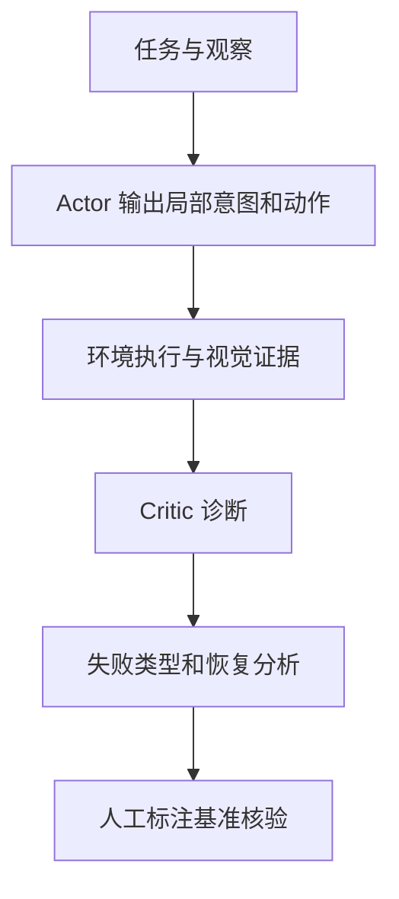
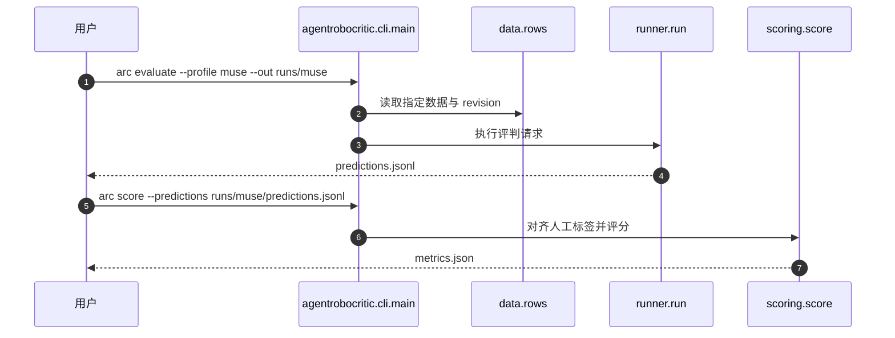

# AgentRoboCritic：面向机器人直接控制的动作级批评器（Understanding the Capability of Frontier Agents on Direct Robot Control）

## 一句话定义

在直接数值动作控制中加入局部意图，用动作执行前后证据诊断失败机制，补足回合级成功率盲区。

## 英文缩写速查

| 缩写 | 英文全称 | 简要说明 |
|---|---|---|
| VLM | Vision-Language Model | 基于视觉证据的评判模型 |
| EFE | Embodied Frontier Evaluation | 意图与动作证据采集环境 |
| SR | Success Rate | 回合成功率 |

## 为什么重要

从回合成功率深入局部意图、动作失败和恢复诊断。将其作为可比较的独立研究或工程入口，而不是仅记录热度。

## 核心信息

| 字段 | 内容 |
|---|---|
| 机构 | 卡内基梅隆大学、伊利诺伊大学厄巴纳-香槟分校、博世研究院 / 博世人工智能中心 |
| 论文 | [arXiv:2611.26613](https://arxiv.org/abs/2611.26613) |
| 日期 | 2026-11-19 |
| 开放状态 | MIT；公开评测 harness、EFE 数据采集转换、训练数据与微调 checkpoint；不能据此推断各闭源 actor 权重开放。 |

## 核心原理与流程总览

actor 在提交 action chunk 时同时声明局部意图；评判器接收意图、命令和执行证据，输出意图是否成功、失败机制、抓取子类及原因。将动作级标签汇总成各失败类型与恢复统计。评测 Parquet 包含 id、messages、images、human_label；推理不读取人工标签。

以下为已查阅官方资料支持的概念流程，完整原文核对待补。

## 源码运行时序图

`src/agentrobocritic/cli.py` 及 README 的 `arc verify`、`arc evaluate`、`arc score`；已核对 CLI import 与分支入口，runner/provider 深层调用待复核。

## 工程实践

MIT；公开评测 harness、EFE 数据采集转换、训练数据与微调 checkpoint；不能据此推断各闭源 actor 权重开放。 复现入口与版本依赖见参考来源。本次未执行训练、推理或仿真复现。

## 实验与评测

作者在 12 个操作基准分析动作，约半数成功回合仍出现失败动作。400 条人工标注动作中有 264 个失败；微调模型失败模式准确率由 32.58%→74.24%（196/264），意图成功判断 76.25%（305/400），联合正确率 67.75%（271/400）。训练数据 12,844 条标注动作。

## 结论

在直接数值动作控制中加入局部意图，用动作执行前后证据诊断失败机制，补足回合级成功率盲区。 工程选型时应同时验证指标口径及使用边界。

- 同时报告回合 SR 和动作失败/恢复统计。
- 区分 400 条意图标签与 264 条失败模式标签的分母。
- 优先从高频、低恢复率的失败模式着手改策略。

## 局限与风险

critic 的标签误差、模型自偏好与局部意图的真实性会影响结论；动作级诊断并不自动修复策略或保证安全。抓取子类和解释不计入仓库所述主评分。

**核对状态：** 草稿；完整原文及必要源码尚未通读，不宣称健康度满分。

## 关联页面

- [robocasa](./robocasa.md)
- [hub-embodied-eval-benchmark](../overview/hub-embodied-eval-benchmark.md)
- [相关纵深路线](../../roadmap/depth-embodied-eval.md)

## 参考来源

- [papers：agentrobocritic](../../sources/papers/agentrobocritic_arxiv_2611_26613.md)
- [sites：agentrobocritic](../../sources/sites/agentrobocritic.md)
- [repos：agentrobocritic](../../sources/repos/agentrobocritic.md)

## 推荐继续阅读

- [论文 HTML](https://arxiv.org/html/2611.26613)
- [arXiv](https://arxiv.org/abs/2611.26613)
- [官方项目页](https://adu2021.github.io/blog/AgentRoboCritic/)
- [官方源码](https://github.com/cxcscmu/AgentRoboCritic)
- [人工标注基准](https://huggingface.co/datasets/cx-cmu/AgentRoboCritic-Bench)
- [微调评判器](https://huggingface.co/cx-cmu/AgentRoboCritic-Muse-Glimmer-30B)
- [训练数据](https://huggingface.co/datasets/cx-cmu/AgentRoboCritic-Dataset)
