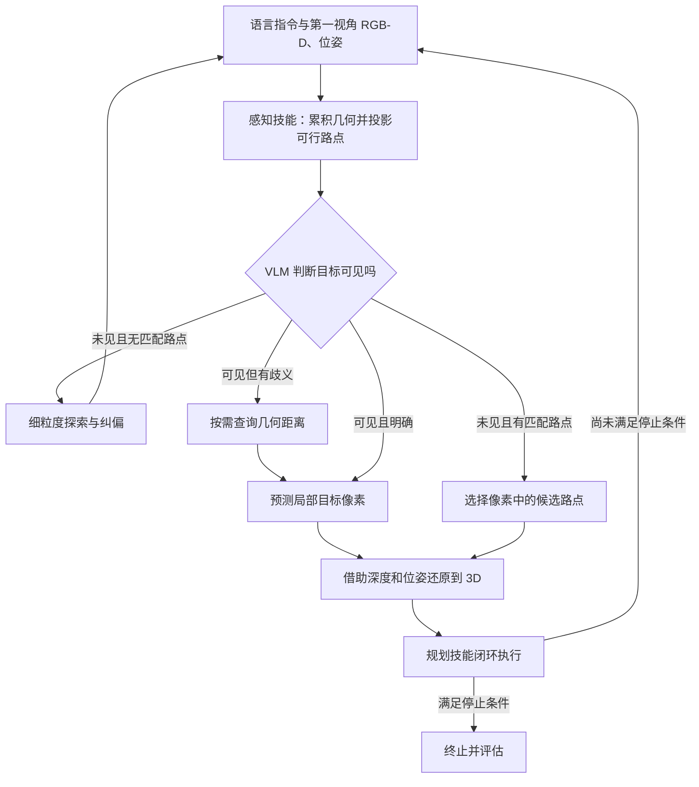
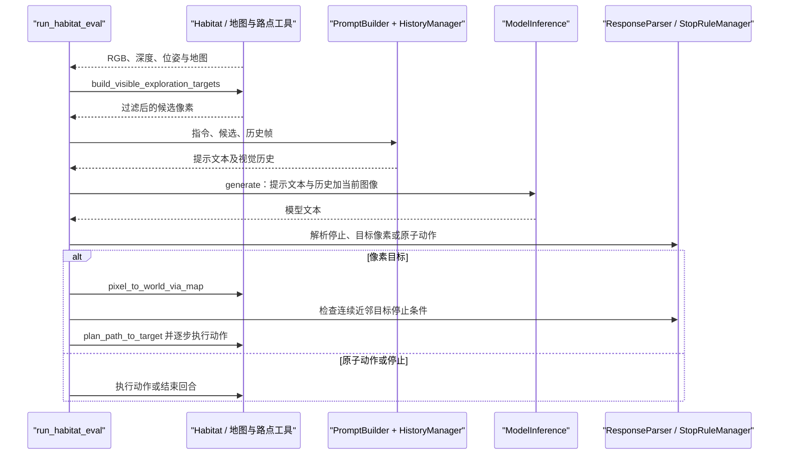

# AgentVLN：面向智能体的视觉语言导航 / Towards Agentic Vision-and-Language Navigation

## 一句话定义

AgentVLN 将语言与像素空间的语义选择交给 Qwen2.5-VL-3B，把可通行路点、度量深度和低层运动交给独立的感知与规划技能。

## 英文缩写速查

| 缩写 | 英文全称 | 简要说明 |
|---|---|---|
| VLN | Vision-and-Language Navigation | 按视觉和语言指令导航 |
| POSMDP | Partially Observable Semi-Markov Decision Process | 只看局部观测，每次技能可持续不等长的时间 |
| QD-PCoT | Query-Driven Perceptual Chain-of-Thought | 在局部目标有空间歧义时请求几何线索 |
| SR | Success Rate | 到达判定阈值的成功率 |
| SPL | Success weighted by Path Length | 同时衡量成功与路径效率 |
| nDTW | normalized Dynamic Time Warping | 执行轨迹与参考路径的归一化对齐分数 |

## 为什么重要

语义上「门旁边」对了，不等于物理空间里的路点可通行。把候选目标显式画回当前画面，模型只需用语言判断选哪一条路，规划器仍负责路径与控制；定位、深度、语义选点和执行都能单独查错。

## 核心信息

| 项 | 内容 |
|---|---|
| 机构 | 南京航空航天大学、山东大学、浙江大学 |
| 作者 | Zihao Xin、Wentong Li、Yixuan Jiang、Ziyuan Huang、Bin Wang、Piji Li、Jianke Zhu、Jie Qin、Shengjun Huang |
| 版本 | 2026-03-18 为预印本提交；ECCV 2026 论文集章节由 Springer 于 2026-09-12 首次上线 |
| 正式引文 | In: Computer Vision – ECCV 2026, LNCS 17033, pp. 114–132，[DOI](https://doi.org/10.1007/978-3-032-37167-6_7) |

## 核心原理与流程总览

- 位姿和相机内参把测得深度从像素反投影到空间，累积几何地图；再将可行的 3D 路点投到当前画面，让模型用像素语义选择。
- 未出现与指令匹配的路点时，模型改用有限的前进、左转、右转原子动作进行探索与纠偏。识别到目标后切入局部定位，歧义时请求几何线索，再把预测像素映射成世界目标。
- 基座冻结视觉编码器和投影层；AgentVLN-Instruct 用 Habitat 的 R2R/RxR 轨迹（补充材料称 61 个室内场景）按可见性分阶段监督，加入偏航/纠偏例子，并混合 LLaVA-Video-178K 训练。

## 源码运行时序图

该图限定于可读的 Habitat 入口，不以论文的多轮 QD-PCoT 图冒充公开评估代码。该路径的俯视地图通过 Habitat 接口构建，真机章节的 RTAB-Map 则是另一套观测与地图来源。

## 工程实践

先在仿真单回合固定 RGB-D、相机外参和历史长度，分别校验像素↔世界坐标、遮挡筛选、路点到轨迹及停止；RxR 验证另需对齐官方 GT。评估默认配置最大 8 张历史帧、每 4 步计划一次、成功距离 3 米。公开配置仍含占位 checkpoint，未重跑上游整套仿真；本次只验证了 5 项上游 nDTW 合成轨迹断言。

## 实验与评测

| 作者报告的 Val-Unseen 仿真 | NE（m） | SR（%） | SPL（%） | nDTW |
|---|---:|---:|---:|---:|
| R2R-CE | 3.88 | 67.2 | 64.7 | — |
| RxR-CE | 3.92 | 69.5 | 61.3 | 74.6 |

R2R 消融 SR 依次为 38.6 → 59.7（调度与跨空间映射）→ 65.6（纠偏）→ 67.2（QD-PCoT）；没有单独分离调度和跨空间映射的收益。表中基线传感器条件不全相同，3B 只表示其 VLM 骨干规模。

## 局限与风险

论文用 Go2、RealSense D455、RTAB-Map 与 Jetson 展示真机路径，作者仓另有 G1 演示。补充材料 §2 报告 Jetson Orin NX 上单轮前向与自回归生成约 3 秒，W4A16 后约 1 秒，并在接近当前路点时异步启动下一轮推理。这个数字不是端到端控制周期；未给可对标的真机总体成功率或闭环延迟分布。RGB-D、定位与几何规划仍影响安全；不要把仿真评估脚本的默认前进回退直接移植到硬件。仓库公开部分实现与数据入口，未见预训练 checkpoint 或完整安装说明。

## 结论

最值得复用的是「几何生成可行候选，VLM 判语义，独立规划器负责执行」的接口设计。

1. 分开定位投影、语义选择和执行错误，不用一个 SR 代替失效诊断。
2. 比较基线时固定深度、观察视角、场景和停止阈值。
3. 把传感器失效与超时做成拒绝或停车路径，先在仿真验证，再核对真机既有保护。

## 关联页面

- [视觉语言导航任务](../tasks/vision-language-navigation.md)
- [导航纵深路线：视觉语言导航](../../roadmap/depth-navigation.md)
- [导航系统工作流](../methods/robot-navigation-workflow.md)
- [VLN-CE 基准](./paper-vln-02-vln-ce.md)
- [ETPNav：拓扑规划](./paper-vln-09-etpnav.md)

## 参考来源

- [论文原文与补充材料归档](../../sources/papers/agentvln_arxiv_2603_17670.md)
- [官方代码及数据归档](../../sources/repos/agentvln.md)

## 推荐继续阅读

- [官方项目页：Go2/G1 及 Habitat 示例](https://allenxinn.github.io/AgentVLN/)
- [Springer 会议论文书目](https://doi.org/10.1007/978-3-032-37167-6_7)
