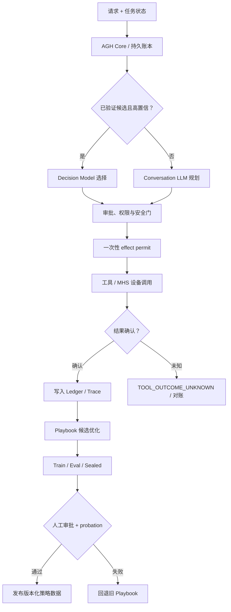
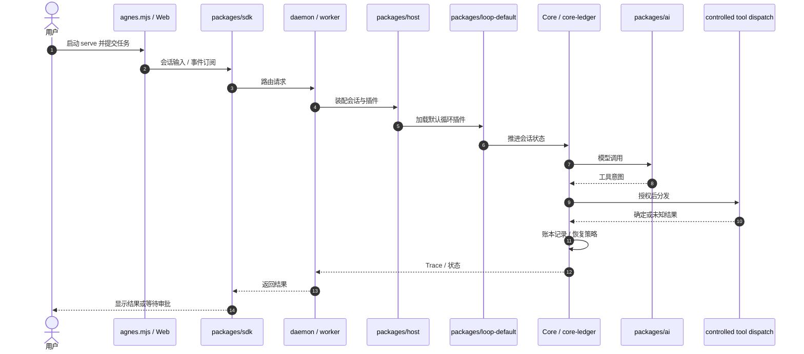

# Agnes Harness Technical Report：账本主权、双系统与可治理 RSI（2026）

## 一句话定义

**AGH 系统报告**讲的是让 LLM 提议、由权威事件账本与内核审查副作用，配合快速决策模型与受治理 Playbook 自改进的 Agent 系统架构，而不是一个自动更改控制器或模型权重的机器人算法。

## 英文缩写速查

| 缩写 | 英文全称 | 简要说明 |
|---|---|---|
| AGH | Agnes Harness | 本文系统 |
| DM | Decision Model | 已验证候选上的快速决策 |
| LLM | Large Language Model | 开放式规划与异常处理 |
| RSI | Recursive Self-Improvement | 本文仅配置数据级 Playbook 进化 |
| MHS | Model Hardware Standard | Agnes 自有设备协议 |
| JCS | JSON Canonicalization Scheme | RFC 8785，用于确定性账本编码 |

## 为什么重要

业务工具与真实设备可能产生无法自动撤销的副作用，超时也不证明动作未执行。AGH 把执行授权和结果记录放在模型之外，并明确未知结果要对账，避免重复调用。对机器人场景的价值是**任务级执行与物理控制分权**。

## 核心原理与流程总览

- **单一权威：** 单写者 SQLite append-only ledger + RFC 8785 JSON + SHA-256 digest chaining。一次性 permit 绑定 effect/intent 序号；未确认的非重放副作用进入 `TOOL_OUTCOME_UNKNOWN`。
- **门控：** approval、principal、billing、checkpoint、artifact、OS sandbox、completion、repair policy、platform 共九项强制 seam；缺失 fail closed。
- **双系统：** 报告以 Jev 为决策模型样例；信心不足或异常回交 Conversation LLM。无论哪条路径，外部工具与设备均需相同的独立授权。
- **RSI：** 版本化 Playbook 只更新提示、工作流、事实规则与 DM 阈值，不更新权重、代码、grader、硬件安全边界、预算；经过 Train/Eval/Sealed 双生仿真、人审、200 任务 probation 和统计回滚门。

## 工程实践

针对机器人上层任务：预定义工具能力与前置条件，明确 effect 序号和唯一审批；把可能的未知结果路由至 reconciliation，而非自动重试；在封闭/隐藏任务上验收版本化 Playbook，再经人审与回滚保护发布。急停、互锁、实时闭环仍留在设备控制器。

## 源码运行时序图

报告仓库未给出可核验的独立 benchmark/RSI 实验脚本。下图**仅描述已公开 AGH 运行时**，依据官方根入口 `agnes.mjs`、`docs/develop/architecture.md`、`docs/develop/source-map.md`，不冒充 Playbook 试验代码：

## 实验与评测

| 测量 | 作者报告 | 证据边界 |
|---|---|---|
| Home-leak DM 与 LLM 单步 | 0.53 s vs 7.6 s（约 14.3 倍） | 仅指定仿真，非端到端延迟 |
| Luggage-room 单决策费用 | $0.000091 vs $0.00247（约 27.1 倍） | 非整任务成本 |
| sealed Playbook 双生仿真 | 行李房 9/9；机械臂单/多故障各 10/10；入库 9/9 | 多次重复且冻结 Playbook，非真机 |
| MHS-Benchmark | 41/100；其中 GUI 9/40 | 桌面 GUI 仍弱 |
| AGH-Benchmark | 34.62% | 作者内部评测 |
| AppWorld dev | 91.67% | 不同 model+harness 组合的系统分 |

报告还列其他 6 组基准，详见 [来源归档](../../sources/papers/agnes_harness_technical_report_nov_2026.md)；**当前仅通读官方 REPORT.md，未读 PDF 的完整方法、13 表/9 图，故此页为 draft。**

## 结论

**本报告值得复用的是可追责的 effect 边界与配置级自改进门控；其加速、成功率不可解读为已复现的机器人现场指标。**

1. 效果不确定时先对账，不重放不可逆调用。
2. 决策库必须包括设备或业务工具的完整前置条件。
3. Playbook 提升与底座权重提升必须分开衡量。
4. 演化与验收拆分数据集，并保留人的发布否决权。
5. 真机端须独立配置互锁、时限和急停。

## 与其他工作对比

- [Sys1 1.0 模型报告](./paper-agnes-sys1-decision-model-technical-report.md) 描述决策模型结构和概率；本报告是完整执行系统。Jev DM 与当前 Sys1 插件配置不等同。
- [RRSI](./paper-rrsi-2609-24972.md) 聚焦 harness 提案/接纳搜索的正则化；AGH 重点是执行账本、Playbook 发布治理。
- [递归自改进](../concepts/recursive-self-improvement.md) 提供配置级与权重级的证据层级。

## 局限与风险

- PDF 全文未能获取；本文实验统计和机制均据同一发布团队的网页摘要，不构成第三方复现。
- 报告承认工具 schema 敏感性、冷启动、GUI grounding、sim-to-real、跨平台 sandbox、压缩规则保留尚待验证。
- 真实后端插件是受信进程内代码；MHS 仍接入中，不是安全认证机器人控制接口。

## 关联页面

- [Agnes Harness 主实体](./agnes-harness.md)
- [Sys1 1.0 独立报告](./paper-agnes-sys1-decision-model-technical-report.md)
- [RSI Stage 4](../../roadmap/depth-rsi.md)
- [机器人控制接口边界](../concepts/llm-robotics-control-interfaces.md)

## 参考来源

- [技术报告来源档案](../../sources/papers/agnes_harness_technical_report_nov_2026.md)
- [AGH 源码档案](../../sources/repos/agnes-harness.md)
- [作者原始 PDF（待全文核验）](https://github.com/AgnesAI-Labs/Agnes-Harness-Technical-Report-Nov-2026/blob/main/PAPER.pdf)
- [运行时架构一手文档](https://github.com/AgnesAI-Labs/agnes-harness/blob/main/docs/develop/architecture.md)

## 推荐继续阅读

- [官方报告全文网页摘要](https://github.com/AgnesAI-Labs/Agnes-Harness-Technical-Report-Nov-2026/blob/main/REPORT.md)
- [AGH 官方代码](https://github.com/AgnesAI-Labs/agnes-harness)
