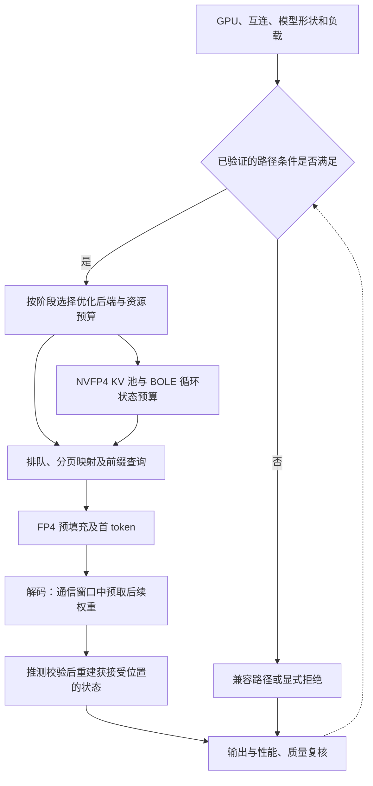

# Inference Framework Specialization · Agnes 推理框架专用化

## 一句话定义

Agnes AI 实验室在 SGLang 上按设备、模型形状和负载选择已验证的执行路径，分别缓解长上下文预填充计算、解码读权重和 KV/循环状态显存压力。

## 英文缩写速查

| 缩写 | 英文全称 | 简要说明 |
|---|---|---|
| KV | Key–Value | 全注意力缓存；存储量随实际驻留 token 增长 |
| GDN | Gated DeltaNet | 使用循环状态的线性注意力层 |
| TP | Tensor Parallelism | 跨卡切分运算，层内可能涉及 AllReduce |
| MBO | Microbatch Overlap | 一批做通信时调度另一批的独立计算 |
| TTFT | Time to First Token | 从请求到首 token，包含排队和输入处理等待 |
| TPOT | Time per Output Token | 输出阶段平均每 token 耗时，依评测的聚合口径计算 |
| E2E | End to End | 提交请求到收到完整响应的耗时 |

## 核心信息

| 项 | 内容 |
|---|---|
| 机构 | Agnes AI 实验室 |
| 原文 | 英文 v2（2026-11-13），32 页 |
| 目标环境 | Blackwell，GPU 间走 PCIe，显存受限；示例 64 层，包含 16 层全注意力和 48 层 GDN |
| 软件与证据 | SGLang 为基础；公开的是报告及图解，性能来自作者阶段性测量 |

## 为什么重要

同样的 GPU 上，批量大小、历史缓存命中和活跃请求上限都能改变瓶颈。若只看算子耗时，容易误判线上吞吐、首 token 和机器人上层服务积压的来源。

## 核心原理与流程总览

先按设备能力、注意力头维度、数据/尺度布局及 CUDA Graph、掩码和推测解码模式判断路径是否适用。常驻权重、历史 KV 在 GPU 本地被读取；TP AllReduce 交换的是激活或中间值；只有启用分层缓存并需恢复时，才走主机至 GPU 的历史 KV 搬运。这三类等待应分开测量。

| 技术 | 作用 | 集成结果是否包含 |
|---|---|---|
| FP4 预填充 | 将适配的注意力 QK、PV 计算降为 FP4，仍需准备块尺度、布局和校正项 | 是 |
| GPU L2 权重预取 | 利用 AllReduce 等待窗口，侧流提前把随后 GEMM 会读的部分权重送到芯片 L2 | 是 |
| NVFP4 KV | 总占用约为 FP8 的 62.5%，含元数据；等 KV 预算理论上约可放 1.6 倍 token | 是 |
| BOLE | 保存推测候选的更新因子，验收位置确定后才重建所需 GDN 循环状态 | 是 |
| 小形状算子适配 | BF16 门控投影按实际行数补齐后截回；为目标 FP8 投影形状选已有 skinny GEMM | 否，单列组件实验 |
| MBO | 在一批规约时计算另一独立微批，需复查竞争和同步成本 | 否，单列组件实验 |

机制图整理自报告 §2–3、§8，用于说明阶段与资源配置，不是可执行源码的调用图。GPU 的硬件 L2 和分层 KV 的第二级缓存并不是同一个资源。

## 源码运行时序图

**不适用。** 固定发布提交只含报告、说明和图；未提供该专用化实现的源码或服务入口。上游 SGLang 不能替代此配置的复现实验。

## 工程实践

固定一组客户端请求轨迹，分别比较同资源上限和实际放宽限额的配置。归档实际 CUDA Graph 填充后的批维度、缓存命中率、各阶段耗时、拒绝请求以及固定子集质量；无法满足条件的请求交给兼容路径。

## 实验与评测

| §8 集成配置，作者报告 | 基线 → 集成配置 |
|---|---|
| GPU KV 容量 | 530,400→927,000 token（+74.8%） |
| 512K 冷预填充 | 231.71→65.54 秒（约 3.54 倍；未注明汇总统计量） |
| 单轮及多轮输出吞吐 | 最高分别 +61.3% 与 +52.7%，都出现在客户端并发 12 |
| 并发 8 首 token 中位数 | 单轮 2.302→0.525 秒；多轮 2.663→0.703 秒 |
| 资源变化 | 活跃请求上限 8→16，循环状态槽 64→80；客户端并发相同 |

单轮请求为约 40K–44K 输入和 1,000 输出 token；多轮从相似长文起步，后续各轮增加约 5K 输入 token 及历史。上述吞吐不代表 512K 冷输入；容量、前缀复用和排队共同影响结果，不能归因于单一内核。512K 的 **3.09 倍**来自 §4 的 FP4 组件 P50，对应的是另一组对比。

## 局限与风险

- FP4 组件在 1K–2K 上 P50 约慢 3%；固定 LongBench v2 子集由 64.50% 降至 63.50%。
- 算子组合在生产流量回放中降低部分耗时，但 GSM8K 从 94.77% 到 94.28%，未过预设非劣效性门槛；E2E 只统计成功请求。
- BOLE 组件实验在并发 32 将资源从基线 16 槽扩为 32 槽时，吞吐升高，TPOT P50 也由 9.87 增至 14.95 ms。集成配置的完整任务质量、真实负载长期稳定性和跨平台迁移仍未验证。

## 结论

这个案例说明，长上下文服务收益要同时看计算路径和资源分配；阶段性提速不足以证明所有请求或设备都获益。

1. 做归因时固定 GPU、版本、活跃请求上限和缓存预算，再分别消融计算、缓存格式及状态快照。
2. 分开测量冷输入、热缓存、长短混合、不同客户端并发；同时记录首 token、输出间隔、尾延迟、拒绝率和任务质量。
3. 机器人端不要用数据中心的首 token 或吞吐指标代替控制周期和感知时效；设备、后端或模型形状改变后重新验证，并保留安全回退。

## 与其他工作对比

| 对比对象 | 定位与机制 | 与本工作差异及边界 |
|---|---|---|
| **通用开源框架（SGLang / vLLM）** | 提供跨硬件与跨模型的广泛兼容性及通用高性能实现 | 原文 §1 明确指出本工作构建于 SGLang 之上而非替代通用引擎；针对特定 Blackwell + PCIe + 混合注意力负载启用条件式专用路径，条件不满足时回退兼容路径 |
| **基线 SGLang 配置（报告 §8 对照组）** | FP8 paged KV + BF16 注意力操作数（`QK^T / PV`），活跃请求上限 8、循环状态槽 64 | 集成配置叠加 NVFP4 KV、FP4 预填充、GPU L2 权重预取与 BOLE 并放宽活跃上限至 16（80 槽）；因此 §8 收益为整套配置变化而非单一内核可加和归因 |
| **[Agnes Sys1 决策模型报告](./paper-agnes-sys1-decision-model-technical-report.md)** | 模型架构侧：基于 3:1 Gated DeltaNet + 全注意力的分块双向候选概率接口及请求内 TTT 提议 | 同用 3:1 混合注意力结构，但 Sys1 聚焦模型输出结构与未实测的 TTT，本页聚焦服务引擎侧长上下文 KV/状态显存与算子调度 |
| **[模型推理与服务部署](../methods/ai-model-serving-inference.md) / [模型压缩与推理优化](../methods/ai-model-compression.md)** | 通用服务批处理/SLO 观测与 PTQ/QAT 量化范式 | 本页是混合注意力长上下文在特定硬件互连上的特化案例，部署前仍须按通用压测与非劣效门槛做回归验收 |

## 关联页面

- [模型推理与服务部署](../methods/ai-model-serving-inference.md)
- [模型压缩与推理优化](../methods/ai-model-compression.md)
- [LLM 推理显存估算](../concepts/llm-inference-vram-estimation.md)
- [Agnes Sys1 决策模型报告](./paper-agnes-sys1-decision-model-technical-report.md)

## 参考来源

- [Agnes v2 技术报告全文核读归档](../../sources/papers/agnes_inference_framework_specialization_2026.md)

## 推荐继续阅读

- [官方图解与图表口径](https://github.com/AgnesAI-Labs/Inference-Framework-Specialization/blob/95296c62086c807e4298507009b67995fb5eadf7/REPORT.md)
