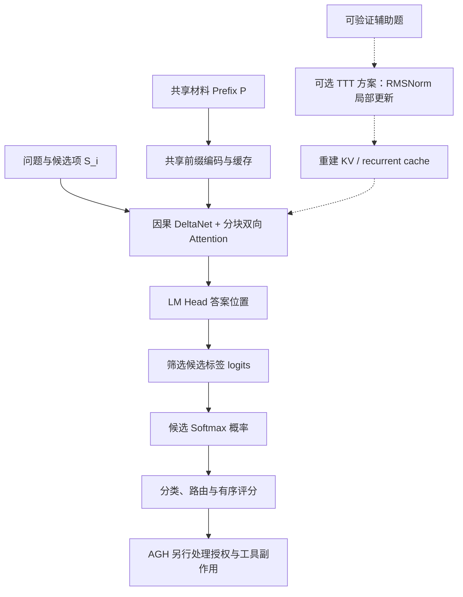

# Agnes Sys1 1.0 Decision Model Technical Report：分块双向候选决策模型

## 一句话定义

**Agnes Sys1 1.0** 在 Qwen3.5-9B 语言骨架上设计共享前缀、隔离的问题后缀和候选标签概率输出，用于分类、工具选择与路由，并提出请求内 RMSNorm 轻量适应方案（尚无 TTT 实测结果）。

## 英文缩写速查

| 缩写 | 英文全称 | 简要说明 |
|---|---|---|
| Sys1 | System 1 | 快速结构化判断的侧模型 |
| DM | Decision Model | 候选集合上的概率判断模型 |
| LM | Language Model | 保留语言模型输出头 |
| TTT | Test-Time Training | 在单个请求内适应部分参数的方案 |
| KV | Key-Value | 注意力缓存，权重更新后需重建 |
| ECE | Expected Calibration Error | 概率校准的拟评测指标 |

## 为什么重要

工具调用时机与业务分类需要可比较的选项概率，但自由生成的长文本并不是唯一选择。Sys1 以当前请求提供的选项为条件给出相对概率；其置信度仍需校准，不能替代真实设备的授权与安全约束。

## 核心原理与流程总览

- **基座：** 官方摘要称 Qwen3.5-9B、32 层、hidden size 4096；8 组“3 个 Gated DeltaNet + 1 个 full-attention”。24 个 DeltaNet 仍按 causal，8 个 full-attention 用 block-bidirectional mask。
- **多问复用：** Prefix P（共享材料）可双向访问自身；suffix S_i（问题 + 选项）可访问 P+S_i，不能访问其他 S；prefix 缓存能复用，但每个 suffix 仍单独前向。完整注意力位置 i 可看 j 当 b(j) ≤ b(i)。
- **概率：** 从 LM head 筛选候选标签的 logits z_i，在当前候选集合中 softmax 得 p_i=exp(z_i)/Σ_j exp(z_j)。这是相对概率，**并非自动校准的正确率**。
- **TTT 提议：** 从当前材料生成可验证辅助题，每请求只更新部分末端 RMSNorm scaling；损失有交叉熵/Brier、跨视图 JS、一致性 KL anchoring、权重偏移惩罚。错误/超时回退，更新后必须重建缓存并丢弃临时权重。

图中虚线是尚无实证结果的 TTT 提议，不能当已完成部署路径。

## 工程实践

将候选标签、问题规格与证据材料显式提供给模型；多问题共用输入时检查 suffix 隔离及缓存生命期，设置 calibrated abstention/回退规则。研究 TTT 时仅从可验证材料抽取辅助标签，不使用目标问题答案或评测标签；限定 update steps、耗时、漂移阈值；一旦模型参数变动，旧 KV 和 DeltaNet recurrent states 均不得复用。

## 源码运行时序图

**不适用：** 官方技术报告仓库仅公开 PAPER.pdf、README.md、REPORT.md，所核对材料未包含可独立验证的 Sys1 1.0 模型权重、训练/TTT 代码或推理入口；不能将 [AGH 运行时](./agnes-harness.md) 的代码时序冒充模型代码。

## 实验与评测

| 指标 | Sys1 1.0（团队提供） |
|---|---:|
| HLE-MultiChoice | 38.8% |
| When2Call | 95.2% |
| WildGuardTest | 93.6% |
| Omniscience accuracy（开源子集） | 38.8% |
| Omniscience non-hallucination | 75.2% |
| AA Composite Index | 71.2 |

官方摘要明确 **未独立复评**：71.2 为加权 71.15 四舍五入；与表内 elephant-1 的 64.7 相差 6.5 分，但 Omniscience 非幻觉率低 18.0 个百分点。“Rank 1/2/3”不是实时排名。**TTT 的 1/3/5 步、校准/延迟/显存 ablation 都是计划，不是已发表的试验成绩。**

## 结论

**贡献定位是面向任务选项的结构化判断接口与请求内适应方案，而非已验证的 TTT 性能提升。**

1. 候选必须按请求定义，不能把标签概率当绝对正确概率。
2. Prefix 可复用但不同问题 suffix 仍有各自开销。
3. TTT 辅助标签须可验证，不能泄露业务答案或评测集。
4. 更新 RMSNorm 后销毁旧缓存与 DeltaNet 状态。
5. 团队复合分必须连同非幻觉率短板与无独立复评限制报告。

## 与其他工作对比

- [AGH RSI 系统报告](./paper-agnes-harness-rsi-technical-report.md) 讨论 Kernel/账本、DM+LLM 系统及数据级 RSI；Sys1 聚焦判断模型结构。
- [Agnes Harness](./agnes-harness.md) 提供可选 `@agnes/judgment` 适配；并非模型权重与训练代码的发布。
- 标准 causal LLM 也能输出候选 logits；本文声称的差异是问题块表征和决策训练，而不只是 softmax 本身。

## 局限与风险

- 已核对官方 PAPER.pdf 全部五页的可提取文本与能力表，并与官方 REPORT.md 对照；模型及 TTT 评测仍未独立复现。
- TTT 报告没有实测收益，同时新增反向传播和缓存重建延迟。
- 模型权重及训练入口未查得，不能宣称开箱可运行。
- 快速决策不能绕开设备安全门、权限或人工批准。

## 关联页面

- [Agentic Manipulation Policies](../methods/agentic-manipulation-policies.md) — 区分语言代理的任务/工具选项判断与机器人操作策略输出。
- [VLA](../methods/vla.md) — 对比结构化候选概率的高层路由与连续动作策略、执行安全边界。

- [Agnes Harness](./agnes-harness.md)
- [AGH 系统报告](./paper-agnes-harness-rsi-technical-report.md)
- [机器人任务级控制接口](../concepts/llm-robotics-control-interfaces.md)
- [RSI 学习路线](../../roadmap/depth-rsi.md)

## 参考来源

- [Sys1 官方资料归档](../../sources/papers/agnes_sys1_decision_model_technical_report_2026.md)
- [已核对 PDF 原始报告（5 页）](https://github.com/AgnesAI-Labs/Agnes-Sys1-1.0-Technical-Report/blob/main/PAPER.pdf)
- [AGH 判断插件的一手说明](https://github.com/AgnesAI-Labs/agnes-harness/blob/main/docs/guide/judgment.md)

## 推荐继续阅读

- [官方 REPORT.md](https://github.com/AgnesAI-Labs/Agnes-Sys1-1.0-Technical-Report/blob/main/REPORT.md)
- [官方报告仓库](https://github.com/AgnesAI-Labs/Agnes-Sys1-1.0-Technical-Report)
