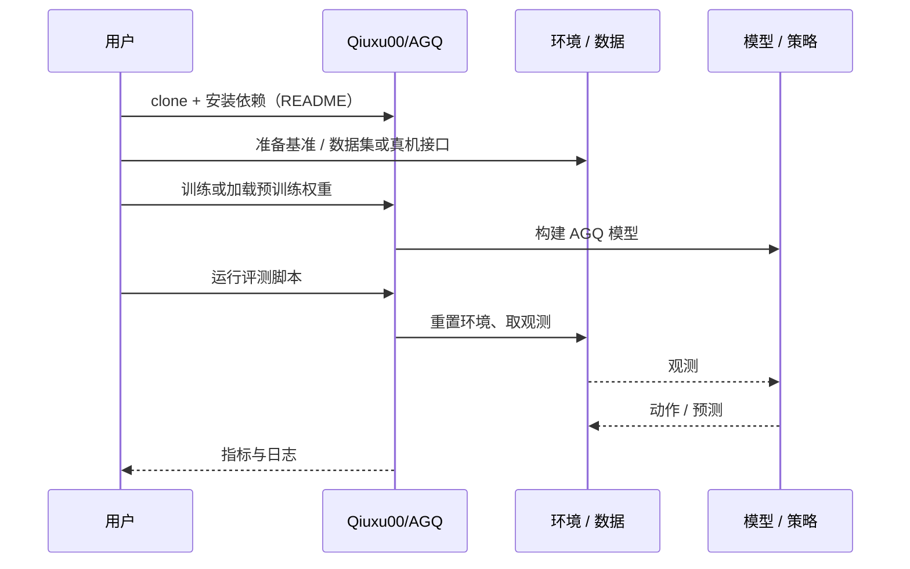

# AGQ（arXiv:2610.33074）

**AGQ**（*AGQ: Action-Guided Ultra-Low-Bit Quantization for Vision-Language-Action Models*，[arXiv:2610.33074](https://arxiv.org/abs/2610.33074)，[代码](https://github.com/Qiuxu00/AGQ)）来自 [具身智能小站 2026-10-28 盘点](../../sources/blogs/wechat_embodied_station_59_papers_human_video_to_robot_experience_2026-10-28.md)，属「VLA 与策略后训练」组。

## 一句话定义

**联合动作敏感度与权重恢复开销分配矩阵位宽，辅以校准、无损编码和分块恢复。**

## 英文缩写速查

| 缩写 | 英文全称 | 简要说明 |
|------|----------|----------|
| AGQ | AGQ: Action-Guided Ultra-Low-Bit Quantization for Vision-Language-Action Models | 本文方法 / 基准的简称 |
| VLA | Vision-Language-Action | 视觉–语言–动作策略 |

## 为什么重要

- 低比特压缩需要保住动作敏感权重。LIBERO 结果显示压缩率与成功率明显取舍；权重存储减少不能直接解释为推理加速。
- 开源结论：**已开源**（步骤 2.5，2026-10-28）。仓库可达（git ls-remote）。
- 同期同组工作见 [潜在动作、免渲染事件仿真与机器人评测：具身智能小站 10-28 期 59 篇阅读坐标](../overview/embodied-station-2026-10-28-59-papers-technology-map.md)。

## 核心机制

| 项 | 内容 |
|----|------|
| **arXiv** | [2610.33074](https://arxiv.org/abs/2610.33074) |
| **开源** | **已开源** |
| **要点** | 联合动作敏感度与权重恢复开销分配矩阵位宽，辅以校准、无损编码和分块恢复。 |
| **文内指标** | 公众号转述：LIBERO 结果显示压缩率与成功率明显取舍；权重存储减少不能直接解释为推理加速。 |

## 源码运行时序图

以下为按仓库入口（`Qiuxu00/AGQ`）推断的通用运行链路；入库日仅核实仓库可达，未逐文件阅读，具体脚本名以 README 为准。

## 实验与评测

- 公众号转述：LIBERO 结果显示压缩率与成功率明显取舍；权重存储减少不能直接解释为推理加速。
- **读法：** 本页为索引级摘要，依据公众号转述的官方摘要与仓库信息整理；逐项数字与 baseline 以原文 PDF 为准。

## 与其他工作对比

- 横向索引见 [潜在动作、免渲染事件仿真与机器人评测：具身智能小站 10-28 期 59 篇阅读坐标](../overview/embodied-station-2026-10-28-59-papers-technology-map.md)；同 arXiv 不重复造页。

## 结论

**低比特压缩需要保住动作敏感权重：LIBERO 结果显示压缩率与成功率明显取舍；权重存储减少不能直接解释为推理加速。**

1. 开源边界：**已开源** — 仓库可达（git ls-remote）。
2. 核心机制：联合动作敏感度与权重恢复开销分配矩阵位宽，辅以校准、无损编码和分块恢复。
3. 复现与选型前核对任务协议、硬件与基准口径，勿直接横比公众号摘录数字。

## 关联页面

- [vla](../methods/vla.md)
- [imitation-learning](../methods/imitation-learning.md)
- [reinforcement-learning](../methods/reinforcement-learning.md)
- [embodied-station-2026-10-28-59-papers-technology-map](../overview/embodied-station-2026-10-28-59-papers-technology-map.md)

## 参考来源

- [agq_arxiv_2610_33074.md](../../sources/papers/agq_arxiv_2610_33074.md)
- [wechat_embodied_station_59_papers_human_video_to_robot_experience_2026-10-28.md](../../sources/blogs/wechat_embodied_station_59_papers_human_video_to_robot_experience_2026-10-28.md)
- [arXiv:2610.33074](https://arxiv.org/abs/2610.33074)

## 推荐继续阅读

- [arXiv PDF](https://arxiv.org/pdf/2610.33074)
- [https://github.com/Qiuxu00/AGQ](https://github.com/Qiuxu00/AGQ)
