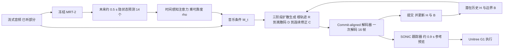

# AHEADance（arXiv:2611.13370）

**AHEADance**（*AHEADance: Anticipatory Humanoid Dance from Streaming Audio*，[arXiv:2611.13370](https://arxiv.org/abs/2611.13370)，UCL，Tianhu Peng、Yukun Wang 等，[项目页](https://ihcr.github.io/AHEADance/)）。论文称代码、评测脚本与指标验证协议“录用后发布”，项目页显示 “Code soon”，目前无可引用的代码仓库。

## 一句话定义

**一个按 16 帧（0.533 s）动作块、从流式音频逐块生成 G1 参考动作的扩散生成器：用冻结音乐模型对未来约 0.5 s 音乐的预测补足尚未听到的音乐，用“从自己已提交动作续写”的训练避免静止塌缩，再交给全身跟踪器执行。**

## 英文缩写速查

| 缩写 | 英文全称 | 简要说明 |
|------|----------|----------|
| MRT-2 | Magenta RealTime 2 | 论文引用 [11]，被冻结，从已听音频预测未来隐状态 |
| CoF | Commit Forcing | 本文的续写训练：历史与边界都来自自己已提交的块 |
| TF | Teacher Forcing | 以参考历史训练续写，表 III 中的对照 |
| D+C | Discrete + Continuous | 离散码加连续残差的块表示（III-B） |
| SONIC | Supersizing motion tracking for natural humanoid whole-body control | 论文使用的预训练全身跟踪器（III-E） |
| MMR | Music-Motion Retrieval | 动作窗口与自己音乐相似度相对他曲的间隔分，作者在 G1 动作上重训（附录 A-c） |
| BAS | Beat Alignment Score | 常用节拍对齐分，作者发现对真实舞蹈也不区分自己/他曲音乐，故表 II 不报 |
| FIDk / FIDg | Fréchet Inception Distance（kinetic / geometric 特征） | 与真实舞蹈的分布距离，越低越好 |
| Divk | Kinetic Diversity | 动力学特征多样性 |

## 为什么重要

- 流式舞蹈与离线编舞的约束不同：只能听到已播放的音乐，动作块须在听到对应音乐前提交，且不可撤回（摘要、I）。
- 给出一个具体做法：不等音乐，而是用对未来约 0.5 s 音乐的预测补足，并按预测可靠度加权（III-C）。
- 把“自己的输出变成自己的输入”分成两件事：潜在历史和解码边界必须同时来自生成结果，只改历史不够（IV-D：边界留在参考时低活动率仍有 72.5%）。
- 附带一套在真实 G1 舞蹈上验证过的评估器（ChoreoSync、MMR、风格分类、节奏显著度），并指出 BAS 在这里不可靠（附录 A-c、A-g）。

## 核心原理与流程总览

要点（均出自论文 III 节）：

- **提交单位：** 编码、生成、提交共用同一固定长度块（16 帧，30 Hz，0.533 s）；每块先在内部整体解码一次，提交后不再重解码。历史是有界的（64 个 token，4.27 s），所以上下文长度不随时间增长（附录 A-b）。
- **三阶段采样（式 3）：** 连续扩散先采根轨迹（定全局位置），再用类别扩散采离散码，最后条件连续扩散采残差修正；三阶段共用历史、边界与音乐条件。残差按实际采样码重基（式 4），使不同码样本仍指向同一身体目标。
- **ListenAhead：** 预测含 14 个状态，25 Hz，目标时间到音频截止点后约 0.5 s；每状态为 8 次采样续写的均值，每次决策算一次。注意力得分加按时间差生成的偏置 β(Δ)（式 5），输出乘可靠度 ρ（式 6）。ρ 由岭回归估计“该预测比保持最后听到状态好多少”。预测通路零初始化；屏蔽全部预测并令 ρ=0 即得 “w/o future” 模型。
- **风格条件：** 另有最近 10 s 的 MusicCoCa 风格嵌入，经尺度和偏移作用于隐藏状态（III-C）。
- **Commit Forcing（式 7）：** 先用参考历史预热，再对 K=8 个加噪参考块依次重建、解码、提交，更新 (H, B)，梯度在历史构建处停止，用参考目标监督下一块。训练先用参考历史再整体切到重建历史，无渐进混合（附录 A-b）。
- **静音行为：** 训练数据含站立与回站立片段，生成器无任何规则地在音乐静音时站住，音乐回来时再跳（III-A）。

## 关键结果（作者报告，带出处）

| 项 | 数值 | 出处 |
|----|------|------|
| 低活动率：TF → CoF | 83.5% → 10.3%（真实 9.7%） | 表 III、IV-D |
| 32.8 s 序列后段低活动率 | 98.5% → 8.4% | IV-D |
| 无未来通道 vs 完整：ChoreoSync | 17.4% vs 24.2%（差 6.8 [2.4, 11.2]） | 表 III、IV-C |
| 预测给出的拍时点增益占真实未来的比例 | 95%（拍相位 96%，音符起始 74%） | IV-C |
| 42 首未见歌曲 ChoreoSync / MMR / FIDk | 28.6% / 0.187 / 18.8（基线 MMR 至多 0.046，FIDk 至少 23.7） | 表 II、IV-B |
| 仿真 SONIC 成功率 | 99.5%（369 次） | IV-E |
| 物理 G1 | 20 次开始与 20 次停止均跟随，无跌倒，关节跟踪误差中位 5.5° | IV-E |

## 工程实践

- **延迟预算（IV-E、图 5）：** 音频截止后 0.13 s 提交一块（95 分位 0.15 s）；SONIC 读参考约提前 0.9 s，真机用 1.24 s 延迟，即机器人比听众听到的音乐慢约 1.2 s；官方低延迟 SONIC（0.32 s 预览）下仿真 0.8 s 延迟可实时（附录 A-k）。
- **部署形态（V、附录 A-b）：** 生成器场外运行在工作站上，音乐模型与生成器分别使用不同 GPU，不在机器人板载上跑。
- **重定向：** 六个数据集通过 OMG-Data 发布的重定向与官方划分得到 61.7 h 训练动作；基线人体动作用重新播种的 GMR 路线重定向（附录 A-a、A-g）。FIDg 在两种路线间差异大到“测的是路线”，故表 II 不报 FIDg。
- **接口：** 联合/朝向/时序约定转换后交给 SONIC；生成器只用已提交的参考更新历史，SONIC 用测量状态做反馈控制（III-E）。
- **复现状态：** 代码未发布，复现需自行实现 MRT-2 接入、三阶段扩散与 Commit Forcing；需要的超参数在附录 A-b（采样步数 10、种子 1234 等）。

## 与文章说法的核对

对照公众号文章《机器人动作块太长，什么时候该重新规划？》（2026-11-11）中对该论文的介绍：

| 文章说法 | 核对结果 |
|----------|----------|
| 用音乐预测补偿感知与动作延迟 | 部分对应。论文把预测用于补足“动作块要在听到其音乐之前提交”的缺口，预测前瞻只有约 0.5 s（III-C）；机器人上的 1.24 s 延迟主要由 SONIC 的 0.9 s 参考预览决定（IV-E），并不是预测补偿掉的。 |
| 再从已经承诺执行的动作接续生成舞姿 | 对应。Commit Forcing 与提交对齐编码（III-B、III-D）。 |
| 作者展示真机舞蹈 | 对应。物理 Unitree G1，12 次运行，无跌倒（IV-E、附录 A-l）；项目页另有麦克风实录。 |
| 节拍指标主要评估生成参考动作 | 对应。论文原文：音乐分数在生成的参考动作上计算，在执行之前（III-E、V）。 |
| 尚未形成机器人状态反馈闭环 | 对应。生成器不接收测量状态，且在场外工作站运行，留作未来工作（V）。SONIC 内部有测量状态反馈，但那是跟踪层，不是生成层。 |

其他可补充的限定：对比结果来自 42 首未见歌曲，且基线由作者在同一 AIOZ-GDANCE 训练集上继续训练（附录 A-g）；DiscoForcing 未能复现故未比分数；ChoreoSync 是作者自建的评估器。

## 局限

论文自己承认（V）：

- 动力学多样性低于真实舞蹈（Divk 2.22 对 6.22，表 II）。
- 预测只能预见节拍等规律结构，无法预见突然停止，机器人在停止后才响应（仿真约 1 s）。
- 音乐分数测在生成的参考上，由通用跟踪器延时执行；专为舞蹈训练的跟踪器可能保留更多拍级细节。
- 生成器不接收机器人状态，且场外运行；状态反馈与板载运行未做。
- 未做观众感知的用户研究（V 称其为下一步）。

我读后看到的未验证之处（作者自述之外，属判断）：

- 真机结果以出现的“跟随开始/停止”和无跌倒为主，只有 12 次运行与 6 首歌（附录 A-l），没有节拍同步等指标在真机测量状态上的评估（V 自述指标在参考上）。
- ChoreoSync 绝对值不高：真实舞蹈 45.2%，本方法在 42 首上 28.6%，真实 69.0%（表 II、IV）。
- 风格跟随在 Table III 的 FineDance 片段上不显著（附录 A-h：5.5 [−14.6, 27.8]），主结论来自 23 首歌的小样本。
- 严格在线基线是作者把离线模型改造成因果推理，且不重训（附录 A-g），并非这些方法的原始设计用途，读对比数字时需带上这一点。
- 区间未做多重比较校正（附录 A-m）。
- 代码未发布，结果无法独立复现。

## 与其他工作对比

| 工作 | 关注点 | 与 AHEADance 的区别 |
|------|--------|---------------------|
| Bailando++ / Danceba / MEGADance（表 II 严格在线基线） | 音乐到舞蹈生成 | 原为离线或非流式设计，作者改为因果推理且不重训；42 首未见歌曲上 MMR 为 −0.010/−0.003/−0.011，对本文 0.187（表 II、附录 A-g） |
| EDGE / Lodge（表 II 离线基线） | 能看到整首音乐的离线编舞 | 不受「先提交后听到」约束，MMR 仍只有 0.046/0.044；Lodge 在风格跟随上与本文无显著差异（表 VIII） |
| [Wan-Dancer](./paper-wan-dancer.md) | 视频生成式 music-to-dance，分钟级 720p 视频 | 输出像素视频而非机器人参考动作，离线生成，不涉及跟踪执行 |
| [CoDance](./paper-codance.md) | G1 双人舞中的受力顺应与跟随 | 关注接触力与 RL 控制层；AHEADance 只生成参考动作，执行交给 [SONIC](./nvidia-sonic.md) |

## 结论

**AHEADance 说明流式舞蹈的关键不只是「预测音乐」，而是让生成器从自己已提交、不可撤回的动作块续写，并用短时音乐预测补足尚未听到的部分。**

1. Commit Forcing 把低活动率从 Teacher Forcing 的 83.5% 降到 10.3%（真实 9.7%），且历史与解码边界必须同时来自生成结果（表 III、IV-D）。
2. ListenAhead 的约 0.5 s 预测让 ChoreoSync 从 17.4% 升到 24.2%，拍时点增益达真实未来的 95%（IV-C）。
3. 生成器配 SONIC 在仿真成功率 99.5%，物理 G1 跟随开始 / 停止且无跌倒（IV-E）。
4. 局限：节拍指标测在参考动作而非真机状态上，生成器无状态反馈且场外运行，动力学多样性偏低（Divk 2.22 对 6.22），代码未发布。

## 关联页面

- [NVIDIA SONIC](../entities/nvidia-sonic.md)：论文使用的全身跟踪器。
- [全身跟踪管线](../concepts/whole-body-tracking-pipeline.md)
- [扩散模型](../concepts/diffusion-model.md)
- [运动重定向](../concepts/motion-retargeting.md)
- [全身控制](../concepts/whole-body-control.md)
- [SONIC、BeyondMimic 等对比](../comparisons/sonic-vs-beyondmimic-vs-sdamp-vs-heracles.md)
- [BeyondMimic](../methods/beyondmimic.md)

## 参考来源

- [sources/papers/aheadance_arxiv_2611_13370.md](../../sources/papers/aheadance_arxiv_2611_13370.md)
- 论文：<https://arxiv.org/abs/2611.13370>
- 项目页：<https://ihcr.github.io/AHEADance/>

## 继续阅读

- 论文所依赖的 [SONIC 论文归档](../../sources/papers/sonic_reading_arxiv_2511_07820.md)
- 同一类问题（流式、因果、人形）的前作：DiscoForcing、RoboPerform、InfiniDanceRobot（论文引用 [6]–[8]）；Self Forcing、Diffusion Forcing 为续写训练的来源思路（引用 [9]、[10]）。
