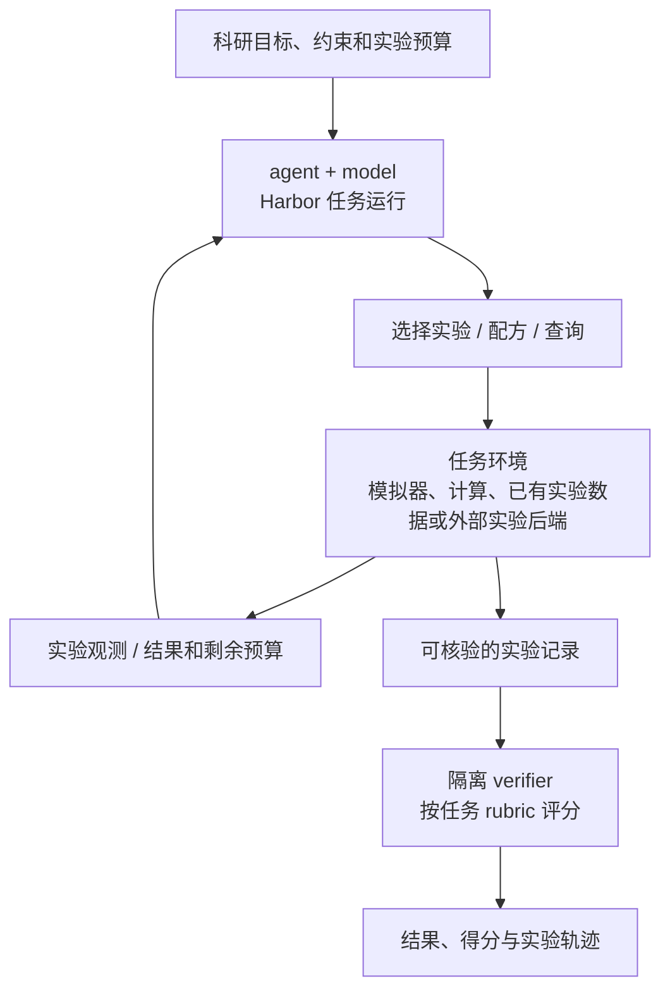
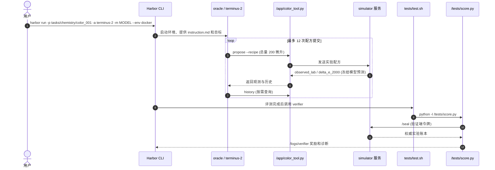

# AI Scientists' Last Exam（AISLE）：以实验结果验证科学智能体

## 一句话定义

**AISLE**（AI Scientists' Last Exam，AI 科学家的最后一场考试）是一个以实验选择、反馈学习、预算约束与可验证结果为主轴的 **科学智能体评测**项目；官方公开了 Harbor 任务、隔离验证器，以及独立的湿实验票据和恢复框架。论文标题为 *AI Scientists' Last Exam: Nature as the Last Verifier Towards Closed-Loop Discovery*；截至本次核查，论文仍是未发表的工作稿。

## 英文缩写速查

| 缩写 | 英文全称 | 简要说明 |
|---|---|---|
| AISLE | AI Scientists' Last Exam | 实验反馈驱动的科学智能体评测项目 |
| LLM | Large Language Model | 与 agent harness 组合进行评测的基础模型 |
| CIELAB | CIE L*a*b* Color Space | 配色示例的目标颜色表示 |
| CIEDE2000 | CIEDE2000 Color Difference | 配色任务用的色差计算规则 |
| API | Application Programming Interface | agent 与模拟器/实验网关通信接口 |

## 为什么重要

- 对比仅评审文本答案的科学问答：AISLE 更关注 **agent 能否在预算内提出实验、利用反馈调整动作并获得可验证结果**。
- 对机器人与实验室自动化：它将 **实验环境/机器人操作、模型决策、反馈信号、独立评分** 分离，能与 [Google 湿实验智能体工作](google-grounding-ai-agents-wet-labs.md) 对照。
- 对评测工程：权威记录应在任务环境和 verifier 一侧，而不应只验证 agent 自己的最终总结。

## 核心信息

| 项目 | 已核事实 |
|---|---|
| 官方项目 | <https://aisle.science/> |
| 论文 | [官方 PDF](https://github.com/MasterAI-EAM/ai-scientists-last-exam/blob/main/paper/AI_Scientists_Last_Exam.pdf)；仓库引文标注 unpublished manuscript / work in progress（2026） |
| 官方代码 | [MasterAI-EAM/ai-scientists-last-exam](https://github.com/MasterAI-EAM/ai-scientists-last-exam)，Apache-2.0 |
| 评测底座 | Harbor 0.25.0；Docker 任务环境及 verifier |
| 任务样例 | 配色优化、受约束配色、漂移恢复/树脂转移、光谱匹配与 pKa 推断，见官网任务页 |
| 开放程度 | **已开源**评测任务、验证器与 wetlab 控制器；不意味着真实实验设备、全部数据及运行轨迹完全开源 |
| 阅读状态 | **论文全文尚未获得可解析副本**；目前的机制叙述来自 README、任务说明和源码，非论文全文核证 |

## 核心原理

### 问题形式

将科学任务表达为目标、实验预算与约束：agent 从当前信息选择一次实验行动，环境给出观测，再决定后续实验；任务结尾由独立验证程序使用可核验的记录进行计分。不同任务可产生模拟反馈、已有记录查询或物理实验反馈，**不能混用这三种证据等级**。

### 流程总览

以下流程依据项目 README、color_001 任务和 wetlab 文档整理，**不是对尚未通读论文图的复刻**。

代码实现见下方时序图；**网站可见真实实验案例不代表每个公开任务都调用物理设备**。

## 源码运行时序图

下图只描述已检查入口的 **color_001 模拟配色任务**，不是物理实验室的通用执行流程。具体路径与入口见 [官方仓库归档](../../sources/repos/ai-scientists-last-exam.md)。

**另一个运行分支（非上图）**：wetlab/wetlab_run.py 的 start/continue 控制与 wait_for_result 实验票据协作。默认 suspend 模式：提交 ticket → 会话/容器快照 → 网关等待结果 → 恢复会话；blocking 模式保持容器与会话持续运行。实际示例使用算术模拟网关；真实实验需要可信后端处理票据，不能据此宣称自动化物理实验已完成。

## 工程实践

1. **本地最短复现**：按官方 README 安装 uv、Docker 及 Harbor 0.25.0，执行 oracle 示例（不需要模型 API key）；然后在自有凭据下用 terminus-2 评测模型。
2. **查看任务边界**：先读 tasks/chemistry/color_001/instruction.md、task.toml，再读 tests/test.sh 和 tests/score.py；不要把 agent 输出的「做到了」当成 grader 证据。
3. **辨别模拟与真实**：color_001 的观测来自冻结 LightGBM 预测器而非新做的湿实验；wetlab 算术网关验证的是交互与容错，真实外设还需单独安全验证。
4. **自定义任务验证**：官方贡献流程要求 oracle 成功、nop 失败，隔离 verifier 且冻结任务版本/数据；任务静态检查入口是 scripts/check_tasks.sh。

## 实验与评测

- **任务样例（源码已读）**：color_001 的配方总量 200 μL，最多提交 12 次；若记录中最小 CIEDE2000 色差 ΔE00 ≤ 1.0 则达到样例成功门槛，成功得分还考虑首次成功所需实验次数。该阈值属于样例任务，**不是全 AISLE 总分定义**。
- **验证层次（官方文档）**：wetlab/VALIDATION.md 单独列出模拟网关、Docker 集成测试、有限 live-model 恢复测试，并明确未完成 ≥24 小时的持续等待验证；不可扩展为对所有模型/实验室的证据。
- **官网排行榜**：公开显示按 wet/dry 与能力类别划分的动态分数；本页不固定最新数字，也不将实时成绩充当论文主实验表。**论文表格、统计显著性、消融与正式基准聚合方法均待全文核对**。

## 结论

**AISLE 目前可确认的工程价值是可运行的「科学实验选择—反馈—验证」评测管线；它的论文级实证强度仍须依赖论文全文核对，而非实时排行榜或宣传介绍。**

1. **优先把实验记录交给 verifier**：使用环境服务端账本和可隔离的评分脚本，而非读取 agent 自述的最终答案。
2. **区分数据来源**：模拟预测值、历史实验数据查询和新执行的物理实验不是同一种验证证据。
3. **先跑可复现样例**：Harbor 的 oracle 与 nop 对照可以检查任务与验证器是否自洽。
4. **长时真实实验要看恢复语义**：wetlab 明确区分 suspend 与 blocking；真实外设执行还需强制幂等及安全门控。
5. **暂缓论文排行榜结论**：未通读 PDF 前不记录具体 SOTA、样本总数或跨模型优劣作为论文结论。

## 与其他工作对比

- [Google 的自主湿实验构件](google-grounding-ai-agents-wet-labs.md) 更多在研究系统构件与物理接地；AISLE 的公开接口重点是 **科学智能体评测与实验验证**。
- [Agentic Aptamer Sandbox](paper-agentic-aptamer-sandbox.md) 报告数轮由人执行的真实湿实验反馈；AISLE 的公开代码则强调可复现实验任务和评测协议，不应将两者的成功率直接比较。
- [PyLabRobot](pylabrobot.md) 是液体处理机器人控制接口；AISLE 不是机器人本体控制栈。

## 局限与风险

- **原文未读完**：官方 PDF 约 31.5MB，当前环境无法解析为逐页可核文本。本页保留 draft；项目级实验结论、消融与论文附录须另行复核。
- **评测覆盖边界**：部分公开任务的反馈由模型产生；真正的物理闭环受设备、外部执行人、安全审查与验证数据限制。
- **公开范围有限**：Harbor 任务及 wetlab 控制器虽已公开，全部原始 model-run 轨迹/签名材料/实验室基础设施未在仓库公开。
- **复现成本**：模型试验需要 Docker、依赖和 API 预算；在真实实验室接入网关时，不能只依赖 ticket 机制保障设备安全。
- **论文与代码版本漂移**：仓库持续更新；源文件路径和文档口径应在实际复现时绑定 commit，官网榜单亦可能变动。

## 关联页面

- [Google Research：Grounding AI Agents in Biological Reality](google-grounding-ai-agents-wet-labs.md)
- [Agentic Aptamer Sandbox](paper-agentic-aptamer-sandbox.md)
- [PyLabRobot](pylabrobot.md)
- [AI Agent Evaluation](../concepts/ai-agent-evaluation.md)

## 参考来源

- [论文 PDF 来源归档（注明未通读）](../../sources/papers/ai_scientists_last_exam_2026.md)
- [官网与动态排行榜核查](../../sources/sites/aisle-science.md)
- [官方代码与可运行入口](../../sources/repos/ai-scientists-last-exam.md)
- [官方论文 PDF](https://github.com/MasterAI-EAM/ai-scientists-last-exam/blob/main/paper/AI_Scientists_Last_Exam.pdf)
- [官方 README](https://github.com/MasterAI-EAM/ai-scientists-last-exam/blob/main/README.md)
- [wetlab 验证边界](https://github.com/MasterAI-EAM/ai-scientists-last-exam/blob/main/wetlab/VALIDATION.md)

## 推荐继续阅读

- [AISLE 任务目录](https://aisle.science/tasks.html)
- [Harbor 官方框架](https://github.com/harbor-framework/harbor)
- [AISLE wetlab 技术说明](https://github.com/MasterAI-EAM/ai-scientists-last-exam/blob/main/wetlab/README.md)
