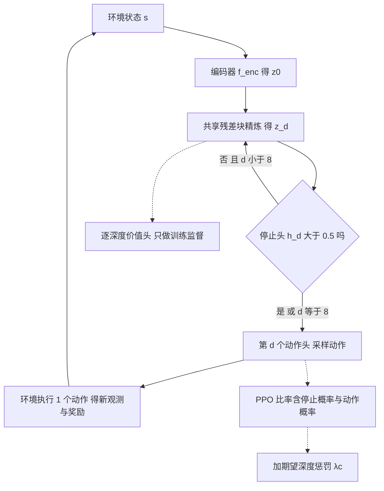

# AIC：学会何时停止思考（arXiv:2611.10822）

*Learning When to Think: Adaptive Internal Computation for Reinforcement Learning*（Rohit Kumar Salla、Simon Stepputtis，Virginia Tech；[arXiv:2611.10822](https://arxiv.org/abs/2611.10822)，NeurIPS 2026；[项目页](https://rohitsalla.github.io/aic-neurips2026/)）。本页依据 arXiv v1 全文与项目页整理，原文归档见 [sources/papers/aic-adaptive-internal-computation_arxiv_2611_10822.md](../../sources/papers/aic-adaptive-internal-computation_arxiv_2611_10822.md)。

## 一句话定义

**Adaptive Internal Computation（AIC）是一种迭代式策略：共享的残差块在同一个环境步内反复精炼状态的隐表示，一个「停止头」决定精炼到第几步就出动作；停止深度与动作被写成同一个联合策略，由 PPO 的回报信号一起训练，再加一项期望深度惩罚来为计算付费**（§3，式 1–3）。

## 英文缩写速查

| 缩写 | 英文全称 | 简要说明 |
|------|----------|----------|
| AIC | Adaptive Internal Computation | 本文方法：学习何时停止内部精炼 |
| PPO | Proximal Policy Optimization | 近端策略优化，本文训练联合策略的算法（§3.1） |
| GAE | Generalized Advantage Estimation | 广义优势估计，所有深度的价值头共用同一个 GAE 目标（§3.1） |
| VoC | Value of Computation | 计算价值，论文里指相邻深度价值预测之差，仅作诊断量（式 4） |
| ACT | Adaptive Computation Time | Graves 2016 的自适应计算时间，本文的停止基线之一（§4.3） |
| POGP | Prefix-Optimal Dynamic Diffusion Policies | 同组作者的扩散去噪提前停止方法，Table 2 的对比对象 |
| MLP | Multi-Layer Perceptron | 多层感知机，精炼块与编码器的组成 |
| B | nominal budget | 名义预算，限制可执行的精炼步数上限，取 1/2/4/8（§4） |

## 为什么重要

- **问题（作者自述，§1）：** 迭代式策略对每个决策都花同样多的计算，而精炼的收益因状态而异：常规动作少算几步即可，意外接触后的恢复可能需要更多步。
- **与「动作块重规划」不是一回事（本页判断）：** 论文里的「一步」是单个环境步之内的内部精炼，不产生新观测，也没有动作块；它回答的是「这一步想几轮」，不是「一段动作执行多久再重规划」。
- **读者可带走的东西：** 一个把「计算深度」纳入 RL 策略的最小可复现配方（联合似然进 PPO 比率、期望深度惩罚、逐深度价值监督），以及一套把增益拆给「停止、监督、数据」的对照实验设计。
- 机构：弗吉尼亚理工学院（Virginia Tech）。

## 核心原理与流程总览

**架构（§3，图 1，附录 A.2）：** 编码器 f_enc 得 z0（本体感觉用两层 MLP，网格状态用小 CNN，语言任务用冻结 GPT-2）；共享残差块 z_d = z_{d-1} + MLP(z_{d-1})，d=1…d_max；每个深度三个轻量头：动作分布 π_d、价值预测 V_d、条件停止概率 h_d（d<d_max，上限处强制停止）。主配置 d_z=256、d_max=8。

**联合策略（§3.1，式 1）：** 到达深度 d 的概率 S_d = ∏_{j<d}(1−h_j)，停在 d 的概率 q(d|s)=S_d·h_d（d<d_max）或 S_{d_max}，联合分布 p(a,d|s)=q(d|s)·π_d(a|z_d)。PPO 比率同时含停止概率与动作概率，所以回报同时训练「停在哪」与「做什么」。

**损失（§3.1，式 2–3）：** L = L_PPO + (λV/d_max)·Σ_d E(V_d − 目标)² + λc·E[C(s)]，C(s)=(1/d_max)·Σ_d d·q(d|s)。主配置 λc=.01、λV=.5，二者仅在 PickCube 上选定并共享给全部 12 个任务（附录 I）。价值头是辅助监督，推理时不被读取（§2，附录 A.10）。

**推理（§3，附录 A.12）：** 依次算 z1、z2…，在第一个 h_d>0.5 的深度停止并从该深度的动作头出动作，否则到上限；训练时对停止做伯努利采样并计算所有深度（用于价值监督），所以训练不省算力。

**理论（§3.2，定理 1）：** 设易状态在所有深度达到参考值 W*，难状态要到深度 K 才达到且之前有 Δ(1−d/K) 的缺口，则理想分配器用期望深度 1+ε(K−1) 即可无缺口，任何同期望深度的状态无关停止分布（含随机化）有至少 εΔ(1−b/K)>0 的期望缺口。这是「分配器知道难易划分」的存在性结论，不保证学习能找到它（§3.2，项目页同样声明）。

## 工程实践

- **代码：** 论文未给仓库；项目页 Paper / Code 两个入口在 2026-11-11 均为 "coming soon"，因此本页无 `code:` 字段，复现暂无官方实现可对照。附录 O 提到的 "code release" 尚未见到地址（未核实后续是否发布）。
- **设置（附录 I）：** Adam、学习率 3e-4、γ=.99、GAE λ=.95、PPO clip .2、10 个 PPO epoch、batch 64、4 个并行环境、d_max=8；基线共享编码器、精炼块、逐深度头与 PPO 目标，只固定训练深度 K_train∈{1,2,4,8}（§4）。
- **预算口径（§4）：** AIC 在 B<8 时用 d_max=B 重训；B=1 时没有停止决策，该档的差异反映训练差异而非分配。
- **成本（附录 Q，表 19）：** 单张 A100 80GB，批大小 1，中位延迟：HalfCheetah 0.86→0.48 ms（−44%）、AntMaze 0.89→0.53（−40%）、PickCube 0.92→0.57（−38%）、StackCube 0.94→0.65（−31%）；GPT-2/RTE 9.41→8.68 ms（仅 −7.8%，因冻结编码器占大头）；PickCube 训练 5.9 h→7.2 h（1.22×）。全文约 9800 A100 GPU 小时。
- **接入扩散策略（§5，附录 R）：** 把一次去噪步当作一次精炼，停止头读去噪网络隐特征；在线方法（DPPO、D3P）用联合 PPO 比率，离线/异策略方法（DiffusionQL、IDQL、DSAC-D）改用对 Q 的得分函数梯度（附录 R）。
- **部署注意（附录 O，作者自述）：** 在训练数据覆盖差的罕见状态提前停止是新增的失败模式，安全关键场景建议监控停止深度并设最小深度。

## 与文章说法的核对

对象：公众号《机器人动作块太长，什么时候该重新规划？》第 35 条「简单状态少算几步，复杂状态再多想一会」（2026-11-11）。

| 文章说法 | 核对结果 |
|----------|----------|
| 「把内部计算深度也纳入策略学习，联合决定何时停止推演和采取什么动作」 | 基本属实（§3.1：深度与动作为同一联合策略）。但「推演」易被读成滚动预测或规划：论文明确是对隐表示的精炼，不查询环境模型、不展开搜索树（§2），且内部精炼期间环境不给新观测。 |
| 「多个仿真基准显示计算节省」 | 属实：12 个仿真任务平均 3.32 步 / 上限 8（表 10）；延迟 −31% 至 −44% 只是 4 个控制 / 机器人任务（附录 Q 表 19）。全文无真机实验，真机与大模型主干是未来工作（§5，附录 O）。 |
| 「部分任务回报下降」 | 属实且需量化：对按预算调参的固定基线，FourRooms −.0216（p<.05）、Puzzle −.0047（不显著）（表 1）；对任一预算 ≤8 的最强固定基线，7 个领先、1 个持平、4 个落后，含 RareEvent −.0420 与低异质 AntMaze −.0140（表 1，§4.1）。 |
| 「速度与控制质量仍需按任务权衡」 | 与论文一致：GPT-2/RTE 49% 步数换 7.8% 延迟，FourRooms 在所有测试损失权重下低于深度匹配基线（§5，表 11），Puzzle 对价值监督权重敏感（表 12）。文章未写的限定：PickCube 对 Fixed-4 仅 +.0015（§4.1），多数「提升」量级很小（RTE 的 +.0023 约合每种子 0.64 个样本，附录 D.1）。 |
| 文章标题把本文放在「动作块重规划」栏目下 | 论文不涉及动作块或重规划时机，AIC 每个环境步仍只输出一个动作（§3）。该关联是文章编排，不是论文主张。 |
| 文章未提代码 | 与现状一致：项目页 Code 为 "coming soon"（未开源）。 |

## 局限

**论文自述（§5、附录 O）：**
- 仅用小型精炼模块并在仿真中评测，放大到大主干与真机尚未验证。
- 自适应停止不是处处有效：FourRooms 在整个 λc×λV 网格（表 11）内低于深度匹配基线，Puzzle 随价值监督变强才转正（表 12）。
- 消融无法完全分开「把算力花在哪」与「花了多少」：析因中自适应配置多执行 1.8–3.9 步（§4.2.3、附录 F），等计算量对照与深度重分配对照尚未做。
- 延迟节省取决于精炼在单决策耗时中的占比，大型冻结编码器会稀释节省（附录 Q 的拟合：RTE 中精炼约占 Fixed-8 耗时的 16%）。
- 计算惩罚依赖奖励尺度，同一个 λc 在不同任务上并不等价；特权参考只是诊断，不是上界（附录 I、O）。

**本页的判断（推测或未验证之处）：**
- 没有等平均深度的状态无关调度对照来直接验证「分配」本身的作用：PickCube 上 Fixed-4（.4911）超过「只自适应停止」配置（.472），说明部分增益可能只是多算了步数（§4.2.3）。
- 对最强固定基线的优势多数很小，且按预算分别调参，基线间不完全可比；统计检验仅 5 个种子（表 1）。
- 截断研究中目标组与随机组的差值有一部分来自移除的计算量不同，等功控制后均值差从 .0463 降到 .0118（§4.2.1），「模型更依赖这些状态的精炼」的结论强度因此降低。
- §5 局限段有一句措辞不通（FourRooms 低于固定深度「on eleven of twelve tasks」，同段又说 12 个任务中 9 个更高、1 个持平、2 个更低），数字应以表 1 与表 11 为准。
- 项目页与论文的代码状态不一致（论文提到代码发布，项目页写 coming soon），复现性待发布后再评估。

## 关联页面

- [PPO](../methods/ppo.md) — 本文联合策略的训练算法
- [强化学习方法总览](../methods/reinforcement-learning.md)
- [Diffusion Policy](../methods/diffusion-policy.md) — 迁移实验把去噪步当作精炼步
- [扩散模型](../concepts/diffusion-model.md)
- [奖励设计](../concepts/reward-design.md) — 期望深度惩罚本质是给计算定价，量纲依赖奖励尺度
- [具身基础模型的延迟与泛化权衡](../concepts/embodied-fm-latency-generalization-tradeoff.md)
- [ManiSkill](../entities/maniskill2.md) — PickCube、StackCube 所在仿真平台

## 参考来源

- [sources/papers/aic-adaptive-internal-computation_arxiv_2611_10822.md](../../sources/papers/aic-adaptive-internal-computation_arxiv_2611_10822.md)
- [arXiv:2611.10822](https://arxiv.org/abs/2611.10822)
- [项目页](https://rohitsalla.github.io/aic-neurips2026/)（静态读取 2026-11-11，Paper / Code 均 coming soon）

## 继续阅读

- [arXiv PDF](https://arxiv.org/pdf/2611.10822)
- 论文所引的先行工作：Graves 2016 的 ACT（arXiv:1603.08983）、Banino 等 2021 的 PonderNet（arXiv:2107.05407）、Ghugare 等 2026 的 On the role of computation in RL（arXiv:2602.05999）
- [PPO](../methods/ppo.md) 与 [PPO vs SAC](../comparisons/ppo-vs-sac.md)
