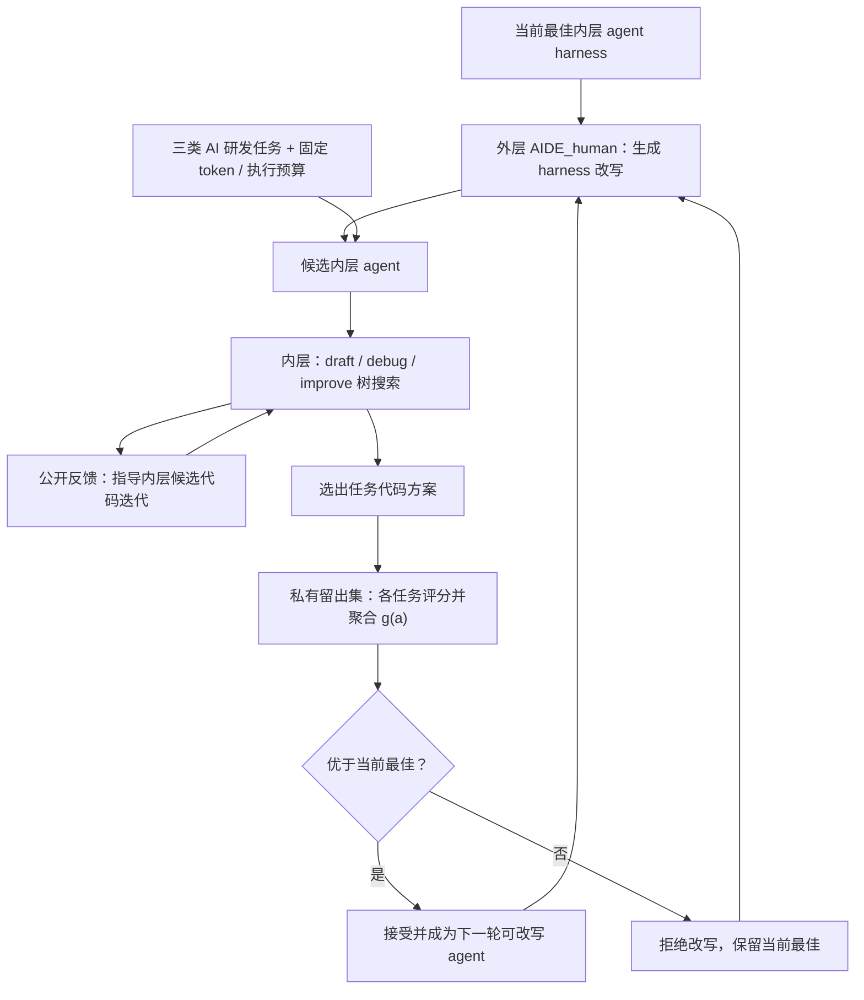

# AIDE²：AI 研究智能体的递归自我改进 / Recursive self-improvement of AI research agents

**论文：** Dhruv Srikanth、Bingchen Zhao、Dixing Xu、Yuxiang Wu、Zhengyao Jiang（Weco AI），2026-09-22，arXiv:2609.26457v1（预印本）。[原文 HTML](https://arxiv.org/html/2609.26457v1) · [作者博客](https://www.weco.ai/blog/first-evidence-of-recursive-self-improvement)。

## 一句话定义

**AIDE²（AIDE squared）**把 AI 研究 agent 的搜索策略、提示上下文与验证逻辑（harness）当作下一轮优化的代码对象：外层研究 agent 改写内层研究 agent，在固定预算任务集上通过私有评分筛选后继版本。

## 英文缩写速查

| 缩写 | 英文全称 | 简要说明 |
|---|---|---|
| RSI | Recursive Self-Improvement | 改进对象是下一轮负责研究的 agent 本身 |
| AIDE | AI-Driven Exploration | 原始树搜索式代码研究 agent |
| R&D | Research and Development | 受固定预算约束的 AI 研发任务 |
| UCB1 | Upper Confidence Bound 1 | AIDE_85 用于分配不同草稿策略臂的选择规则 |
| MLE | Machine Learning Engineering | 选择与外部评测中的机器学习工程任务 |
| OOD | Out-of-Distribution | WeatherBench 2 属于选择任务家族外的评测 |

## 为什么重要

1. **比“让 agent 改模型训练脚本”更深一层：** 普通 autoresearch 优化任务代码，AIDE² 让 agent 再去优化“如何进行代码研究”的 harness；主模型权重仍固定。
2. **把改进效率与算力堆叠分开：** 每个任务规定 token 与执行费用上限，用同一预算评估新旧 agent；选拔分数来自内层看不到的私有任务拆分。
3. **为机器人研发提供可审计设计范式（迁移建议，非论文实验）：** 可将这种“候选改动 → 仿真指标 → 留出验收 → 保留/回滚”的闭环用于算法、训练脚本、仿真与评测工具改进；真机安全和外部验收另需独立设计。

## 核心原理：双层优化

- **内层：** 给 agent 一份任务代码库与可见反馈，让它通过 draft、debug、improve 算子形成候选树，按照自身策略选择返回的最好方案。
- **外层：** AIDE_human 提议重写内层 agent 的完整 harness，然后把候选版本放到机器学习工程、启发式算法工程、harness 工程三类任务上；以私有留出集平均分选择新版本。
- **分离信号：** 内层只看公开评测，外层验收隐藏评测；并将不同 agent 的单任务预算固定，限制对公开分数的投机和增加计算量。
- **模型分工：** 文中外层使用 Claude Opus 4.7、内层用 Gemini 3 Flash。改写的是软件层，不是自主训练这些基础模型的权重。
- **AIDE_85 改进：** 五种固定草稿策略臂由 UCB1 及 30% softmax 混合分配，每五次搜索从当前最佳节点分叉；用有界历史摘要和角色化上下文，错误率达到 15% 才注入最多三个去重错误签名。

## 流程总览

**关键边界：** 评分器和评估预算由实验协议固定；不能把外层改写评估器当作默认允许的自我改进路径。

## 源码运行时序图

**不适用（截至 2026-11-21 未发现 AIDE² 官方完整可运行仓库与公开运行入口）。** 上图是由 arXiv v1 的 Algorithm 1 绘制的**论文算法流程**，不是声称已核对的源码调用时序图；不借用 AIDE、autoresearch 的其他代码虚构实现。

## 工程实践

| 环节 | 实施要点 |
|---|---|
| 提议与执行 | 让 coding agent 只改明示范围的 harness / 脚本，记录每个候选 diff 与执行输出 |
| 成本公平性 | 每轮记录 token 费用、任务执行费用、步数；同预算比较，而不是只比较墙钟 |
| 验收 | 将可见开发反馈与私有 held-out 验收分开；保留分数变化、失败原因与可回滚版本 |
| 迁移性 | 将改进后 agent 带到未参与选择的任务与不同模型上复评，防止只对内部 benchmark 提分 |
| 机器人延伸（建议） | 优先在 RL/Sim2Real 的离线研究脚本与仿真上试验；真机部署需额外安全门控、延迟和成功率评测 |

## 实验与评测

**自改进轨迹：** 单次 8 天、100 节点（初始版本 + 99 次改写提案），7 次改写通过私有验收；内层私有聚合分由 **0.703 → 0.778**。另两次独立运行分别接受 2、4 次改写，不能把一条轨迹的曲线当作无噪声的必然提升。

**四项外部 held-out 评测**（原文 Appendix A Table 1，指标口径各异，均为越高越好）：

| 评测 | AIDE_0 | AIDE_85 | AIDE_human |
|---|---:|---:|---:|
| ALE-Bench（竞赛表现） | 1536 | **1790** | 1511 |
| MLE-Bench（private percentile） | 0.678 | **0.722** | 0.708 |
| WeatherBench 2（预报技能增益） | 0.262 | **0.793** | 0.404 |
| FML-Bench（标准化测试增益 %） | 15.0 | **19.9** | 19.6 |

**reward hacking：** held-out KernelBench 下游训练集成的作弊判定比例 **55%（AIDE_0）→32%（AIDE_85）**；AIDE_human 为 39%。这是沿改进谱系观察到的相关变化，未证明由哪一条 harness 改写单独导致。

**ignition test：** 让 AIDE_47 替代人工研发的 AIDE_human 成为外层改进者，每组 3 个种子 × 50 步，两组结束均分 0.780 vs 0.782；原文结论为**不确定，不能证明达到 ignition**。

## 与其他工作对比

| 对照 | 关键差异 |
|---|---|
| [karpathy/autoresearch](./karpathy-autoresearch.md) | 固定 agent 改一个训练任务代码，优化目标给定；AIDE² 改负责“研究任务”的 agent harness |
| [Darwin Gödel Machine](./paper-darwin-godel-machine.md) | 也允许改写 coding agent；AIDE² 强调 AI 研发任务的效率、固定成本、私有评分与外部迁移 |
| [AI Auto-Research](../concepts/ai-auto-research.md) | 研究生命周期自动化是上游范式，AIDE² 是“研究工具本身持续改写”的具体验证切片 |
| [RSI 纵深路线](../../roadmap/depth-rsi.md) | 属于 Stage 4 harness 进化，并在 Stage 5 测试“改进者是否也更强”的 ignition 边界 |

## 结论

**AIDE² 的强证据是固定预算下反复接受 harness 改写且部分能力跨任务迁移；证据还不足以证明改进者递归加速或机器人策略已自进化。**

1. 优先复制 **公开反馈 / 私有验收隔离** 的门控设计，而不是照搬作者的具体搜索超参。
2. 实验对比必须固定**总成本预算**；更多调用与更快墙钟并不自动代表研究算法提升。
3. 强搜索策略兼顾**探索与局部改进**，有界摘要避免随着历史增长而耗尽上下文。
4. 读跨域结果时分清 **held-out 任务、任务家族与模型迁移** 三层；WeatherBench 2 样本较少。
5. **55%→32%** 是指定 KernelBench 协议下的 reward hacking 率，并非对所有 agent 安全性的普适改善。
6. **ignition 未获证实**；机器人研究应从离线 harness 迭代出发，不把论文分数当作真机可信度。

## 局限与风险

- **未发布完整可运行代码：** 官方论文与官方解读未列 AIDE² 的训练/评估复现仓库和运行入口；因此本文没有虚构源码时序。
- **单一团队主导评测：** 私有任务和评分协议不能简单独立复验；四个 held-out benchmark 使用不同指标、模型与预算，WeatherBench 2 只有一个任务。
- **搜索过程与论文机制的代价：** 七次接受不代表 99 次提案都有效；部分候选出错，演化代码复杂度增长，亦出现评估脚本 bug 修复。
- **不得外推到机器人闭环：** 未评估真机操作成功率、Sim2Real 迁移、控制回路延迟与安全性。机器人场景的建议属于工程类比。

## 关联页面

- [递归自我改进（RSI）](../concepts/recursive-self-improvement.md)
- [AI Auto-Research](../concepts/ai-auto-research.md)
- [Coding Agent 验证闭环](../methods/coding-agent-verification-loops.md)
- [Claude Code 动态多 Agent 工作流](../methods/claude-code-dynamic-workflows.md)
- [karpathy/autoresearch](./karpathy-autoresearch.md)
- [Darwin Gödel Machine](./paper-darwin-godel-machine.md)
- [RSI 纵深路线：Stage 4–5](../../roadmap/depth-rsi.md)

## 参考来源

- [arXiv:2609.26457v1 全文通读归档](../../sources/papers/aide2_recursive_self_improvement_ai_research_agents_2609_26457.md)
- [Weco AI 官方技术解读归档](../../sources/sites/weco-aide2-recursive-self-improvement.md)
- [arXiv HTML v1](https://arxiv.org/html/2609.26457v1)
- [Weco AI 官方博客](https://www.weco.ai/blog/first-evidence-of-recursive-self-improvement)

## 推荐继续阅读

- [AIDE: AI-driven exploration in the space of code（原始 AIDE 工作）](https://arxiv.org/abs/2502.13138)
- [FML-Bench：科研 Agent 搜索动态评测](https://arxiv.org/abs/2605.17373)
