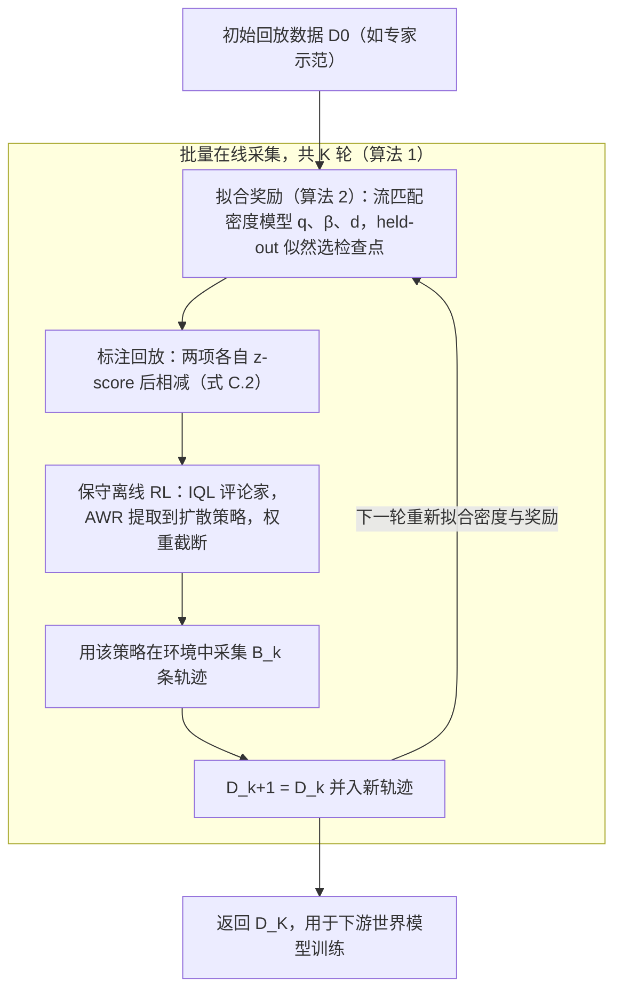

# Action Influence Maximization（AIM，提升世界模型动作可控性的数据采集）

## 一句话定义

**AIM 认为动作条件世界模型「不听话」的根因在数据：近乎确定的专家示范里动作对下一状态的影响太小，所以主动采集能让「动作更可从结果中辨认」的 episode，而不是只扩大模型或数据量（Bateman 等，Princeton，arXiv 2610.27387，仿真实验）。**

## 英文缩写速查

| 缩写 | 英文全称 | 简要说明 |
|------|----------|----------|
| AIM | Action Influence Maximization | 本文提出的主动数据采集算法 |
| WM | World Model | 动作条件视频预测模型 |
| MI | Mutual Information | 数据的条件互信息 I(A; S′ given S)，论文称等价于单步 empowerment（§3.2） |
| EE | End-Effector | 末端执行器，Push-T 中可控性评测对象 |
| IQL | Implicit Q-Learning | 保守离线 RL 的评论家（§3.4） |
| AWR | Advantage-Weighted Regression | 把评论家估值提取为策略的加权回归，权重截断到 [0,100]（附录 C） |
| BC | Behavior Cloning | 评测用的弱「学习者」策略之一 |
| DIAYN / DADS / ICM / METRA | 技能发现与好奇心类内在动机方法 | 论文中的对比基线（附录 E） |

## 为什么重要

- 世界模型常预测「典型的专家式未来」而不随动作变化，削弱其在规划与策略评估中的用途（摘要、§1）。
- 作者给出的论点是：数据的动作影响设上限，单靠模型容量抬不高（Theorem 1，§3.2）；被动扩大数据量收益饱和得很慢（图 6、附录 B）。这把「世界模型数据该怎么采」从覆盖问题改写成了「动作后果是否被数据暴露」的问题。
- 在 Push-T 上，500 条主动数据加 3k 专家数据，在 BC rollout 的 EE 可控性上持平 300k 专家数据（§4.2，作者据此称 85 倍数据缩减）。证据全部来自仿真。

## 核心原理与流程总览

**度量与上界。** 可控性用「解释性动作信息」衡量：不知道动作时的预测误差减去知道动作时的预测误差（式 1，§3.1）。Theorem 1 证明它不超过数据的条件互信息 I(A; S′ | S)（式 2，证明在附录 A.1）。Four Rooms 中跨数据规模，它与仿真保真度相关 r=0.979，95% CI [0.96, 0.99]（图 3，§4.1）。

**奖励。** 式 (4)（§3.3）：r = log q(a|s,s′) − log β(a|s) + log ρ_eval(s) − log d(s)。前两项是动作信息项（逆动力学相对行为策略），后两项是参考状态覆盖项（偏向评测状态分布、远离已采数据）。Theorem 2 证明该奖励倾斜后的策略与重放缓冲情境 bandit 问题同解，且只要 β 不是最优就提升数据互信息（附录 A.3）。

**实用化。** 批量在线循环（§3.4、算法 1/2）：

图依据：论文 §3.3-3.4 与附录 C 的算法 1/2。实际使用的奖励（式 C.2）是 z_score(log q − log β) 减 z_score(log d)；ρ_eval 取目标状态空间上的均匀分布，在式中是常数（§3.4）。

## 工程实践

- **世界模型**：Four Rooms 用 97.8M 参数 DiT 流匹配模型；Push-T 用 44.5M 参数、DreamerV4 风格的潜变量 Diffusion Forcing 模型，SD-VAE 编码 144×144 图像，均从零训练、不用预训练（附录 D、表 5）。
- **采集策略**：Push-T 的策略是 ViT 加扩散策略，动作块长 16，6 维连续动作；IQL 的期望分位 0.7、折扣 0.99，AWR 逆温度 0.1，权重截断 [0,100]（表 3）。
- **协议**：先验数据 3005 条 PPO 专家轨迹；每轮 100 条，Four Rooms 4 轮，Push-T 5 轮（§4.2、附录 E）。基线 DIAYN/DADS/ICM/METRA 共用 SAC 骨干，采用 31 维仿真特权状态（附录 E）。
- **信任域很关键**：未经 AWR 约束时，学到的 AIM 奖励会在工作空间之外给高分，作者认为无约束优化会导致不聚焦的状态覆盖（图 11，附录 G）。
- **算力与实现**：需要反复重训多个学习密度奖励模型，作者自承实现复杂、计算密集（§5）。
- **代码**：论文首页给出 https://github.com/princeton-prism/action-influence-maximization 与项目页 princeton-prism.github.io/action-influence-maximization；本次未能访问，仓库内容与是否已公开未核实。

## 与清单说法的核对

清单（Glen Berseth 的 CoRL 2026 阅读清单，据摘要由 LLM 起草）的一句话：「World models trained on successful trajectories ignore actions; an action-influence (empowerment) objective restores controllability.」逐项核对：

- **「successful trajectories 的世界模型忽略动作」**：与论文摘要和 §1 一致。限定词：Push-T 的「专家」数据是 ManiSkill 里的状态型 PPO 策略轨迹，不是人类遥操作；人类示范只是 §1 的动机描述（附录 E）。
- **「action-influence (empowerment) objective」**：论文 §3.2 明确说式 (3) 等价于单步 empowerment。但需分清：empowerment 是用来「决定采集什么数据」的奖励，不是训练世界模型的损失，世界模型本身用普通流匹配目标训练（附录 D）。清单措辞容易被读成「用 empowerment 目标训练世界模型」。
- **「restores controllability」偏强**：论文的证据是 Push-T 末端执行器像素召回上的提升，且只在仿真里；Tee（被推物体）召回在所有数据策略下都很低，AIM 在 Push Away 评测上 Tee 召回 0.201，低于 300K 专家的 0.282（表 1，附录 H）；BC 评测集上的「持平 300k」不能推到所有评测分布，Anti-Push-T 上只是接近 19k 专家基线（§4.2）。BC-Failure 评测上 EE 召回仅从 0.517 到 0.564（表 1）。
- **清单漏掉的前提**：Four Rooms 中均匀随机采集反而最强，AIM 只是接近（§4.2）；AIM 的优势依赖「无法均匀采样状态」的现实设定。
- **仿真还是真机**：清单摘要没说，论文结论自称「仿真中的概念验证」（§5）。

## 局限

**作者承认的（§5）**：奖励模型重训的实现复杂且算力高；序贯 RL 近似不保证改进情境 bandit 目标；后训练对数据效率的影响没有分析；迁移到持续改进的通用模型尚未验证。附录 H 另承认 Tee 保真度全面偏低，并推测需要更丰富的先验数据才能外推。

**读者看到的未验证之处（推测，非论文原话）**：

- 每个数据集、规模、分辨率只训练一个世界模型，置信区间来自推理种子和轨迹的自助重采样，未涵盖训练种子方差（附录 E）。
- AIM 用像素观测，内在动机基线用仿真特权状态，两类输入条件不同；因此「AIM 是唯一持续提升」的比较结论带有设置依赖（附录 E、H）。
- 去掉重新估计奖励的消融反而更好（BC 联合召回高 10%，§4.3），说明迭代重估的收益尚未被实验证明，与论文方法动机（§3.4）有张力。
- 可控性指标是像素召回，依赖带仿真特权信息的掩码；在没有仿真特权信息的真机场景如何评测，论文没有给出。
- 评测任务只有离散网格和单个推 T 任务，更丰富的操作和视觉场景未覆盖。

## 关联页面

- [World Action Models](../concepts/world-action-models.md) — 动作条件世界模型的背景
- [Generative World Models](../methods/generative-world-models.md) — 视频世界模型方法族
- [PlayWorld](./paper-playworld-autonomous-play-data.md) — 论文最接近的相关工作，用自主 play 数据改进世界模型（§2）
- [Ctrl-World](./paper-ctrl-world.md) — 论文引用的可控机器人世界模型之一
- [DreamerV4](./paper-sa-2509-24527-dreamerv4-training-agents-inside-of-scalable-wor.md) — 论文世界模型结构的参照（附录 D）
- [Diffusion Forcing](./paper-sa-2407-01392-diffusion-forcing-next-token-prediction-meets-fu.md) — Push-T 世界模型使用的序列扩散框架
- [PPO](../methods/ppo.md) — 论文中专家数据的生成算法
- [Diffusion Policy](../methods/diffusion-policy.md) — AIM 采集策略与 BC 评测策略的形式
- [流匹配具身策略](../concepts/flow-matching-embodied-policy.md) — 密度估计与策略共同使用的流匹配
- [具身数据采集四层分类](../concepts/embodied-data-collection-four-layers-taxonomy.md) — 数据采集在整体框架中的位置
- [具身基础模型总览](../overview/hub-embodied-foundation-model.md)

## 参考来源

- [AIM 论文来源归档](../../sources/papers/aim_action_influence_maximization_arxiv_2610_27387.md) — 含通读范围与缺项
- [arXiv 2610.27387v1 PDF](https://arxiv.org/pdf/2610.27387v1)：本次通读全文（含附录 A-H）
- [森蓝科周报 2026-10-19~23 操作](../../sources/blogs/wechat_senlanke_weekly_manipulation_2026-10-19_23.md)：二手线索，未作事实依据

## 继续阅读

- [arXiv 2610.27387 摘要页](https://arxiv.org/abs/2610.27387)
- 项目页 princeton-prism.github.io/action-influence-maximization（论文首页所列）
- 论文参考文献 [1] PlayWorld（Yin 等）与 [47]（Hansen 和 Wang 的同期好奇心采集工作）
