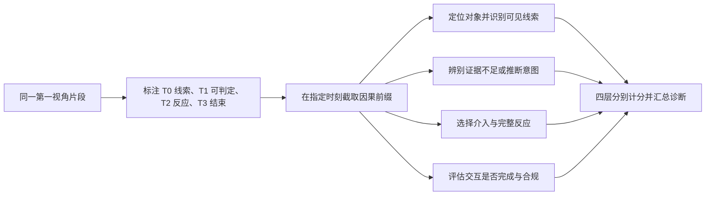
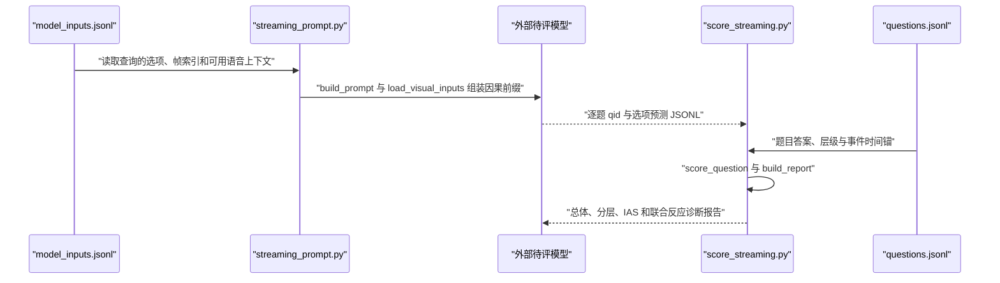

# AIRIS：第一视角流式视频的社会具身智能基准 | AIRIS: Benchmarking Social Embodied Intelligence in Egocentric Streaming Videos

## 一句话定义

AIRIS 把第一视角社会互动拆成注意、意图、反应与交互四个阶段，只给模型当前可见的视频前缀，检查模型何时有依据判断、是否该介入，以及能否选对完整反应。

## 英文缩写速查

| 缩写 | 英文全称 | 简要说明 |
| --- | --- | --- |
| A-I-R-I | Attention, Intention, Reaction, Interaction | 关注、意图、反应、交互四层 |
| ASR | Automatic Speech Recognition | 给普通视觉语言模型提供时间对齐的语音转录 |
| IAS | Intent Anticipation Score | 对有依据后的提前识别计分，并惩罚提前猜测 |
| FCR | False Commitment Rate | 可判定时刻之前贸然给出具体意图的比例 |
| Joint-EM | Joint Exact Match | 对完整反应链做联合精确匹配 |

## 为什么重要

**机构：** 腾讯 Robotics X 实验室。

在完整视频上看懂别人伸手，不等于机器人在现场知道该立即递物还是先等待。AIRIS 让同一片段上的感知、证据判断与响应可对照，区分事后正确、当下猜对和根据当下证据及时判断。

## 核心机制

- 四个时间锚：T0 是首个社会线索，T1 是专家凭已见证据最早能判定意图的时刻，T2 是第一视角主体开始实质回应，T3 是本次交换结束。在 T1 前，意图题正确选项为证据不足；反应则允许动作、交流、等待或不介入。
- 每题只用查询时刻之前或当时可见的帧和语音。普通视觉语言模型用对齐文本，支持音频的全模态模型可用原始音频。测试四层共享片段和时间锚，但不把前一层预测作为后一题的自动输入。
- 单选、是非与框选用精确匹配；多选用集合 F1。总体先各自做四层题目微平均，再等权合并。IAS 用从 T1 后稳定正确到 T2 的归一化提前量乘以 1 减 FCR；Joint-EM 检查是否介入、动作域、具体子动作及适用的言语功能是否同时正确。

## 实验与评测

| 项目 | 作者报告 |
| --- | --- |
| 数据与模型 | 357 段第一视角视频，来自 276 个源视频，合计 10.91 小时；11 类场景、36 项能力、每层 2,000 题，测 45 个模型。 |
| 总体与阶段差异 | Gemini-3.7-Flash 总体 0.726、Attention 0.936；HY-Embodied-VLM-1.0 的 Reaction 0.688 居首，但不是完整反应联合成功率。 |
| 提前断言 | 各模型家族在 T1 前平均 FCR 为 0.26–0.51；领先模型的 IAS 也只有 0.237。 |
| 组合反应 | 没有模型的反应 Joint-EM 超过 0.147；单个决策分项较高并不保证同一事件上组合正确。 |

## 工程实践

官方仓库含问答、模型输入、示例预测、评估和媒体本地重建工具。代码为 MIT，自建标注等为 CC BY 4.0，不重发第三方视频、音频或帧。已用本地仓库执行 `validate_release.py` 的仅元数据检查（8,000 题、357 clips、20,295 个引用帧，无校验失败），并用官方评分脚本重算自带的总选 A 示例（8,000 题、无缺失，总体约 0.35193）。不涉及视频下载、原始媒体复原或模型推理。

### 源码运行时序图

## 局限与风险

- 这是离线、封闭选项评测，而非实际驱动机器人。论文将机器人在环、更广社会场景和开放式输出明确列为后续工作。
- 源视频可能下架、地域受限或变更转码，重建只追求发布时刻与语义输入一致，不保证与历史图片逐字节相同。
- 语音输入方式因模型能力而异。基准分数也不代表跨文化规范、真实响应时延或安全关键部署能力。

## 结论

有用的社会具身评测不仅测模型能否给出正确意图，还应检查它是否依据当时的证据、是否适时介入，以及能否在同一事件上给出完整而合规的动作。

## 关联页面

- [具身模型测评纵深路线](../../roadmap/depth-embodied-eval.md)

- [具身评估与基准](../overview/hub-embodied-eval-benchmark.md)：把离线诊断和真实机器人评测分开解读。
- [多模态基础](../concepts/multimodality-basics.md)：视频与语音时间对齐是因果输入的前提。

## 参考来源

- [论文全文归档](../../sources/papers/airis-arxiv-2611-34347.md)
- [官方项目页归档](../../sources/sites/airis.md)
- [官方代码与数据归档](../../sources/repos/airis.md)

## 推荐继续阅读

- [EgoNormia](./paper-sa-ego-002-egonormia-benchmarking-physicalsocial-norm-under.md)：对照第一视角物理与社会规范理解，注意不同任务定义和时序约束。
