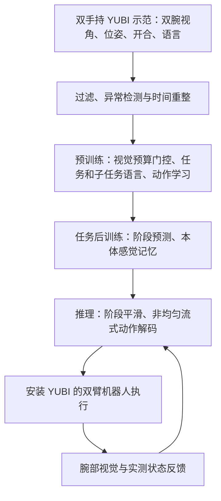
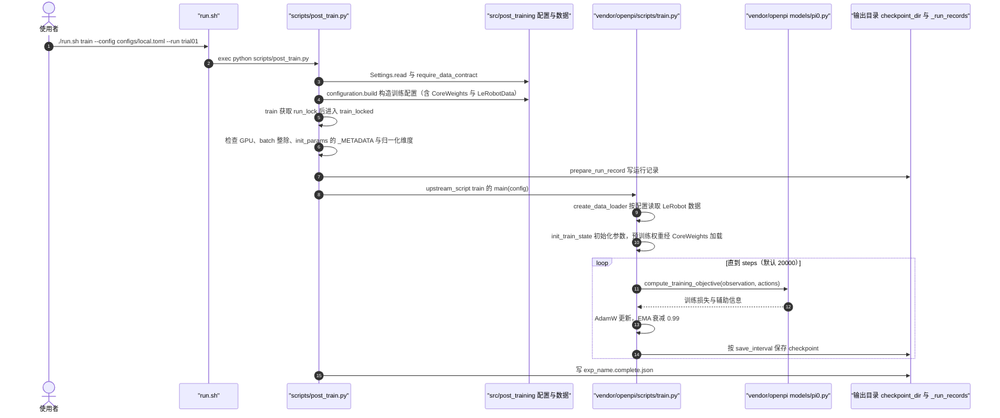

# AIRoA-0：从手持数据学习长程精细跨本体操作

**AIRoA-0** 以手持 YUBI 夹爪数据进行预训练和任务后训练，并在配备相同夹爪与腕部相机的机器人上执行双臂任务。本文依据 [arXiv v1](https://arxiv.org/html/2611.03815v1) 整理，全文（正文、实验、相关工作与附录 A）已于 2026-11-06 通读。

## 英文缩写速查

| 缩写 | 英文全称 | 简要说明 |
|------|----------|----------|
| VLA | Vision-Language-Action | 视觉语言动作模型，本页指以 π0.5 为骨干的双臂策略 |
| S2 | See Less, Specify More | 视觉证据预算与步骤级语言监督的预训练目标 |
| UMI | Universal Manipulation Interface | 手持夹爪采集数据的前序工作，A-0 的相对轨迹表示沿用其做法 |
| TCP | Tool Centre Point | 夹爪工具中心点，动作与状态都在该点定义 |
| EMA | Exponential Moving Average | 指数移动平均；本页用于阶段概率平滑，以及后训练权重的滑动平均 |
| NUF | Non-Uniform Streaming Decoding（仓库中缩写为 NUF） | 本页提出的分槽去噪调度，两个噪声槽取 (0.1, 1) |

## 为什么重要

手持夹爪采集的数据随录制的人数增长，而不随可用机器人数量增长：人手持夹爪完成任务即可，不需要机器人在场（论文引言）。过去的 VLA（如 RT-2、Octo、OpenVLA）主要依赖机器人上采集的数据，而 A-0 主张训练与后训练全程不使用机器人示范或机器人上的经验，只在测试时上机。它对两个问题给出了实证：手持数据能否支撑长程、精细的双臂任务；在训练数据未覆盖的场地和不同机械臂上能否成立。论文的证据主要是作者自己的评测，见下文「实验与评测」。

## 流程总览

## 核心原理与方法栈

- **数据与接口：** 16,151 小时双手持示范，覆盖百余任务、1,065 万个子任务片段（平均约 5.5 秒，30 Hz）；训练和后训练均使用手持数据，论文称未采集机器人遥操作、强化学习、上机纠正或仿真数据。每个动作块内目标相对观测时夹爪 TCP 位姿锚定（沿用 UMI 的相对轨迹思路）；双臂动作每步 20 维（每臂平移 3 + 6D 旋转 6 + 开合 1），状态为一个夹爪在另一夹爪坐标系下的相对位姿加双夹爪开合，共 11 维。
- **输入与输出：** 输入为左右两路腕部图像（224×224）、指令和当前状态；预训练输出未来 32 步动作（20 Hz 网格），后训练配方中动作块为 20 步。阶段概率、子任务文本等为训练或推理中间量。
- **预训练：** 骨干为 π0.5（SigLIP So400m/14 图像编码器、Gemma 2B 视觉语言骨干、300M 动作专家，流匹配训练），从公开的 π0.5 基座权重初始化；在语料上训练 300,000 步、batch 2,048。指令条件的视觉证据预算门控依据 S2 对每个图像 token 乘以保留概率，预算约束平均保留概率，动作损失决定哪些区域被强调，无需框、掩码或「看哪里」的标注。子任务文本预测作为训练辅助损失，不作为动作专家输入。
- **后训练：** 阶段分类头依据示范的子任务标签学习当前阶段，阶段以文本条件传给动作专家；最近 10 个实测本体感觉状态（带时间差）经 4 个可学习查询压缩为 4 个记忆 token，训练时以 5–15 Hz 随机采样，并以四分之一概率整体丢弃。论文配置为 20,000 步、batch 64，单节点 8 张 H200 不足 4 小时。
- **部署：** 阶段概率经 EMA 平滑后再条件化动作专家；非均匀流式解码维护两个噪声槽，新观测到来时先对新块大步去噪、再对即将执行的块以小步修正。论文报告 H200 单次查询约 60 ms，这是推理耗时，不能直接等同于机器人伺服周期。

## 源码运行时序图

**核查结论（2026-11-06）：部分开源。** 项目页的 "Post-training code" 链接到 [GitHub 仓库 airoa-org/AIRoA-0](https://github.com/airoa-org/AIRoA-0)，"Pre-trained weights" 链接到 [Hugging Face 上的 airoa-org/AIRoA-0](https://huggingface.co/airoa-org/AIRoA-0)（公开，卡片标注 `openpi` 库与 `gemma` 许可，门控方式为 auto），"Dataset" 标为 Coming soon。仓库可公开读取，含可运行的后训练入口 `./run.sh inspect|norm|train`（`scripts/post_train.py`），后训练代码基于 OpenPI 并 vendor 在 `vendor/openpi`。仓库不含预训练代码、数据集，也未找到推理部署 harness（阶段 EMA、非均匀流式解码的实现），因此下图只描绘后训练路径。本环境无 GPU，未运行训练或测试套件，图中调用关系依据源码阅读。

复现路径是先用 `inspect` 检查数据 schema，再用 `norm` 生成归一化资产，最后 `train --run <name>` 训练；断点续训使用 `--resume` 并保持其余配置不变。`src/post_training_losses/` 是按显式张量实现的参考损失，由测试和 `examples/losses.py` 使用，不在上述训练调用路径中。

## 工程实践

**复现步骤**（依据仓库 README）：

1. 使用 Python 3.11、Linux 和 CUDA 12 的 NVIDIA GPU，执行 `pip install -e '.[train,test]'`。
2. 从 Hugging Face 下载预训练权重，设置 `configs/local.toml` 中的 `init_params`、`assets_dir`、`checkpoint_dir`。
3. 准备 LeRobot v3.0 格式的数据集（v2.1 需先转换），设置 `data.repo_id`、状态与动作字段、相机映射和 `labels.task_instruction`、`labels.pa_to_stage`。仓库默认配置中的 `your_org/your_task` 与 "REPLACE" 字段均为占位，须替换。
4. 依次运行 `./run.sh inspect`、`./run.sh norm`、`./run.sh train --run <name>`；训练默认开启 W&B（`training.wandb = true`），可改为本地日志。

**关键参数**（论文表 4 与仓库默认配置一致，除非另注）：

| 项 | 取值 |
|----|------|
| 基座 | π0.5 公开 base 权重 |
| 动作块 | 20 个锚定动作，20 Hz（仓库 README 的 NUF 示例为 chunk 8、buffer 2、horizon 16，与论文配方不同，复现时需按目标选择） |
| 视觉证据预算 | 目标均值 ρ = 0.9，温度 τ = 0.805，下限 γ 从 0.1 退火到 0.02，预算损失权重 0.1 |
| 辅助损失 | 阶段损失权重 0.1，子任务（仓库中的 PA）损失权重 0.01 |
| 本体感觉记忆 | 最近 10 个状态，4 个记忆 token，采样频率 5/8/10/12/15 Hz，整体丢弃概率 0.25 |
| 优化 | AdamW，学习率 5×10⁻⁶（500 步预热后恒定），batch 64，20,000 步，EMA 衰减 0.99 |
| 维度 | 状态 11 维，动作 20 维（6D 旋转）；发布的后训练 checkpoint 的 norm_stats 只适配此布局 |

**硬件与资源**：论文报告单节点 8 张 H200 不足 4 小时；仓库示例使用 8 卡，并建议至少 32 个 CPU 核用于输入管线。

**部署要点**：阶段 EMA 与非均匀流式解码未随仓库发布，若要在真机上复现，需按论文 §6 自行实现并核对与动作锚定的一致性。推理耗时 60 ms 为论文报告值。

**源码开放与依赖**：仓库许可 Apache-2.0（README 徽章），vendor 的 OpenPI 另含 Gemma 许可文件；HF 权重卡片标注 `gemma` 许可（具体条款未核实）。数据集未发布（项目页 Coming soon），因此无法在本地复现论文表 1 的数据条件。

## 实验与评测

论文表 1 在未采集训练数据的地点以双臂 Franka 评测 10 项任务，每项 15 次，部分完成可获部分分数；表中称成功率，**不等同于每次完整任务的二值成功率**。

| 方法 | 10 项平均得分 |
|------|--------------|
| AIRoA-0 | 78% |
| π0.5 | 27% |
| Xiaomi-Robotics-1 | 23% |
| GR00T N1.7 | 16% |
| MolmoAct2 | 14% |

基线使用相同任务示范后训练，并逐任务选取搜索到的最佳设置；AIRoA-0 对所有任务使用同一配方。A-0 在 10 项任务中的最低分为耳机任务的 30%，显示任务难度差异。论文还展示同一任务权重用于 TX-G2、OpenArm 和双 UR，但其他平台只展示部分任务（TX-G2 4 项、OpenArm 3 项、UR 2 项），不能把 Franka 十任务平均结果推广至它们。

预训练数据规模实验使用留出示范的动作损失而非机器人成功率；报告在约 1,000–16,000 小时范围内数据翻倍使后训练损失约降低 2.4%，是该实验口径下的拟合结果（R² = 0.98，五个数据点）。

## 与其他工作对比

- **实验内对照**：[π0.5](./paper-pi05-open-world-vla.md)、[Xiaomi-Robotics-1](./xiaomi-robotics-1.md)、[GR00T N1.7](./paper-gr00t-n1-7.md)、[MolmoAct2](./paper-molmoact2.md) 均从公开预训练检查点出发，用与 AIRoA-0 相同的手持示范后训练；基线逐任务搜索动作长度 4–16、多种动作频率和 60,000/80,000/100,000 次更新并取最佳，AIRoA-0 十项任务只用表 4 一套配方（§2.1、表 1）。分数含部分得分、每项 15 次，不能与其他论文的二值成功率横比。
- **手持采集路线**：[UMI](./paper-rcl-ref-e064f89fc62c8df5da9f-universal-manipulation-interface-in-the-wild-rob.md) 首先证明无机器人在场的手持示范可迁移到机器人；RDT2、Xiaomi-Robotics-1 把手持数据用于基础模型预训练；[HiFi-UMI](./paper-hifi-umi.md) 提升采集保真度并公开 2,000 小时数据（§7）。本文主张把这条路线推进到单条指令、仅腕部相机、训练数据未覆盖地点的长程双臂任务。
- **VLA 数据来源**：[RT-2](./paper-rt-2.md)、[Octo](./paper-octo.md)、[OpenVLA](./paper-openvla.md) 依赖机器人上采集的数据（Open X-Embodiment、DROID），π\*0.6 进一步用机器人上强化学习与纠正（§7）。AIRoA-0 沿用 [π0](./paper-pi0.md)/π0.5 架构与公开权重，但论文称不采集机器人示范或机器人上经验。
- **长程任务中的语言层级**：RT-H 在动作前预测语言动作，[Hi Robot](./paper-hi-robot.md) 用高层模型选下一步，π0.5 预测自由文本子任务（§7）。AIRoA-0 预训练沿用 S2 的步骤级语言监督，后训练把高层决策简化为阶段分类，做法参照 Larchenko 等在 2025 BEHAVIOR Challenge 中的阶段跟踪（§5.1、§7）。
- **实时动作生成**：[ACT](./paper-act.md) 对重叠动作块取平均，[Real-Time Chunking](./paper-real-time-chunking.md) 在推理时与上一块未执行部分保持一致；Diffusion Forcing、Streaming Diffusion Policy 与 [FlashVLA](./paper-flashvla.md) 走分级噪声缓冲路线（§7）。AIRoA-0 在 FlashVLA 基础上提出非均匀噪声调度，并适配锚定动作与阶段条件策略（§6.2）；与均匀调度的差异只以示意图（图 11）和推箱子演示（§2.2、图 4）说明，未给出与上述解码方法的同条件定量对比。

## 结论

手持双夹爪数据与共享末端执行器可支撑长程双臂操作，但跨本体效果依赖相匹配的夹爪、相机和控制接口。

1. **用夹爪坐标对齐人手示范与机器人动作**，减少对机械臂本体坐标的依赖，是跨本体的主要前提。
2. **长任务结合阶段预测与近期状态历史**；阶段信息来自训练标签，标注质量直接影响阶段预测。
3. **78% 是含部分得分的十任务平均**，比较或复现时应保留评测口径，并注意基线逐任务调参而 A-0 只用一套配方。
4. **其他平台的演示覆盖任务较少**，不能据此推断任意夹爪或任意机器人适用。
5. **可核查资源分层**：后训练代码与预训练权重已公开，数据集标为待发布；推理部署 harness 未在仓库中找到。

## 局限与风险

- **评测来源单一**：十项任务、每项 15 次、单一 Franka 场地，结果由作者自行评测且含部分得分；尚未见独立复现。
- **基线比较不对称**：基线逐任务搜索最佳设置，A-0 只用一套配方，两者差距的一部分可能来自调参方式，论文未报告消融。
- **跨本体证据有限**：TX-G2、OpenArm、UR 只演示 2–4 项任务，没有定量成功率。
- **扩展性结论的口径**：数据规模实验看的是动作损失的拟合关系，不是真机成功率的 scaling law。
- **解码方法未定量对比**：非均匀流式解码相对均匀调度与其他实时方法的优势只有示意与单个演示，缺少同条件数字。
- **部署依赖硬件一致性**：要求机器人挂载同款 YUBI 夹爪和腕部相机，状态与动作维度、坐标约定需与训练数据一致；换用其他夹爪或相机时结论不直接适用。
- **可复现性受限**：数据集未发布（项目页 Coming soon），"最大开放手持数据集"的说法 （未核实）；推理 harness 未随仓库发布；HF 权重为门控访问并标 gemma 许可，使用前需确认条款（未核实）。
- **运行成本**：论文配方依赖 8 卡 H200 级别资源；仓库默认配置含占位数据集与占位状态/动作描述，直接运行会失败或训练无意义。
- **速度数字的含义**：60 ms 是单次查询耗时，不是控制回路频率，不能据此判断真机的响应速度。

## 关联页面

- [具身数据采集四层分类](../concepts/embodied-data-collection-four-layers-taxonomy.md)
- [模仿学习](../methods/imitation-learning.md)
- [遥操作](../tasks/teleoperation.md)
- [具身智能小站阅读坐标](../overview/embodied-station-2026-11-04-57-papers-technology-map.md)

## 参考来源

- [论文来源归档](../../sources/papers/airoa_0_arxiv_2611_03815.md)
- [项目页归档](../../sources/sites/airoa-0.md)
- [仓库线索归档](../../sources/repos/airoa_0.md)
- 外部：[GitHub 仓库 airoa-org/AIRoA-0](https://github.com/airoa-org/AIRoA-0)（2026-11-06 浅克隆读取，HEAD ab9c7ec，许可 Apache-2.0）；[Hugging Face 权重 airoa-org/AIRoA-0](https://huggingface.co/airoa-org/AIRoA-0)

## 推荐继续阅读

- [论文全文 arXiv v1](https://arxiv.org/html/2611.03815v1)
- [项目页](https://a-0.airoa.io/)
- [GitHub 后训练代码](https://github.com/airoa-org/AIRoA-0)
- [Hugging Face 预训练权重](https://huggingface.co/airoa-org/AIRoA-0)
- [YUBI 夹爪硬件与采集软件](https://yubi.airoa.io)
