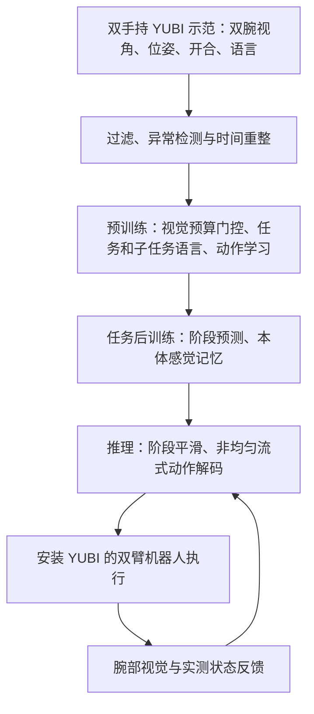

# AIRoA-0：从手持数据学习长程精细跨本体操作

**AIRoA-0** 以手持 YUBI 夹爪数据进行预训练和任务后训练，并在配备相同夹爪与腕部相机的机器人上执行双臂任务。本文依据 [arXiv v1](https://arxiv.org/html/2611.03815v1) 整理。

## 英文缩写速查

| 缩写 | 英文全称 | 简要说明 |
|------|----------|----------|
| VLA | Vision-Language-Action | 视觉语言动作模型 |
| S2 | See Less, Specify More | 视觉证据预算与更具体的语言监督 |
| EMA | Exponential Moving Average | 指数移动平均，用于平滑阶段概率 |
| TCP | Tool Centre Point | 夹爪工具中心点 |

## 流程总览

## 核心机制

- **数据与接口：** 16,151 小时双手持示范，覆盖百余任务、1,065 万个子任务片段；训练和后训练均使用手持数据，论文称未采集机器人遥操作、强化学习或上机纠正数据。每个动作块内目标相对观测时夹爪 TCP 位姿锚定；双臂动作每步 20 维，状态为双夹爪相对位姿及开合，共 11 维。
- **预训练：** 从公开的 π0.5 基座权重初始化，双腕图像与指令输入视觉语言骨干；指令条件视觉门控按预算加权图像 token，子任务文本预测作为训练辅助损失，不直接送入动作专家。
- **后训练：** 阶段分类头依据示范的子任务标签学习当前阶段，阶段以文本条件传给动作专家；最近 10 个实测本体感觉状态经注意力压缩为 4 个记忆 token。论文配置为 20,000 步、batch 64、单节点 8 张 H200 不足 4 小时。
- **部署：** 阶段概率经 EMA 平滑；非均匀流式解码采用两个噪声槽，先大步去噪再以最新观测小步修正。论文报告 H200 单次查询约 60 ms，不能直接等同于机器人伺服周期。

## 源码运行时序图

不适用：截至 2026-11-05，项目页未能在当前环境打开；此前二手线索给出的 [仓库地址](https://github.com/airoa-org/AIRoA-0) 返回 404，无法确认其为官方实现或检查运行入口。论文表示将发布数据、预训练权重和后训练配方；实际可获取状态待复核，故不绘制推测时序图。

## 实验与评测

论文表 1 在未采集训练数据的地点以双臂 Franka 评测 10 项任务，每项 15 次，部分完成可获部分分数；表中称成功率，**不等同于每次完整任务的二值成功率**。

| 方法 | 10 项平均得分 |
|------|--------------|
| AIRoA-0 | 78% |
| π0.5 | 27% |
| Xiaomi-Robotics-1 | 23% |
| GR00T N1.7 | 16% |
| MolmoAct2 | 14% |

基线使用相同任务示范后训练，并逐任务选取搜索到的最佳设置；AIRoA-0 对所有任务使用同一配方。最低的耳机任务为 30%，显示任务难度差异。论文还展示同一任务权重用于 TX-G2、OpenArm 和双 UR，但其他平台只展示部分任务，不能把 Franka 十任务平均结果推广至它们。

预训练数据规模实验使用留出示范的动作损失而非机器人成功率；报告在约 1,000–16,000 小时范围内数据翻倍使后训练损失约降低 2.4%，是该实验口径下的拟合结果。

## 结论

手持双夹爪数据与共享末端执行器可支撑长程双臂操作，但跨本体效果依赖相匹配的夹爪、相机和控制接口。

1. 用夹爪坐标对齐人手示范与机器人动作，减少对机械臂本体坐标的依赖。
2. 长任务结合阶段预测与近期状态历史；阶段信息来自训练标签。
3. 78% 是含部分得分的十任务平均，比较或复现时应保留评测口径。
4. 其他平台的演示覆盖任务较少；不能据此推断任意夹爪或任意机器人适用。
5. 代码、权重与数据的实际开放入口尚待核实。

## 关联页面

- [具身数据采集四层分类](../concepts/embodied-data-collection-four-layers-taxonomy.md)
- [模仿学习](../methods/imitation-learning.md)
- [遥操作](../tasks/teleoperation.md)
- [具身智能小站阅读坐标](../overview/embodied-station-2026-11-04-57-papers-technology-map.md)

## 参考来源

- [论文来源归档](../../sources/papers/airoa_0_arxiv_2611_03815.md)
- [项目页归档](../../sources/sites/airoa-0.md)
- [仓库线索归档](../../sources/repos/airoa_0.md)

## 推荐继续阅读

- [论文全文 arXiv v1](https://arxiv.org/html/2611.03815v1)
- [项目页](https://a-0.airoa.io/)
