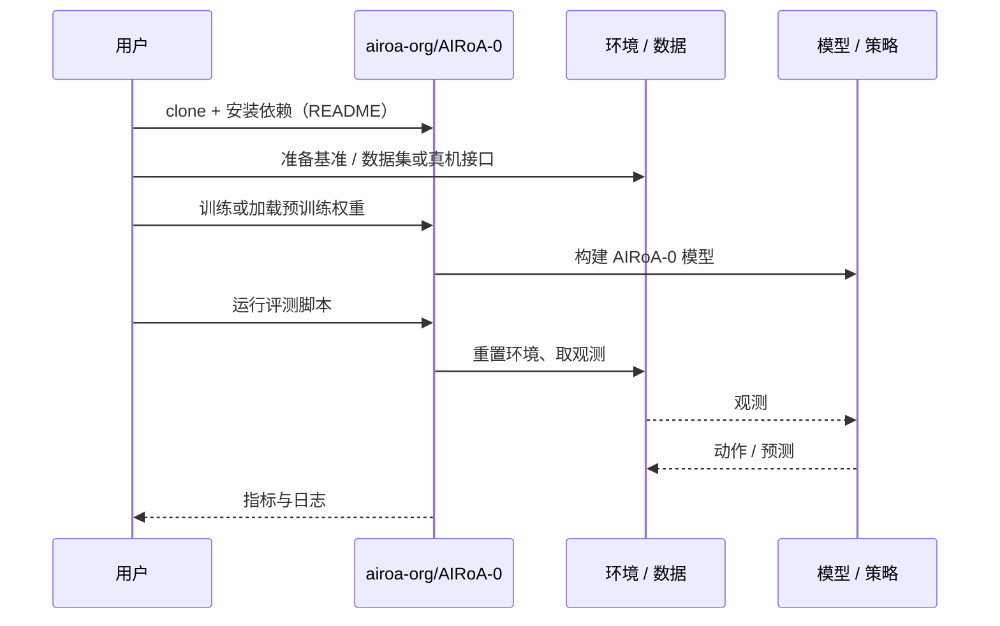

# AIRoA-0（arXiv:2611.03815）

**AIRoA-0**（*AIRoA-0: Long-Horizon, Precise, Cross-Embodiment Manipulation from Handheld Data*，[arXiv:2611.03815](https://arxiv.org/abs/2611.03815)，[项目页](https://a-0.airoa.io/)，[代码](https://github.com/airoa-org/AIRoA-0)）来自 [具身智能小站 2026-11-04 盘点](../../sources/blogs/wechat_embodied_station_57_papers_da_reward_model_failure_2026-11-04.md)，属「数据采集与跨形态迁移」组。

## 一句话定义

**用手持夹爪示范贯通预训练与后训练，通过腕部视角和匹配夹爪连接不同机器人；重点看陌生地点、长任务与精细操作，而非任意硬件通用性。**

## 英文缩写速查

| 缩写 | 英文全称 | 简要说明 |
|------|----------|----------|
| AIRoA-0 | AIRoA-0: Long-Horizon, Precise, Cross-Embodiment Manipulation from Handheld Data | 本文方法 / 基准的简称 |

## 为什么重要

- 只采手持数据，学习跨形态操作。
- 开源结论：**部分开源**（步骤 2.5，2026-11-04）。公众号代码 airoa-org/AIRoA-0 经 git ls-remote 失败（可能私有或尚未发布），项目页 HTTP 200，不能当作已开源。
- 同期同组工作见 [VLM 奖励评估、动作动力学与开放权重机器人智能体：具身智能小站 11-04 期 57 篇阅读坐标](../overview/embodied-station-2026-11-04-57-papers-technology-map.md)。

## 核心机制

| 项 | 内容 |
|----|------|
| **arXiv** | [2611.03815](https://arxiv.org/abs/2611.03815) |
| **开源** | **部分开源** |
| **要点** | 用手持夹爪示范贯通预训练与后训练，通过腕部视角和匹配夹爪连接不同机器人；重点看陌生地点、长任务与精细操作，而非任意硬件通用性。 |
| **文内指标** | 公众号未给具体数字，本页不引用。 |

## 源码运行时序图

以下为按仓库入口（`airoa-org/AIRoA-0`）推断的通用运行链路；入库日仅核实仓库可达，未逐文件阅读，具体脚本名以 README 为准。

## 实验与评测

- 公众号未给具体数字，本页不引用。
- **读法：** 本页为索引级摘要，依据公众号转述的官方摘要与仓库信息整理；逐项数字与 baseline 以原文 PDF 为准。

## 与其他工作对比

- 横向索引见 [VLM 奖励评估、动作动力学与开放权重机器人智能体：具身智能小站 11-04 期 57 篇阅读坐标](../overview/embodied-station-2026-11-04-57-papers-technology-map.md)；同 arXiv 不重复造页。

## 结论

**只采手持数据，学习跨形态操作：用手持夹爪示范贯通预训练与后训练，通过腕部视角和匹配夹爪连接不同机器人；重点看陌生地点、长任务与精细操作，而非任意硬件通用性。**

1. 开源边界：**部分开源** — 公众号代码 airoa-org/AIRoA-0 经 git ls-remote 失败（可能私有或尚未发布），项目页 HTTP 200，不能当作已开源。
2. 核心机制：用手持夹爪示范贯通预训练与后训练，通过腕部视角和匹配夹爪连接不同机器人；重点看陌生地点、长任务与精细操作，而非任意硬件通用性。
3. 复现与选型前核对任务协议、硬件与基准口径，勿直接横比公众号摘录数字。

## 关联页面

- [embodied-data-collection-four-layers-taxonomy](../concepts/embodied-data-collection-four-layers-taxonomy.md)
- [teleoperation](../tasks/teleoperation.md)
- [imitation-learning](../methods/imitation-learning.md)
- [embodied-station-2026-11-04-57-papers-technology-map](../overview/embodied-station-2026-11-04-57-papers-technology-map.md)

## 参考来源

- [airoa_0_arxiv_2611_03815.md](../../sources/papers/airoa_0_arxiv_2611_03815.md)
- [wechat_embodied_station_57_papers_da_reward_model_failure_2026-11-04.md](../../sources/blogs/wechat_embodied_station_57_papers_da_reward_model_failure_2026-11-04.md)
- [arXiv:2611.03815](https://arxiv.org/abs/2611.03815)

## 推荐继续阅读

- [arXiv PDF](https://arxiv.org/pdf/2611.03815)
- [项目页](https://a-0.airoa.io/)
- [https://github.com/airoa-org/AIRoA-0](https://github.com/airoa-org/AIRoA-0)
