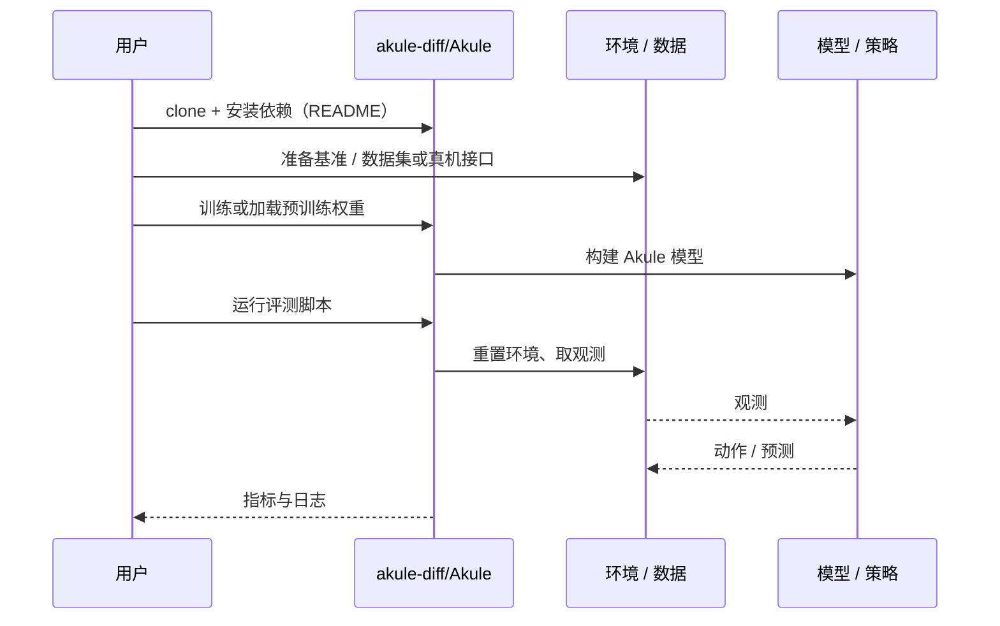

# Akule（arXiv:2610.14248）

**Akule**（*Akule: Fast and Scalable Multi-Robot Motion Planning via Sparse Interaction Diffusion*，[arXiv:2610.14248](https://arxiv.org/abs/2610.14248)，[项目页](https://akule-diff.github.io/)，[代码](https://github.com/akule-diff/Akule)）来自 [具身智能小站 2026-10-14 盘点](../../sources/blogs/wechat_embodied_station_41_papers_streamingwam_2026-10-14.md)，属「多机器人协作与评测」组。

## 一句话定义

**冻结单机器人扩散先验，学习成对修正、交互选择与组合权重，只为必要交互分配计算；生成轨迹仍交搜索规划器验证修复。**

## 英文缩写速查

| 缩写 | 英文全称 | 简要说明 |
|------|----------|----------|
| MRMP | Multi-Robot Motion Planning | 多机器人运动规划 |
| DM | Diffusion Model | 扩散模型 |
| CBS | Conflict-Based Search | 多智能体搜索规划器 |

## 为什么重要

- 大队伍联合规划计算爆炸；稀疏交互是可扩展的关键。
- 开源结论：**已开源**（步骤 2.5，2026-10-14）。项目页链接的 GitHub 仓库可达。
- 同期同组工作见 [流式动作块与世界模型记忆：具身智能小站 10-14 期 41 篇阅读坐标](../overview/embodied-station-2026-10-14-41-papers-technology-map.md)。

## 核心机制

| 项 | 内容 |
|----|------|
| **arXiv** | [2610.14248](https://arxiv.org/abs/2610.14248) |
| **开源** | **已开源** |
| **要点** | 应比较完整规划流程而非仅生成器。 |
| **文内指标** | 以原文为准。 |

## 源码运行时序图

以下为按仓库入口（`akule-diff/Akule`）推断的通用运行链路；入库日仅核实仓库可达，未逐文件阅读，具体脚本名以 README 为准。

## 实验与评测

- 以原文为准。
- **读法：** 本页为索引级摘要，依据公众号转述的官方摘要与仓库信息整理；逐项数字与 baseline 以原文 PDF 为准。

## 与其他工作对比

- 横向索引见 [流式动作块与世界模型记忆：具身智能小站 10-14 期 41 篇阅读坐标](../overview/embodied-station-2026-10-14-41-papers-technology-map.md)；同 arXiv 不重复造页。

## 结论

**多机器人扩散规划的可扩展性来自稀疏交互选择，而非更大模型。**

1. 开源边界：**已开源** — 项目页链接的 GitHub 仓库可达。
2. 核心机制：应比较完整规划流程而非仅生成器。
3. 复现与选型前核对任务协议、硬件与基准口径，勿直接横比公众号摘录数字。

## 关联页面

- [marl](../methods/marl.md)
- [trajectory-optimization](../methods/trajectory-optimization.md)
- [diffusion-model](../concepts/diffusion-model.md)
- [embodied-station-2026-10-14-41-papers-technology-map](../overview/embodied-station-2026-10-14-41-papers-technology-map.md)

## 参考来源

- [akule_sparse_interaction_diffusion_arxiv_2610_14248.md](../../sources/papers/akule_sparse_interaction_diffusion_arxiv_2610_14248.md)
- [wechat_embodied_station_41_papers_streamingwam_2026-10-14.md](../../sources/blogs/wechat_embodied_station_41_papers_streamingwam_2026-10-14.md)
- [arXiv:2610.14248](https://arxiv.org/abs/2610.14248)

## 推荐继续阅读

- [arXiv PDF](https://arxiv.org/pdf/2610.14248)
- [项目页](https://akule-diff.github.io/)
- [https://github.com/akule-diff/Akule](https://github.com/akule-diff/Akule)
