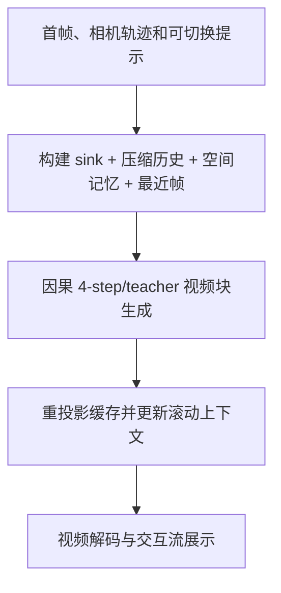
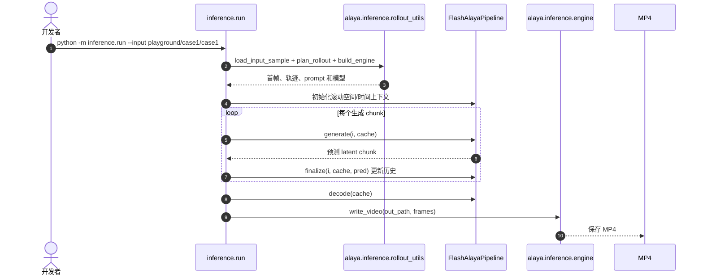

# AlayaWorld｜压缩时序记忆与显式几何缓存的交互世界

**核心定位：** 因果视频模型结合 sink frame、压缩时序历史、几何对齐空间缓存与最近帧，支持相机轨迹及生成中切换文本提示。

## 一句话定义

因果视频模型结合 sink frame、压缩时序历史、几何对齐空间缓存与最近帧，支持相机轨迹及生成中切换文本提示。

## 英文缩写速查

| 缩写 | 英文全称 | 简要说明 |
|---|---|---|
| WM | World Model | 由条件预测环境后续视觉或潜在状态 |
| AR | Autoregressive | 基于历史视频块续写未来 |
| DiT | Diffusion Transformer | 部分生成路径的视频扩散骨干 |
| 3D | Three-Dimensional | 空间结构或几何缓存的维度 |

## 为什么重要

- **研究角色：** 在固定长度上下文中结合空间与时间记忆；可用于世界模型架构和工程复现的横向对照。
- **边界明确：** 相比 HY-WorldPlay 通过历史上下文重建保证回访，AlayaWorld 显式组合空间缓存与压缩时序特征，并提供交互提示切换；相比 DreamerV3 并非以 latent 策略想象训练为主。
- **资料身份：** 2026-07 全文报告；2026-08 v1.1，开发团队 Alaya Lab（AlayaWorld Team）；源码/权重与报告不能一概而论。

## 核心信息

| 字段 | 内容 |
|---|---|
| 机构 | Alaya Lab（AlayaWorld Team） |
| 技术原文 | [官方报告](https://arxiv.org/abs/2607.18367) |
| 官方代码 | [AlayaLab/AlayaWorld](https://github.com/AlayaLab/AlayaWorld) |
| 发布范围 | 推理、训练、checkpoint 已发布，外部依赖/门控模型和许可证需要单独核对 |
| 控制接口 / 输出 | 首帧 `*_image.*`、相机位姿 `*_camera.pt`、文本 `*_prompt.txt`（可选 `*_skill.txt`）；输出按多 chunk 自回归生成的视频。 |

## 核心原理

在双向视频基础模型预训练后，转入因果视频块生成：条件前缀由固定 sink、压缩历史特征、按当前相机从空间记忆重投影的条件和最近帧组成；用户可逐块切换提示。训练通过模型自身 rollout 的退化样本缓解积累漂移，后训练用 DMD + Self-Forcing++ + 一致性蒸馏把约 30 步缩到 4 步。仓库 v1.1 额外提供 DA3 与 ViGeo 两套空间记忆实现，需对齐所用 checkpoint。

### 流程总览

图的模块关系依据 [官方 README 及源码归档](../../sources/repos/alayaworld.md) 和 [报告/主页](https://arxiv.org/abs/2607.18367)；无真实硬件执行验证。

## 源码运行时序图

**核对入口：** inference/run.py，alaya/inference/pipeline.py，README Quick Start 和 docs/vigeo/README.md；上图聚焦源码实际提供的推理入口，非训练系统所有内部调用；未在本地执行 GPU 推理。

## 工程实践

`pip install -r requirements.txt`、安装 Depth-Anything-3 依赖、下载官方相应模型后，运行 `bash inference/run.sh` 或 `python -m inference.run --input playground/case1/case1`。训练入口 `CONFIG_PATH=configs/<config>.yaml bash scripts/finetune/train.sh`；浏览器交互从 `reactor/` 单独部署。

### 建议验证指标

- 对动作/相机控制：轨迹遵从、操作响应、长程回访同视角一致性。
- 对效率：将模型 FPS、首响应帧、单块时延、端到端用户可见延迟分开记录。
- 对复现：记录代码版本、checkpoint 类型、GPU/显存、图像大小与许可证。

## 实验与评测

论文在 iWorld-Bench 上比较长程视觉质量、相机轨迹跟随和记忆一致性；论文称轨迹精度和记忆指标具竞争力。视频 24 FPS 指生成视频帧率，不能直接等价于消费级卡的实际生成吞吐。

## 与其他工作对比

相比 HY-WorldPlay 通过历史上下文重建保证回访，AlayaWorld 显式组合空间缓存与压缩时序特征，并提供交互提示切换；相比 DreamerV3 并非以 latent 策略想象训练为主。 可与 [11 项世界模型对照](../comparisons/open-source-world-models-11-2026.md)中的实时视频、3D 资产与 latent 预测分支比较。

## 结论

**总判：AlayaWorld 的价值在于在固定长度上下文中结合空间与时间记忆，而不是泛化为物理真值模拟器。**

1. 首先验证官方控制接口与实际输出，而非仅对比宣传视频。
2. 区分公开代码、权重、训练数据和许可证，确定复现边界。
3. 部署涉及大权重、DA3/ViGeo 外部依赖与受门控的 Gemma 文本编码器，不能把“开放代码”解读为所有依赖即取即用。

## 局限与风险

部署涉及大权重、DA3/ViGeo 外部依赖与受门控的 Gemma 文本编码器，不能把“开放代码”解读为所有依赖即取即用。论文多版本 checkpoint 功能范围不同，不能混用；生成一致性不能证明符合真实碰撞动力学。

此外，视频视觉一致性与物理动力学准确性不是同一个指标，机器人控制仍需独立验证闭环执行和接触动力学。

## 关联页面

- [2026 年 11 项开源世界模型技术对照](../comparisons/open-source-world-models-11-2026.md)
- [Generative World Models](../methods/generative-world-models.md)
- [Video as Simulation](../concepts/video-as-simulation.md)
- [WAM 纵深学习路线](../../roadmap/depth-wam.md)

## 参考来源

- [官方代码与运行入口](../../sources/repos/alayaworld.md)
- [官方项目页面核对](../../sources/sites/alayaworld.md)
- [论文原文归档](../../sources/papers/alayaworld_arxiv_2607_18367.md)
- [深蓝具身智能综述线索](../../sources/blogs/wechat_shenlan_world_models_11_2026_11_20.md)

## 推荐继续阅读

- [官方仓库 README](https://github.com/AlayaLab/AlayaWorld)
- [官方技术报告](https://arxiv.org/abs/2607.18367)
