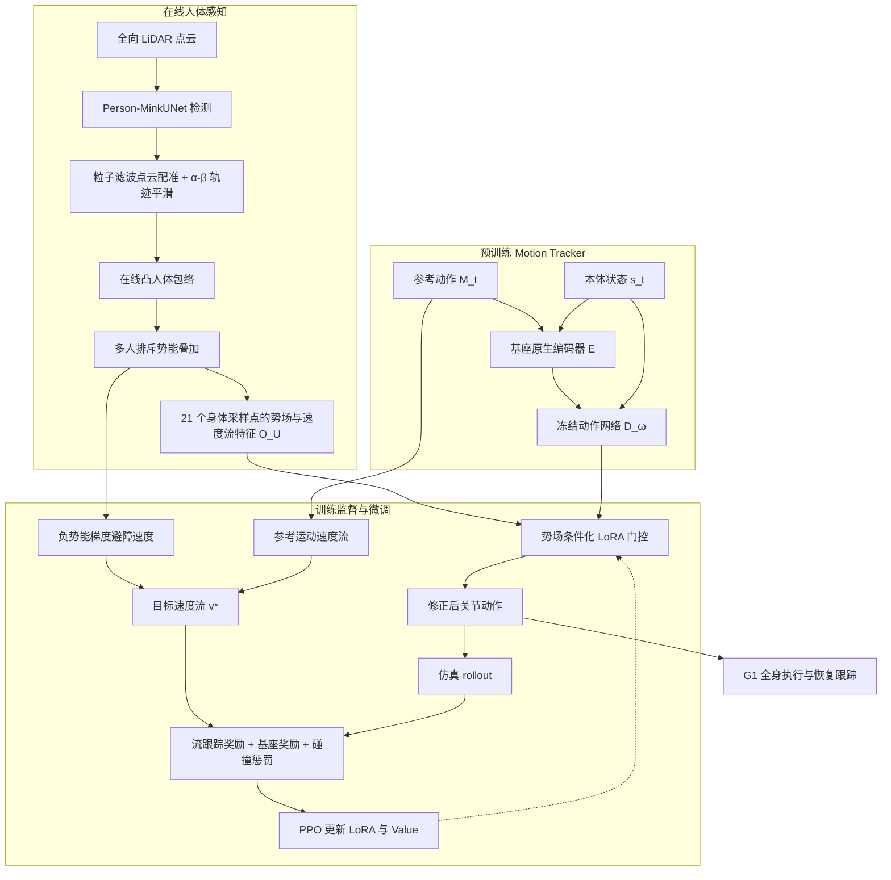

# ALERT：人形运动跟踪器的轻量级主动避人管线
*ALERT: Extending Humanoid Motion Trackers with a General and Lightweight Human Avoidance Pipeline*

## 一句话定义

**ALERT**（*Adaptive Low-Rank Extension Pipeline for Reference Trackers*，[arXiv:2611.22258v1](https://arxiv.org/abs/2611.22258)，2026-11-17）由中国科学院自动化研究所、中国科学院大学与北京理工大学的 Zhaoyang Li、Chiyu Zhang、Chengxin Xu 等提出：**冻结预训练全身 Motion Tracker，在动作输出层加入人体势场条件化的 LoRA 分支，学习仅对危险肢体做短暂避让，并恢复参考跟踪**。

## 英文缩写速查

| 缩写 | 英文全称 | 简要说明 |
|---|---|---|
| ALERT | Adaptive Low-Rank Extension Pipeline for Reference Trackers | 预训练跟踪器的避人适配管线 |
| LoRA | Low-Rank Adaptation | 冻结基座、训练低秩修正 |
| LiDAR | Light Detection and Ranging | 以点云实时检测与跟踪人体 |
| PF | Potential Field | 从人体包络生成排斥势能 |
| PPO | Proximal Policy Optimization | 训练条件 LoRA 的强化学习算法 |
| SR | Success Rate | 无碰撞、无跌倒地完成被测序列的比例 |
| BFM | Behavior Foundation Model | BFM-Zero 等行为基座 |
| CBF | Control Barrier Function | 对照方法涉及的安全约束，并非 ALERT 的形式化保证 |

## 为什么重要

- **补足通用跟踪器的人体意识：** [SONIC](./nvidia-sonic.md)、[TWIST2](./paper-twist2.md) 和 [BFM-Zero](./paper-bfm-zero.md) 能跟随舞蹈、踢腿和遥操作参考，但未必主动避免进入肢体运动范围的人员。
- **不从头重学动作：** 保留原模型的 motion-conditioning 接口与全身协调能力，只对动作网络做低秩微调；论文使用 500 条可能进入周边空间的动作，在单张 RTX 4090 上训练。
- **避让与连续跟踪兼顾：** 斥力主要影响接近人体的肢体，远离人体后趋向原参考速度流；不需要把整个剩余动作序列换成别的动作。
- **与安全证明要区分：** 成功完成论文场景不意味着得到严格的碰撞不变性证明。

## 核心信息

| 项 | 内容 |
|---|---|
| 机构 | 中国科学院自动化研究所（CASIA）、中国科学院大学（UCAS）、北京理工大学（BIT） |
| 作者 | Zhaoyang Li、Chiyu Zhang、Chengxin Xu、Peng Yang、Zhonghao Guo、Wanting Li、Ziyu Chen |
| 版本 | [arXiv:2611.22258v1](https://arxiv.org/html/2611.22258)，2026-11-17，预印本 |
| 跟踪骨干 | SONIC、TWIST2、BFM-Zero |
| 训练 | BONES-SEED 选取 500 条动作；Isaac Sim / Isaac Gym；每次单张 RTX 4090；PPO |
| 适配参数 | LoRA rank 16；21 个身体采样点（骨盆 1、双臂合计 10、双腿合计 10） |
| 真机 | Unitree G1，适配 SONIC，测试 Ninja Dance / Disco Dance / Kick / Teleop |
| 开源 | 截至 2026-11-21，未核实到 ALERT 作者的官方项目页、可运行代码或权重发布 |

## 流程总览

**注意：** 目标流用于训练监督；实际推理使用感知势场特征驱动已训练的动作分支。图仅反映论文所述数据流，不冒充未发布的源码调用关系。

## 核心原理

### 1. 保留基座参考编码，条件化低秩动作修正

基座写为 $\xi_t=E(s_t,\mathcal M_t)$，$a_t^0=D_\omega(s_t,\xi_t)$。ALERT 冻结各基座的原生参考编码和动作网络权重，仅在动作层增加条件低秩项（论文式 1–2）：

$$
y_\ell=[W_\ell+B_\ell\operatorname{diag}(g_\ell)A_\ell]h_\ell+b_\ell,
\qquad g_\ell=\sigma(G_\ell O_U+b_\ell^g).
$$

$O_U$ 是人体势场与速度流特征；$B_\ell$ 从零初始化。与完全替换原动作或在输出端独立叠加残差不同，此适配在动作网络内部利用已有全身协调能力。

### 2. 从噪声 LiDAR 点云到动态人体包络

论文 §3.2 以 **Person-MinkUNet → 粒子滤波点云配准 → α–β 位置速度滤波** 获得平滑人体中心轨迹；将凸模板 $\mathcal K_0$ 在线平移缩放为 $\mathcal K_t=b_t+S_t\mathcal K_0$，按点云覆盖比例调整形状。机器人采样点到凸包络表面的距离与梯度，提供连续避让方向，免于直接对离散点云求不稳定斥力。

### 3. 势能梯度变成速度流，而不是直接覆盖参考动作

对包络外距人体边界为 $d$ 的点，定义平滑斥力势能（论文式 6–8）：

$$
U=f_{\max}\delta\log\!\bigl(1+\exp((d_0-d)/\delta)\bigr).
$$

多人体势能求和。在每个身体采样点沿势能下降方向 $e_i$ 追加避障速度 $\sqrt{2U_i/m_i}e_i$，形成 $v_i^\star=v_i^0+\sqrt{2U_i/m_i}e_i$（式 9–10）。**保留等势面切向的原动作分量**；距离变大时避障项减弱并回到原参考动作趋势。

### 4. PPO 训练条件 LoRA

势场输入 $O_U=\{U_i,e_i,v_i^d,v_i^t\}$（势能、方向、法向/切向速度）控制各层 LoRA gate；奖励为基座跟踪奖励 + 目标速度流跟踪奖励 + 碰撞惩罚（论文设碰撞为 −10），只更新 LoRA 和 value network（式 11–12）。因此不是只靠稀疏碰撞惩罚学会保守远离人群。

## 源码运行时序图

**不适用。** 截至 2026-11-21，arXiv v1 摘要页及全文没有提供可确认的 ALERT 官方代码仓库或运行入口。没有源码依据，故不编造训练脚本、ROS 节点或部署时序图。上图是经论文核对的方法流程图。

## 实验与评测

| 论文实验 | 报告结果 | 指标边界 |
|---|---|---|
| Table 1 跨骨干 | SONIC、TWIST2、BFM-Zero 适配后在无人体环境的误差接近原始跟踪；SONIC 全局位置误差 52.32→54.70 mm | 微调影响较小，但不是完全无损 |
| Table 1 有人体 | SONIC 受影响肢体位置误差 37.29→84.03 mm，未受影响部位 35.87→37.75 mm | 必要避让会偏离原参考；应区分受影响与未受影响部位 |
| Table 1 安全增益 | SONIC / TWIST2 / BFM-Zero 的 M = 1.21±0.14 / 2.18±0.38 / 2.16±0.86 | M 是归一化最小净空改善量，**不是**成功率 |
| Table 3 SONIC 对照 | SR：原始 SONIC 0%、ConstrainedMimic 83%、CSF 95%、ALERT **100%** | 论文指定的避人对照，不能外推全部环境 |
| G1 真机（§4.2） | 四类动作各 20 次测试，均获得 **100% SR**，距 SMPL 重建人体表面的最小净空 **3 cm** | 有限测试、并非安全认证 |
| 感知与响应 | ~30% 人体遮挡、人体移动至 2 m/s：中心定位均误差 8 cm、包络表面覆盖 93%、避障命令平均延迟约 100 ms | 净空、传感器估计误差和响应延迟必须同时看 |
| Table 3 消融 | 无 LoRA / 无 PF / 无流奖励时 SR 51% / 60% / 79%；完整方法 100% | 与完整方法同一 SONIC 测试设置 |
| 未参与微调的参考动作 | 2048 条 unseen motions，多数条件 LoRA / 全量微调误差比小于 1 | 对保持原动作泛化有帮助，但非绝对保证 |

## 结论

**ALERT 的价值是让现有全身动作跟踪器通过轻量训练学会「避开人后继续原动作」，而非用安全脚本中断动作；它尚不提供严格碰撞安全保证。**

1. **先比无人体 tracking：** 明确微调对原有动作能力的损伤，而非只看避撞结果。
2. **按身体部位看误差：** 受影响肢体偏离参考是必要代价，未受影响身体误差应尽量保持低。
3. **多人输入可定长：** 将各人体势能叠加到固定身体采样点，不随人数增长改变策略输入规模。
4. **速度流奖励提供方向监督：** 避免只依赖碰撞终止与稀疏惩罚，减少无关肢体扰动。
5. **上机不能省安全壳：** 论文里的 100% SR 不等于可证明的长期零碰撞。

## 与其他工作对比

| 对照 | 做法 | 关键取舍 |
|---|---|---|
| [SONIC](./nvidia-sonic.md) | 预训练全身参考动作跟踪 | ALERT 保留 SONIC 基础能力，添加人机共处适配 |
| CSF（论文基线） | 将有风险的后续动作替换为安全参考 | 可避险，但可能丢失原动作内容及连续性 |
| ConstrainedMimic（论文基线） | CBF/单步优化修正参考与底层动作 | 几何安全过滤不必然兼顾未来接触/平衡；ALERT 用策略学习协调 |
| [Safety Filter](../concepts/safety-filter.md) | 运行时约束投影，具体保证依赖模型假设 | ALERT 习得避障，不提供形式化不变集保证 |
| [BFM-Zero](./paper-bfm-zero.md) | 通用全身行为基座 | ALERT 是其动作解码层适配，不是另一个从零训练的基座 |

## 工程实践

| 项 | 建议 |
|---|---|
| 复现 | 等待官方代码、权重、训练配置核实开放；不要据论文重构冒充官方实现 |
| 感知与输入 | 验证 21 个身体采样点的势能、梯度、法/切向速度，在人群、遮挡、噪声下观测漂移 |
| 训练 | 先复现原动作 tracker，再冻结主干适配 LoRA；500 条数据和 rank 16 是论文设置，不是通用最优超参 |
| 评测 | 同时报 SR、最小净空、受影响/未受影响误差、参考恢复时间、人体速度与感知延迟 |
| 真机 | 保护吊架、限制力矩/速度、人员隔离与独立急停仍然必要；学习到的避人动作不是硬安全保证 |

## 局限与风险

- **凸包络保守：** 人体双臂等肢体之间的空隙不能表达，可能过度避让；作者建议引入关节化人体几何。
- **动态感知误差：** 论文条件下仍有约 8 cm 中心定位误差和约 100 ms 命令延迟，更复杂人群及遮挡场景需额外验证。
- **缺少形式化保证：** 碰撞惩罚与有限次 100% SR 不能覆盖所有传感器故障、异常动作与人机近距离工况。
- **开源边界：** 截至本次核对，仅能核验原文，无可靠 ALERT 官方训练/推理代码、权重或运行入口。

## 关联页面

- [Whole-Body Tracking Pipeline](../concepts/whole-body-tracking-pipeline.md)
- [SONIC](./nvidia-sonic.md)
- [TWIST2](./paper-twist2.md)
- [BFM-Zero](./paper-bfm-zero.md)
- [Safety Filter](../concepts/safety-filter.md)
- [Teleoperation](../tasks/teleoperation.md)
- [人形运动跟踪方法选型指南](../queries/humanoid-motion-tracking-method-selection.md)
- [BFM 纵深路线](../../roadmap/depth-bfm.md)

## 参考来源

- [ALERT 论文原文归档](../../sources/papers/alert_arxiv_2611_22258.md)
- [ALERT HTML v1（方法、实验、局限）](https://arxiv.org/html/2611.22258)
- [ALERT PDF（Figure 2 总览）](https://arxiv.org/pdf/2611.22258)

## 推荐继续阅读

- [论文全文：ALERT（arXiv:2611.22258）](https://arxiv.org/html/2611.22258)
- [人形运动跟踪方法选型指南](../queries/humanoid-motion-tracking-method-selection.md)
