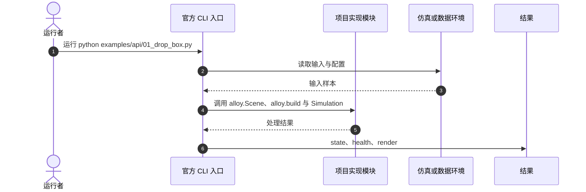

# Alloy: A Multi-Material Physics Engine for Robot Learning｜Alloy：多材料机器人物理引擎

## 一句话定义

**Alloy：多材料机器人物理引擎**：依据材料卡将刚体、软体、颗粒和液体交给不同求解器，并在单一场景中耦合仿真。

## 英文缩写速查

| 缩写 | 英文全称 | 简要说明 |
|---|---|---|
| MJCF | MuJoCo XML Format | 仿真机器人模型文件 |
| VBD | Vertex Block Descent | 柔体模拟算法 |
| SPH | Smoothed Particle Hydrodynamics | 流体粒子方法 |

## 为什么重要

依据材料卡将刚体、软体、颗粒和液体交给不同求解器，并在单一场景中耦合仿真。 本项目的机制、指标和开放边界需要分开理解，不能把单个结果推广到所有机器人平台。

## 核心信息

| 项 | 一手来源 |
|---|---|
| 论文 | [arXiv:2611.16312v1](https://arxiv.org/abs/2611.16312) |
| 项目 | [官方项目](https://alloy.argonrobotics.ai/docs/) |
| 代码 | [官方仓库](https://github.com/argonrobotics-ai/alloy)；开放范围见源码归档 |

## 核心原理

Scene 统一读取材料与几何对象，Router 按物相/形态/刚度选 MuJoCo、Newton VBD/MPM 或 SPH，Coupler 在控制步内部交换接触影响，并用每世界健康分级检查数值稳定性。

### 流程总览

该图表示论文机制的主要数据或控制方向，不表示已经运行作者模型。

## 源码运行时序图

已核对 [官方代码归档](../../sources/repos/alloy-multimaterial-2611-16312.md) 的 README 与公开运行入口（仅说明所发布组件，不代表实机复现）：

## 工程实践

1. 核实数据许可、训练/测试切分、时序观测和动作坐标系，建立与原文一致的对照协议。
2. 参照[官方源码归档](../../sources/repos/alloy-multimaterial-2611-16312.md)核实入口、依赖及模型数据权限。
3. 分别统计训练预算、模拟指标、真机成功率与执行延迟，记录失败模式和软硬件约束。

## 实验与评测

官方文档支持一份场景描述混合 MuJoCo 机器人、水和柔性材料；并行数与速度依赖 GPU、材料和耦合求解设置。

## 结论

**依据材料卡将刚体、软体、颗粒和液体交给不同求解器，并在单一场景中耦合仿真。**

1. 对照同数据与同测评协议，不混淆不同平台/样本统计口径。
2. 在复现前单列训练数据、预训练、控制接口和硬件依赖。
3. 验证边界是研究结论的必要组成，不能由示例直接推出可量产部署。

## 与其他工作对比

- **与底层单域及多求解器框架的关系（§2）：** 相比纯刚体/并行训练平台 [MuJoCo Warp](./mujoco-warp.md)、[Isaac Lab](./isaac-lab.md) 与 ManiSkill3，以及集成多求解器的底层引擎 [Newton](./newton-physics.md) 和 [Genesis](./genesis-sim.md)，Alloy 并不替代这些求解器，而是在其上增加统一层——用同一 MJCF 与材料卡描述把刚体/机器人交给 MuJoCo（CPU）或 MuJoCo Warp（GPU），布料/软体/弹性杆交给 Newton VBD，沙土/膏体交给 Newton 隐式 MPM，液体交给自研 SPH，并由 Coupler 在控制步内同步位姿与接触力、由 Health Monitor 逐世界标记 `OK / DEGRADED / INVALID`。
- **评测覆盖口径：** 原文 Table 2–4 报告了单张 NVIDIA L4（`0.1.0rc2`）上 Go2 行走（4,096 并行世界、150 N 推力测试两随机种子 252/256 与 248/256 站立）、抓抬线缆（30 min 达 95.7%）、1,024 世界深度渲染吞吐与 10 项解析闭式物理误差检验，但未做跨引擎同任务的策略训练横向跑分对照。

## 局限与风险

各类材料的参数、求解步长和物理精度边界不同；健康度 OK 只说明求解器运行稳定，不能代替实物物性校准。

## 关联页面

- [2026-11-16 具身研究论文阅读地图](../overview/embodied-frontier-29-papers-2026-11-16.md)
- [ActionCodec2：流式动作编解码](./paper-actioncodec2-streaming-action-tokenizer.md)
- [Robot Simulation Integration · 机器人仿真环境集成](../methods/robot-simulation-integration.md)：Alloy 将 MJCF 机器人模型、多材料物理求解器与渲染环境集成为统一的并行机器人仿真验证平台。
- [Engineering Simulation and Verification Workflow · 工程仿真建模与验证流程](../methods/engineering-simulation-workflow.md)：Alloy 按材料卡将刚体、柔体、颗粒与液体路由至不同求解器并做步内耦合与健康评分，体现了多物理场仿真核查流程。

## 参考来源

- [论文原文核对归档](../../sources/papers/alloy-multimaterial-2611-16312.md)
- [项目核查归档](../../sources/sites/alloy-multimaterial-2611-16312.md)
- [源代码归档](../../sources/repos/alloy-multimaterial-2611-16312.md)

## Alloy v0.1.7 更新核对（2026-11-18 发布）

依据 [官方 Release v0.1.7](https://github.com/argonrobotics-ai/alloy/releases/tag/v0.1.7)，这一版支持 Python 3.11/3.12，Linux x86_64 CPU/GPU 和 Apple silicon CPU。可用 `pip install alloy-engine==0.1.7` 安装。

- `Scene(liquid_tension=True)` 对液体开启按材料参数的表面张力（默认关闭）；`liquid_accuracy="ultra"` 采用更密粒子，作者估计工作量约为默认 **50 倍**，并非免费提高精度。
- 相机 look 增加白平衡；重复构建、渲染、close 的 GPU 内存增长问题获修复；CPU 的 `alloy.estimate` 估算行为有调整。
- 发布记录说明其 wheel 与 CPU quick-start 做过验证，并列出依旧开放的重置确定性、颗粒/流体等数值边界；**本次未独立执行仿真**。

## 推荐继续阅读

- [arXiv HTML v1](https://arxiv.org/html/2611.16312v1)
- [官方代码](https://github.com/argonrobotics-ai/alloy)
