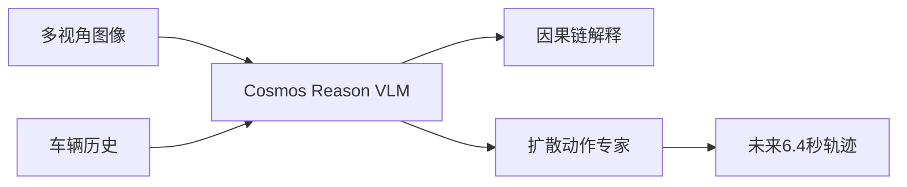
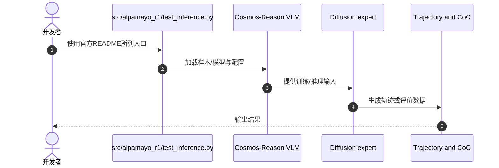

# Alpamayo 1：因果链推理与扩散动作专家

**英文：** Alpamayo-R1: Bridging Reasoning and Action Prediction for Generalizable Autonomous Driving in the Long Tail

## 一句话定义

多相机和自车历史经 Cosmos-Reason VLM 处理，Chain of Causation（CoC）训练场景解释，扩散轨迹专家预测未来 6.4 秒（64 waypoint）。

## 英文缩写速查

| 缩写 | 英文全称 | 简要说明 |
|---|---|---|
| CoC | Chain of Causation | 因果链驾驶解释 |
| E2E | End-to-End | 从观测到规划的端到端模型 |
| RL | Reinforcement Learning | 奖励信号驱动的优化 |
| VLA | Vision-Language-Action | 视觉语言动作联合学习 |

## 为什么重要

因果链推理与扩散动作专家专门针对单纯模仿驾驶轨迹难以解释或处理长尾交互的限制，提供可核查的论文、权重或代码入口。

## 核心原理

多相机和自车历史经 Cosmos-Reason VLM 处理，Chain of Causation（CoC）训练场景解释，扩散轨迹专家预测未来 6.4 秒（64 waypoint）。

## 流程总览



此流程根据 [原始论文记录](../../sources/papers/ad_top10_2026_alpamayo-r1.md)，非跨项目通用套图。

## 源码运行时序图



按官方README和 [源码入口记录](../../sources/repos/ad_top10_2026_alpamayo-r1.md) 核对；**未在本次 ingest 执行完整 GPU 推理或训练**。

## 评测与指标

论文展示困难场景规划精度和闭环近距离风险的改进；仓库公共10B权重没有完成论文所述RL后训练。

## 工程实践

官方仓库：https://github.com/NVlabs/alpamayo

1. ```python src/alpamayo_r1/test_inference.py```

## 结论

**因果链推理与扩散动作专家** 是驾驶研究中一条具有独立问题设定的复现路线。

1. 先使用官方公开checkpoint与现有评测脚本建立基线。
2. 明确划分论文提出的完整系统和当前代码实际已开放的部分。
3. 记录数据、版本、硬件与指标，避免不同评测设定的数字错比。

## 局限与风险

官方仓已转为有限维护；HF权重和数据需单独申请；推理要求GPU显存至少24GB；公共10B不接收显式导航路线输入。

真实上路安全和合规均不能由离线分数、仿真结果或开源状态单独证明。

## 关联页面

- [2026 自动驾驶开源项目技术地图](../overview/autonomous-driving-open-source-top10-2026.md)
- [VLA](../methods/vla.md)
- [生成式世界模型](../methods/generative-world-models.md)

## 参考来源

- [论文核对记录](../../sources/papers/ad_top10_2026_alpamayo-r1.md)
- [官方源码入口](../../sources/repos/ad_top10_2026_alpamayo-r1.md)
- [深蓝AI策展原文](../../sources/blogs/wechat_shenlan_ai_autonomous_driving_top10_2026.md)

## 推荐继续阅读

- [原论文](https://arxiv.org/html/2511.00088)
- [官方代码](https://github.com/NVlabs/alpamayo)
