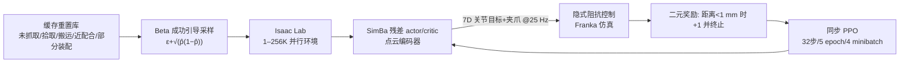

# AlphaNIST：只用二元奖励学会 NIST 装配

**AlphaNIST**（*Emergent Assembly Skills from Binary Task Rewards*，[arXiv:2610.13354](https://arxiv.org/abs/2610.13354)，[项目页](https://alpha-nist.github.io/)）来自 **NVIDIA 与华盛顿大学**：不用示范、稠密进度奖励或脚本化原语，在仿真里从零训练一个策略完成 NIST Assembly Task Board #1 的 20 类装配，并观察到装配准备与恢复等涌现行为。

## 一句话定义

**奖励只有“装好了 +1”，靠超大规模并行环境与成功引导的初始状态采样，让单个策略学会 20 类接触丰富的装配。**

## 英文缩写速查

| 缩写 | 英文全称 | 简要说明 |
|------|----------|----------|
| NIST | National Institute of Standards and Technology | 其装配任务板 #1 提供 20 类装配对 |
| PPO | Proximal Policy Optimization | 本文使用的同步强化学习算法 |
| DoF | Degrees of Freedom | 仿真 7 自由度 Franka Panda |
| SimBa | （论文采用的残差网络架构名） | actor/critic 的 LayerNorm+Swish 残差网络 |
| OmniReset | （重置库项目名） | 本文缓存重置库的来源 |

## 为什么重要

- 检验“稀疏二元奖励 + 规模”能否代替示范与奖励塑形，覆盖小至 4 mm 的接触丰富装配。
- 给出环境数扩展与初始状态采样的消融：同为 256K 环境，Beta 成功引导采样 97.4%，均匀采样 84.3%。
- 涌现出的抓取选择、滚动重定向、敲击推进等行为，说明二元奖励下可发现非预设策略（仅限仿真）。

## 方法栈 / 流程总览

## 方法

- **观测/动作：** 本体 + 上一动作，加可动零件、配合几何和机器人的表面点云；无任务 ID。25 Hz 输出 7 维相对关节目标 + 夹爪指令，隐式阻抗控制跟踪。
- **奖励：** 零件到完全装配位姿的距离 < 0.001 m 时给一次 +1 并终止；过程无奖励；附带动作幅度、关节速度、力矩的固定代价。
- **优化：** 同步 PPO，每环境每迭代 32 步、5 epoch、4 minibatch；SimBa 风格残差网络。
- **初始状态：** 改自 OmniReset 的重置库（含倒置位姿），用 Beta 分布成功引导采样（概率 ∝ ε + √(p̂(1−p̂))）。
- **规模：** 64K 环境、25K 迭代的共享策略消耗 410 GPU 小时；多卡时每卡 4K 环境。
- **评测判据：** 15 s 内完整装配且无安全失败；论文未描述仿真训练中的域随机化。

## 源码运行时序图

不适用：论文称代码在评审修订期后发布，项目页与 arXiv 页均无仓库链接，截至 2026-10-12 未发布。

## 工程实践

| 项 | 建议 |
|----|------|
| 初始状态 | 先建覆盖“拾取—搬运—近配合—部分装配”的重置库，再做成功引导采样 |
| 规模 | 1K 环境仅 38.6%，256K 达 97.4%（稀疏奖励 Beta 采样），预算不足时先放大环境数 |
| 单策略 vs 专家 | 共享策略 98.2% 且算力约为专家总和的 1/39.3 |
| 真机 | 论文未做，需另行评估感知、延迟与接触模型失配 |

## 实验与评测

- **共享策略：** 20 任务总体训练成功率 98.2%，图 5 说明每个任务均超 98%。
- **单任务专家：** 平均 81.4%，总计 16.1K GPU 小时（约 39.3 倍）；稠密奖励专家平均 78.3%；M4 螺母、4 mm 销、杆从随机起点最多 0.3%。联合稠密训练 25K 迭代仅 17.8%。
- **环境数扩展（稀疏奖励，Beta/均匀）：** 1K 38.6%，4K 78.9%，8K 86.9%，256K 97.4%/84.3%；稠密奖励 256K 为 77.4%/34.3%。
- **多对装配（活动对数 → 成功率）：** 1:99%，2:97%，3:95%，5:92%，7:89%，10:84%。
- **涌现行为：** 板面重定向连接器、释放重抓、侧向笼夹放齿轮、滚动 M12 螺母、敲击推进 M4 螺母、铲起杆、M16 螺母指尖整圈旋入；多对任务里先挪开 USB-A 再装杆。
- 以上均为仿真训练成功率，不是真机结果。

## 结论

**在足够多样的初始状态和大规模并行下，二元奖励即可训练出覆盖 20 类装配的单策略，但目前只有仿真证据。**

1. 初始状态多样性与成功引导采样是关键：256K 环境下 97.4% 对 84.3%。
2. 单一共享策略既更省算力，也比单任务专家更高（98.2% vs 81.4%）。
3. 二元奖励可产生人工难以脚本化的行为（滚动、敲击、铲取）。
4. 多对连续装配随对数增加而下降（1 对 99% → 10 对 84%）。
5. 迁移真机前需补感知误差、延迟、接触失配的验证。

## 与其他工作对比

| 对照 | 差异读法 |
|------|----------|
| [NVIDIA Isaac Lab UR10e 工业装配 sim2real](./nvidia-isaac-lab-ur10e-industrial-assembly-sim2real.md) | 站内另一条装配 sim2real 路线（真机部署），本文是纯仿真的单策略规模化 |
| 稠密奖励专家（论文内对照） | 同任务平均 78.3%，且难任务几乎为 0 |
| OmniReset | 本文重置库的来源，提供多样起始状态 |
| [接触丰富操作](../concepts/contact-rich-manipulation.md) | 概念背景 |

## 局限与风险

- **开源状态：** 截至 2026-10-12 代码未发布（论文称评审修订期后发布）。
- 全部为仿真训练成功率，真机鲁棒性未证明；仿真训练未描述域随机化。
- 算力门槛高（410 GPU 小时、最多 256K 环境）。
- 10 对策略是最大的多对结果，20 件全装配留作未来。

## 关联页面

- [34 篇论文空间落地技术地图（汇总页）](../overview/embodied-station-34-papers-spatial-grounding-technology-map.md)
- [接触丰富操作](../concepts/contact-rich-manipulation.md)
- [强化学习](../methods/reinforcement-learning.md)
- [Isaac Lab](./isaac-lab.md)
- [Isaac Lab UR10e 工业装配 sim2real](./nvidia-isaac-lab-ur10e-industrial-assembly-sim2real.md)
- [Sim2Real](../concepts/sim2real.md)

## 参考来源

- [34 篇论文盘点（具身智能小站，2026-10-12）](../../sources/blogs/wechat_embodied_station_34_papers_spatial_grounding_2026-10-12.md)
- [alphanist_arxiv_2610_13354.md](../../sources/papers/alphanist_arxiv_2610_13354.md) — 论文摘录
- [alphanist-project.md](../../sources/sites/alphanist-project.md) — 项目页核查
- [arXiv:2610.13354](https://arxiv.org/abs/2610.13354)

## 推荐继续阅读

- [AlphaNIST 项目页](https://alpha-nist.github.io/)
- [arXiv HTML 全文](https://arxiv.org/html/2610.13354v1)
- [NIST Assembly Task Board](https://www.nist.gov/el/intelligent-systems-division-73500/robotic-grasping-and-manipulation-assembly)
