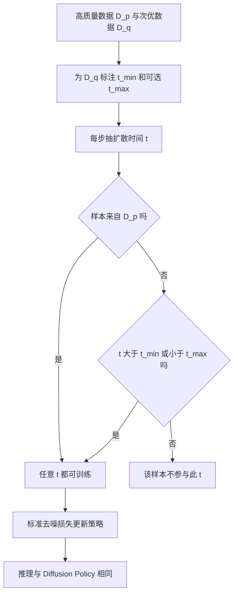

# Ambient Diffusion Policy（arXiv:2606.12365）

**Ambient Diffusion Policy**（*Ambient Diffusion Policy: Imitation Learning from Suboptimal Data in Robotics*，[arXiv:2606.12365](https://arxiv.org/abs/2606.12365)，MIT，Wei、Pfaff、Cohn 等，Tedrake 组）。本页依据论文 v1 全文整理，来源归档见 [sources/papers/ambient-diffusion-policy_arxiv_2606_12365.md](../../sources/papers/ambient-diffusion-policy_arxiv_2606_12365.md)。

## 一句话定义

在 [Diffusion Policy](../methods/diffusion-policy.md) 训练中，高质量数据 D_p 可用于所有扩散时间，次优或分布偏移数据 D_q 只允许用于高噪声区间 t > t_min（可选再加低噪声区间 t < t_max）；训练循环只需换一个数据采样器（论文 §6）。

## 英文缩写速查

| 缩写 | 英文全称 | 简要说明 |
|------|----------|----------|
| OXE | Open X-Embodiment | 多机构机器人数据集合，见 [Open X-Embodiment](../concepts/open-x-embodiment.md) |
| MS++ | Magic Soup++ | OpenVLA 使用的 27 个 OXE 数据集混合（§8） |
| COXE | Custom OXE | 论文自建的 48 个 OXE 数据集混合，包含 MS++（附录 H.1） |
| D_p / D_q | target / suboptimal dataset | 目标高质量数据集 / 次优或偏移数据集（§3.2） |
| t_min / t_max | 最小 / 最大扩散时间阈值 | D_q 样本仅在 t > t_min 或 t < t_max 时参与训练（§3.3） |
| PSD | Power Spectral Density | 功率谱密度，用于说明动作数据的谱幂律（§4.1） |
| GCS | Graphs of Convex Sets | 迷宫实验中生成平滑高质量轨迹的规划器（§7.1） |
| RRT | Rapidly-exploring Random Tree | 迷宫实验中生成抖动的次优轨迹（§7.1） |
| DDIM | Denoising Diffusion Implicit Models | 推理采样用 10 步（附录 E.2） |

## 为什么重要

- 机器人高质量数据昂贵，次优与偏移数据（仿真、跨本体、失败轨迹）很多；常用的「过滤」浪费数据，「按权重共训练」会让策略学到次优分布的有害部分（作者自述，§1、§2）。
- 它给共训练增加了一个新维度：按噪声水平决定数据能用在哪里。方法实现上只改采样器（作者自述，§1）。
- 同类问题可对照 [Sim-and-Real Co-training](../entities/paper-notebook-sim-and-real-co-training-a-simple-recipe-for-vis.md)；论文的平面推 T 实验直接沿用 Wei 等人该工作的数据并与其共训练做法比较（§7.3）。

## 核心原理与流程总览

**直觉（§1、§4）：** 动作数据的功率谱服从幂律，加高斯噪声先抹掉高频（局部细节），保留低频（全局计划）。因此高噪声下 p 与 q 更难区分，D_q 可安全使用；低噪声下去噪器只看时间邻域（局部性），若 p 与 q 局部动作基元相同、全局任务不同，D_q 也可在低噪声使用。

**方法（§6）：**

1. 标注：对每个 D_q 样本（或每个数据集）定 t_min（训练分类器区分 p_t 与 q_t，找到使分类器输出越过 0.5−τ 的最小噪声，式 5；或扫参）与 t_max（可扫参）。
2. 训练：随机抽扩散时间 t，只从「在该 t 下可用」的样本里取 batch；D_p 样本任意 t 可用。
3. 推理：与 Diffusion Policy 完全相同。

**理论（§5）：** 仅对零均值平稳高斯证明：谱幂律加低频一致推出经噪声快速收缩（定理 1，且收缩界不依赖原始距离），谱幂律推出最优去噪器低噪声下的局部性（定理 2）。附录 A 的证明本次未逐行核验。

## 工程实践

- **策略实现（附录 E.2）：** 预测未来 16 步、10 Hz，执行前 8 步（类 MPC）；2 帧观测；U-Net（Diffusion Policy 版本）；图像用 ResNet18；余弦噪声表 T=100；EMA；推理 10 步 DDIM；实现采用方差保持形式。
- **标注粒度（§6.1、§7.3）：** 可每数据集一个 t_min，也可每数据点一个。推 T 实验里按数据点标注最好（93.5% vs 按数据集 87.0%，表 2）。
- **OXE 实验的设置（§8、附录 H.1）：** 为 COXE 中 48 个子数据集各训一个分类器得到各自的 t_min；t_max 不扫参，表格清理设为 10、搭塔设为 5（T=100 下，作者称偏保守，未必最优）；D_q 总权重归一为 0.5。
- **损失（附录 E.1 脚注）：** 论文的 Ambient 损失只在迷宫实验用；OXE 实验用普通去噪损失，作者称无统计显著差异。
- **代码：** 项目页与论文均未给出仓库，复现需自行按附录 E.1 的伪代码实现采样器。

## 与清单说法的核对

清单（Berseth 阅读清单第 061 条，P1 档，作者称摘要由 LLM 据摘要起草）的说法：「Imitation from suboptimal data by restricting low-quality demonstrations to high and low diffusion noise levels.」

| 清单措辞 | 论文核对结果 |
|----------|--------------|
| 从次优数据做模仿学习 | 属实，标题与摘要即此（§1）。注意「次优」在论文中既含质量差也含分布偏移（噪声轨迹、仿真到真机、任务不匹配、OXE 混合，摘要） |
| 把低质量示范限制在高、低扩散噪声水平 | 方法上准确（图 1、§6.2）。但两端并非总同时使用：迷宫、运动规划、推 T 只用高噪声端（t_min），积木分拣设 t_min=0 只用低噪声端（§7.4），OXE 实验分「Ambient」（高噪声）与「Ambient + Locality」（再加低噪声）两种（§8、图 9）。推 T 中低噪声端无帮助（§7.3），表格清理 150 条 D_p 时也无帮助（§8.1） |
| 隐含：是真机方法 | 清单摘要没有说明。论文的真机实验只有 OXE 规模的两个任务（表格清理、搭塔，每策略 20 次试验，§8）；迷宫、神经运动规划、推 T（sim-and-target 代理）均为仿真（§7.1–7.3），积木分拣正文未明确仿真还是真机（§7.4，附录 G.4 只说 VR 遥操作采集） |
| 隐含：对「低质量」有效 | 与 OXE 的比较中，对数据过滤的优势 12–15 点（表格清理，50 条 D_p）、对共训练的优势在 150 条 D_p 时降到约 10 点（§8.1）；摘要写「比共训练基线最多高 33%」，对应正文搭塔比共训练平均高 33%（§8.1），不是所有任务的统一增益 |

作者自述与我的判断分开：上述数字出自论文文本；「清单摘要未区分仿真与真机」是我的读法，不是论文的说法。

## 关键结果（论文原数）

- **2D 迷宫（表 1a，各 1000 次）：** 数据过滤 57.5%，共训练 99.4%（平滑度 62.2），Ambient 99.5%（平滑度 31.0，越低越平滑）。论文称约 2 倍更平滑（§7.1）。
- **神经运动规划（表 1b）：** 过滤 46.0%，共训练 59.9%，Ambient 65.9%。
- **推 T（表 2，200 次）：** 过滤 56.5%，共训练 84.5%，Ambient 按数据集 87.0%、按数据点 93.5%、加局部性 92.0%。
- **积木分拣（表 3，约 800 块）：** 共训练成功率 22.7%，过滤 61.0%，Ambient（Locality）93.3%。
- **OXE 真机（§8.1）：** 表格清理（D_p 50 条）数据过滤 68.2%，共训练只多 2 到 3 个点并在 D_q 从 MS++ 扩到 COXE 时停滞，最优 Ambient 比共训练高 12 点且随 D_q 变大而提升；搭塔（D_p 35 条）Ambient 比过滤高至多 84%、比共训练高至多 33%。
- **对数据权重的敏感度（§8.2、图 10）：** Ambient 去掉重加权最多差 9%，而未重加权的共训练策略「太危险无法在真机评测」。

## 局限

论文自己承认的（§9、附录 J）：

- 不处理观测空间的分布偏移，初步两种尝试放在附录 J。
- 分类器标注 t_min/t_max 理论上有依据，但不总优于（昂贵的）扫参。
- 理论仅限高斯。
- 比数据过滤更费算力（用更多数据）。
- 需用户自己划分 D_p 与 D_q，这是影响效果的重要设计选择。

我看到的未充分验证之处（读法，非论文结论）：

- 真机结果每个策略仅 20 次试验，且表格清理评测有已披露的推理期相机分辨率 bug（训练 224 缩放自 640×320，推理时 128×128 上采样；搭塔实验已修复，附录 H.1），不同任务之间可比性受限。
- 论文说明对每次训练保存 5 到 10 个检查点并报告表现最好的一个（附录 F），在小样本评测下可能偏乐观；微调实验同样挑选最优检查点（附录 I.1）。
- OXE 的 t_max 是手设的（10 与 5），作者承认未扫参且未必最优，所以 Locality 的收益在表格清理上结论混合（§8.1、附录 H.1）。
- 理论对象是平稳高斯，与真实动作分布的差距由实验间接支撑。
- 基线只含数据过滤、重加权共训练与微调，没有与 π0.7 的质量标注（论文相关工作提到）做实验对比。

## 关联页面

- [Diffusion Policy（方法）](../methods/diffusion-policy.md)
- [Diffusion Policy 论文页](../entities/paper-diffusion-policy.md)
- [模仿学习](../methods/imitation-learning.md)
- [行为克隆](../methods/behavior-cloning.md)
- [Open X-Embodiment（概念）](../concepts/open-x-embodiment.md)
- [Open X-Embodiment 论文页](../entities/paper-open-x-embodiment.md)
- [Sim2Real](../concepts/sim2real.md)
- [动作数据质量](../concepts/motion-data-quality.md)
- [Sim-and-Real Co-training 论文页](../entities/paper-notebook-sim-and-real-co-training-a-simple-recipe-for-vis.md)

## 参考来源

- [来源归档：ambient-diffusion-policy_arxiv_2606_12365.md](../../sources/papers/ambient-diffusion-policy_arxiv_2606_12365.md)
- [arXiv:2606.12365](https://arxiv.org/abs/2606.12365)
- [项目页](https://ambient-diffusion-policy.github.io/)

## 继续阅读

- [arXiv PDF](https://arxiv.org/pdf/2606.12365v1)
- [Ambient Diffusion Omni（论文参考文献 [19]，NeurIPS 2025）](https://openreview.net/forum?id=MVYz4GmcUH)
- [Diffusion Policy 方法页](../methods/diffusion-policy.md)
