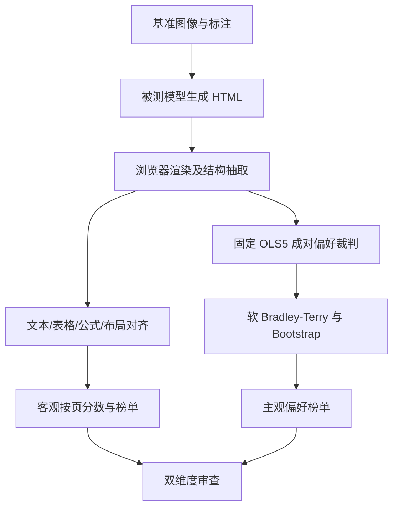
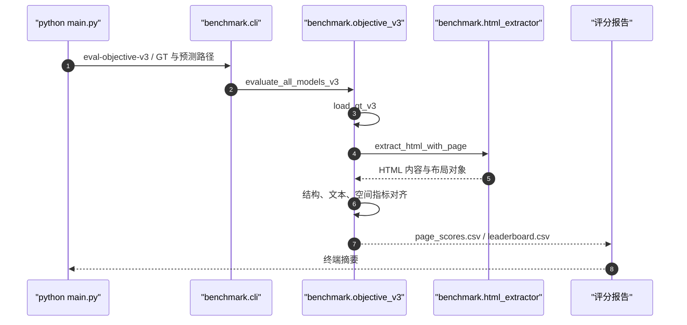

# AmbiHTMLBench: A Benchmark for HTML-based Visually Rich Document parsing｜图像到可执行 HTML 的结构与视觉保真评测

## 一句话定义

AmbiHTMLBench 评测模型将真实文档页面图像重建成可渲染 HTML 时的内容、表格、空间布局和感知保真度。

## 英文缩写速查

| 缩写 | 英文全称 | 简要说明 |
|---|---|---|
| AI | Artificial Intelligence | 生成/执行被评内容的人工智能 |
| LLM | Large Language Model | 基准中的语言智能体或评分模型 |
| API | Application Programming Interface | 运行模型或裁判的程序接口 |
| HTML | HyperText Markup Language | 待还原的可执行页面标记 |
| OLS5 | Ordinary Least Squares (five judges) | 对五名裁判投票做线性校准的冻结偏好代理 |

## 为什么重要

- **1,115 张**页面图像，含 **13 类**注释对象；其中 **263 张**涉及表格，评价多区域页面而非纯文本抽取。

对 [AI Agent 评测](../concepts/ai-agent-evaluation.md) 的价值是将笼统的“成功”拆为可审计且有复现边界的评价对象，而不把模型声明成功当作真实结果。

## 流程总览

## 核心原理

模型先将页面图像生成为可渲染 HTML；客观路径对标注与预测元素做结构/文本/空间对齐并聚合指标；主观路径将候选渲染结果送入固定成对裁判协议、聚合偏好并做 bootstrap 不确定性统计。

- **1,115 张**页面图像，含 **13 类**注释对象；其中 **263 张**涉及表格，评价多区域页面而非纯文本抽取。
- **客观评分**对齐 HTML 解析后的文本块、表格、公式和布局关系；代码中的输出包括 `table_teds`、`table_teds_s`、`formula_cdm`、`text_edit_distance`、`layout_graph_similarity`。
- **主观评分**使用冻结 OLS5 多裁判代理协议，记录五名 judge 的成对偏好，再用软 Bradley–Terry 排序；论文另有人工标定研究。主观排名代表**偏好代理分**，不能视作客观精度或人类正确率。
- 同一模型可能在结构精度和外观偏好上排序不同，不应将两者合成未定义的单一“网页质量”。

## 源码运行时序图

基于已核对的公开 README 和下列模块入口静态整理；未执行端到端实验。图描述已检查的调用职责，不是对每条内部调用的动态跟踪。

对应源码位置参见 [官方仓库归档](../../sources/repos/ambihtmlbench.md)。

## 评测与结果

- 数据集 1,115 页、13 类元素、263 个含表格页面。
- objective 输出以模型及页面为单位的 TEDS、TEDS-S、公式、文本和布局指标；subjective 是冻结裁判偏好代理估计。
- 论文比较 15 个系统的客观分数：Gemini 3.1 Pro Preview 以 0.8092 排第一；主观 OLS5 代理榜在 10 个候选系统中由 GPT-5.6 Sol 以 BT 154.70 排第一。
- 未在本次环境下载原始预测或运行评分，文中数值为论文/官方资料中的发布口径。

## 论文全文复核要点（v1）

- **数据构建（§3）：** 从 50,000+ 候选页面筛至 4,703，再由专家人工审阅得到 **1,115 页**；平均 2,329 字符、26 个块，覆盖 13 种元素标签；263 页含表格。来源有机构 PDF、网页文档、报刊和设计海报。
- **客观指标（§4.1、附录 A）：** headless Chromium 固定 viewport 渲染 HTML，先做表格对象阈值 Hungarian 一对一匹配，再容许文本拆分/合并，综合 **TEDS、TEDS-S**（行/单元结构近似，不是完整 DOM tree edit）、归一化字符编辑距离、二维布局图相似度（3 近邻；边 0.4 方向/0.3 长度/0.3 位移；布局综合 0.55 边/0.30 节点/0.15 覆盖）。
- **客观榜单（§5.1–5.2，表 1）：** 比较 15 个多模态系统，Gemini 3.1 Pro Preview 排名首位、目标加权分 **0.8092**；主榜的权重是表格 0.3、文本和布局各 1.0，不把文本编辑距离未经反向转换直接当高分。
- **小模型适应（§5.3，表 2）：** Qwen3.5-9B 经转录式 SFT 从 **0.6623→0.7064**，4B 从 0.6786→0.6934；标注由额外 1,475 张 PureDocBench 图经 1,230 条质量过滤后监督，不与本 benchmark 页重合。RL 后续增量有限，不构成同口径独立大幅超越。
- **主观判分（§4.2、§5.4–5.6、附录 B）：** 1,872 组人类校准对照经无截距 OLS 得到五位 judge 的固定系数。公开榜重放按 **10,000 对比较、每对五票（50,000 条）**；其中 8,128 对并未单独做人工标注。Soft Bradley–Terry 排序和 2,000 次以页面为单位的 bootstrap 是**冻结代理条件下**的不确定性，不包含模型裁判系统误差。
- **主观榜单（§5.5–5.6，表 3）：** GPT-5.6 Sol 以 BT **154.70** 排第一，Gemini 3.1 Pro Preview 主观第三；客观/主观名次 Spearman ρ=0.588，不能把偏好代理等于真实人类准确率。
- **审计边界（附录 B.3–B.6）：** OLS 系数不强制和为 1，判定的 A/B 编码不自动对称；人工标定采用 8 个 annotation block 的留一块交叉验证，非独立新数据校准；候选同步只刷新部分对照，不能称为外部独立验证。

## 结论

**模型先将页面图像生成为可渲染 HTML，评价边界与复现设置同样重要。**

1. 同时看 objective 与 subjective 榜单，二者排名可能不同。
2. 做客观复现需冻结图像、预测 HTML、viewport 和 Ground Truth 版本。
3. 主观录制判决重放是可重复聚合，不等同于原始标注或重新采样裁判。
4. 表格与公式需要单独看指标，不能只依赖外观截图相似度。

## 与其他工作对比

与 DeliverBench 的持续专业交付、SelfImprove-Bench 的 RSI 泛化不同，本项目专门对**视觉页面重建结果**设计机器度量与主观校准。

共同评测原则见 [AI Agent 评测](../concepts/ai-agent-evaluation.md)；机器人工作流的代码与实验验收可参照 [RLE-Bench](rle-bench.md)，但不能直接移植这三项榜单的数字。

## 工程实践

1. Python 3.10+ 安装 `pip install -e .`，如跑客观路径则另 `python -m playwright install chromium`。
2. 从 HF 数据集取图像，将模型输出放到 `all_model_infer/<model>/html/0001_*.html` 等路径。
3. 执行 `python main.py eval-objective-v3 --gt-json AmbiHTMLBench_GT_v5_1115.json --infer-dir all_model_infer --out-dir outputs/objective_v3`。
4. 主观复现须另取 `single_results.jsonl` 录制判决，执行 `python -m benchmark.frozen_proxy_cli replay ... --config configs/subjective_ols5_frozen.json`；该 replay **不调用**裁判 API，也不能替代重新评测。

## 局限与风险

- README 提供评分实现和标注 JSON，但主观评测的原始 judge 结果、图像及人工注释需额外供应；主观 replay 本身不重新调用模型或生成新判断。
- 已核对论文正文与附录，详见论文一手归档的核对范围；这不代表独立重跑模型实验。
- 本次仅静态阅读公开仓库和入口，尚未安装完整环境或独立复现实验成绩。

## 关联页面

- [AI Agent 评测](../concepts/ai-agent-evaluation.md) — agent 的评测任务、grader、隔离与判据原则。
- [RLE-Bench](rle-bench.md) — 与机器人学习工程交付相关的 Agent 评测。
- [DeliverBench](paper-deliverbench.md) — 区分被评对象与评价指标。
- [SelfImprove-Bench](paper-selfimprove-bench.md) — 区分被评对象与评价指标。
- [具身大模型评测基准选型闭环](../queries/embodied-eval-benchmark-selection-loop.md) — 借其「客观指标 vs 偏好代理、可复现性 vs 真实代表性」的取舍框架阅读本基准的双榜单；本基准测文档→HTML，不属于机器人四层评测本身。

## 参考来源

- [论文一手归档](../../sources/papers/ambihtmlbench_arxiv_2611_06449.md)
- [官方项目页归档](../../sources/sites/ambihtmlbench.md)
- [官方源码归档](../../sources/repos/ambihtmlbench.md)

## 推荐继续阅读

- [作者项目主页](https://ambihtmlbench.tech/)
- [原始论文](https://arxiv.org/abs/2611.06449)
- [官方 GitHub 源码](https://github.com/theseus-labs-rsi/AmbiHTMLBench)
